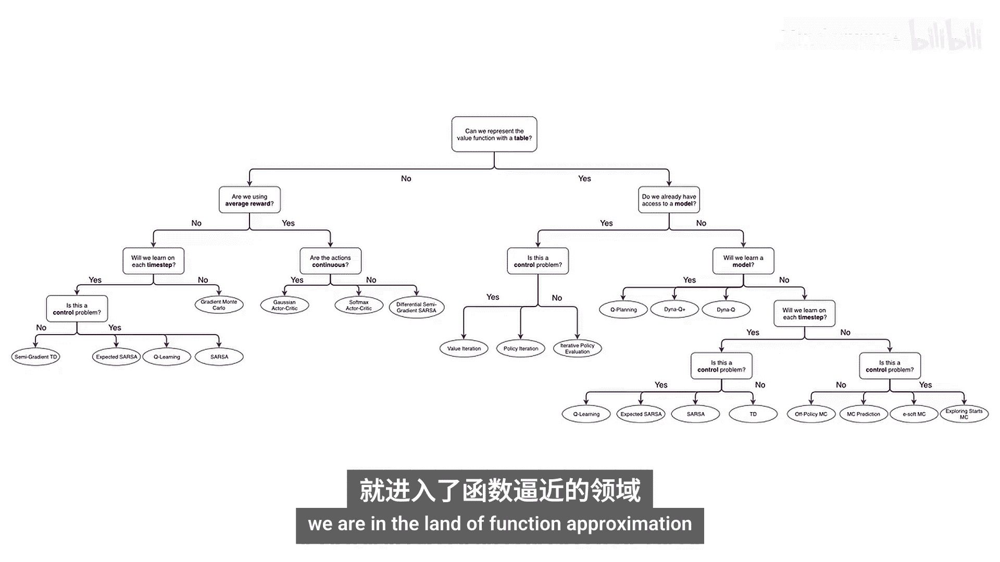
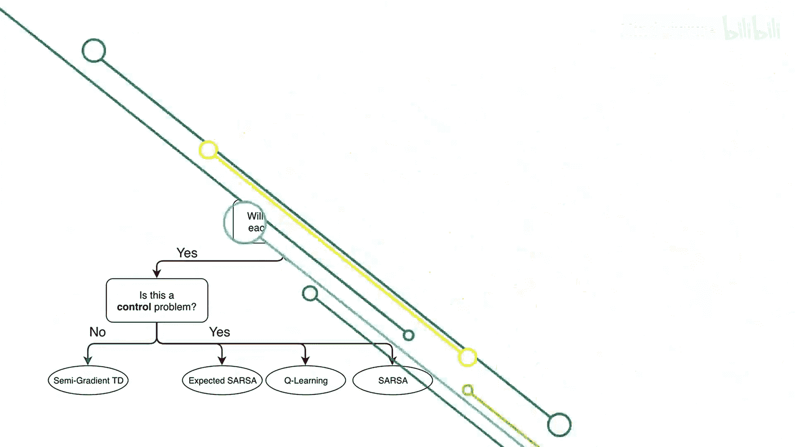
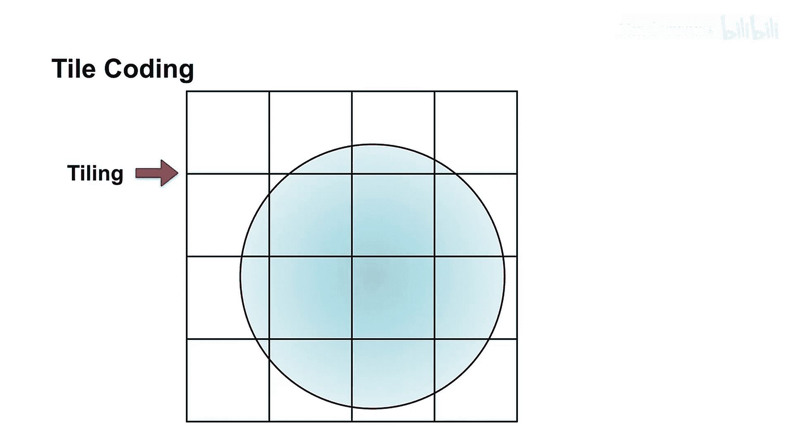
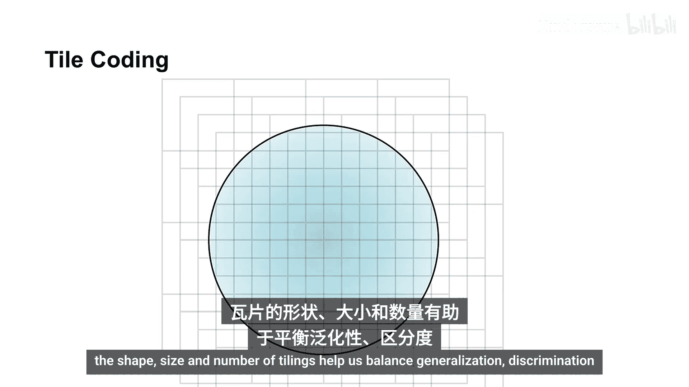
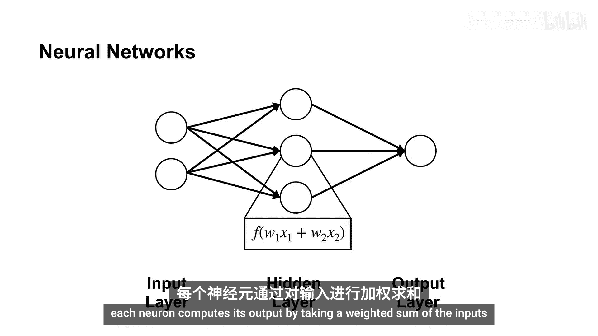
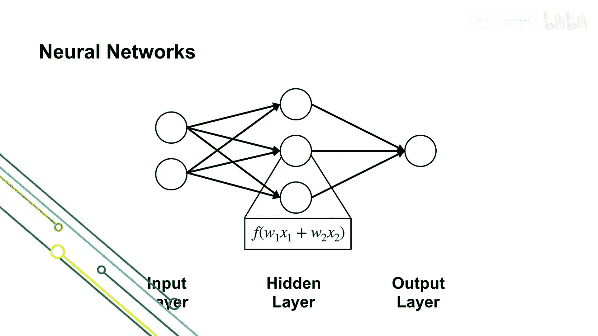
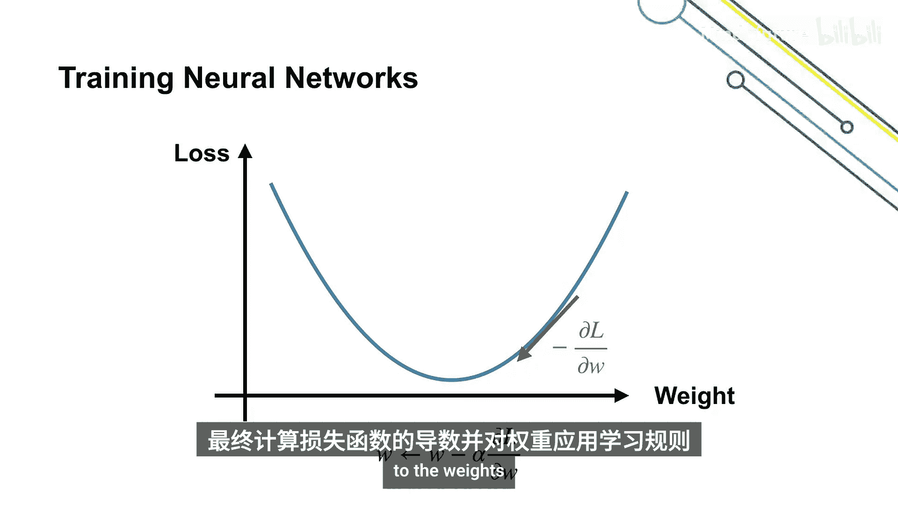

# 026：回顾与总结 🧠

在本节课中，我们将回顾第二周的核心内容，主要探讨如何利用函数逼近技术来表示和处理大型或连续的状态空间。我们将学习两种关键的表示方法：粗编码和神经网络，并理解它们如何帮助智能体进行有效的预测和控制。

---

## 表示大型状态空间的方法

上一节我们介绍了函数逼近的必要性，本节中我们来看看如何具体构建状态表示。表示是智能体对状态的一种内部编码方式。智能体通过构建特征来总结当前的输入信息。当我们讨论特征和表示学习时，我们实际上已经进入了函数逼近的领域。

这引出了我们课程地图的左侧部分，即如何为预测和控制问题构建有效的状态表示。

---

## 粗编码与瓦片编码

首先，我们介绍粗编码。粗编码与状态聚合相关，它将相邻的状态分组在一起，每个分组可以具有任意的形状。

以下是一个二维粗编码的具体例子，由这些重叠的圆圈表示：
*   每个圆圈代表一个特征。当状态位于圆圈内部时，该特征值为1；当状态位于圆圈外部时，该特征值为0。

接下来，我们讨论一种特殊类型的粗编码，称为瓦片编码。瓦片编码使用一组重叠的网格来生成特征。每个网格被称为一个“铺砌层”。一个铺砌层内部的方格之间没有重叠或间隙，因此同一时间只能有一个特征被激活。

通过堆叠多个偏移的铺砌层，我们可以区分不同的状态。铺砌层的形状、大小和数量帮助我们平衡泛化能力、区分度和计算效率。

---

## 使用神经网络在线学习表示

然后，我们讨论了如何使用神经网络在线学习表示。与粗编码技术不同，神经网络的表示是在学习过程中动态调整的。

一个前馈神经网络使用一系列层来产生表示。在每一层中，多个神经元接收相同的输入并产生不同的输出；这些输出随后被馈送到下一层，该过程不断重复。

每个神经元通过计算其输入的加权和，并将该和通过一个激活函数来产生输出。其计算过程可以用以下公式描述：
**`output = activation_function(weighted_sum_of_inputs + bias)`**

为了训练神经网络，我们使用一种称为梯度下降的迭代过程：
1.  将输入传入网络以产生预测。
2.  将这些预测与目标输出进行比较，并计算损失函数。
3.  计算损失函数关于权重的导数，并应用学习规则来更新权重。

---

## 总结与展望

本节课中，我们一起学习了两种用于函数逼近的状态表示方法：预先定义的粗编码/瓦片编码，以及能够在线学习的神经网络。我们了解了它们的基本原理和构建方式。

下周，我们将讨论如何结合函数逼近技术来学习最大化奖励的策略，即进入“控制”部分的学习。