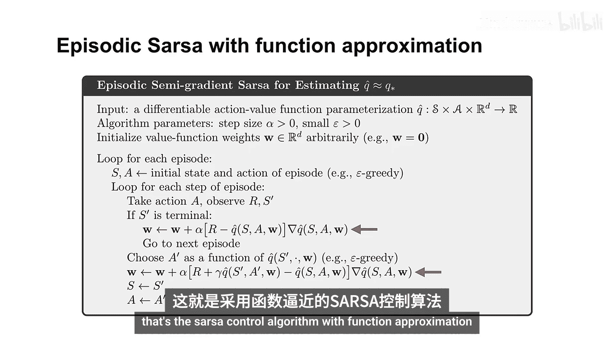

强化学习：函数逼近预测与控制：P27：带有函数逼近的回合制Sarsa

在本节课中，我们将学习如何将函数逼近技术应用于控制问题，特别是介绍回合制Sarsa算法在函数逼近下的实现。我们将从如何构建依赖于动作的特征表示开始，并逐步讲解完整的算法流程。

我们已经学习了如何构建特征和逼近函数，但之前的内容都局限于在固定策略下进行预测。本周，我们将讨论如何利用函数逼近进行控制。在本视频中，我们将从广义策略迭代（GPI）算法——回合制Sarsa开始。通过本视频的学习，你将能够理解如何为近似动作值函数构建依赖于动作的特征，并解释如何在带有函数逼近的回合制任务中使用Sarsa算法。

回想一下，值函数逼近包含两个组成部分：一个权重向量和一个特征向量。在给定状态下，值的估计是这两个组成部分的点积。为了从TD方法过渡到Sarsa，我们需要动作值函数。因此，特征表示也必须能够表示动作。

一种方法是为每个动作使用一个独立的函数逼近器。这可以通过“堆叠”特征来实现，即我们可以为每个动作使用相同的状态特征，但只激活对应动作的特征。为了更清楚地理解这一点，让我们看一个例子。

假设有四个状态特征和三个动作。这四个特征代表了你所处的状态。但我们希望学习一个关于状态和动作的函数。我们可以通过为每个动作重复这四个特征来实现。现在，特征向量在这里有12个分量，每四个特征组成的片段对应一个独立的动作。我们称这种特征表示为“堆叠的”，因为每个动作的权重是彼此堆叠在一起的。因此，只有指定动作的特征会被激活，而其他动作的特征则被设为零。

让我们看一个如何从给定状态计算动作值的例子。假设有四个特征和三个动作。权重向量看起来像这样：`w = [w0, w1, w2, w3, w4, w5, w6, w7, w8, w9, w10, w11]`。

使用堆叠特征，我们得到状态S下动作0的特征向量：`x(S, a0) = [f0, f1, f2, f3, 0, 0, 0, 0, 0, 0, 0, 0]`。我们将其它动作的特征置零。然后，我们提取权重向量中对应每个动作的片段。动作值就是每个权重向量片段与特征向量的点积。

你可能会认为，通过堆叠特征来创建动作值是线性函数逼近特有的，但事实并非如此。例如，用神经网络表示动作值的常见方法是生成多个输出，每个输出对应一个动作值。然而，这等价于我们刚刚描述的堆叠过程。神经网络输入状态，最后一个隐藏层产生状态特征。每个动作值都是使用这些状态特征，通过一组独立的权重计算得出的。一个动作值的权重与另一个动作值的权重互不干扰，就像在堆叠中一样。

出于与泛化状态相同的原因，我们可能也希望泛化动作。这在神经网络中如何实现呢？我们会将状态和动作同时输入网络。网络只有一个输出，即该状态-动作对的近似动作值。我们也可以通过将状态和动作同时作为输入，在瓦片编码中实现类似的功能。

好的，我们现在知道了如何处理带有函数逼近的动作值。接下来，让我们讨论如何使用带有函数逼近的Sarsa进行控制。

该算法与表格版本非常相似，因此我们只回顾其中的差异。我们使用参数化的动作值函数来估计动作值。更新规则也改为使用梯度来更新权重，类似于半梯度TD方法。这就是带有函数逼近的Sarsa控制算法。

以下是算法的伪代码：



```
初始化权重向量 w （例如，w = 0）
对每个回合（episode）：
    初始化状态 S
    根据 Q(S, ·, w) 选择动作 A （例如，使用 ε-贪婪策略）
    当状态 S 不是终止状态时：
        执行动作 A，观察奖励 R 和下一个状态 S‘
        如果 S’ 是终止状态：
            Q_target = R
        否则：
            根据 Q(S‘, ·, w) 选择动作 A’ （例如，使用 ε-贪婪策略）
            Q_target = R + γ * Q(S‘, A’, w)
        计算 TD 误差：δ = Q_target - Q(S, A, w)
        更新权重：w = w + α * δ * ∇_w Q(S, A, w)
        S = S‘
        A = A’
```


在本视频中，我们讨论了依赖于动作的特征，并介绍了带有函数逼近的回合制Sarsa算法。在接下来的课程中，我们将介绍更多的控制算法。下次见。