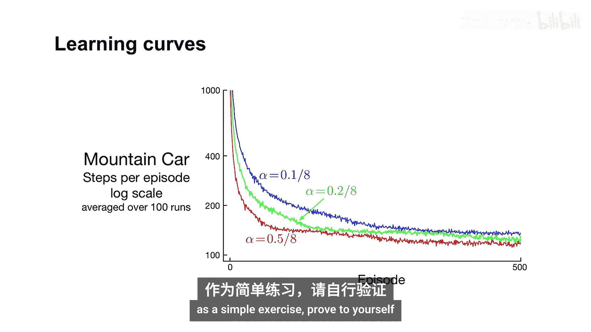

# 028：山地车中的回合制Sarsa

## 概述
在本节课中，我们将通过一个经典的控制问题——山地车问题，来观察回合制Sarsa算法在连续状态空间中的实际应用。我们将可视化学习到的价值函数，并分析算法学习到的策略性能。

## 山地车问题介绍
上一节我们介绍了函数逼近的基本概念，本节中我们来看看它在具体问题中的应用。山地车是一个回合制任务，目标是驾驶一辆动力不足的汽车驶上山坡。由于重力强于汽车引擎，智能体无法直接上山。唯一的逃脱方法是先倒车驶上左侧斜坡，然后借助下坡获得的足够动量冲上右侧斜坡并逃脱。

回合开始时，汽车随机出现在山谷底部附近。当汽车到达山顶的旗帜位置时，回合结束。为了鼓励智能体尽快完成回合，每一步的奖励设为-1，并且不使用折扣。

## 状态、动作与特征表示
智能体可以观察到汽车的当前位置和速度，这是一个二维的连续值状态。智能体有三个可选动作：向前加速、向后加速或滑行。

对于此示例，我们联合编码位置和速度以生成特征。我们使用了八个瓦片，这意味着我们为二维输入空间使用了8x8的网格。我们使用了八个重叠的瓦片覆盖。我们通过使用堆叠的特征表示来独立处理动作。

我们将权重初始化为0。这个初始化实际上是乐观的，因为每步奖励为-1，所以任何策略下的价值都会小于0。在这个问题中，这些乐观的初始值导致了广泛且系统的探索。因此，我们可以贪婪地行动，无需任何额外的随机探索。

## 学习后的价值函数
让我们看看智能体运行很长时间后价值函数的样子。理想情况下，我们希望绘制每个状态的价值函数。然而，状态数量是不可数无限的，因此我们必须对状态集进行采样。

我们将使用每个采样状态中的最大值。这个数字告诉我们，智能体认为在其贪婪策略下，从该状态逃脱需要多少步。由于每步奖励是-1，我们取这个数字的负值，以产生智能体对从每个状态出发所需步数的估计。

以下是智能体在9000个回合后对预期步数的估计。对于这个问题来说，这是非常长的时间，因此我们相当确定价值估计已经接近其能达到的最佳水平，但由于函数逼近，它们并非完美。

绿色线条代表目标位置，它与速度无关。在目标附近，如果速度足够大，智能体可以直接驶出。然而，如果智能体靠近目标但速度太低，则需要很多步才能逃脱。这是因为智能体必须先返回山下，再次驶上左侧以获得足够的逃脱动量。峰值对应于起始状态，大约需要120步才能到达旗帜。

绿色轨迹揭示了习得策略在状态空间中采取的路径。

## 学习曲线分析
价值函数看起来很有趣。但让我们看看一些学习曲线，以更好地了解学习速度。

我们尝试使用三个不同的alpha值运行Sarsa，即算法的三个变体。这里我们关心的是达到目标所需的步数，在本例中对应于每个回合的回报。我们期望每个回合的步数随着学习而减少。X轴越低，对应策略越好，即平均能以最少步数达到目标的策略。

与往常一样，我们对多次独立运行的性能进行平均。以下是结果。到500个回合时，每个回合的步数大致稳定下来，所有学习曲线都呈现出熟悉的指数轮廓。较小的步长参数值0.1导致学习速度较慢，而alpha为0.5则允许智能体学习得更快，并在500个回合内找到更好的策略。

注意，我们将每个alpha值除以了8。如果我们不使用步长向量，我们通常按特征向量范数缩放步长参数。这里我们在瓦片编码器中使用了八个瓦片覆盖。这意味着特征向量中1的数量始终为8。作为一个简单的练习，请证明8对应于特征向量的L1范数。

## 总结
本节课中，我们一起学习了在山地车问题中使用线性函数逼近的回合制Sarsa算法的评估过程。我们观察了学习到的价值函数形态，并通过学习曲线分析了不同学习率对算法性能的影响。