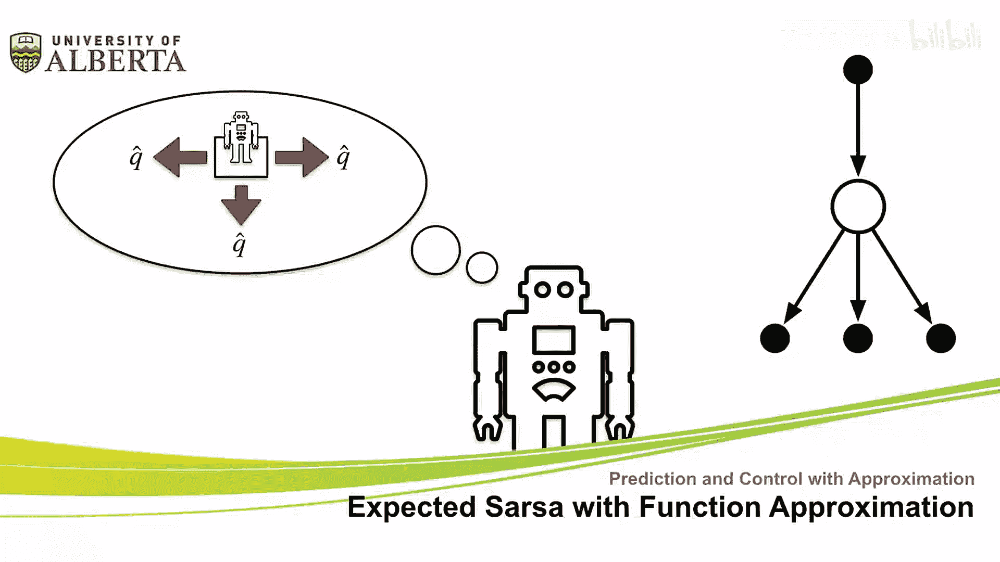
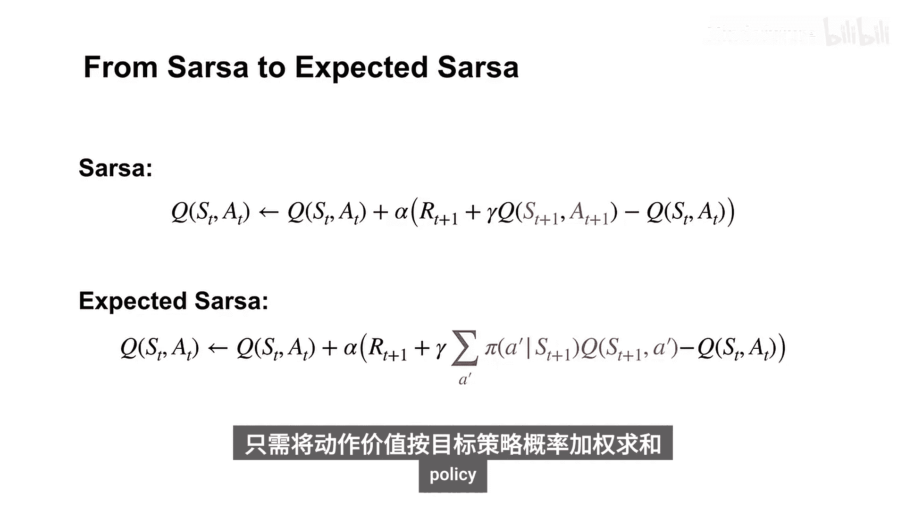
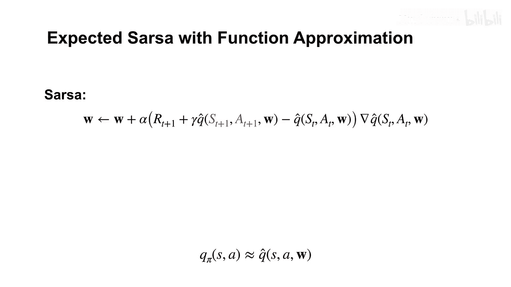
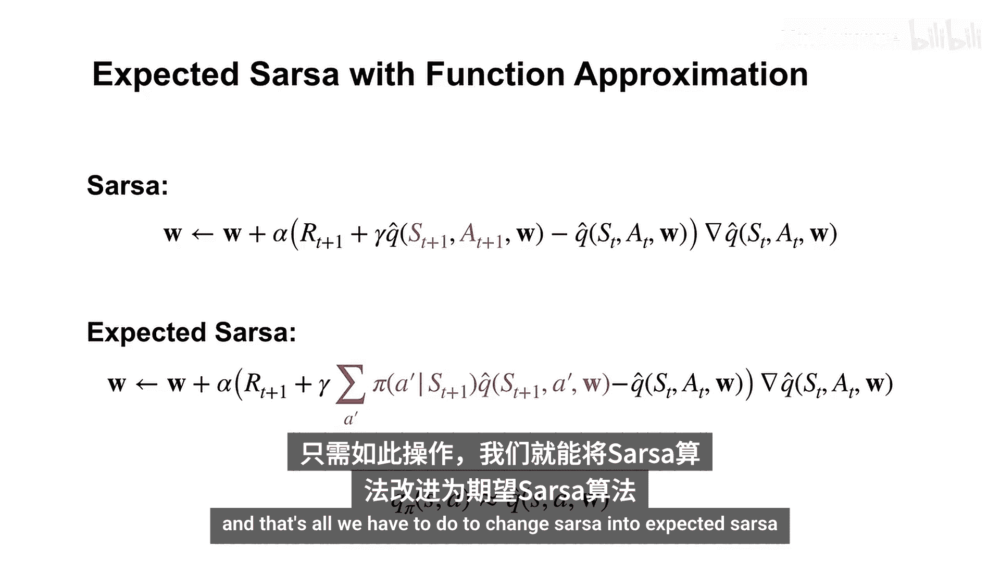
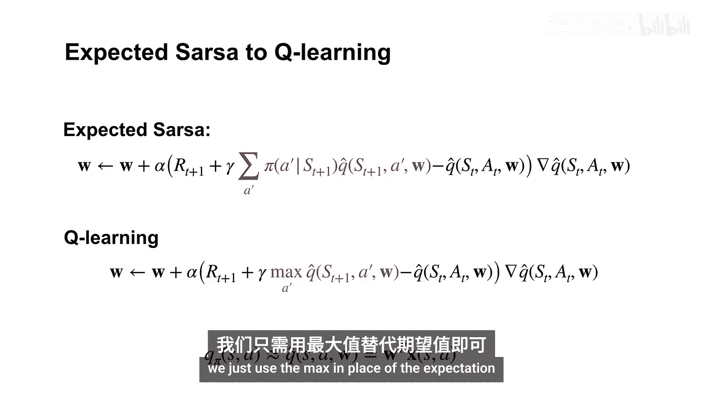

# 029：带有函数逼近的期望Sarsa

在本节课中，我们将学习如何将期望Sarsa算法与函数逼近结合使用。我们将从回顾Sarsa的函数逼近形式开始，然后推导出期望Sarsa的更新公式，并最终展示Q学习作为其特例的实现方式。

## 从Sarsa到期望Sarsa 🧠

上一节我们介绍了使用函数逼近的Sarsa算法。本节中，我们来看看如何将其扩展为期望Sarsa。

期望Sarsa与Sarsa的核心区别在于目标值的计算方式。Sarsa使用下一个状态-动作对的具体值，而期望Sarsa使用在目标策略下所有可能动作的期望值。

以下是期望值的计算公式：
`E[Q(S_{t+1}, A) | S_{t+1}] = Σ_a π(a|S_{t+1}) * Q(S_{t+1}, a)`
其中，`π` 是目标策略，`Q(S_{t+1}, a)` 是状态 `S_{t+1}` 下动作 `a` 的价值估计。

## 函数逼近下的Sarsa回顾 🔄

在深入期望Sarsa之前，我们先快速回顾一下函数逼近下Sarsa的更新规则。

其更新公式如下：
`W_{t+1} = W_t + α * [R_{t+1} + γ * Q(S_{t+1}, A_{t+1}; W_t) - Q(S_t, A_t; W_t)] * ∇_w Q(S_t, A_t; W_t)`

这个公式与表格型设置类似，但动作价值估计由权重向量 `W` 参数化。梯度项 `∇_w Q` 用于将误差适当地分配到各个权重上。

## 函数逼近下的期望Sarsa 🎯

了解了Sarsa的基础后，现在我们可以构建函数逼近下的期望Sarsa。

函数逼近下的期望Sarsa遵循相似的结构。我们需要为下一个状态的所有可能动作计算其动作价值，然后计算这些价值在目标策略下的期望。

具体更新步骤如下：
1.  使用当前权重向量 `W_t`，计算下一个状态 `S_{t+1}` 下所有动作 `a` 的价值 `Q(S_{t+1}, a; W_t)`。
2.  根据目标策略 `π` 的概率分布，计算这些价值的期望值。
3.  将此期望值用于目标计算，并更新权重。

更新公式可以表示为：
`W_{t+1} = W_t + α * [R_{t+1} + γ * Σ_a π(a|S_{t+1}) * Q(S_{t+1}, a; W_t) - Q(S_t, A_t; W_t)] * ∇_w Q(S_t, A_t; W_t)`

## 扩展到Q学习 ⚡

那么，如何将其应用于函数逼近下的Q学习呢？幸运的是，这个过程非常直接。

Q学习可以看作是期望Sarsa的一个特例。在Q学习中，目标策略是关于近似动作价值的贪婪策略。在贪婪策略下计算期望，等价于计算最大动作价值。

因此，函数逼近下Q学习的更新规则非常简洁。我们只需用最大值替换期望计算即可。

其更新公式为：
`W_{t+1} = W_t + α * [R_{t+1} + γ * max_a Q(S_{t+1}, a; W_t) - Q(S_t, A_t; W_t)] * ∇_w Q(S_t, A_t; W_t)`

## 总结 📝

本节课中，我们一起学习了函数逼近下的期望Sarsa算法。我们首先回顾了Sarsa的更新方式，然后通过将下一个动作的具体价值替换为目标策略下的期望价值，推导出了期望Sarsa的更新公式。最后，我们展示了Q学习如何作为期望Sarsa在贪婪目标策略下的一个自然特例，只需将期望计算替换为求最大值即可。

下次课，我们将探讨在函数逼近背景下如何进行有效的探索。