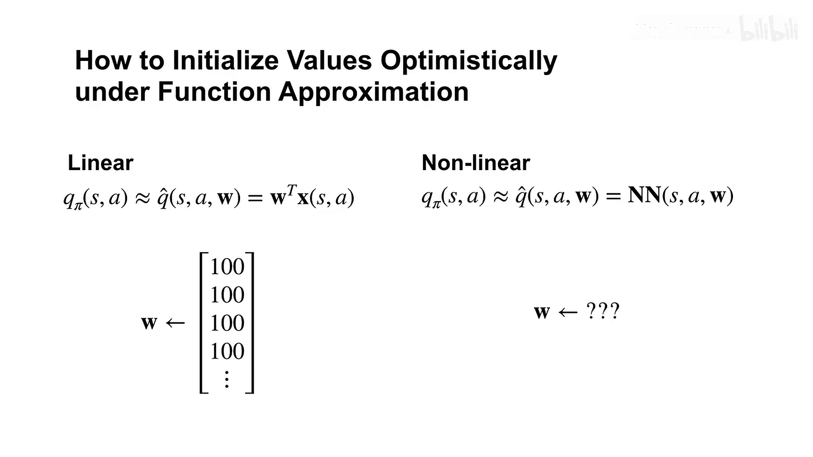
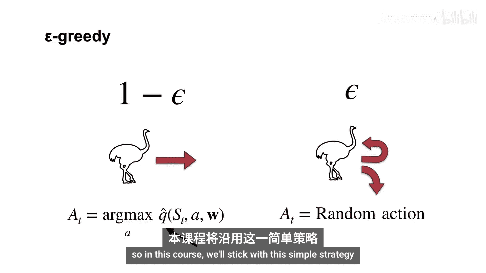

强化学习：函数逼近下的探索：P30：探索与利用的平衡

在本节课中，我们将学习在函数逼近的背景下，如何平衡强化学习中的探索与利用。我们将回顾两种经典方法——乐观初始值和ε-贪心策略——并探讨它们在函数逼近环境下的应用与挑战。

探索与利用的平衡是序列决策问题的核心特征之一。我们之前讨论过在赌博机和表格型强化学习中促进探索的几种简单方法。但在函数逼近的背景下，探索是否有其特殊性？本节课我们将对此进行探讨。

**乐观初始值在表格型设定中的回顾**

首先，我们简要回顾如何在表格型设定中使用乐观初始值。我们将价值函数初始化为高于其真实值的数值。这相当于智能体想象通过采取某个动作能获得比实际更多的奖励。通常，以这种方式初始化价值函数会使智能体系统地探索状态-动作空间。随着智能体对价值的估计越来越准确，这种初始化的影响会越来越小。这在表格型设定中很容易实现，因为每个状态-动作对的更新是独立于其他对的。

**函数逼近下的乐观初始值**

上一节我们回顾了表格型设定，本节中我们来看看函数逼近下的情况。在函数逼近中，乐观初始值对应于初始化权重，使得产生的价值估计是乐观的。在某些情况下，这很简单。例如，当特征是二元的，我们只需将每个权重初始化为可能的最大回报值。这样，只要每个状态至少有一个活跃的特征，其价值估计就会是乐观的，甚至可能过于乐观。

然而，在许多情况下，乐观初始化很困难。例如，在神经网络中，最终输出值与特征之间的关系可能非常复杂。想象一个由ReLU激活函数组成的网络，即使权重初始化为正值，网络也可能输出负值。

但这还不是全部。根据特征泛化的方式，乐观初始值可能不会产生与表格型情况下相同的系统性探索效果。考虑一个极端例子：我们只有一个特征，其值始终为1。我们可以乐观地初始化，但每次更新都会改变所有状态的价值。这意味着，在某些状态甚至被访问之前，其价值估计就已经下降到不再乐观的水平。

为了促进系统性探索，对价值函数的改变需要更加局部化。例如，使用瓦片编码的函数逼近可以产生这种局部更新。神经网络也能提供局部更新，但它们也可能进行激进的泛化。在实践中，如果没有特殊考虑，神经网络会相对较快地失去其乐观性。

**ε-贪心策略的应用**

上一节讨论了乐观初始值的局限性，本节中我们来看看另一种更通用的方法。ε-贪心策略通常适用且易于使用，即使在非线性函数逼近的情况下也是如此。ε-贪心策略唯一需要的是动作价值估计，这与它们如何初始化或逼近无关。

然而，ε-贪心策略不是一种定向探索方法；它依靠随机性来发现当前策略附近状态下的更好动作。因此，它不如依赖乐观性的探索方法那样系统。在函数逼近设定中改进探索仍然是一个开放的研究问题，因此在本课程中，我们将坚持使用这种简单策略。

**总结**

本节课中，我们一起探讨了将乐观初始值与函数逼近结合时的诸多微妙之处，以及ε-贪心策略如何能与任何函数逼近方法结合使用。理解这些方法的适用性和局限性，对于在复杂的函数逼近环境中设计有效的探索策略至关重要。