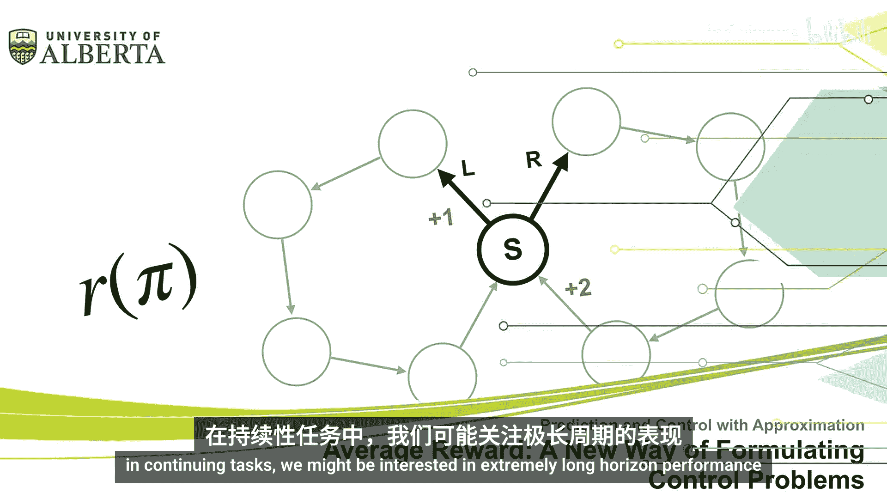
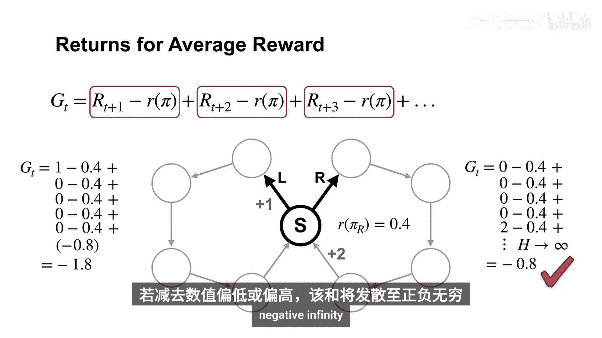
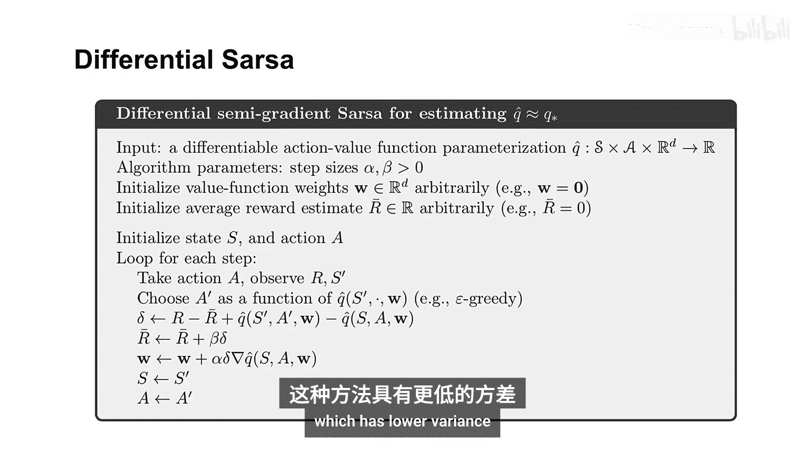

# 031：平均奖励——一种构建控制问题的新方法

在本节课中，我们将学习一种处理持续性任务的新方法：平均奖励设定。我们将了解平均奖励目标如何定义，解释它与折扣设定下策略的差异，并理解差分价值函数的概念。

## 平均奖励设定

上一节我们讨论了在持续性任务中使用折扣因子来平衡短期与长期收益。然而，这并不是唯一的表述方式。本节中，我们来看看一种称为“平均奖励设定”的新方法。

想象一个简单的任务，其状态排列在两个相交的环中，我们称之为“短视MDP”。在大多数状态下，只有一个可执行的动作，因此无需做出决策。只有一个状态可以做出决策：智能体可以决定遍历哪个环。这意味着存在两种确定性策略：遍历左环或遍历右环。

奖励在所有地方都是零，除了每个环中的一个转移。在左环中，奖励+1出现在状态S之后。在右环中，奖励+2出现在状态S之前。直观上，你会选择右边的动作，因为你知道会得到+2奖励。但价值函数会告诉我们怎么做呢？

如果我们使用折扣，状态S在这两种不同策略下的价值是多少？选择左动作的策略的价值是 `1 / (1 - γ^5)`。选择右动作的策略的价值是 `(2 * γ^4) / (1 - γ^5)`。

让我们思考状态S在特定γ值下的价值。如果γ是0.5，左策略价值VL约为1，右策略价值VR约为0.1。这意味着在这种更短视的折扣下，采取左动作的策略更优。尝试一个更大的γ值，0.9。VL现在约为2.4，VR约为3.2，因此我们现在更偏好另一个策略。实际上，我们可以计算出使智能体偏好右策略的最小γ值。γ需要至少为0.841。

这里的问题是，折扣幅度取决于具体问题。对于这个例子，0.85足够大，但如果每个环有1000个状态，这个折扣因子需要超过0.99。通常，确保智能体行为能最大化长期奖励的唯一方法是不断将折扣因子向1增加。根据问题，我们可能需要γ非常大，并且记住在持续性设定中不能将其设为1，因为那样回报可能是无限的。

那么，使用较大的γ有什么问题呢？大的γ值也可能导致更大、更不稳定的求和，这可能难以学习。那么，有替代方案吗？

## 定义平均奖励

让我们讨论一个称为“平均奖励”的新目标。想象智能体与世界交互了H步。这是它在这些步骤中平均获得的奖励，换句话说，是其奖励率。如果智能体的目标是最大化这个平均奖励，那么它对近期和远期奖励的关心程度是相等的。我们用 `R(π)` 表示策略π的平均奖励。

更一般地，我们可以使用状态访问分布 `μ(π)` 来写平均奖励。内部项是策略π下状态的期望奖励。外部求和是对策略访问该状态频率的期望。合起来，我们得到跨状态的期望奖励，即策略的平均奖励。

在短视MDP例子中，两种可能的确定性策略会无限期地访问左环或右环。在这两种情况下，每个环中的五个状态被访问的次数相等。在左环中，除了一个状态获得+1外，所有状态的即时期望奖励都是+0。这导致平均每5步获得1的奖励，即平均奖励为0.2。右环中的大多数状态即时期望奖励也是+0，但这次最后一个状态获得+2。这给出平均每5步获得2的奖励，即平均奖励为0.4。

我们可以看到，平均奖励更偏好总体上获得更多奖励的策略，而无需考虑越来越大的折扣因子。

## 差分回报与价值函数

平均奖励的定义对于判断一个策略是否优于另一个很直观，但我们如何判断从一个状态出发的哪个动作更好呢？我们需要的是这个新设定下的动作价值。第一步是弄清楚回报是什么。在平均奖励设定中，回报是根据奖励与平均奖励 `R(π)` 之间的差值来定义的，这称为差分回报。

让我们看看短视MDP中的差分回报是什么。差分回报表示智能体从当前状态和动作开始，相比遵循该策略的平均奖励，将多获得多少奖励。

让我们看看从状态S开始，首先选择动作AL，然后遵循策略PL的差分回报。该策略的平均奖励是0.2。差分回报是未来奖励的总和，其中每个奖励都减去了平均奖励。这个求和从状态S和动作L开始。我们可以通过求和到某个有限视野H，然后取H趋于无穷大的极限来计算它。

我们通过这个极限符号稍微简化了事情。虽然这个符号在许多情况下有效，但当环境是周期性时，我们需要使用一种不同的技术，即使用更一般的极限（称为Cesàro和）来计算回报，但这个技术细节并不关键，这里的主要点是其直观含义。

我们发现差分回报是0.4。现在让我们看看另一个动作。这次，我们可以将差分回报分成两部分。首先，是遍历右环单次的求和，我们可以明确写出这个和，它等于1。然后，是无限期采取左动作的求和。这个和与我们刚刚计算的差分回报相同，即0.4。将两部分相加，我们发现差分回报是1.4。因此，如果智能体的策略总是采取左动作，它可以观察其差分回报并意识到应该切换到采取右动作。

现在，让我们看看如果智能体的策略总是采取右动作，其差分回报是多少。该策略的平均奖励为0.4，在状态S下采取右动作策略的差分项是-0.8。现在，在状态S下一次采取左动作，然后无限期采取右动作的差分回报是多少？像之前一样，我们将和分成两部分，遍历左环一次导致前五个时间步的和为-1，加上从状态S开始遵循策略πR的差分回报（我们之前发现是-0.8），结果是-1.8。我们再次看到，右动作更受青睐。

你可能已经注意到，策略πR的差分回报低于策略πL的差分回报，即使πR的平均奖励更高。这是因为差分回报表示在特定策略下，从某个状态采取某个动作比该策略的平均情况好多少。只有在后续时间步遵循相同策略时，差分回报才能用于比较动作。要比较策略，应改用它们的平均奖励。

有趣的是，只有当减去的常数等于真实平均奖励时，差分回报才是一个收敛的和。如果减去一个更低或更高的数字，和将发散到正无穷或负无穷。

## 差分价值函数与算法

现在我们有了平均奖励的有效回报定义，我们可以像往常一样将价值函数定义为期望回报。类似地，我们也可以将差分价值函数定义为在给定策略下，从给定状态或状态-动作对开始的期望差分回报。这个量捕捉了智能体从特定状态开始，相比遵循固定策略在所有状态上的平均情况，将多获得多少奖励。

与折扣设定类似，差分价值函数可以写成贝尔曼方程。方便的是，它们看起来像我们之前见过的方程，它们的不同之处仅在于从即时奖励中减去了 `R(π)`，并且没有折扣。

许多来自折扣情况的算法可以重写以适用于平均奖励情况。例如，差分SARSA与你之前见过的SARSA算法非常相似。

让我们逐步了解其差异。一个关键区别是，差分SARSA必须跟踪其策略下平均奖励的估计值，并在其更新中从样本奖励中减去它。这个实现使用了我们在整个课程中见过的增量平均技术。给定这个估计，它然后在更新中从采样的奖励中减去 `R_bar`。

在实践中，我们可以通过对该算法稍作修改来获得更好的性能：不是使用奖励的指数平均来计算 `R_bar`，我们使用这个方差更低的更新公式：`R_bar ← R_bar + β * (r - R_bar)`。

## 总结

本节课中，我们一起学习了平均奖励目标，并为此设定定义了差分回报和差分价值函数。平均奖励提供了一种替代折扣的方法，用于评估持续性任务的长期性能，它平等对待所有时间步的奖励。我们看到了在短视MDP例子中，平均奖励如何更直接地引导智能体选择更优策略，而无需调整折扣因子。下周我们将讨论优化这个平均奖励目标的另一种方法。