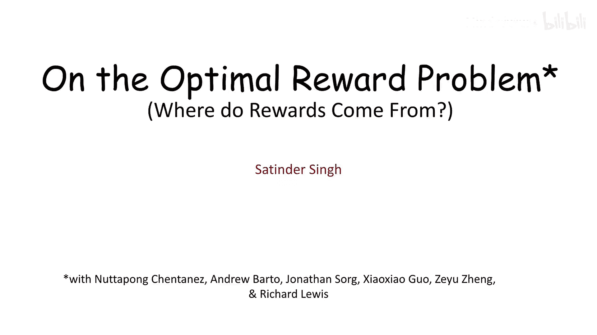
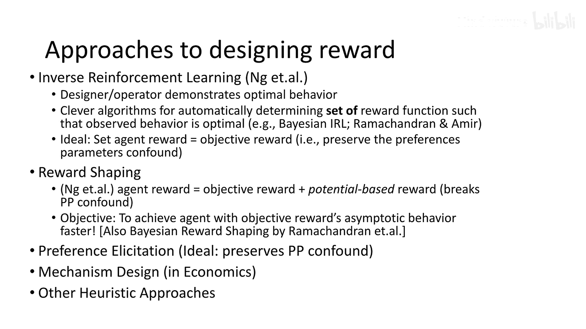
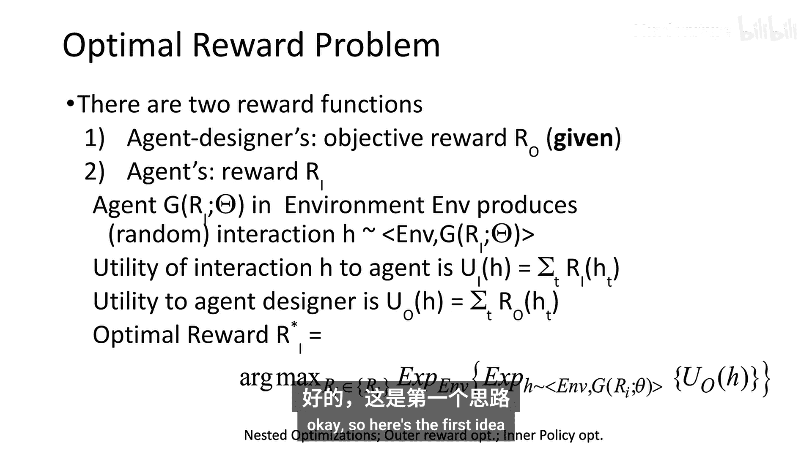
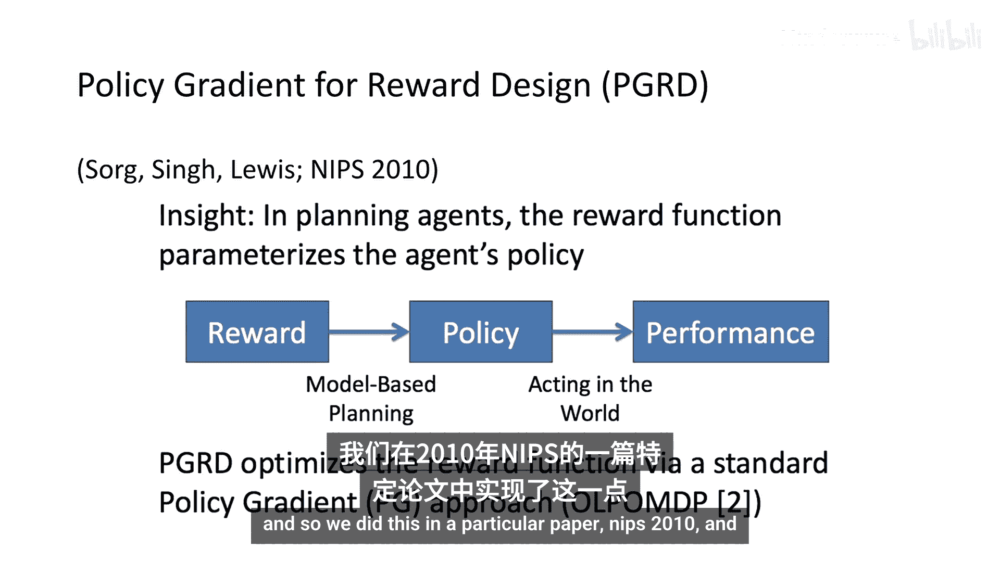
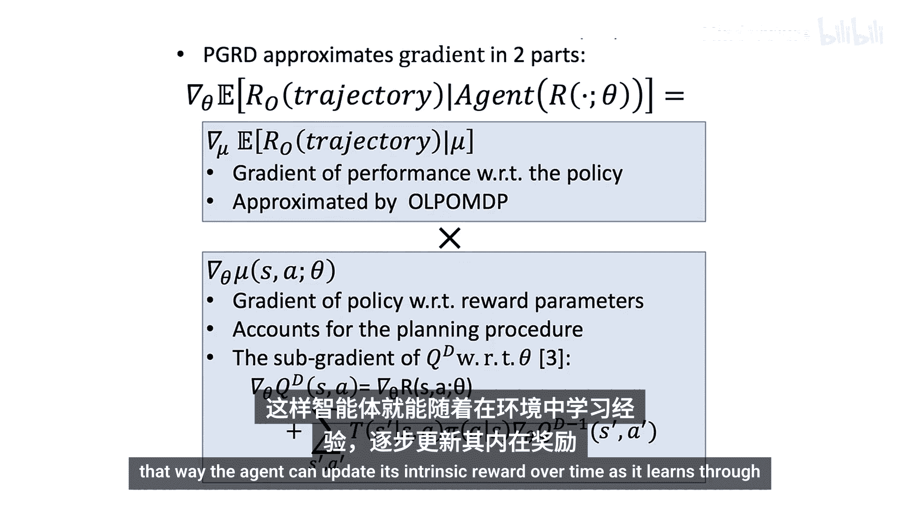
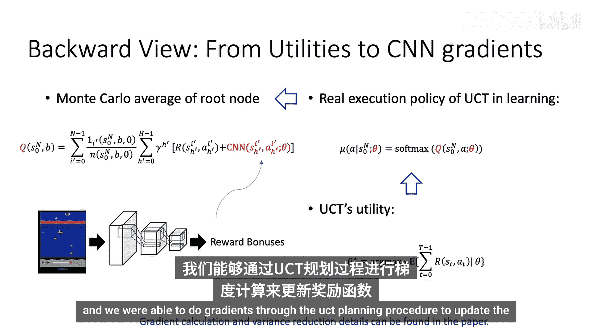
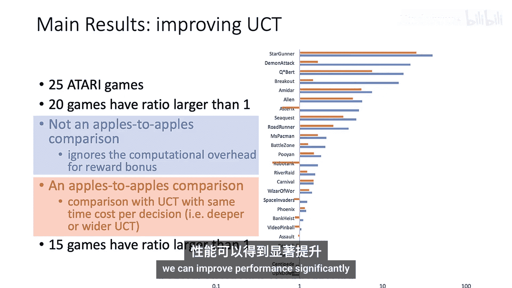
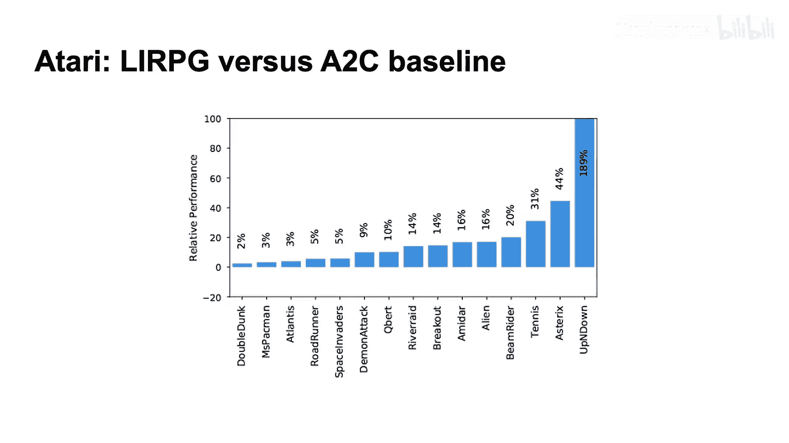

# 032：内在奖励的设计与优化

## 概述

在本节课中，我们将探讨强化学习中一个核心但常被忽略的问题：智能体的奖励从何而来？我们将学习如何将奖励函数的设计本身视为一个优化问题，并介绍一种通过梯度方法学习“内在奖励”的框架，以帮助智能体更有效地优化设计者真正的“外在”目标。

---

## 奖励函数的双重角色 🤔

在标准的强化学习框架中，我们通常假设奖励函数是环境给定的一部分，智能体的任务就是优化这个奖励的累积值。

然而，从设计者的角度看，这个单一的奖励函数实际上**混淆了两种不同的角色**：
1.  **偏好**：它表达了设计者对智能体行为的偏好。
2.  **参数**：根据“奖励假设”，它定义了智能体的目标，并成为驱动智能体行为的算法参数。

因此，我们可以提出一个问题：这两种角色是否应该被混入同一个奖励函数中？

---

## 内在奖励与外在奖励的区分 🧠

一种更清晰的思路是将奖励区分为两种：
*   **外在奖励**：代表设计者真正的、客观的目标，记为 **R_O**。它可能非常稀疏或延迟。
*   **内在奖励**：智能体内部实际用来学习和决策的奖励，记为 **R_I**。它是设计者可以调整的参数。

这类似于自然界的生物：进化塑造了我们的内在奖励机制（如对食物、安全的渴望），以驱动我们采取有利于生存和繁衍（外在目标）的行为。

---

## 最优奖励问题 🎯

基于上述区分，我们可以形式化地定义“最优奖励问题”：

**给定一个内在奖励函数空间，我们应该为智能体选择哪个内在奖励函数 R_I，使得智能体在优化 R_I 的过程中，最终能最大化真正的外在奖励 R_O？**

这本质上是一个**元优化问题**：外层循环优化内在奖励函数，内层循环是智能体基于给定的内在奖励学习策略。

---

## 基于策略梯度的奖励设计

以下是解决最优奖励问题的一种思路：**策略梯度奖励设计**。

既然内在奖励是智能体策略的参数之一，我们就可以像用策略梯度方法优化策略参数一样，用梯度方法优化内在奖励参数。

具体而言，我们可以计算外在奖励 **R_O** 相对于内在奖励参数 **θ** 的梯度，并沿此梯度方向更新 **θ**。其核心公式推导如下：

首先，策略梯度方法计算目标函数 **J(π)** 相对于策略参数 **φ** 的梯度：
`∇_φ J(π) = E[∇_φ log π(a|s) * G]`
其中 **G** 是回报。

接着，我们需要计算策略参数 **φ** 相对于内在奖励参数 **θ** 的梯度 **∇_θ φ**。这取决于智能体如何利用内在奖励来更新其策略。通过链式法则，我们可以得到：
`∇_θ J ≈ (∇_θ φ)^T * ∇_φ J`

这样，智能体就能在与环境交互的过程中，同时更新其策略和内在奖励函数。

---

## 应用实例：规划与学习中的内在奖励优化

上一节我们介绍了PGRD的基本思想，本节中我们来看看它在不同场景下的应用。

### 在规划算法中优化内在奖励

我们首先将PGRD与**UCT**规划算法结合。UCT是一种基于模拟的向前搜索算法。在此设置中：
*   智能体使用一个可学习的**内在奖励函数**来评估UCT搜索树中的状态。
*   我们通过**PGRD**方法，计算外在奖励相对于内在奖励参数的梯度，并更新这些参数。
*   策略（即行动选择）完全由固定参数的UCT规划产生，**唯一被学习的就是内在奖励函数**。

实验表明，在多个Atari游戏中，仅通过学习内在奖励，就能显著提升基于UCT的智能体的性能。

### 在学习算法中优化内在奖励

接下来，我们将PGRD扩展到**在线学习**场景，与**Actor-Critic**算法结合。这里的挑战在于，内在奖励参数的微小变化会影响整个学习过程的动态。

我们采用**元梯度**方法来解决这个问题：
1.  **内层更新**：Actor-Critic算法使用当前的内在奖励来更新策略参数 **φ**。
    `φ_{t+1} = φ_t + α * ∇_φ J(π_φ)`
2.  **外层更新**：我们计算外在奖励相对于内在奖励参数 **θ** 的梯度，这个梯度需要考虑内层策略更新所带来的影响。通过展开学习过程，我们可以估计这个元梯度并更新 **θ**。
    `θ_{t+1} = θ_t + β * ∇_θ J(π_{φ_{t+1}})`

实验同样表明，在多个Atari游戏中，通过元梯度学习内在奖励，能够显著超越仅使用原始外在奖励的基准Actor-Critic算法。

---

## 总结

本节课中我们一起学习了强化学习中奖励函数的设计问题。我们认识到标准框架中奖励函数混淆了设计者偏好和智能体参数的双重角色，进而提出了区分**外在奖励**和**内在奖励**的视角。

核心的解决方案是**最优奖励问题**，即寻找能使智能体行为最好地服务于外在目标的内在奖励。我们重点介绍了一种基于**策略梯度**的实用方法，它允许智能体通过梯度下降直接优化其内在奖励参数，并展示了该方法在规划和学习两种范式下的成功应用。

这种方法的价值在于，**内在奖励可以作为一种机制，帮助受限于计算、感知或学习能力的智能体，更有效地对齐设计者的复杂、稀疏或长期的外在目标**。