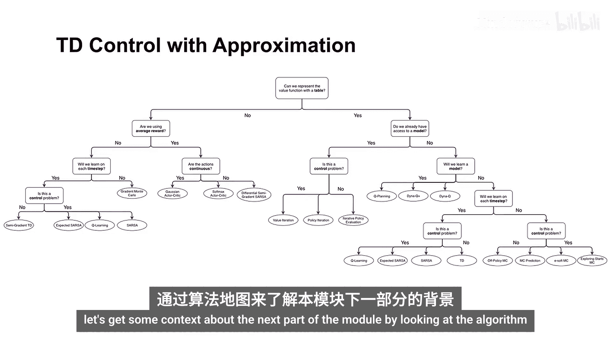
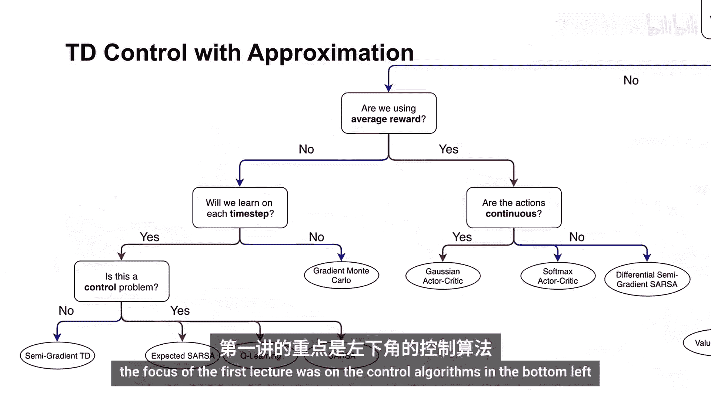
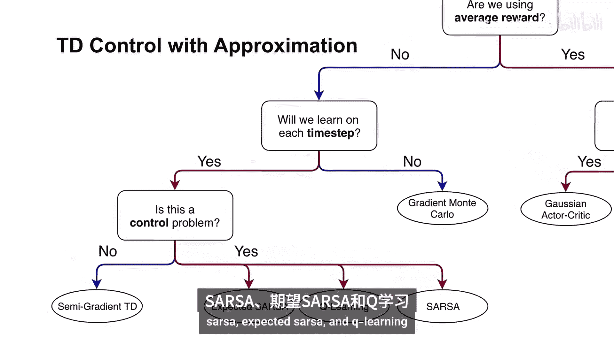
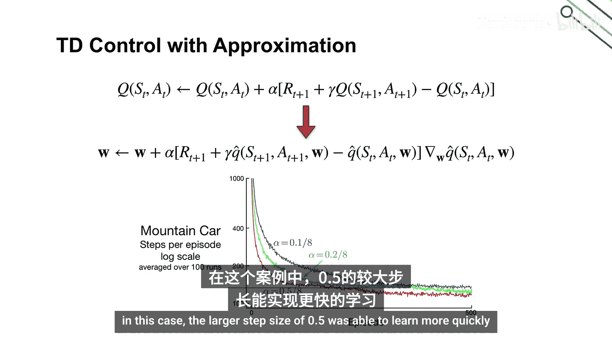
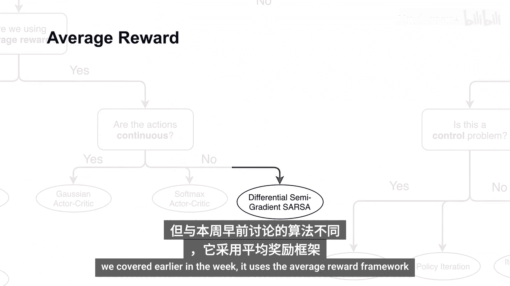

# 033：利用函数逼近进行预测与控制回顾 🧠

在本节课中，我们将回顾第三周的核心内容，即如何在使用函数逼近时进行控制。我们将涵盖动作值估计、控制算法的扩展、探索策略的调整，以及一种处理持续控制问题的新框架。

---

## 动作值估计方法

上一节我们介绍了函数逼近的基本概念，本节中我们来看看如何利用函数逼近来估计动作值。

如果动作空间是离散的，最简便的方法是将状态特征进行堆叠。其**公式**可以表示为：`Q(s, a) ≈ f(φ(s), a; θ)`，其中 `φ(s)` 是状态特征向量，`θ` 是参数。

如果动作空间是连续的，或者希望模型能在不同动作间进行泛化，则可以将动作本身作为一个输入变量，与其他状态变量一同传递给函数逼近器。其**代码**描述类似于：`Q_value = neural_network(concatenate(state_features, action))`。

---

## 控制算法扩展

了解了动作值估计后，我们进入本周的重点：控制算法。函数逼近将我们置于算法地图的左侧。

第一讲的重点是左下角的控制算法，包括 SARSA、期望 SARSA 和 Q-learning。

这些算法都是我们在第二课中学到的表格型控制算法的扩展。它们与表格型版本唯一的区别在于更新方程。所有更新都以相同的方式为函数逼近进行了调整，即**使用梯度来更新权重**。

我们还看到了分幕式 SARSA 如何被用于解决“山地车”问题。在这个案例中，较大的步长参数（如0.5）能够使学习速度更快。

---

## 探索策略的考量

在函数逼近的背景下，探索策略需要重新考量。

以下是关于探索策略的要点：
*   **乐观初始值**：可以与一些结构化的特征表示（如瓦片编码）结合使用。但对于像神经网络这样的非线性函数逼近器，通常不清楚如何乐观地初始化值函数，并且其行为可能不符合预期（例如，乐观性可能消退过快）。
*   **ε-贪心策略**：无论使用何种函数逼近器，ε-贪心策略都可以直接应用，是一种更通用的探索方法。

---

## 持续控制的新视角：平均奖励框架

最后，我们介绍了一种思考持续控制问题的新方式。与其最大化从当前状态开始的折扣回报，不如考虑最大化策略随时间获得的**平均奖励**。

我们定义了**差分回报**和**差分价值函数**。这些定义使得智能体能够在平均奖励设定下评估动作的相对价值。

基于此，我们引入了**差分半梯度 SARSA** 算法，它通过逼近差分价值函数来学习策略。差分 SARSA 同样位于算法地图的左侧，但与本周早先介绍的算法不同，它使用的是平均奖励框架。

---

## 总结

本节课中我们一起学习了：
1.  如何使用函数逼近估计动作值，包括对离散和连续动作空间的不同处理方法。
2.  如何将表格型控制算法（SARSA、期望 SARSA、Q-learning）扩展到函数逼近设置，核心在于使用梯度更新权重。
3.  在函数逼近中，ε-贪心是比乐观初始值更可靠的探索策略。
4.  引入了一种处理持续控制问题的新框架——平均奖励设定，并学习了相应的差分价值函数和差分半梯度 SARSA 算法。

下周，我们将探讨如何在不学习价值函数的情况下进行强化学习。