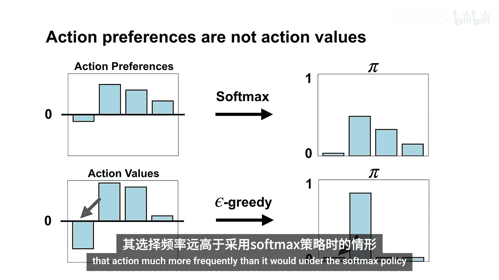

# 034：直接学习策略

在本节课中，我们将学习一种新的策略学习方法：直接参数化策略。我们将了解如何将策略定义为参数化函数，并介绍一种基于Softmax函数的参数化策略类别。

## 概述

到目前为止，我们学习的所有寻找优秀策略的方法都依赖于估计动作价值。我们研究的每一个控制算法都建立在广义策略迭代的框架之上。在本模块中，我们将探索一类新的方法，即策略本身被直接参数化。

## 直接指定策略的含义

上一节我们介绍了基于动作价值的策略学习方法，本节中我们来看看直接指定策略意味着什么。我们以“山地车”环境为例进行说明。

之前，我们使用ε-贪婪策略将近似的动作价值转换为策略。但我们也可以考虑一种直接将状态映射到动作的策略，而无需先计算动作价值。

例如，在山地车环境中，我们可以定义这样一个策略：当速度为正值时，选择“向右加速”动作；否则，选择“向左加速”动作。换句话说，这个策略会沿着我们当前运动的方向加速。事实上，这个简单的“能量泵”策略已经接近最优了。

这个策略完全没有使用动作价值。但这只是一个激发直觉的例子，旨在说明我们不需要动作价值也能构建策略。我们实际上不会手动指定策略，而是要学习它们。

## 使用函数逼近表示和学习策略

我们可以使用函数逼近的语言来直接表示和学习策略。我们将使用希腊字母θ表示策略的参数向量，以区别于近似价值函数的参数W。

我们将使用符号 **`π(a|s, θ)`** 来表示参数化策略。对于给定的输入状态和动作，参数化策略函数将输出在该状态下采取该动作的概率。这个映射由参数θ控制。

参数化函数必须生成一个有效的策略，这意味着它必须为每个状态生成一个有效的动作概率分布。具体来说，选择动作的概率必须大于或等于零，并且对于每个状态，所有动作的概率之和必须为一。

要满足参数化函数的这些条件需要一些思考。例如，这意味着我们不能像在价值函数逼近中那样直接使用线性函数。没有简单的方法能保证线性函数的输出之和为一。因此，我们需要限制可用于构建策略的函数类别。

## Softmax策略

让我们考虑一种满足这些条件的简单而有效的方法，称为Softmax策略。

以下是Softmax策略的定义。这里显示的函数 **`h(s, a, θ)`** 被称为动作偏好。在某个状态下，对某个特定动作的偏好越高，意味着该动作被选中的可能性越大。动作偏好是状态、动作以及参数向量θ的函数。

使用Softmax计算选择动作的概率很简单：我们取动作偏好，对其取指数，然后除以所有动作的指数偏好之和。

指数函数保证了每个概率都是正数。分母对每个动作的输出进行归一化，使得所有动作的概率之和为一。动作偏好可以按我们喜欢的任何方式进行参数化，因为Softmax会强制执行概率分布的约束。例如，动作偏好可以是状态-动作特征的线性函数，也可以是更复杂的函数，如神经网络的输出。

以下是将一组特定的动作偏好通过Softmax函数后得到的结果：

*   输入的偏好值可以任意大，甚至可以是负数。
*   如果一个偏好值远大于其他所有值，其对应的动作概率将接近1。无论偏好值有多大，概率永远不会大于1。
*   如果一个偏好值非常小，Softmax策略仍会以非零概率选择该动作。例如，如果某个偏好为负值而其他偏好为正值，该负值对应的动作仍将具有非零概率。
*   在Softmax策略下，具有相似偏好的动作将以接近相等的概率被选择。

## 动作偏好与动作价值的区别

区分动作偏好和动作价值非常重要。

偏好表示智能体对每个动作的喜好程度，但它们不是对未来回报的总结。只有偏好之间的相对差异才是重要的。例如，我们可以给所有偏好都加上100，这不会改变策略的行为。

从动作价值推导出的ε-贪婪策略，其行为可能与基于动作偏好的Softmax策略大不相同。

在ε-贪婪策略中，对应最高价值动作的动作以高概率被选择。选择所有其他动作的概率非常小。具有相近但较低价值的动作被选择的概率要低得多。另一方面，由于ε探索步骤，具有非常差价值的动作仍然会被频繁选择。因此，即使智能体学习到某个动作会产生糟糕的后果，它继续选择该动作的频率仍将远高于在Softmax策略下的频率。

## 总结

本节课中，我们一起学习了直接参数化策略的方法。我们了解到需要定义能够产生有效概率分布的参数化形式，并理解了Softmax策略参数化的原理。