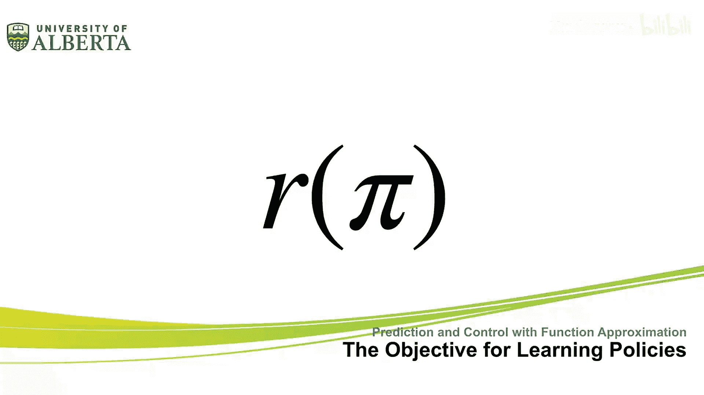
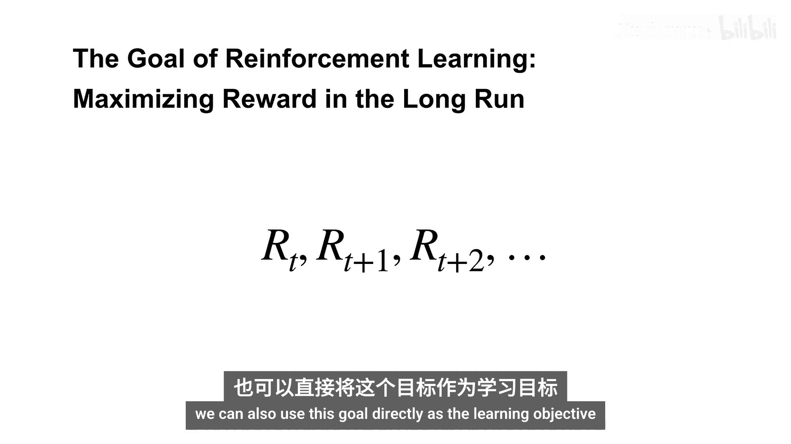
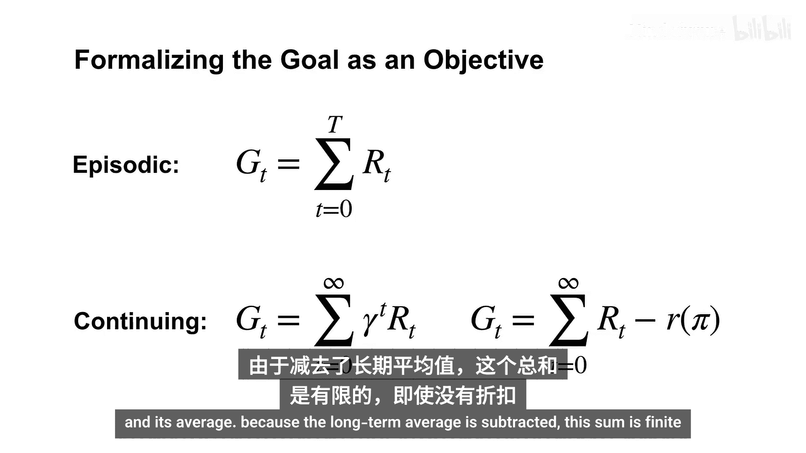
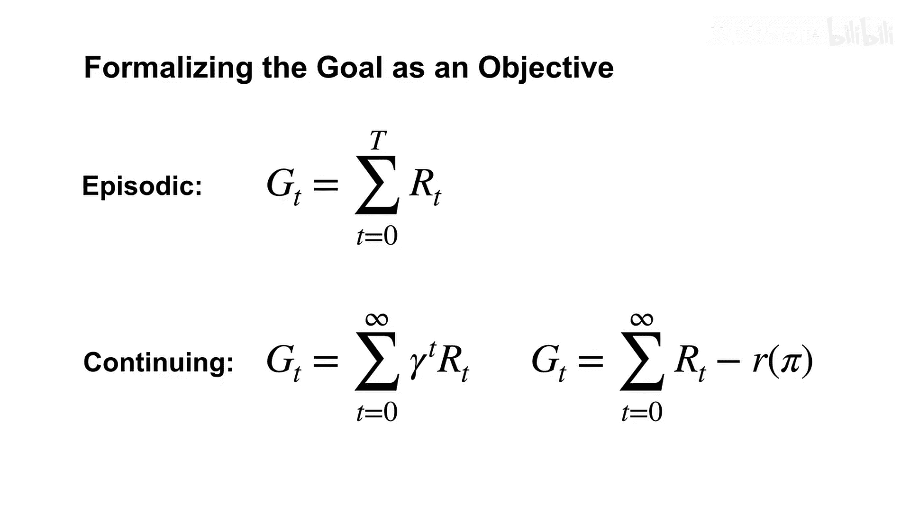
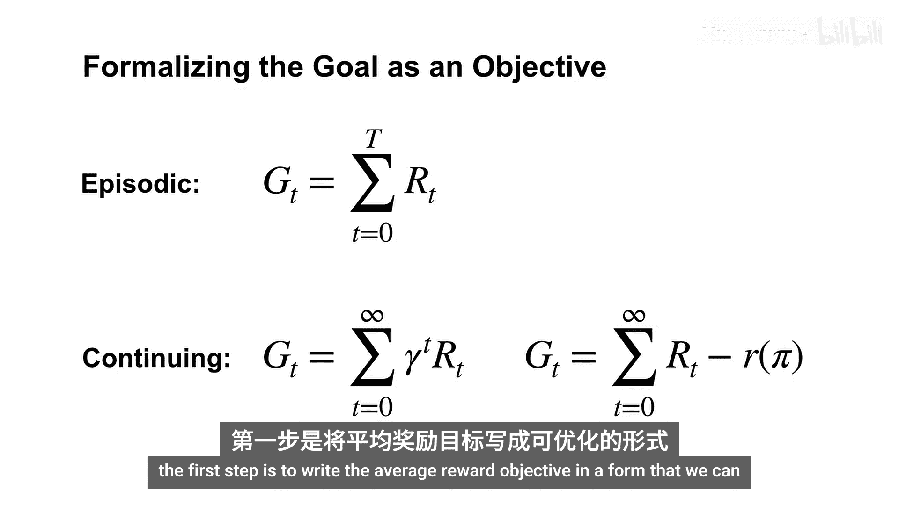
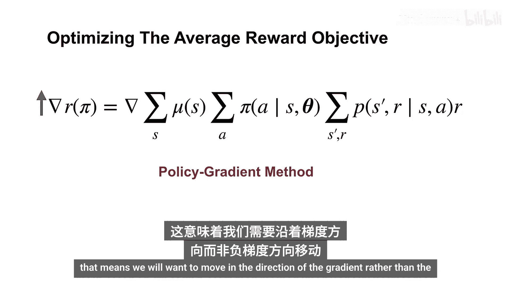
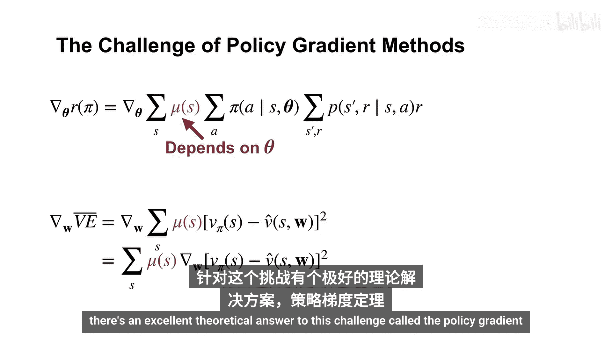

# 036：学习策略的目标

在本节课中，我们将要学习如何为参数化策略的学习过程定义一个明确的目标。上一节我们介绍了直接参数化策略的概念，本节中我们来看看如何学习并改进一个参数化的策略。

与基于动作价值的方法类似，其基本思路是：首先指定一个目标函数，然后找出如何根据智能体的经验来估计该目标函数的梯度。看完本节内容，你将能够描述策略梯度算法的目标。

为参数化策略的学习过程制定目标，在某种意义上比基于动作价值的方法更直接。我们多次强调，强化学习的最终目标是学习一个能在长期内获得尽可能多奖励的策略。事实证明，当我们直接对策略进行参数化时，我们也可以直接将这个目标作为学习的目标函数。

在本系列课程中，我们介绍过几种对“在长期内获得尽可能多奖励”的不同解释。

以下是三种主要的回报形式：
*   **分幕式情况**：使用**无折扣回报**，即整个幕中所有奖励的总和。
*   **持续式情况**：使用**折扣回报**，它更强调即时奖励，以确保总和是有限的。
*   **平均奖励情况**：最大化奖励的长期平均值。此时，合适的回报是即时奖励与其平均值之差的累加和。由于减去了长期平均值，即使没有折扣，这个总和也是有限的。

我们面临三种潜在的问题形式需要考虑。接下来，我们将把注意力集中在**采用平均奖励的持续式设定**上。

我们的目标是找到一种直接优化策略参数的方法。第一步是将平均奖励目标写成我们可以优化的形式。

之前，我们在Sarsa算法的平均奖励变体中，通过估计平均奖励来学习动作价值。现在，我们的目标是学习一个直接优化平均奖励的策略。为此，让我们从一个更有用的形式开始，写出在某个策略下的平均奖励。

我们可以将特定策略 **π** 所获得的平均奖励写成如下公式：

**J(π) = Σ_s μ_π(s) Σ_a π(a|s) Σ_{s‘, r} p(s‘, r|s, a) r**

让我们来分解这个公式，从内层求和开始向外看：
1.  最内层的求和 `Σ_{s‘, r} p(s‘, r|s, a) r` 给出了从状态 **s** 采取动作 **a** 时的**期望奖励**。这简单来说就是所有可能获得的奖励，按其从 **(s, a)** 出发的概率加权求和。
2.  下一层求和 `Σ_a π(a|s) [期望奖励]` 是对所有可能的动作进行求和，并按策略 **π** 下的概率加权。这给出了在特定状态 **s** 下，遵循策略 **π** 的**期望奖励**。
3.  最后，我们通过考虑在策略 **π** 下处于状态 **s** 的时间比例 `μ_π(s)`，来得到整体的**平均奖励**。分布 **μ** 提供了这些概率。跨状态的期望奖励是每个状态的期望奖励按 `μ(s)` 加权后的总和。

**J(π)** 就是我们的平均奖励学习目标。策略优化的目标将是找到一个能最大化平均奖励的策略。

我们的基本方法是：估计目标函数相对于策略参数的梯度，并根据这个估计值调整参数。采用这种思路的方法类别通常被称为**策略梯度方法**。

在此之前，我们使用了一种非常不同的方法。我们使用广义策略迭代框架来学习近似的动作价值，然后间接地使用这些近似值来推导出一个好的策略。现在我们感兴趣的是直接学习策略。

还有一个表面上的区别：之前我们是在最小化均方价值误差，而现在我们是在最大化一个目标函数。这意味着我们将希望沿着梯度的方向移动，而不是负梯度的方向。

然而，计算这个梯度存在一些挑战。主要困难在于，修改我们的策略会改变分布 **μ**。

这与价值函数近似形成对比，在价值函数近似中，我们是在特定策略下最小化均方价值误差，那里的分布 **μ** 是固定的，它不会随着参数化价值函数中权重的改变而改变。因此，我们能够简单地通过遵循策略，来对从 **μ** 中抽取的状态进行梯度估计。

现在的情况则不那么直接，因为 **μ** 本身依赖于我们正在优化的策略。幸运的是，有一个出色的理论答案可以应对这个挑战，称为**策略梯度定理**。我们很快会详细讨论它。

本节课的内容到此结束。你现在应该理解，我们可以将平均奖励作为策略优化的目标。在接下来的课程中，我们将讨论如何从采样经验中实际优化这个目标。下次见。