# 037：策略梯度定理 📈

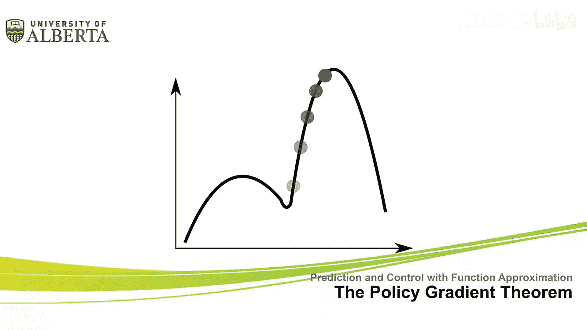

在本节课中，我们将要学习策略梯度定理。这是一个关键的理论成果，它允许我们将平均奖励目标的梯度，以一种更容易从经验中估计的形式表达出来。

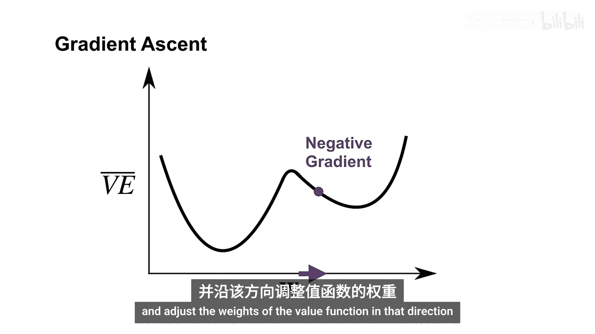

上一节我们介绍了策略优化的目标，本节中我们来看看如何基于智能体的经验来优化这个目标。

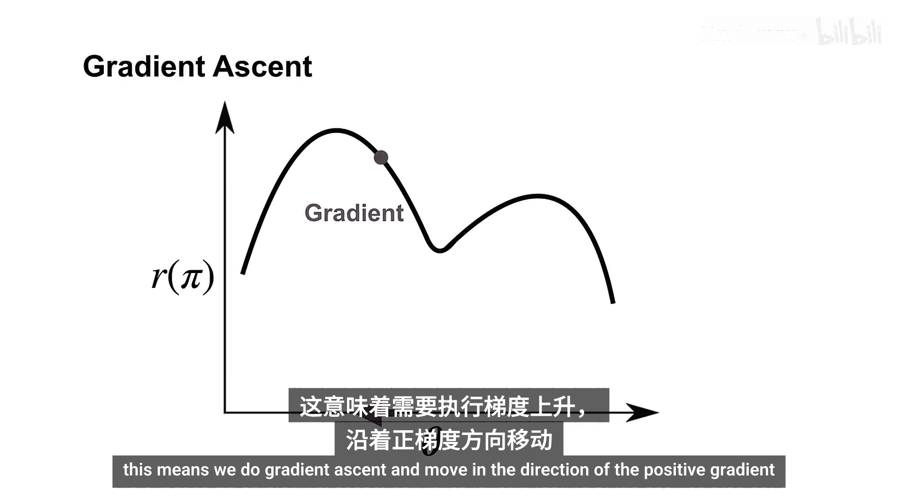

## 梯度优化方法回顾

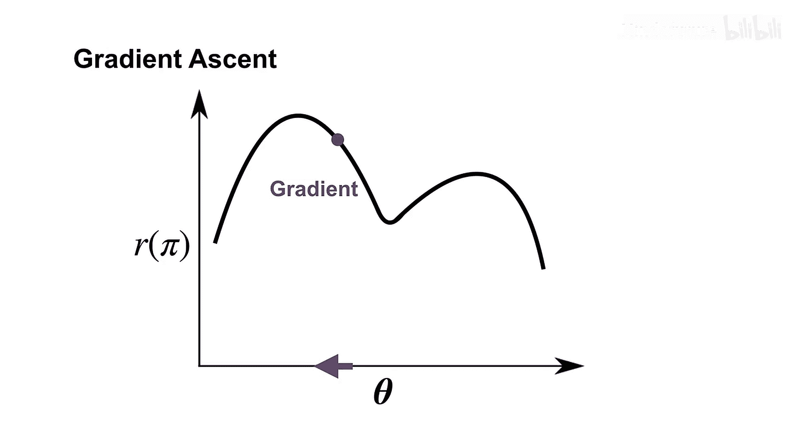

为了优化均方值误差，我们使用了基于随机梯度下降的方法。我们估计目标函数负梯度的方向，并朝该方向调整价值函数的权重。

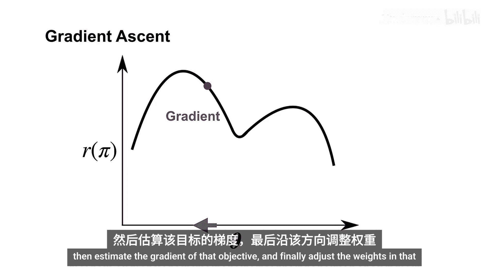

策略梯度方法采用了类似的方法，但针对的是平均奖励目标和策略参数 θ。我们希望最大化平均奖励，而不是最小化误差。这意味着我们需要进行梯度上升，朝着正梯度的方向移动。

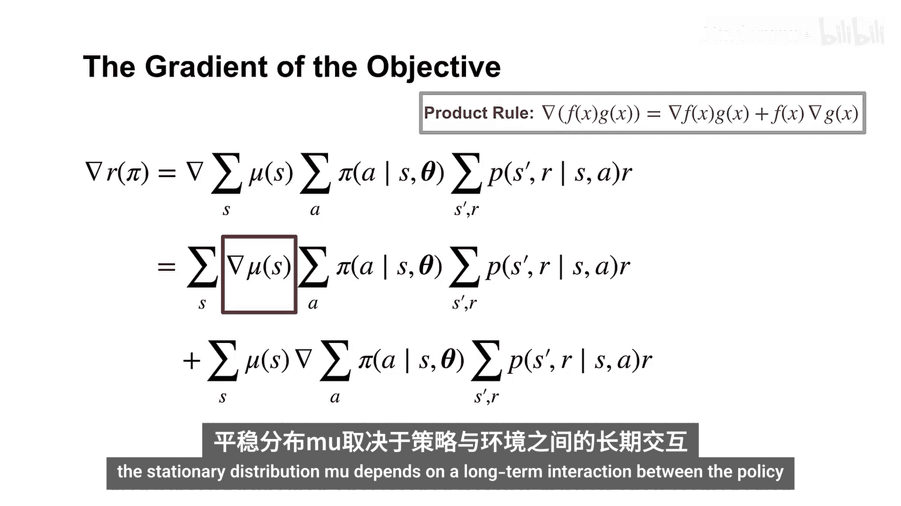

## 计算目标函数的梯度

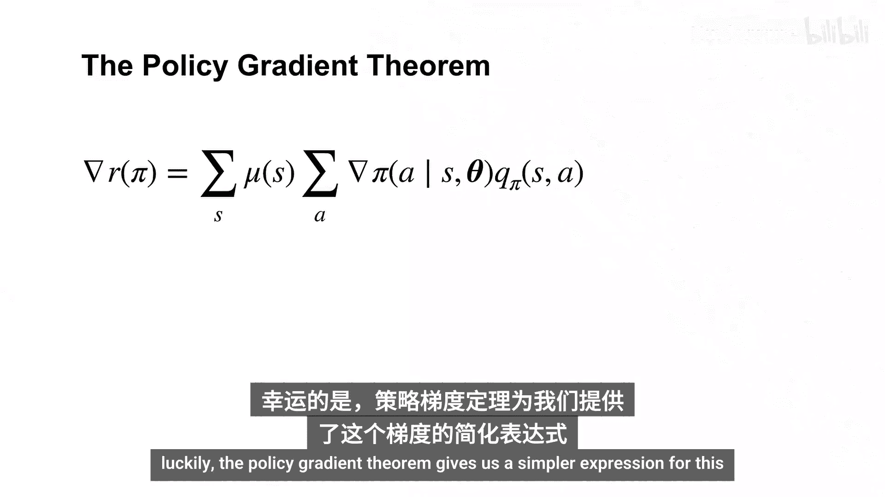

记住，解决问题的一个简单步骤是：首先指定一个目标，然后估计该目标的梯度，最后朝该方向调整权重。第一步已经完成，下一步是估计我们目标的梯度。

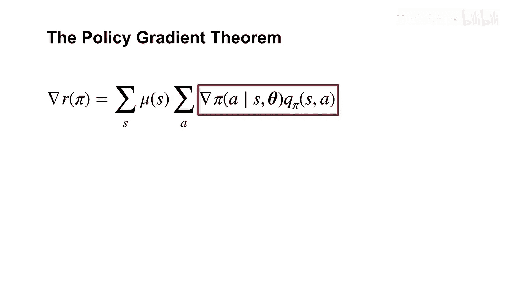

回顾平均奖励目标函数，让我们计算其梯度。我们可以应用微积分的乘积法则，将目标函数的梯度分解为两项。这个表达式看起来相当复杂，让我们更仔细地观察一下。

第一项涉及状态平稳分布 μ 的梯度。不幸的是，μ 的梯度并不容易估计，因为平稳分布 μ 依赖于策略与环境之间的长期交互。

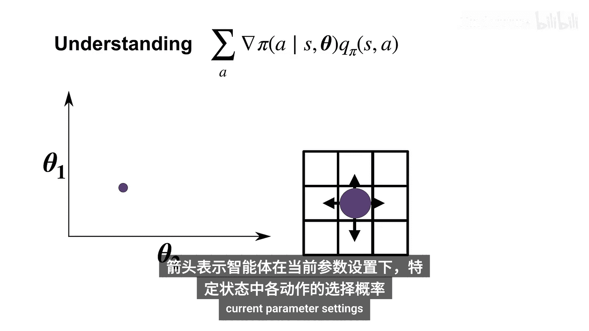

## 策略梯度定理

幸运的是，策略梯度定理为我们提供了这个梯度的一个更简单的表达式。以下是定理的结果，值得仔细分析这个表达式。

在内部求和中，我们有策略的梯度乘以动作价值函数。让我们尝试更好地理解这一项。

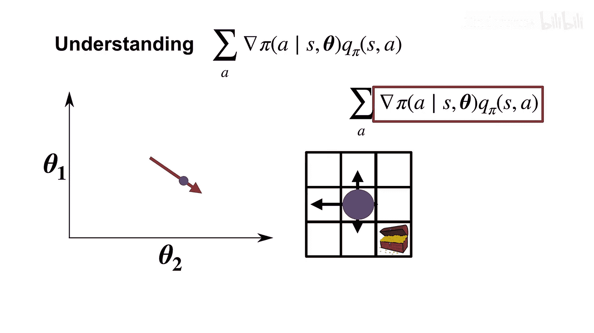

*   **策略的梯度**：只要我们的策略参数化是可微的，策略的梯度就很容易计算。策略的梯度告诉你如何调整参数以增加选择某个动作的概率。
*   **动作价值函数**：它衡量了在给定状态下采取特定动作的“好坏”程度。

整个项是每个动作概率梯度以其关联动作的价值为权重的加权和。这个加权和给出了一个移动参数的方向，它会降低价值为负的动作的概率，同时增加价值为正的动作的概率。

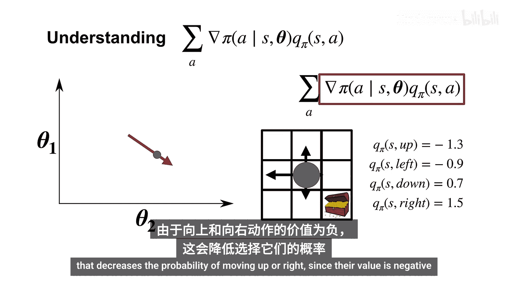

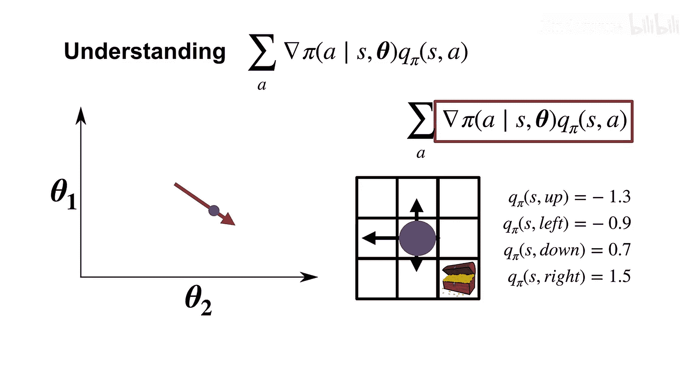

策略梯度定理给出的梯度表达式，将这个加权和再对每个状态进行求和。这给出了移动策略参数以最快速增加整体平均奖励的方向。

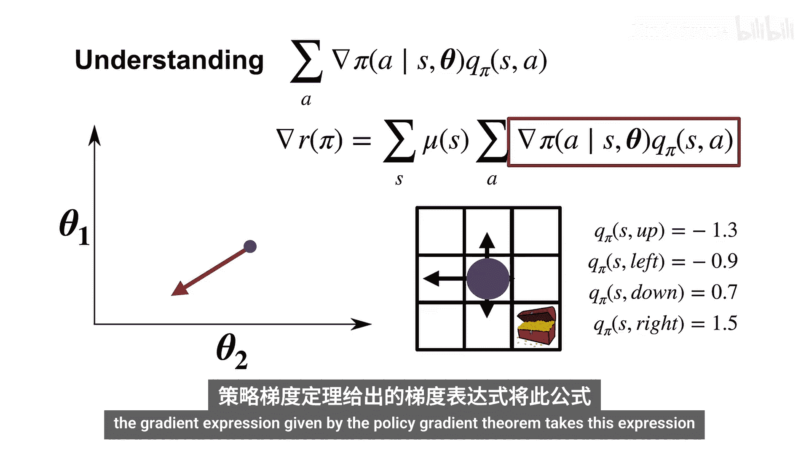

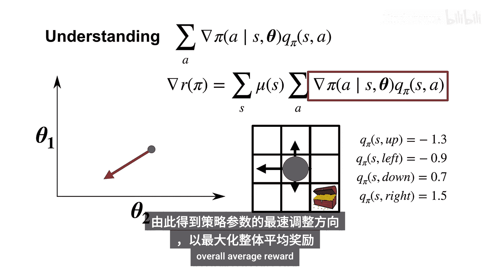

## 总结与展望

本节课中我们一起学习了策略梯度定理。我们现在有了一个简单的梯度表达式。重要的是，这个表达式不包含难以估计的状态分布 μ 的梯度。策略梯度定理的证明可以在课程教材中找到。

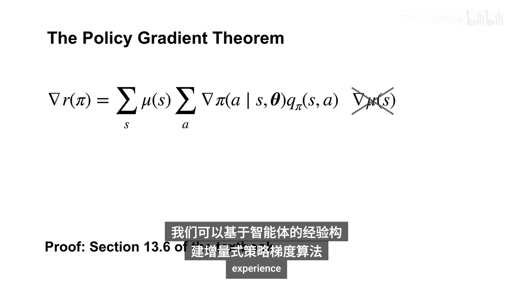

正如我们将在下一讲中看到的，这个梯度很容易估计。这意味着我们将能够利用智能体的经验构建一个增量式的策略梯度算法。