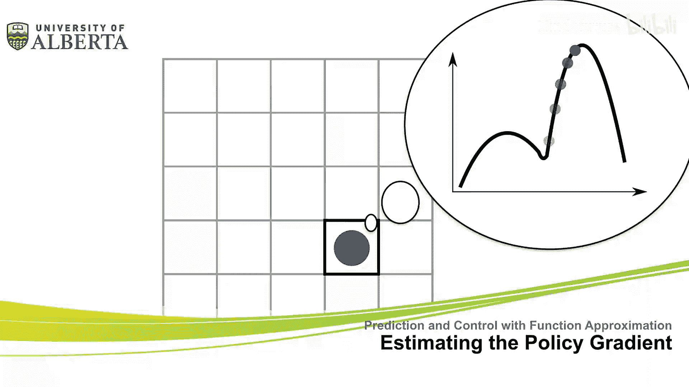
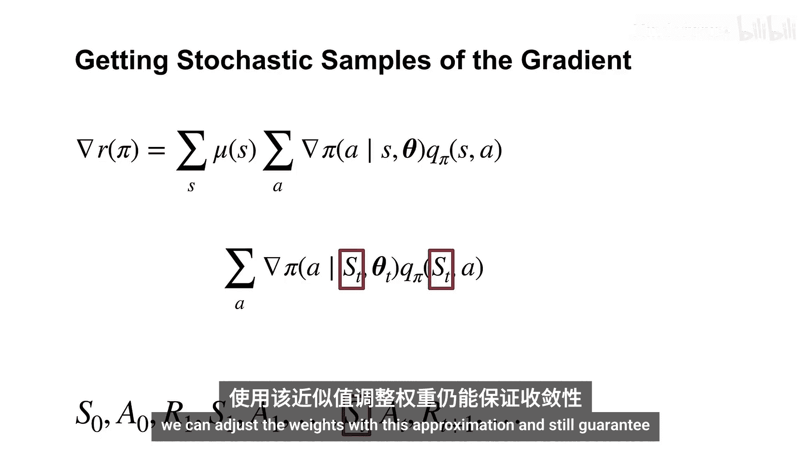
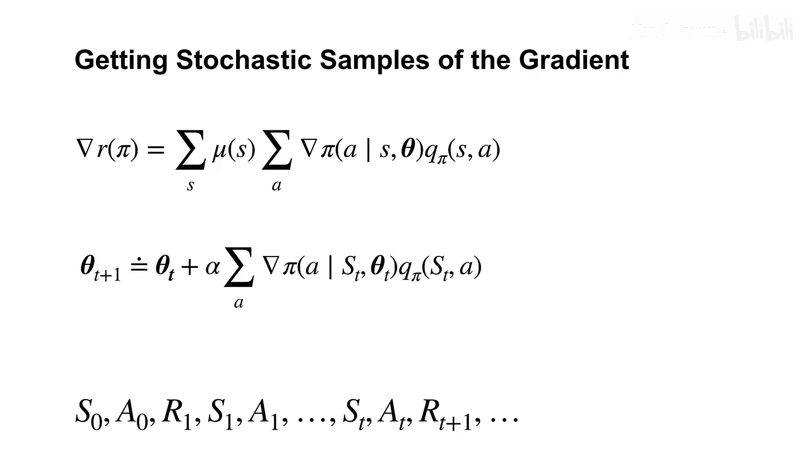
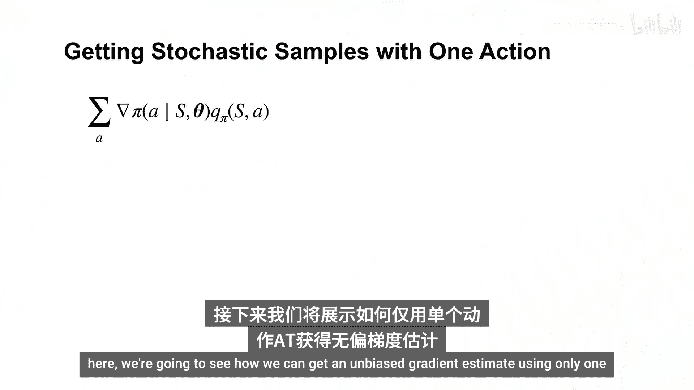
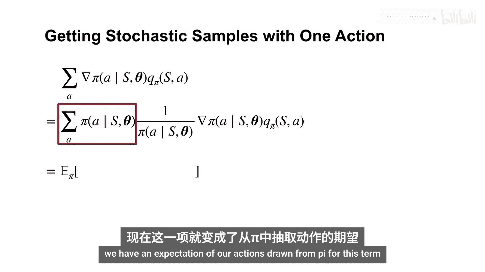
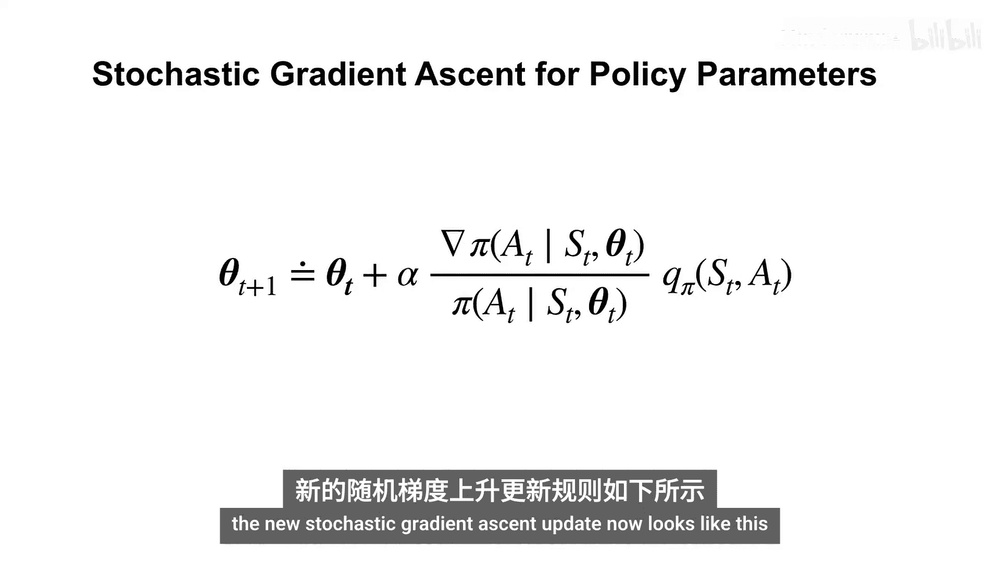
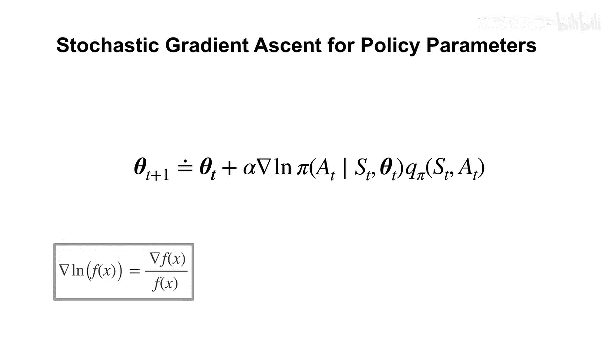
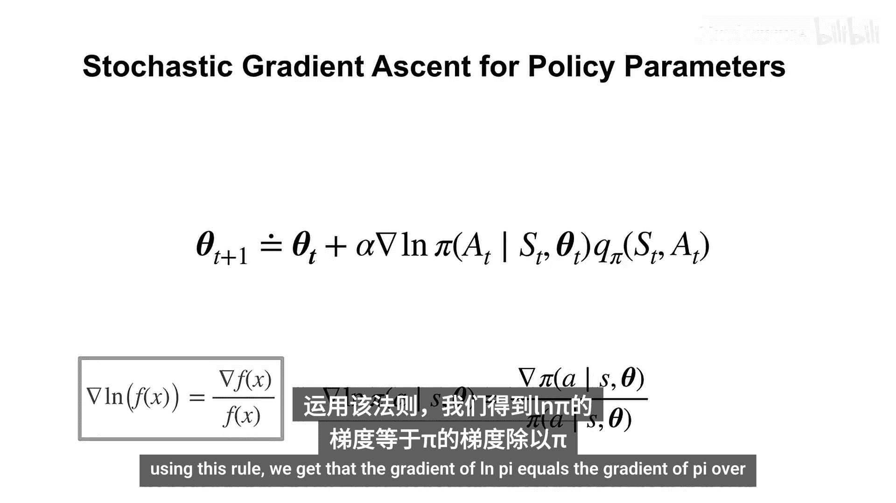
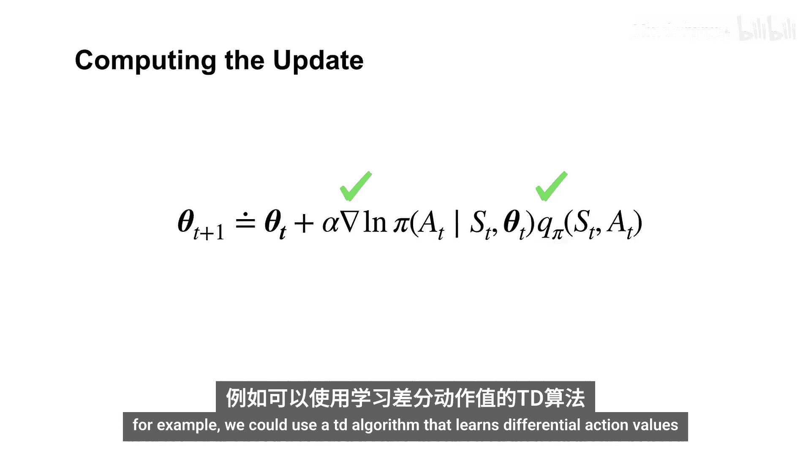
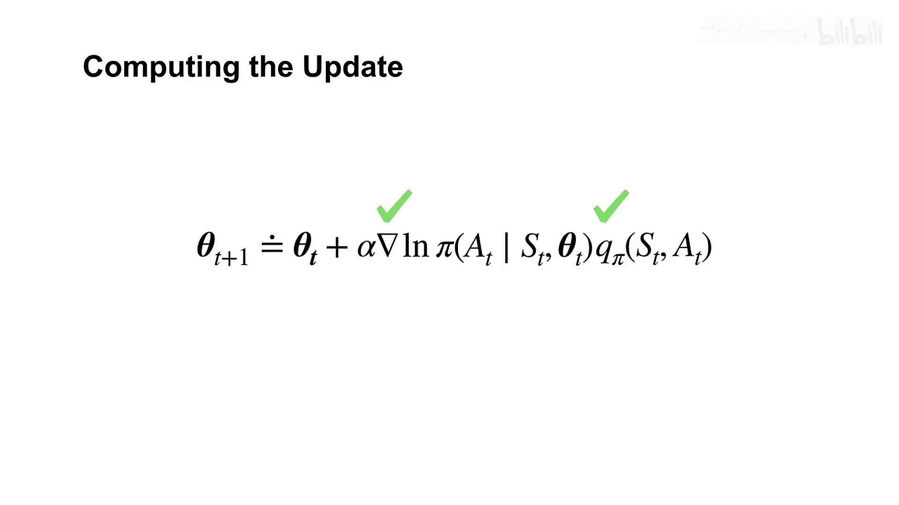

# 038：策略梯度估计

在本节课中，我们将要学习如何利用智能体与环境交互的经验，来估计策略梯度定理给出的梯度表达式，从而完成策略优化的完整拼图。

观看本视频后，你将能够推导出平均奖励目标梯度的基于样本的估计方法。

## 从目标到梯度更新 🎯

上一节我们介绍了策略优化的目标以及策略梯度定理。本节中，我们来看看如何近似计算这个梯度，以驱动策略的梯度上升算法。

我们拥有目标函数及其梯度。现在需要找出如何近似这个梯度。实际上，我们将要获得梯度的随机样本。

回顾平均奖励梯度的表达式：计算对所有状态的求和在实际中并不可行。

但我们可以采用与推导策略评估的随机梯度下降规则时相同的方法：简单地根据遵循策略π时观察到的状态进行更新。

从状态 `S_t` 计算出的这个梯度，为平均奖励的梯度提供了一个近似值。正如之前讨论随机梯度下降时所述，我们可以用这个近似值调整权重，并仍能保证达到一个驻点。

## 随机梯度上升更新 🔄

以下是策略参数的随机梯度上升更新的形式：

`θ ← θ + α * ∇θ J(θ) 的近似值`

我们可以在此停止，但让我们进一步简化它。

## 基于期望的视角简化 🧠

让我们从基于期望的角度重新审视这个更新。这将帮助我们简化更新，并让你更深入地理解更新为何合理。

注意，按 `μ` 加权的状态和可以重写为在 `μ` 下的期望。回想一下，`μ` 是策略 `π` 的平稳分布，反映了在 `π` 下的状态访问频率。实际上，我们遵循策略 `π` 时观察到的状态正是按照 `μ` 分布的。

通过计算来自状态 `S_t` 的梯度，我们得到了这个期望的一个无偏估计。

将随机梯度视为无偏估计，这提示了另一种简化。注意，在期望内部，我们有一个对所有动作的求和。我们希望使这一项更简单，并摆脱对所有动作的求和。

如果这是对动作的期望，我们也可以获得它的一个随机样本，从而避免对所有动作求和。接下来我们将看到，如何仅使用智能体采取的一个动作 `A_t` 来获得无偏的梯度估计。

## 引入动作采样 🎲

如果我们的动作和是按 `π` 加权的，从而是在 `π` 下的一个期望，那就太好了。这样我们就可以使用智能体的动作选择（其分布符合 `π`）来对它进行采样。

事实证明，解决这个问题很容易。为了得到一个对应于期望的加权和，我们只需乘以并除以给定状态 `s` 下的 `π(a|s)`。

现在，我们得到了对于这个项，从 `π` 中抽取动作的期望。

## 简化的更新规则 ✨

新的随机梯度上升更新现在看起来像这样：

`θ ← θ + α * [Q^π(S_t, A_t) * ∇θ ln π(A_t | S_t, θ)]`

作为一个旁注，通常将此梯度重写为策略 `π` 的自然对数的梯度。这是基于微积分中对数梯度的公式。使用这个规则，我们得到 `ln π` 的梯度等于 `∇θ π / π`，因此这个更新与我们开始时是等价的。

我们这样做的一个原因是，对于某些分布，计算其对数的梯度实际上更简单。另一个不太重要的原因仅仅是它让我们能更紧凑地书写这个梯度。归根结底，这只是一个数学技巧，所以不要让它分散你对底层算法的注意力。

## 更新规则的组成与计算 ⚙️

我们现在得到的规则看起来像本课程中使用的许多学习规则：我们按比例调整参数 `θ`，比例系数是目标函数的随机梯度；我们使用步长参数 `α` 来控制该方向上的步长幅度。`α` 的作用一如既往。

最后要讨论的是如何为给定的状态和动作实际计算随机梯度。

我们只需要两个组成部分：策略的梯度，以及差分动作值的估计。

第一部分很容易。我们知道策略及其参数化形式，因此可以计算其梯度。

动作值可以用多种方式近似，例如，我们可以使用学习差分动作值的时序差分算法。在接下来的视频中，我们将详细介绍一种特定的选择，以及如何计算特定策略参数化的梯度。

## 总结 📝

本节课中，我们一起学习了如何为平均奖励设定推导出策略梯度学习规则。我们展示了如何将理论梯度表达式转化为一个实用的、基于智能体交互经验样本的随机更新规则。下一节视频，我们将看到如何使用这个规则。