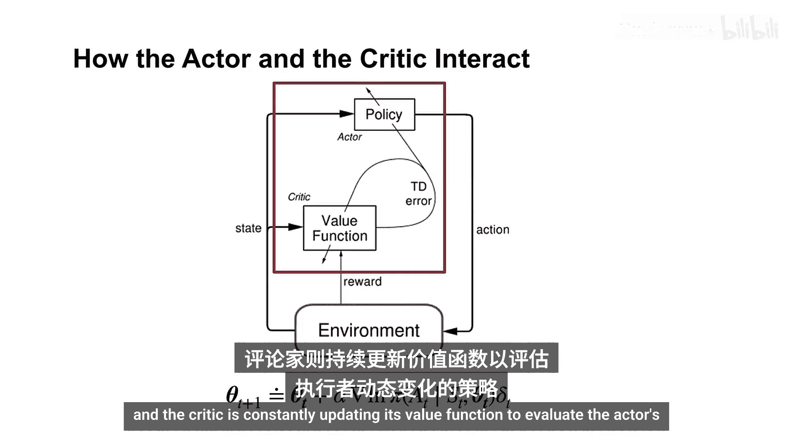
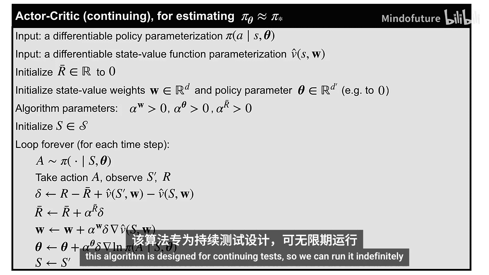

# 039：Actor-Critic算法

在本节课中，我们将学习如何结合策略学习和价值学习，通过Actor-Critic算法在持续任务中进行预测和控制。我们将了解算法的核心组成部分，并详细解析其更新过程。

上一节我们介绍了策略梯度方法的基本思想。本节中我们来看看如何将价值函数学习融入其中，形成Actor-Critic算法。

我们必须在直接学习策略参数和学习价值函数之间做出选择吗？答案是否定的。即使在策略梯度方法内部，像TD这样的价值学习方法仍然扮演着重要角色。在这种设置中，参数化策略扮演着**演员**的角色，而价值函数则扮演着**评论家**的角色，用于评估演员选择的动作。这些所谓的Actor-Critic方法，是强化学习中最早引入的基于TD的方法之一。

## 算法核心：策略梯度与价值近似

我们以上一讲结束时的策略梯度学习规则表达式作为起点。但我们无法直接获得真实的动作价值函数 Q，因此必须对其进行近似。我们可以采用通常的TD方法，使用一步自举回报，即**差分奖励**加上下一个状态的价值。

**公式**：`R_t - \bar{R} + \hat{v}(S_{t+1}, \mathbf{w})`

与往常一样，参数化函数 `\hat{v}` 是价值函数的学习估计。在这种情况下，`\hat{v}` 是差分价值函数。这就是Actor-Critic算法中的**评论家**部分，它为演员提供即时反馈。

为了训练评论家，我们可以使用任何状态价值学习算法。这里我们将使用平均奖励版本的半梯度TD方法。

## 引入基线以减少方差

参数化策略是**演员**，它使用如下所示的策略梯度更新。

**公式**：`\mathbf{\theta}_{t+1} = \mathbf{\theta}_t + \alpha \nabla \ln \pi(A_t|S_t, \mathbf{\theta}_t) [R_t - \bar{R} + \hat{v}(S_{t+1}, \mathbf{w})]`

我们可以使用这种形式的更新，但还可以做最后一件事来改进算法：减去一个称为**基线**的值。我们不单独使用一步价值估计，而是减去状态 `S_t` 的价值估计，从而得到如下所示的更新。

**公式**：`\mathbf{\theta}_{t+1} = \mathbf{\theta}_t + \alpha \nabla \ln \pi(A_t|S_t, \mathbf{\theta}_t) [R_t - \bar{R} + \hat{v}(S_{t+1}, \mathbf{w}) - \hat{v}(S_t, \mathbf{w})]`

这里的 `\hat{v}(S_t, \mathbf{w})` 就是基线。请注意，这个表达式等于**TD误差**。

**公式**：`\delta_t = R_t - \bar{R} + \hat{v}(S_{t+1}, \mathbf{w}) - \hat{v}(S_t, \mathbf{w})`

这个更新的期望值与之前的更新相同。为什么？让我们在给定特定状态 `S_t` 的条件下，计算更新的期望值。期望的和等于和的期望。我们可以利用这一点，将原始项的期望与涉及被减价值函数的期望分离开。结果证明，第二项的期望值为0。因此，我们可以在不改变更新期望值的情况下添加这个基线。您可以自行验证这一点：首先将期望写为奖励的和，并将 `\hat{v}` 项从总和中提出。我们将其留作练习。

那么，如果更新的期望值相同，我们为什么还要添加这个基线呢？减去这个基线有助于**降低更新的方差**，从而带来更快的学习速度。

## 算法直观理解

这个更新在直观上是有道理的。在我们执行一个动作后，我们使用TD误差来判断该动作相对于该状态的平均水平有多好。如果TD误差为正，意味着所选动作带来的价值高于预期。更频繁地采取该动作应能改进我们的策略。这正是此更新所做的：它根据评论家的判断，改变策略参数以增加那些优于预期的动作的概率。相应地，如果评论家“失望”且TD误差为负，则该动作的概率会降低。

演员和评论家同时学习，不断互动。演员不断改变策略以超越评论家的期望，而评论家则不断更新其价值函数以评估演员不断变化的策略。

## 平均奖励Actor-Critic完整算法

有了策略更新规则，我们就可以梳理平均奖励Actor-Critic的完整算法了。

以下是算法的关键步骤：

1.  **初始化**：首先，我们指定策略参数化和价值函数参数化。例如，我们可以使用瓦片编码来构建近似价值函数，并使用softmax策略参数化。我们需要维护一个平均奖励的估计值，就像在差分SARSA算法中一样，将其初始化为零。我们可以按喜好初始化权重和策略参数。我们初始化价值估计、策略和平均奖励的步长参数，它们可以各不相同。然后从环境中获取初始状态，开始行动和学习。
2.  **循环执行**：在每个时间步，我们根据策略选择动作，并从环境中接收下一个状态和奖励。
3.  **计算与更新**：利用这些信息，我们计算差分TD误差，并更新我们对平均奖励的运行估计。
4.  **更新评论家**：使用TD更新来更新价值函数的权重。
5.  **更新演员**：使用我们的策略梯度更新来更新策略参数。

就这样。该算法专为持续任务设计，因此我们可以无限期地运行它，并持续改进策略。

本节课中我们一起学习了如何利用价值函数学习来估计策略参数的梯度是有用的，并且Actor-Critic算法通过一个为演员学习价值函数的评论家来实现这一思想。