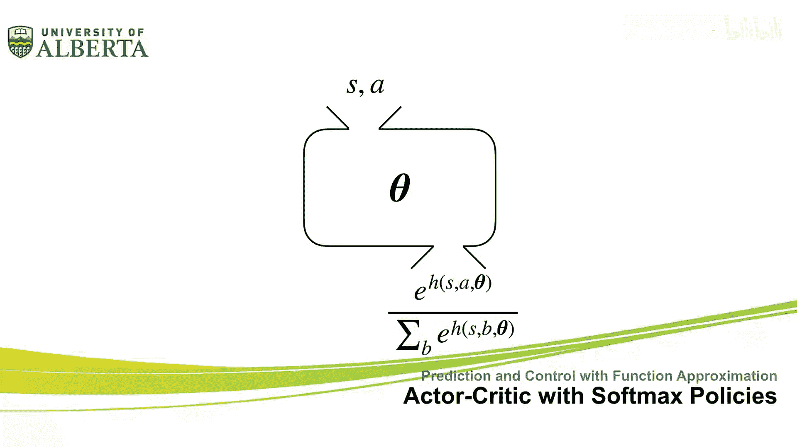
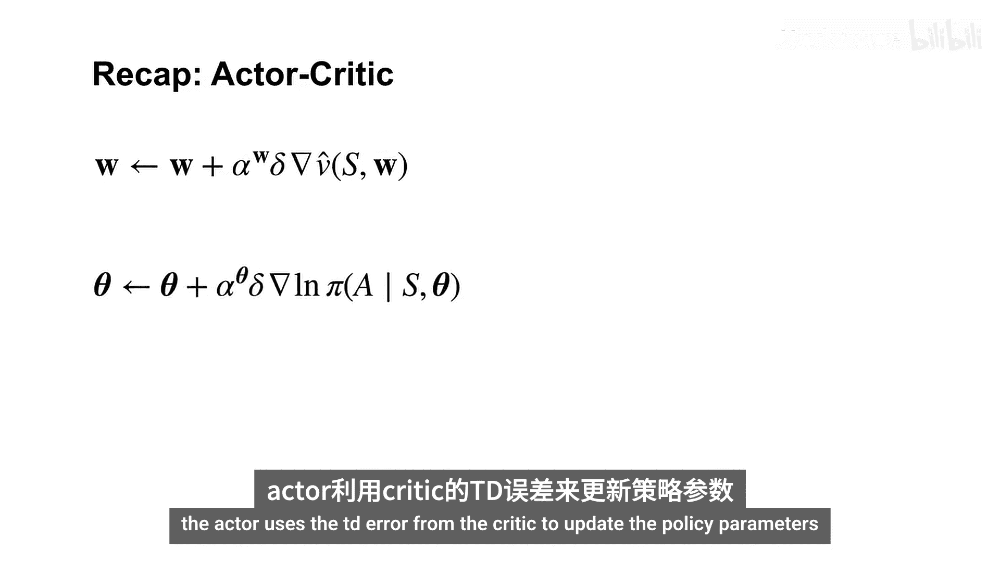
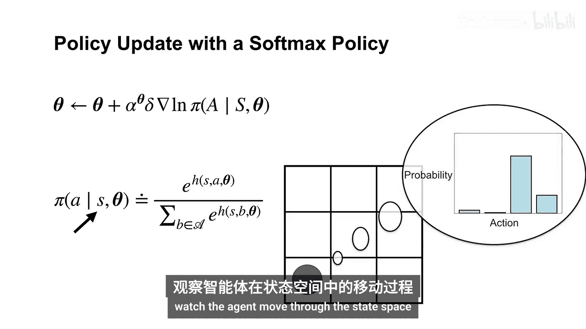
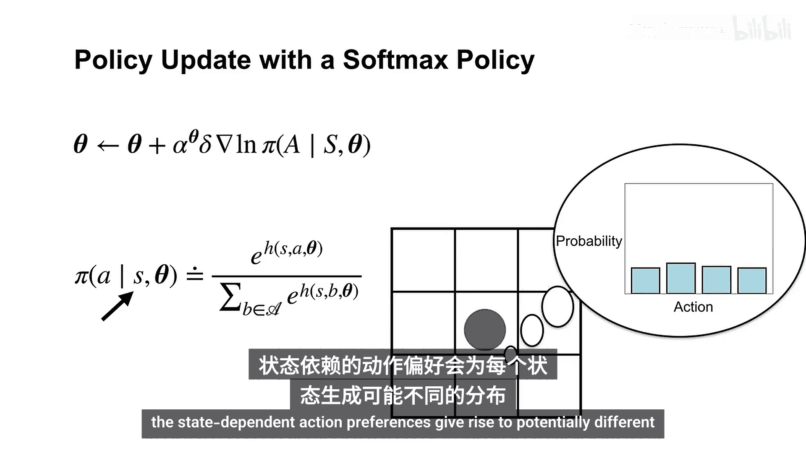
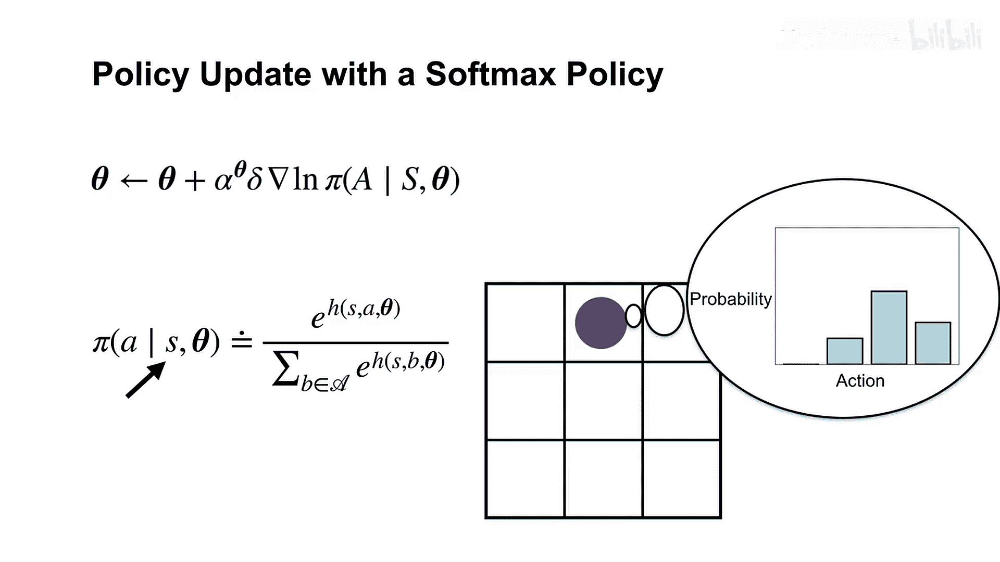
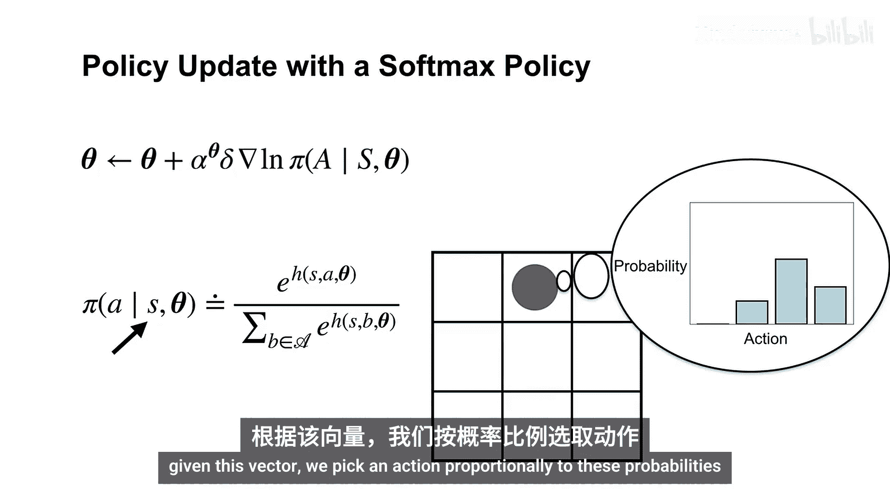
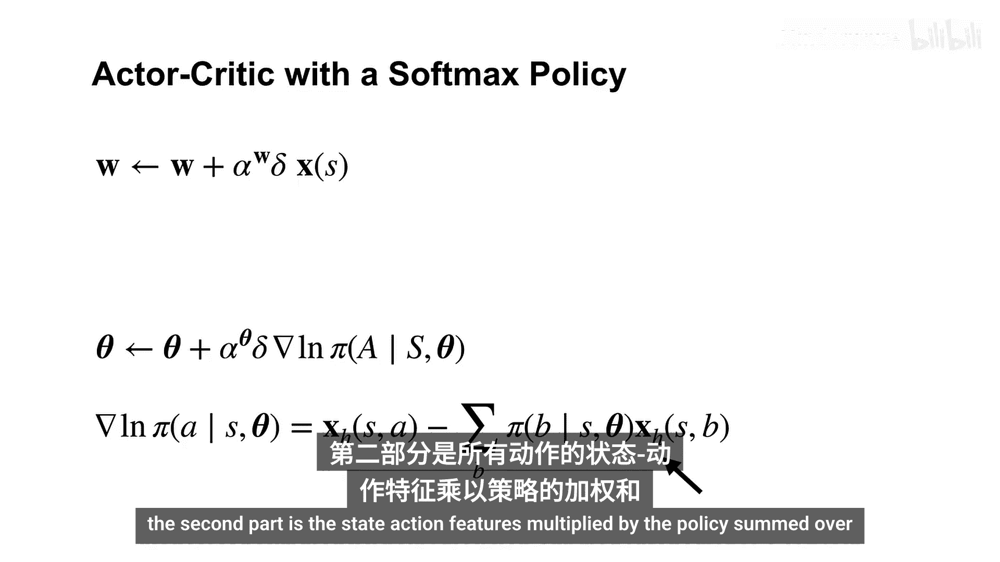

# 040：带有Softmax策略的Actor-Critic



在本节课中，我们将学习Actor-Critic方法的一个具体实现。我们将结合线性函数逼近和Softmax策略参数化，推导出相应的更新规则，并理解如何实现该算法。

## 算法概述

Actor-Critic方法巧妙地融合了直接策略优化、价值函数和时间差分学习。之前讨论的Actor-Critic方法较为通用，并未指定函数逼近或策略参数化的具体形式。本节我们将讨论一个具体的实现：使用线性函数逼近和Softmax策略参数化的Actor-Critic方法。

## 策略参数化：Softmax策略

上一节我们介绍了Actor-Critic算法，该算法结合了策略评估（Critic部分）和策略梯度更新规则（Actor部分）。本节中，我们来看看一个具体的参数化选择。



对于有限动作集和连续状态空间，一个常见的策略参数化选择是之前讨论过的Softmax策略。我们可以使用函数逼近来表示动作偏好。该函数的参数即为策略参数，记作θ，我们的策略梯度学习规则将更新θ。

我们使用Softmax策略，该策略将偏好值取指数后除以总和。这保证了生成的动作概率为正且总和为一。注意，策略被写作当前状态的函数，这类似于为每个状态设置一个不同的Softmax分布。

以下是Softmax策略的公式：

```python
π(a|s) = exp(h(s, a)) / Σ_{b∈A} exp(h(s, b))
```

其中，`h(s, a)` 是状态`s`下动作`a`的偏好值。

## 动作选择过程



智能体在状态空间中移动时，状态相关的动作偏好会导致每个状态可能产生不同的分布。



为了选择一个动作，我们在当前状态下遵循一个简单的过程：查询每个动作的Softmax概率。这会生成一个概率向量，每个动作对应一个条目。给定这个向量，我们按照这些概率的比例选择一个动作。



## 函数逼近与特征设计



现在讨论我们的参数化选择如何影响价值函数、动作偏好以及更新方程。让我们为价值估计和策略使用相同的特征。

记住，Critic更新的是状态价值函数的估计。因此，Critic只需要一个表征当前状态的特征向量。

Actor的动作偏好依赖于状态和动作。因此，我们的动作偏好函数需要一个状态-动作特征向量。我们之前遇到过这个问题，并采用过相同的策略：堆叠状态特征。也就是说，我们为每个动作使用一份状态特征向量的副本。

由于存在三个动作，策略参数向量θ的大小大于Critic使用的权重向量W，具体是W的三倍。

## 更新方程推导

现在，让我们看看在线性Softmax参数化下，Actor和Critic的更新方程。


第一个方程很简单。线性价值函数的梯度就是特征向量本身。因此，Critic的权重更新就是学习率α乘以TD误差δ乘以特征向量。这与之前的半梯度TD方法相同。

Actor对偏好的更新需要更多思考。幸运的是，梯度并不复杂。我们将省略推导过程，直接给出最终结果。梯度由两部分组成：第一部分是所选动作的状态-动作特征；第二部分是所有动作的状态-动作特征乘以策略概率后的总和。

以下是Critic和Actor的更新公式：

**Critic权重更新：**
```
W ← W + α * δ * x(S)
```
其中，`δ = R + γ * v̂(S‘, W) - v̂(S, W)` 是TD误差，`x(S)` 是状态特征向量。

**Actor策略参数更新：**
```
θ ← θ + β * δ * [x(S, A) - Σ_{b∈A} π(b|S) * x(S, b)]
```
其中，`x(S, A)` 是所选动作的状态-动作特征向量，`β` 是Actor的学习率。



## 总结

本节课中，我们一起学习了Actor-Critic方法的一个具体实现。你现在已经掌握了独立实现该算法所需的所有知识。我们讨论了如何为有限动作集使用Softmax策略和线性函数逼近，并推导了Critic和Actor的更新规则。下次我们将尝试运行这个算法模型，看看它的实际效果。