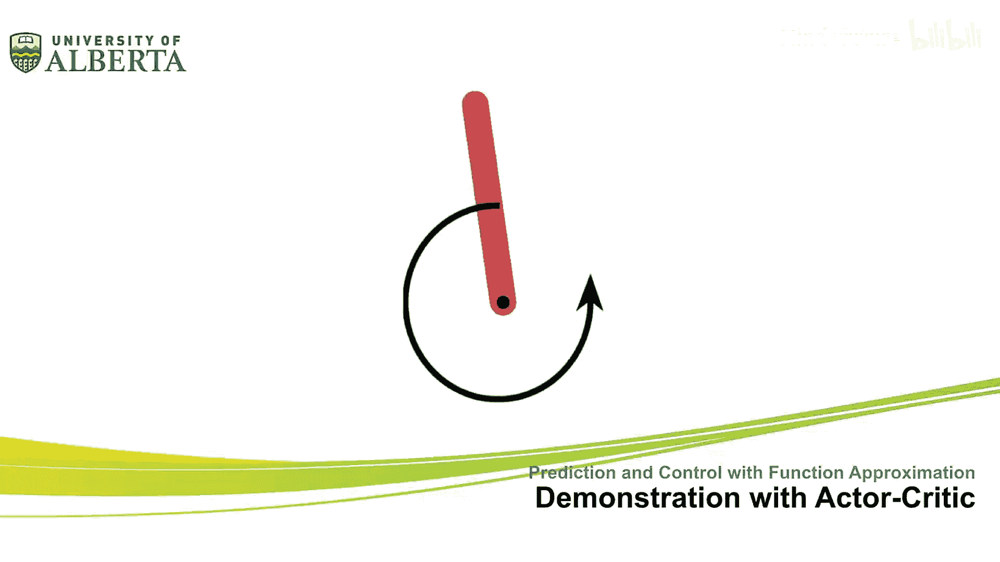
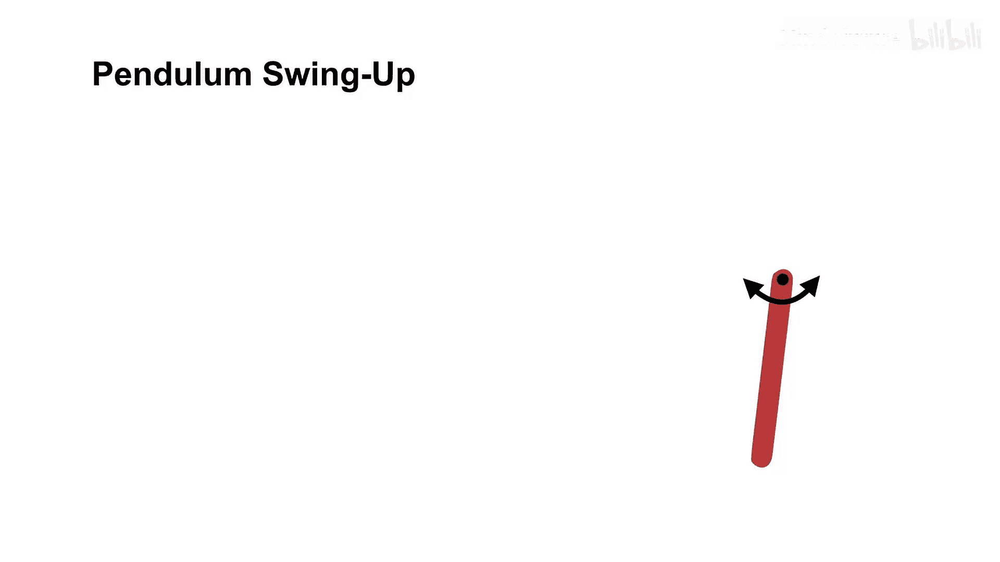
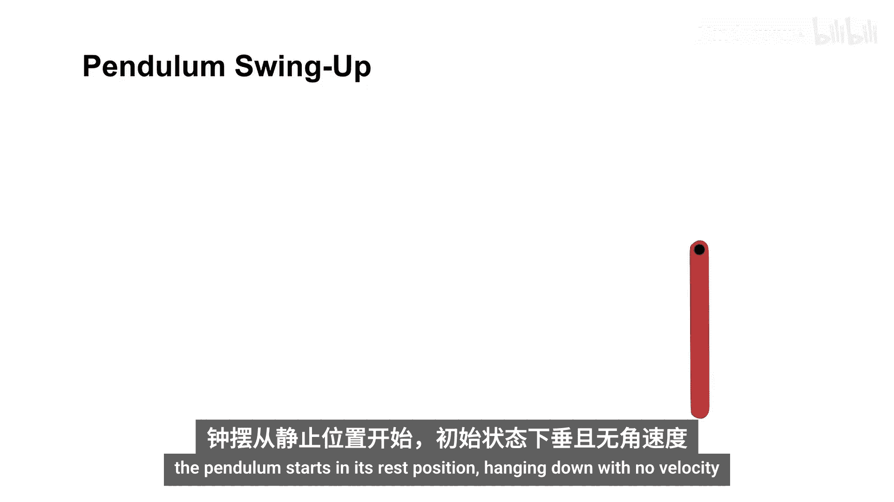
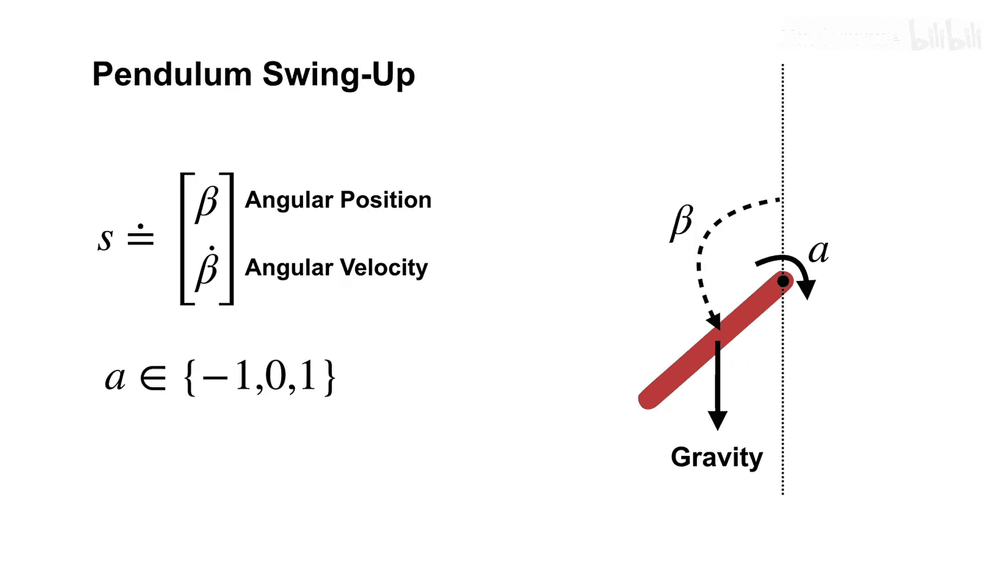
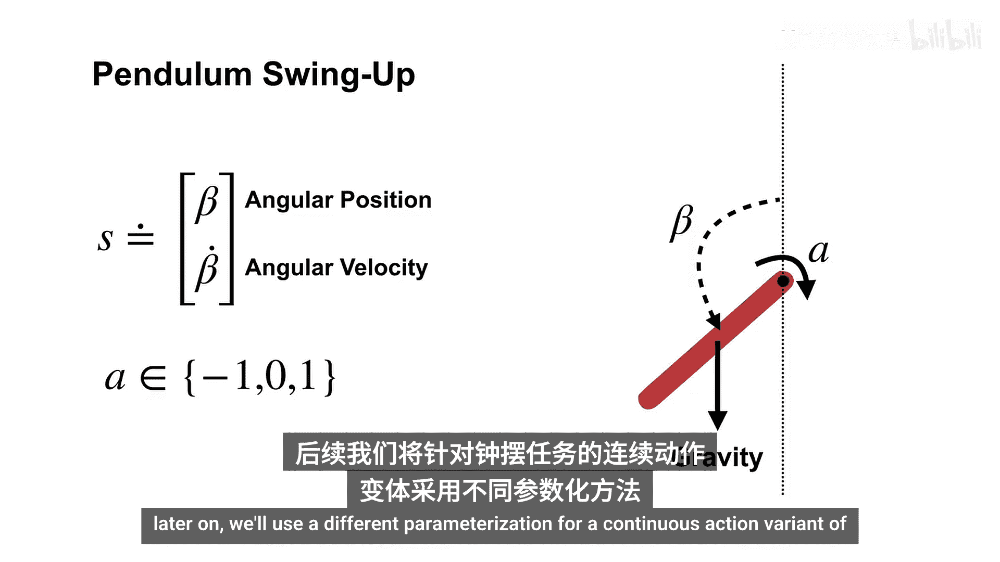
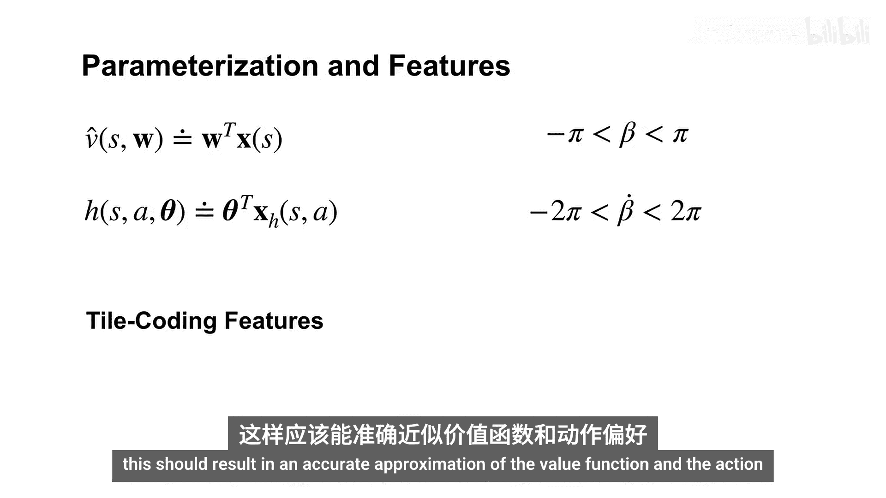
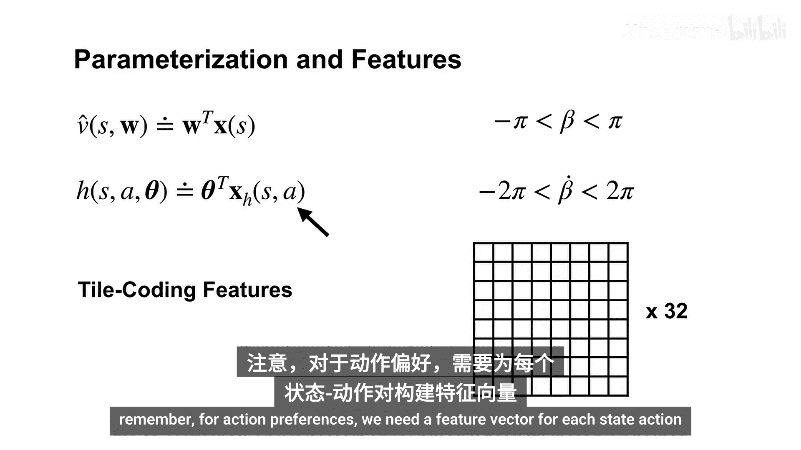
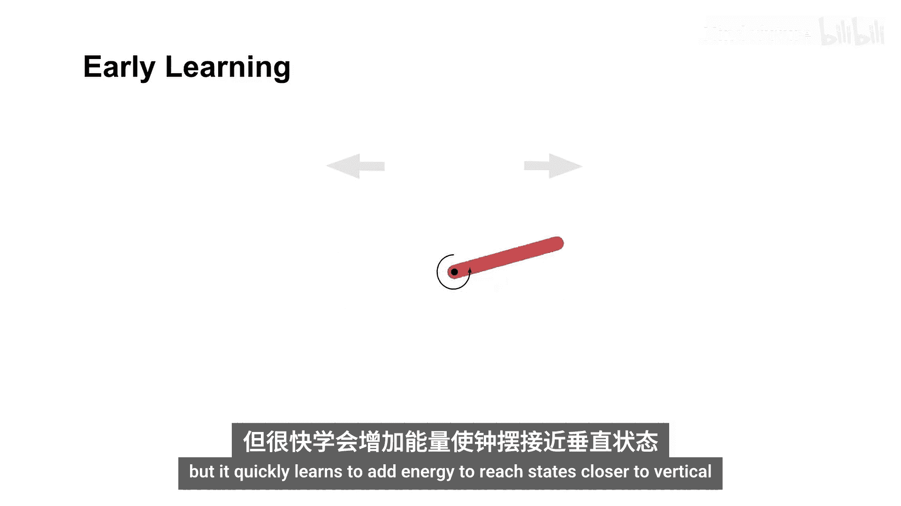
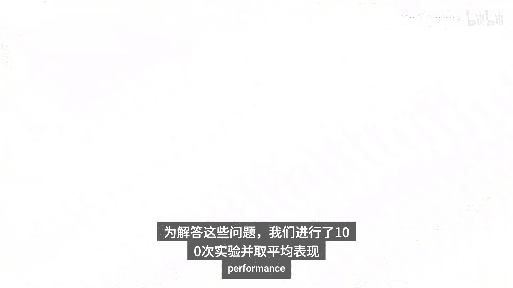
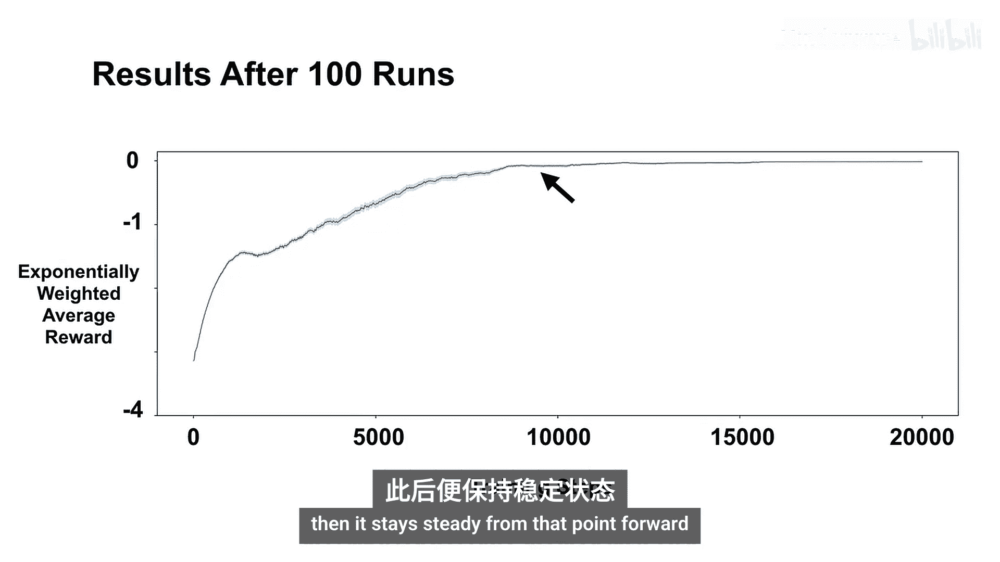

# 041：Actor-Critic算法在钟摆任务中的应用 🎯

在本节课中，我们将学习如何将Actor-Critic算法应用于一个经典的控制任务——钟摆上摆问题。通过本课，你将能够为平均奖励Actor-Critic算法设计函数逼近器，并分析智能体在此任务中的表现。

## 任务介绍：钟摆上摆

今天我们将研究钟摆上摆任务。智能体控制一个钟摆。控制方式很简单：智能体可以在枢轴点（图中黑点所示）施加扭矩。

目标是让钟摆保持直立平衡。钟摆从静止位置开始，即垂直向下且没有角速度。

钟摆可以自由移动，仅受重力和智能体施加的动作影响。

钟摆的状态由摆杆的角度和角速度组成。两者都是实数值。我们的模拟只有三个离散动作：施加恒定的顺时针角加速度、逆时针角加速度或不施加角加速度。

我们为此任务使用Softmax策略，因为动作空间是离散的。

稍后，我们将为钟摆任务的连续动作变体使用不同的参数化方法。

## 定义奖励函数

下一步是确定奖励函数。目标是让钟摆直接指向正上方并保持该状态。因此，奖励等于与垂直方向夹角的负绝对值。

如果钟摆达到较大的角速度，则可能损坏系统，这是不好的。为了避免这种情况，我们将角速度的范围限制在负2π到正2π之间。如果超过此限制，则将钟摆重置到静止位置。

目标是始终让钟摆尽可能接近直立状态。这个过程无限期持续，没有片段或终止。因此，将其表述为一个持续性任务是合理的。

钟摆任务之所以有趣，有几个原因：动作的强度不足以将钟摆直接从静止位置移动到垂直位置。一个好的策略必须施加使钟摆远离期望位置的动作，以获得足够的动量向上摆动。最后，垂直位置是不稳定的，因此一个好的策略必须持续平衡摆杆。

## 应用Actor-Critic算法

现在，让我们将Softmax Actor-Critic算法应用到钟摆任务的模拟版本中。在此之前，我们必须设计函数逼近器和策略参数化方法。

钟摆任务的状态维度较低，只有角度和角速度。这个二维问题非常适合使用瓦片编码。近似价值函数和动作偏好将是瓦片编码特征的线性函数，但在状态变量上是非线性的。

设置瓦片编码的第一步是确定每个状态变量的范围。对于角位置来说这很容易，它只需要在π和负π之间。角速度将位于2π和负2π之间，这是由于我们之前讨论的约束。

通常，使用较大的瓦片和较多的瓦片层是好的：宽泛的瓦片能够实现相当大的泛化，从而实现快速的早期学习；而许多瓦片层有助于区分。这应该能产生对价值函数和动作偏好的准确近似。

我们使用32层瓦片，每层大小为8x8。请记住，对于动作偏好，我们需要每个状态-动作对的特征向量。

和之前一样，我们只需为每个动作使用状态特征的独立副本。

关于平均奖励、Actor和Critic的步长参数呢？参数相当多，每个都对性能有很大影响。我们进行了系统性的参数扫描，为每个参数确定了良好的设置。这符合我们的一般节奏：我们希望Critic以更快的速度更新。这样，Critic可以准确地评判变化较慢的策略。

为了在此任务上获得良好性能，还需要一些其他细节。由于时间关系，我们将跳过这些，但别担心，你将在评估中学习到所有这些实现细节。

## 观察智能体学习过程

让我们看一段视频，观察智能体最初如何与钟摆环境交互。智能体开始时随机行动，但很快学会增加能量以达到更接近垂直的状态。

让我们快进一点，最终的行为看起来是这样的。我们添加了随机扰动来展示学习策略的鲁棒性。这就像偶尔用手指轻弹钟摆。扰动仅在智能体学习到良好的平衡策略后才引入。视频中用黑色箭头显示了这些扰动，我们可以看到训练有素的智能体如何能够平稳恢复，并对这些轻弹具有鲁棒性。

## 性能评估与分析

观看我们编程的智能体掌握钟摆问题确实令人满意，但我们也必须是持怀疑态度的科学家。这只是一个演示，智能体是否每次都成功学会平衡，还是我们只是运气好？它学习的速度和鲁棒性如何？为了回答这些问题，我们进行了100次实验并平均了性能。

为了衡量智能体的性能，我们绘制了所有时间步上奖励的指数加权平均值。误差线显示了均值的标准误差。误差线非常小，事实上，小到几乎看不见，因此我们相当有信心，这个图准确地反映了我们智能体在所选参数下在此任务上的平均表现。

平均奖励开始时很低，但一开始就迅速增加。经过短暂时间后，改进速度放缓，但随着智能体继续优化其策略，改进仍在继续。性能在接近零时达到峰值，这意味着智能体通常能够平衡钟摆直立，仅有微小偏差。然后，性能从那时起保持稳定。

## 总结

本节课到此结束。我们介绍了一个Actor-Critic学习系统的具体实现，并在一个经典控制任务上进行了测试。我们看到了如何为平均奖励Actor-Critic算法设计函数逼近器，并分析了智能体在钟摆上摆任务中的表现。结果表明，该算法能够稳健地学习到一个有效的平衡策略。