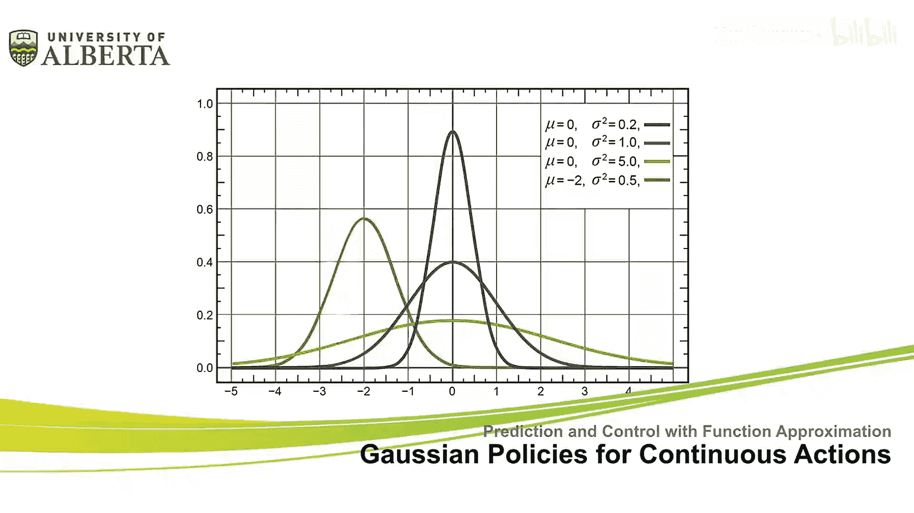
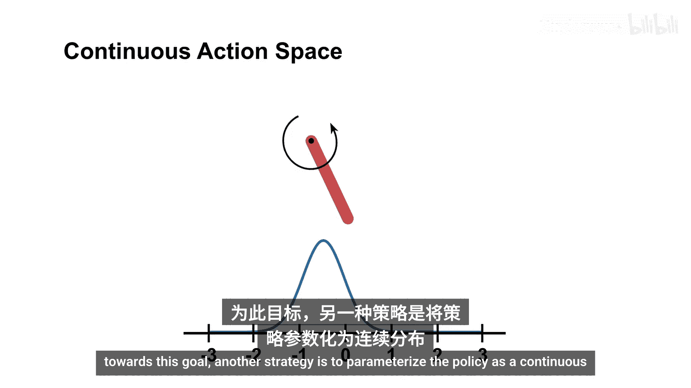
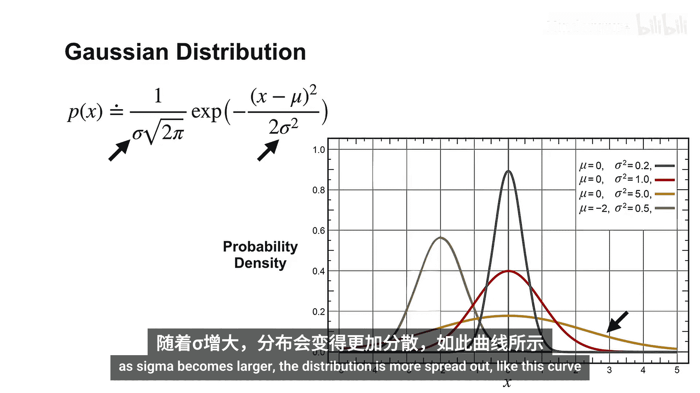
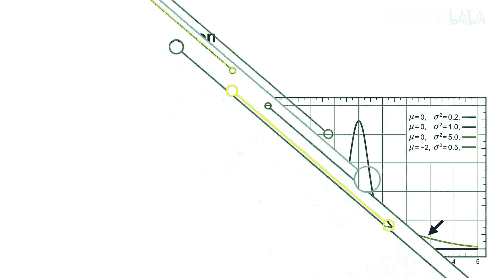
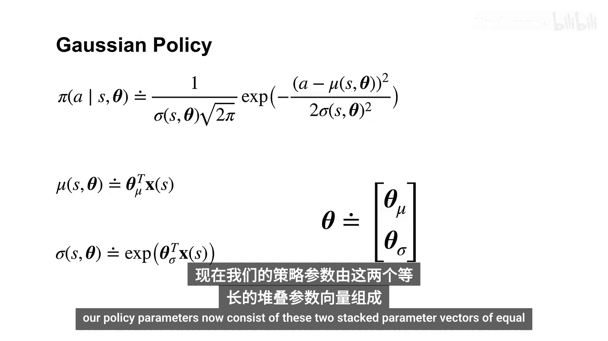
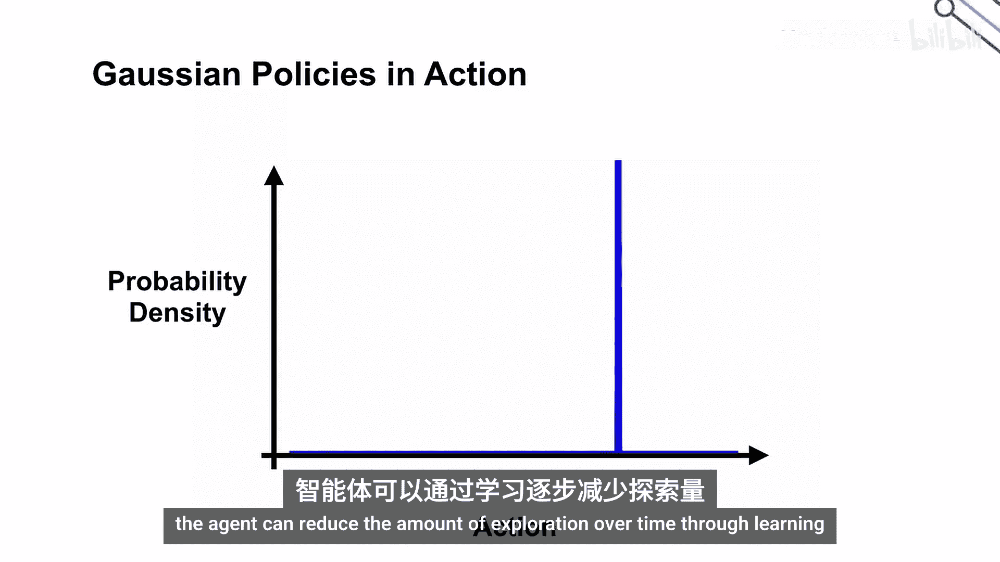
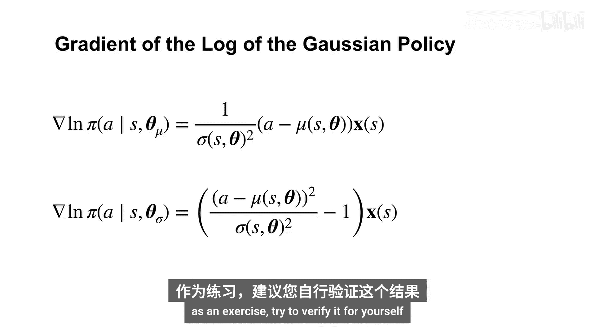
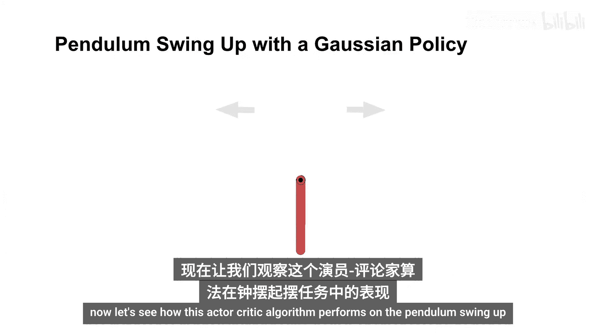
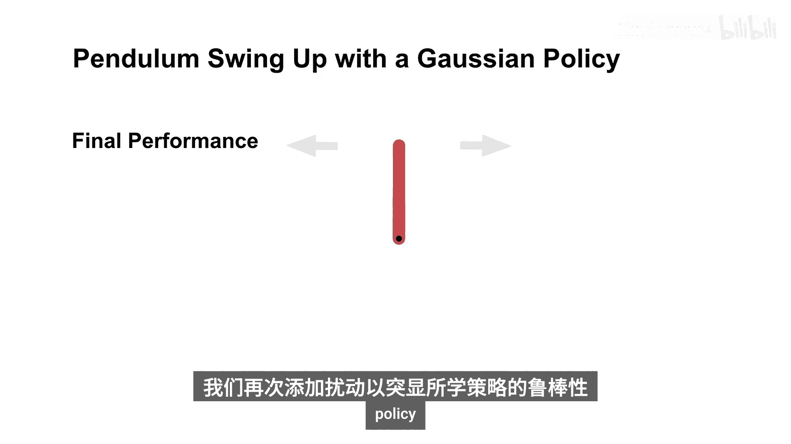

# 042：用于连续动作的高斯策略

在本节课中，我们将学习如何将基于策略的方法应用于具有连续动作空间的问题。我们将重点介绍一种使用高斯分布来参数化策略的方法，并推导出相应的Actor-Critic更新规则。最后，我们将看到这种方法在一个简单环境中的应用效果。

## 连续动作空间的挑战

上一节我们介绍了基于策略的方法。基于策略方法的一个优点是，它们为我们处理非常大甚至连续的动作空间提供了一种自然的方式。我们不必使用为每个动作单独分配概率的策略参数化方法。相反，我们可以学习某个动作分布上的参数。在本节中，我们将讨论如何学习一个依赖于状态的、针对连续动作的高斯分布。

在本节结束时，你将能够推导出高斯策略的Actor-Critic更新规则，并将带有高斯策略的平均奖励Actor-Critic方法应用于一个具有连续动作的任务。

让我们来看一下上次探讨过的同一个钟摆摆动任务。

状态空间和奖励函数完全相同。这一次，我们将为动作空间使用一个连续区间，而不仅仅是三个离散的角加速度级别。

角加速度可以在负3到正3之间的任何位置，这是最小值和最大值。我们无法为每个动作单独分配概率，因为可能的动作空间是无限的。

一种解决方案是将动作限制在整个可能范围内的一个离散子集上，这就是我们之前所做的。在那种情况下，我们通过选择一组足够温和、允许精细控制的动作来做出妥协。但这也会抑制智能体施加更大加速度的能力。我们实际上希望智能体能够在适当的时候施加较大的加速度，并使用较小的加速度来调整平衡。

## 高斯策略参数化

为了实现这个目标，另一种策略是将策略参数化为一个连续分布，例如高斯分布。

高斯随机变量X具有此处所示的概率密度函数。以下是具有不同均值和方差的该PDF的几个示例。请注意，在这种情况下，Y轴表示的是密度，而不是概率。

概率密度意味着，对于给定的范围，x位于该范围内的概率将是概率密度曲线下的面积。

参数μ控制分布的均值。如果μ为0，分布将围绕零中心。对于这条曲线，μ是负2，因此分布围绕负2中心。参数σ是标准差，即方差的平方根。如果σ很低，如这条曲线所示，分布将在均值μ周围急剧尖峰。随着σ变大，分布会更加分散，如这条曲线所示，并且x将从更广泛的值域中抽取。

让我们使用一个关于动作的高斯分布来定义我们的策略。我们将参数μ和σ定义为状态的函数，这样智能体可以为不同的状态分配不同的动作分布。

μ(x)可以是任何参数化函数，但为了简单起见，我们将其设为状态特征的线性函数。与μ相关的策略参数用θ_μ表示。

参数化函数σ有一个约束：它必须是正数。为了强制执行这一点，我们将将其参数化为一个线性函数的指数。与σ相关的策略参数用θ_σ表示。

我们的策略参数现在由这两个大小相等的堆叠参数向量组成。

我们已经定义了高斯策略。请记住，策略的主要目的是为我们提供一种选择动作的方式。要使用此策略选择动作，我们从高斯分布中采样。许多编程库都包含从高斯分布采样的函数，因此我们在这里不担心这一点。过程很简单：在某个状态下，我们从该状态计算μ和σ。然后我们使用该μ和σ调用高斯随机数生成器。

在一个状态下，μ和σ可能看起来像这样。对于这个状态，很可能会采样到广泛范围的动作。这是一个在此状态下可能被采样的动作。

在另一个状态下，μ和σ可能看起来像这样。对于这个状态，只有很窄范围的动作可能被采样。这是一个在此状态下可能被采样的动作。

σ本质上控制着探索的程度。我们通常将方差初始化为较大值，以便在早期尝试广泛的动作。随着学习的进行，我们期望方差会缩小，策略会集中在每个状态下的最佳动作周围。像许多参数化策略一样，智能体可以通过学习随着时间的推移减少探索量。

## Actor-Critic更新规则

尽管我们现在有连续动作而不是离散动作，但我们可以使用相同的Actor-Critic架构。算法实际上非常相似，主要区别在于策略的梯度不同，因为参数化不同。在底层，目标函数看起来也略有不同，因为我们对动作进行积分而不是求和。但采样和梯度最终是相同的。因此，我们所要做的就是计算出策略的自然对数的梯度。

我们将跳过这里的步骤，但结果如幻灯片所示。作为练习，请尝试自己验证它。

## 连续动作的优势

现在我们有了连续动作的更新规则，但我们为什么要做所有这些呢？考虑到我们之前使用的离散动作在这个问题上似乎效果不错。

最明显的原因是，为问题选择一个离散的动作集可能并不简单。例如，想象一个训练机器人打高尔夫球。精确推杆需要相当高的精度。我们可以尝试选择一组离散的力施加到球杆上，并希望它足够好，但不可避免地会出现它不够用的情况。根据距离和地形，我们可能需要使用全部的力范围。

连续动作还允许我们在动作上进行泛化。例如，高斯策略平滑地将概率密度分配给附近的动作。想象一下，发现一个动作很好，更新增加了该动作的密度。附近动作的密度也会增加，智能体会泛化认为这些动作可能也很好。

最后，即使真实的动作集是离散的但非常大，将其视为连续范围可能更好。这提供了一种自然的方式来对它们进行泛化，并避免了独立探索每个动作的昂贵过程。

现在让我们看看这个Actor-Critic算法在钟摆摆动任务上的表现。

我们再次扫描了许多步长值。我们为θ_μ和θ_σ使用了单独的步长。

这里我们可视化了早期学习阶段的策略。它看起来与我们使用离散动作集时没有太大不同。它很快学会了来回摆动钟摆。枢轴周围误差的大小表示在给定时间施加的角加速度的大小。

这里我们可视化了学习结束时的策略。它正在学习一个非常好的平衡策略。这里我们再次添加了扰动，以突出所学策略的鲁棒性。😊

本节课到此结束。你现在应该理解了我们如何将Actor-Critic应用于具有连续动作的问题，并且我们展示了一个如何在简单环境中使用高斯策略参数化来实现这一点的例子。再见。