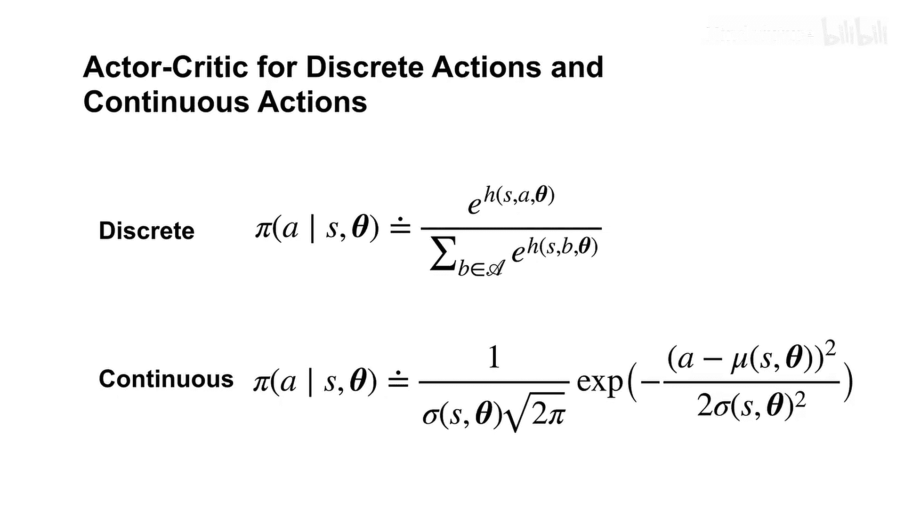

# 043：利用函数逼近进行预测与控制总结 🎯

在本节课中，我们将总结第四周的核心内容：从基于动作价值的方法转向直接学习参数化策略的全新框架。我们将回顾策略参数化的概念、新的优化目标，以及实现此目标的演员-评论家算法。

---

## 策略参数化：从动作价值到策略 🧠

上一节我们介绍了基于函数逼近的预测方法。本节中，我们来看看如何直接对策略本身进行参数化。

我们本周的讨论始于从参数化的动作价值函数转向参数化的策略。参数化策略接收状态-动作对，并输出对应的动作概率。这个函数由一个参数向量 θ 参数化。

一个参数化策略必须是一个有效的概率分布。这意味着每个动作的概率必须大于零，并且在给定状态下所有动作的概率之和必须为 1。

以下是确保参数化策略在离散动作空间中满足这些约束的一种方法：
*   **Softmax策略**：`π(a|s, θ) = exp(h(s, a, θ)) / Σ_b exp(h(s, b, θ))`，其中 `h` 是动作偏好函数。

直接参数化策略具有多个潜在优势。以下是其主要优点：
*   能够在使用随机策略进行早期探索的同时，随时间自主收敛到确定性策略。
*   能够学习随机策略。当最优确定性策略无法用函数逼近器表示时，这非常有用。
*   一个好的策略可能比精确的动作价值函数更容易学习和表示。

---

## 优化目标与策略梯度定理 📈

为了学习参数化策略，我们必须考虑一个新的优化目标以及优化它的新策略。

我们重新审视了平均奖励目标。我们展示了平均奖励可以像这样展开：
`J(θ) = Σ_s μ_π(s) Σ_a π(a|s, θ) * r(s, a)`，其中 `μ_π(s)` 是策略 `π` 下的稳态状态分布。

我们的优化策略是使用随机梯度上升。为此，我们需要一个对平均奖励梯度的估计。这具有挑战性，因为状态分布 `μ` 依赖于策略参数 `θ`。

**策略梯度定理**提供了一个便于优化的平均奖励目标梯度表达式：
`∇J(θ) ∝ Σ_s μ_π(s) Σ_a ∇π(a|s, θ) * q_π(s, a)`

这种形式允许我们通过遵循策略 `π` 从分布 `μ` 中采样状态来估计梯度。

---

## 演员-评论家算法框架 🤝

利用策略梯度定理，我们推导出了演员-评论家算法。

演员-评论家算法同时学习一个参数化策略（演员）和一个对该策略价值函数的估计（评论家）。评论家产生的TD误差反映了演员的表现是优于还是差于评论家的预期。

以下是算法的核心互动：
*   演员被训练为倾向于选择那些表现超过评论家预期的动作。
*   评论家被训练为改进其对演员的价值估计，从而知道对于这个演员应该期望什么价值。

我们演示了演员-评论家算法如何用于离散和连续动作空间。
*   对于离散动作，我们使用了 **Softmax策略参数化**。
*   对于连续动作，我们使用了具有状态依赖均值和方差的**高斯策略**。这使得动作上的高斯策略以状态为条件，其概率密度函数为：
    `π(a|s, θ) = (1 / (σ(s, θ) * √(2π))) * exp(-(a - μ(s, θ))^2 / (2 * σ(s, θ)^2))`

---

## 总结与展望 🏁

本节课中，我们一起学习了如何直接参数化和学习策略。除了之前研究过的动作价值方法，这是你强化学习工具箱中的一个宝贵新工具。

平均奖励演员-评论家算法可以用于与我们之前介绍的差分半梯度Sarsa算法相同的设置。你现在已经掌握了处理离散和连续动作空间的新方法，为解决更复杂的强化学习问题奠定了基础。