# 【阿尔伯塔大学】利用函数逼近进行预测和控制 ｜ Prediction Control Function Approximation p01 P01_课程3-介绍_01_01_01 -BV1GYYWz9E1k_p1-

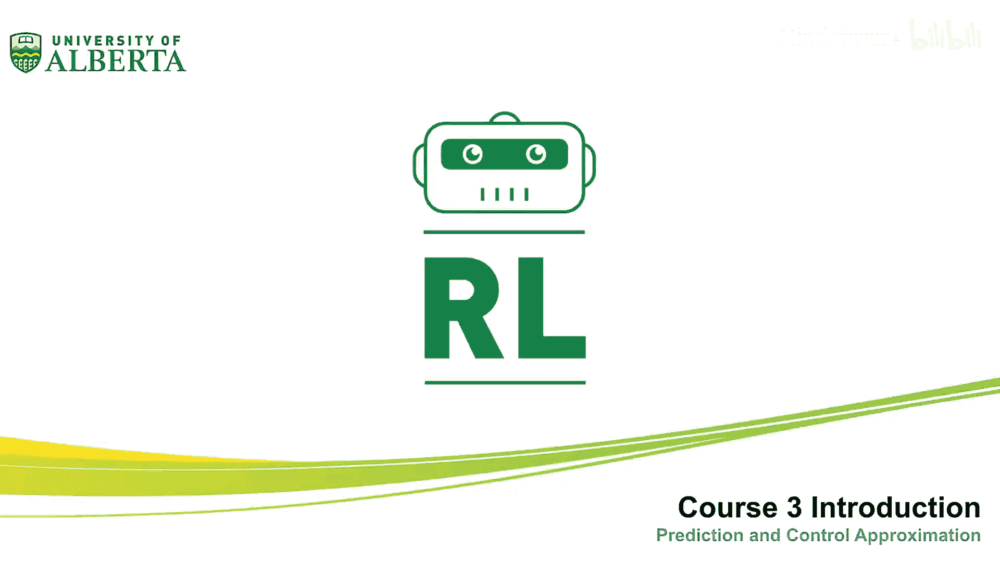

Course3 is really a story of something old and something new Today we begin our journey in reinforcement learning with function approximation in a way this is totally new because we will for the first time discuss objective functions。

 gradient descent， parameterized functions and generalization and discrimination。

But you are totally ready for it， the ideas of exploration， exploitation， value functions， policies。

 and many of the algorithm you've already learned about transfer in a natural way to the function approximation setting。

The beginning of course through represents a significant change in perspective we need to change our focus to learning parameterized functions we will no longer assume we can store the values for all states in a table In fact。

 we can't even guarantee we will see the same state more than once instead we will learn functions parameter by a set of weights like a neural network to approximate the values。

We won't be able to get this approximation perfect。

That means in some states we'll have to be okay with the value function being inaccurate。

 despite this， the move to parameterize value functions is actually overall positive because of generalization。

In fact， this bed reflects how we learn。 you generalize your predictions about how much work you'll have to do in this class based your experience taking other classes。

The concepts will become a bit more technical， we will reason about the distribution of states our agents encounter and how that impacts the accuracy of the value function。

 we will compute the gradientding of objective functions and derive new learning rules。

🎼At this point in specialization， you've learned about many things。

 and now we're going to learn about a bunch of new things。 It's easy to get lost Worse。

 you might lose sight of which algorithms are most relevant for the given task at hand。

To help with this we've developed a course map the idea is that you should be able to start at the top of the tree and work your way down to the algorithm that best fits your problem remember this is a course map。

 it does not include all the algorithms in RL just the ones we have talked about the map is designed to summarize the algorithms in this course it is not necessarily the best way to categorize the broader set of algorithms in RL so use this as a mental model of the course itself。

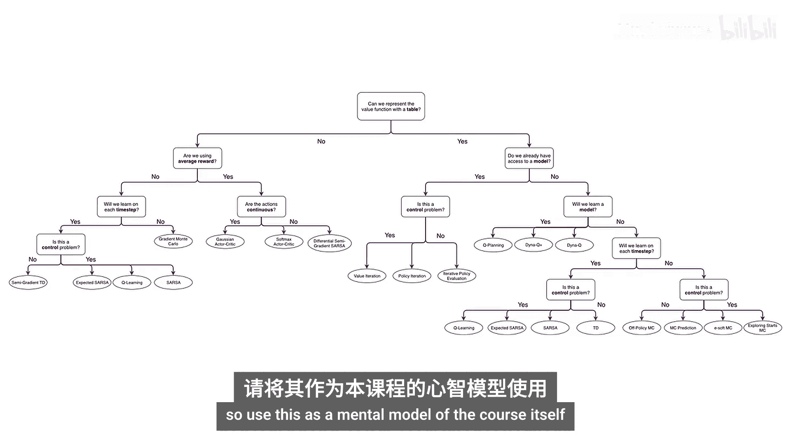

Let's remind ourselves what we've covered in course one and two using the map。

We started by assuming the agent could perfectly represent the values in a table。

 We did this to focus on the fundamental concepts of reinforcement learning without getting bogged down by approximation。

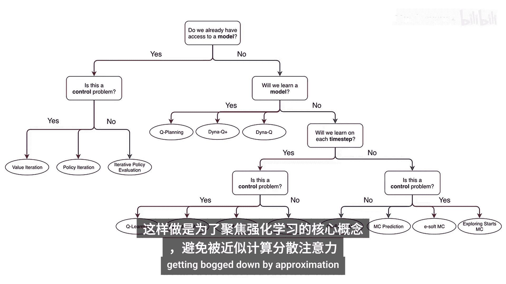

The first RL methods we discussed use a model of the world that was given， not learned。

We use dynamic programming methods to compute value functions and optimal policies from the model without ever interacting with the world。

The branches of this map show all three DP algorithms we discussed。

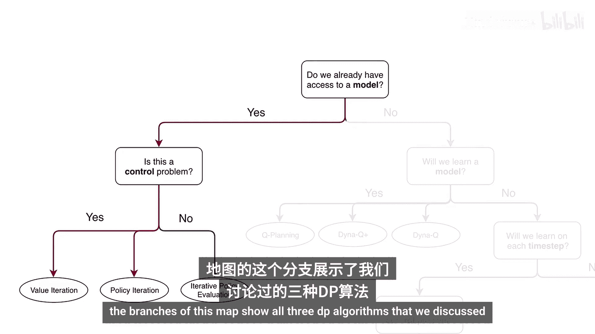

In the next course we covered sample based methods we first talked about Monte Carlo methods。

 which must wait until the end of an episode to make updates we learned about two Monte Carlo methods for prediction and two for control。

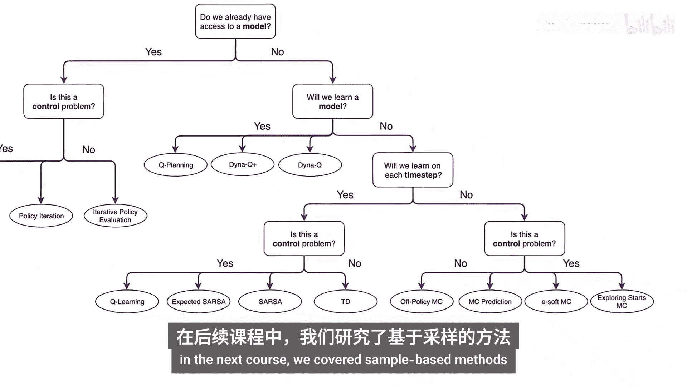

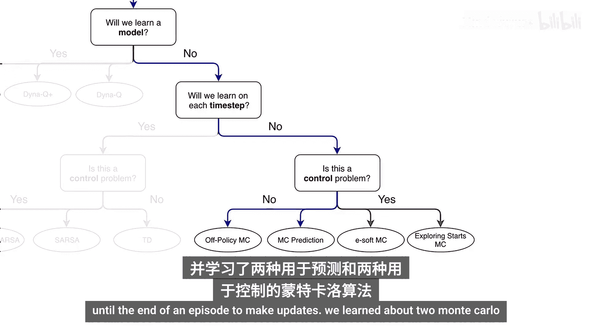

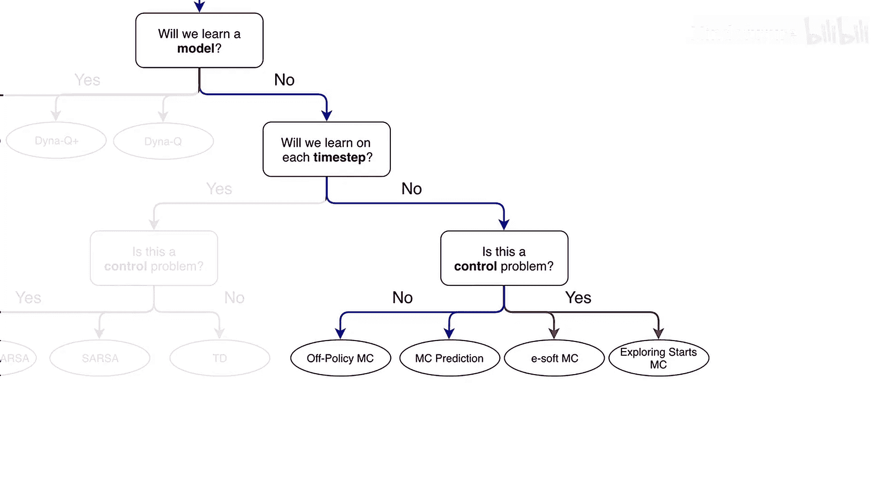

After that， we introduce you to temporal difference learning。

 This family of algorithms allows the agent to make updates to the value function and policy on each step of the episode。

Here we learned about some of the most widely used algorithms from reinforcement learning。

 including Q learning， SARSSA and Exp SARSA。

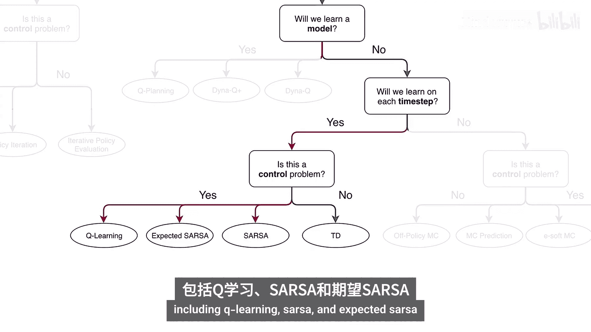

We finished off course two by looping back up to model based planning methods。

 we study the diner architecture in which the agent learns a model while interacting with the world。

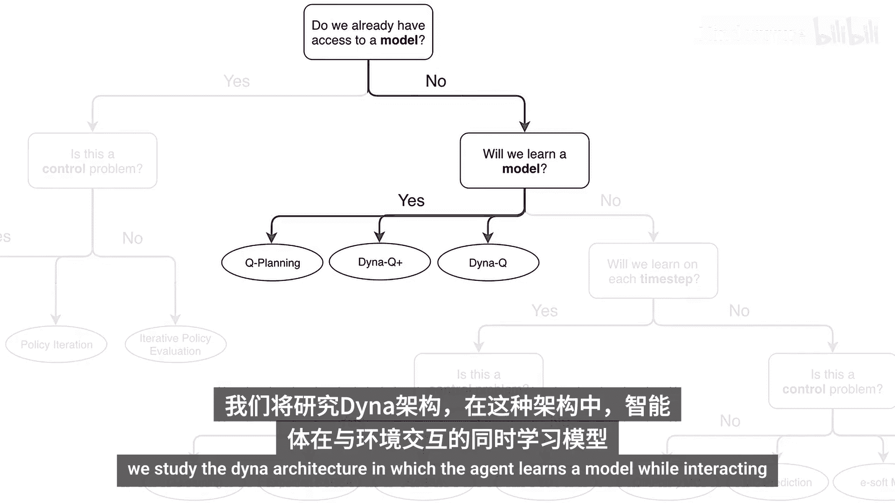

For course3 we only need the right side of this map we will first introduce parameterized functions and how we can use them to approximate value functions we will talk about generalization and discrimination as well as particular function approximators。

 including course coding and neural networks As before well start with prediction and derive new Monte Carlo and T algorithms using ideas from supervised learning and graining descent。

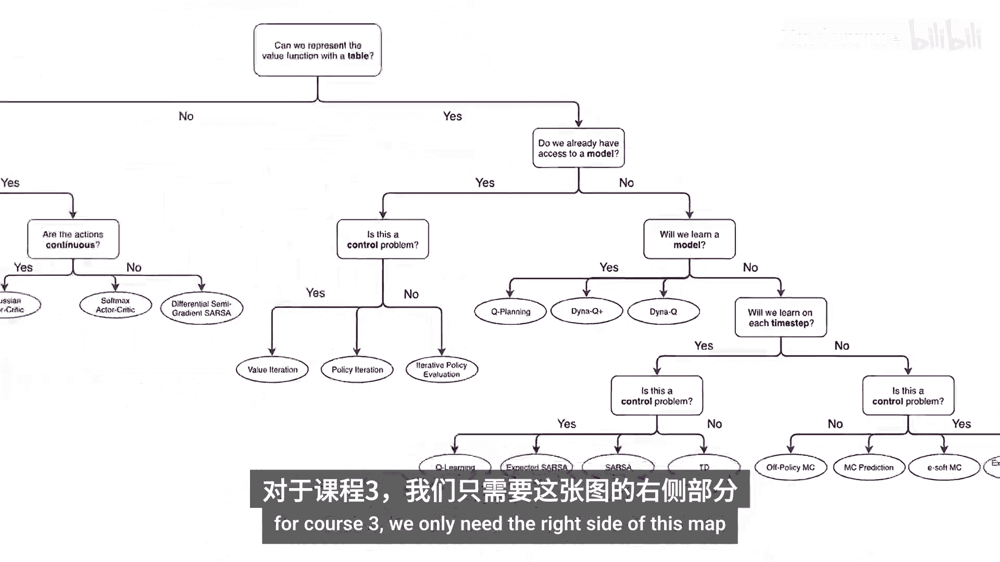

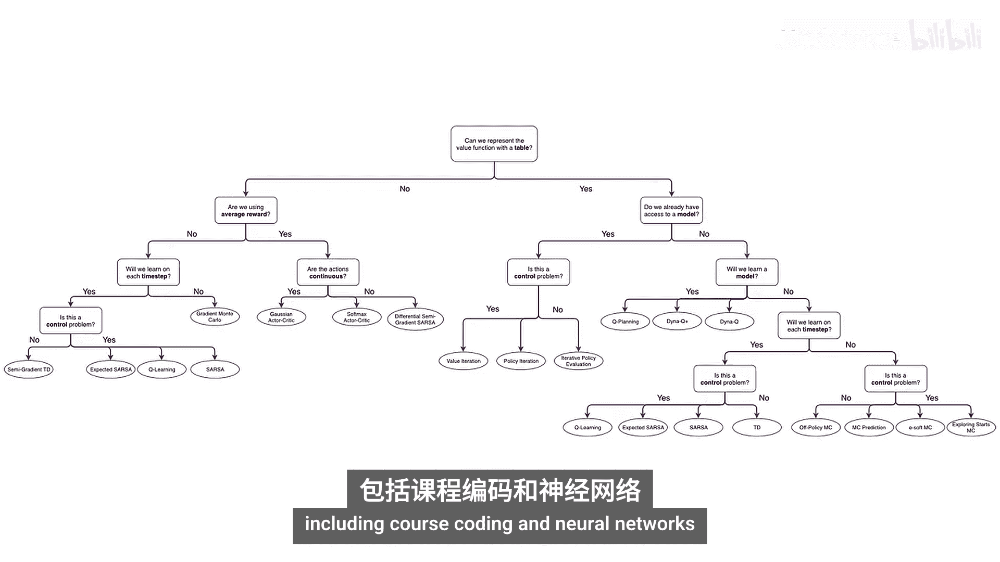

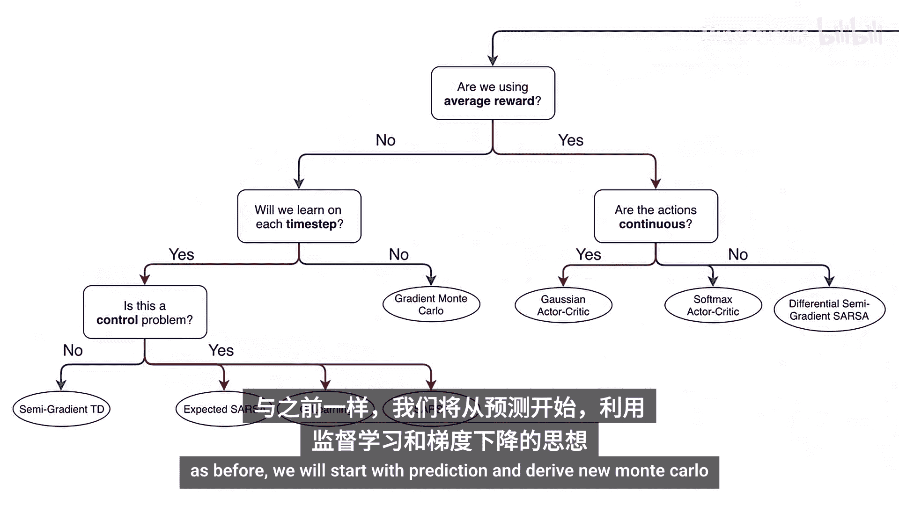

And then we will talk about control algorithms for function approximation。

 This includes expected SArsRSA and Q learning。

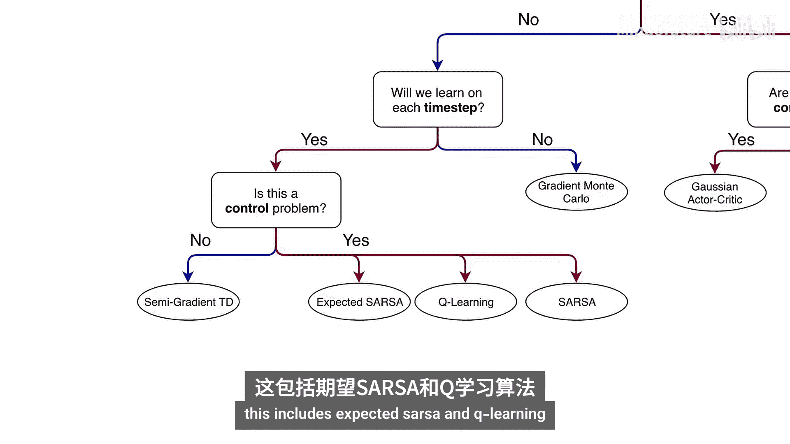

After that， we will totally blow your mind with a new way of formting continuing control problems called average reward。

We will finish off course3 with parameter policies in a nutshell。

 we can parameterize policies just like we parameter the value function。

 we will discuss how to do this in the average reward setting。

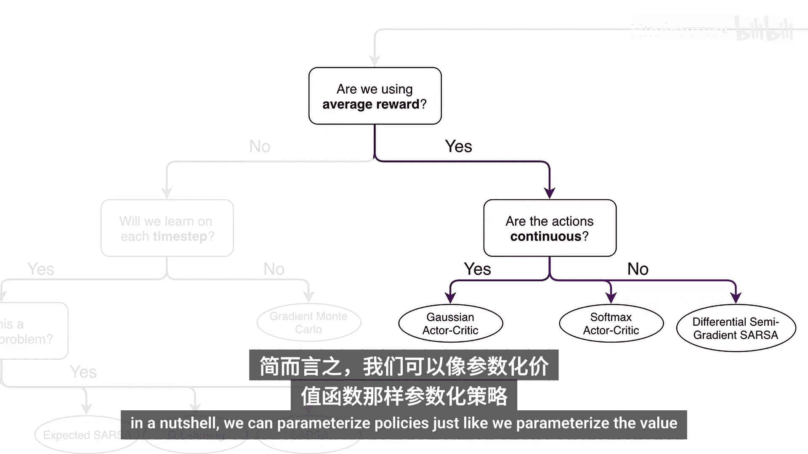

By the end of this course you will know much of what you need to scale RL to real problems。

 you'll then get to use all this newfound understanding to implement a complete RL system in Cose 4。

 so let's get to it。

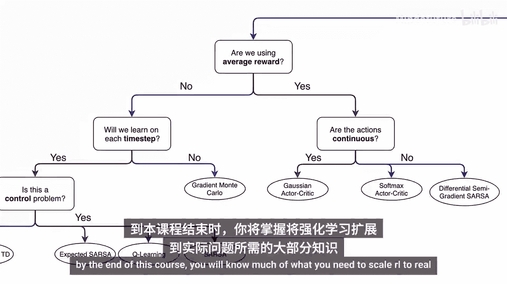

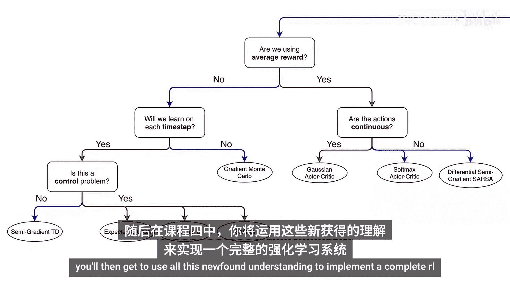

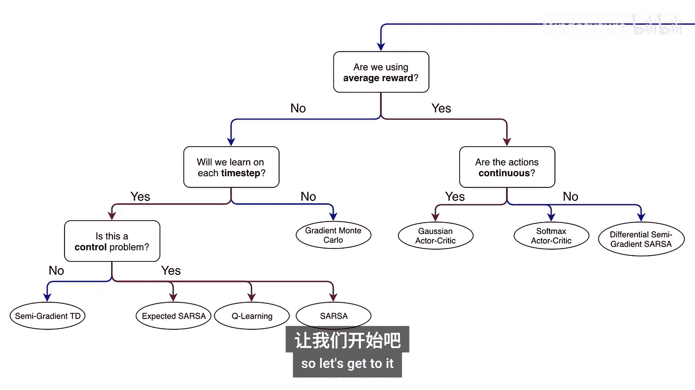