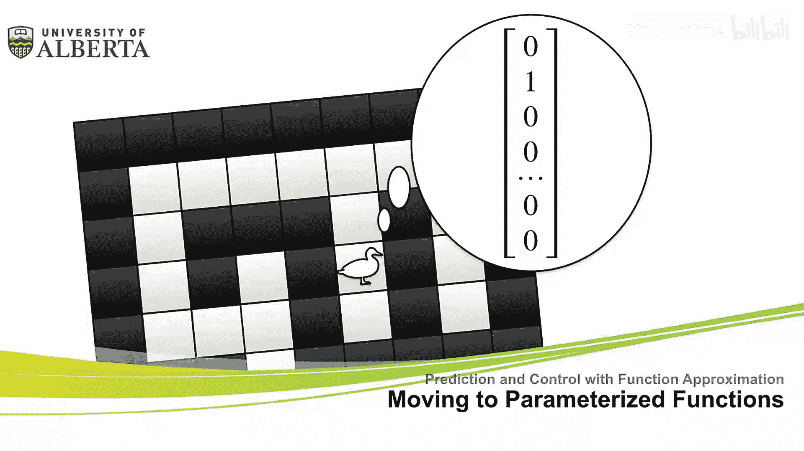
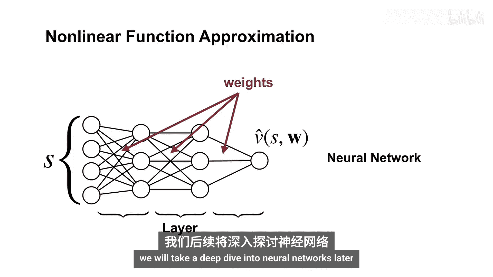

# 【阿尔伯塔大学】利用函数逼近进行预测和控制 ｜ Prediction Control Function Approximation p03 P03_转移到参数化函数_02_01_03 -BV1GYYWz9E1k_p3-

Up until now， we've learned about tabular methods， methods to store a table containing separately learned values for each possible state。

In real world problems， these tables will become inively large。

Imagine a robot that sees the world through a camera。

We clearly cannot store a table entry for every possible image。Luckily。

 this is not the only possibility。Today we'll talk about more general ways to approximate value functions。

By the end of this video， you will be able to understand how we can use parameterized functions to approximate values。

Explain linear function approximation。Recognize that the tabular case is a special case of linear value function approximation。

And understand that there are many ways to parameter an approximate value function。

In previous courses， we spent a lot of time thinking about how to estimate value functions。So far。

 our value approximations have always had the same form。For each state。

 we store a separate value in a table。We look up values and modify them in the table as learning progresses。

But this is not the only way to approximate a value function。In principle。

 we can use any function that takes a state and produces a real number。For example。

 in a grid like this， our value function approximation could take the x and y position and add them together to produce a value estimate。

This was just to get your intuitions going。 We wouldn't want to use this as a value function because we can't modify the approximation。

So we have no way to do learning。This is where the idea of a parameterized function comes in。

We incorporate a set of real valued weight， which we can adjust to change the function。For example。

 in this grid， instead of using a fixed sum of x and Y。

We could use a function of the form W1 times x plus w2 times y。

The weights W 1 and W2 parameterize our function。 They allow us to change the output the function generates。

To indicate that this function approximates the true value function。We use the notation V hat。

W is a vector containing all the weights that parameterize the approximation。

We do not have to store a whole table of values。We only have to store two weights to represent our value function approximation。

 You can imagine how this kind of compact representation is useful for large state spaces。

With a tabular representation， modifying the value estimates for one state leaves the others unchanged。

This is no longer the case with a parameterized function。

Watch what happens to the value estimates of each state as we change the way W1。

If we change either W1 or W2， we will change the value estimate for every state。

Now our learning items will modify the weights instead of the individual state values。

The example we just discussed is a special case called linear value function approximation。

In this case， the value of each state is represented by a linear function of the weights。

This simply means that the value of each state is computed as a sum of the weights multiplied by some fixed attributes of the state called features。

We can express this compactly。We write that the approximate value is given by the inner product of this feature vector and the weight vector。

We will use bold x of S to denote the feature vector。

Our choice of feature impacts the kinds of value functions we can represent。For example。

 consider the approximation we've discussed so far。With it。

 we can only represent value functions which changed linearly as a function of the features X and Y。

Consider the case where the true value function is given by the numbers on this grid。

We cannot represent this as a linear function of X and Y。To get these outer values correct。

 W1 and W2 both need to be 0。However， that would mean these inner values are not correct because at least one of W1 and W2 must be non zeroro for the sum that equal 5。

But we don't have to use X and Y as features。Linear function approximation relies on having good features。

Here， X and Y are not good features for this problem。But as you'll see later。

 there are many powerful methods to construct features。

Linear function approximation is actually very general。 In fact。

 even a tab of the representation is a special case of linear function approximation。

To build a linear value function to represent this tabular value function。

 we need to define the features。Let's choose our features to be indicator functions for particular states。

For state SI。Feature I is1， and the remaining features are 0。We have 16 features， one for each state。

Let's compute the approximatex values for a state with these features。

Since all the features are zero， except for one of them。

 the inner product is equal to the single weight associated with that state。

Since every state's value is represented by a separate weight。

 this is equivalent to a tabular value function。These parameter values are general。

 and we can consider lots of different types of functions。

Neurural networks are an example of a nonlinear function of state。

 The output of the network is our approximate value for a given state。

The state is passed to the network as the input。All the connections in the network correspond to real valued weights。

When data is passed through a connection， the weight is multiplied by its input。

 This process transforms the input state through a sequence of layers to finally produce the value estimate。

 We will take a deep dive into neural networks later。

う。That's it for this video， you should now be comfortable with the idea of parameterized functions and how they might be used to approximate value functions。

In the coming weeks， we will discuss how to update these approximate value functions while the agent interacts with the world。

