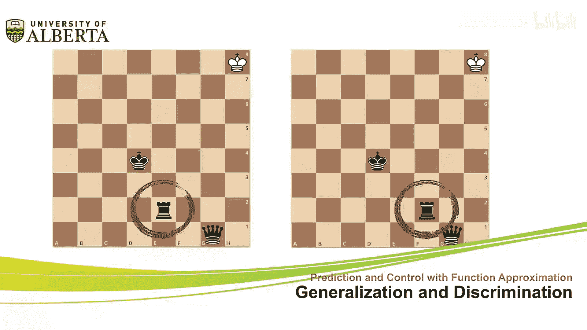
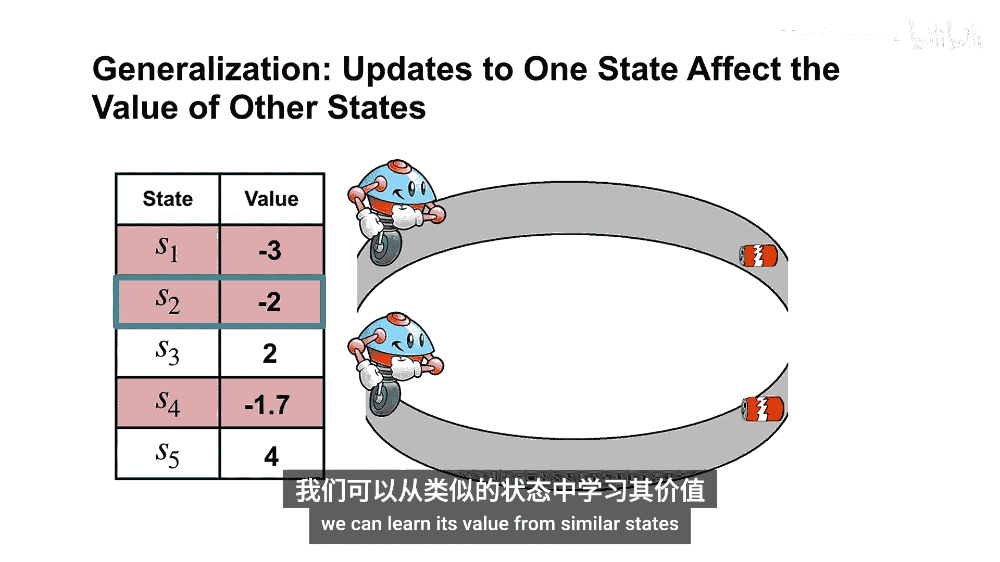
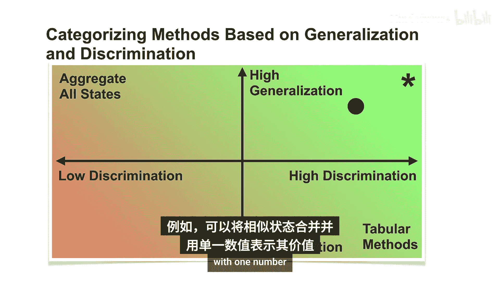
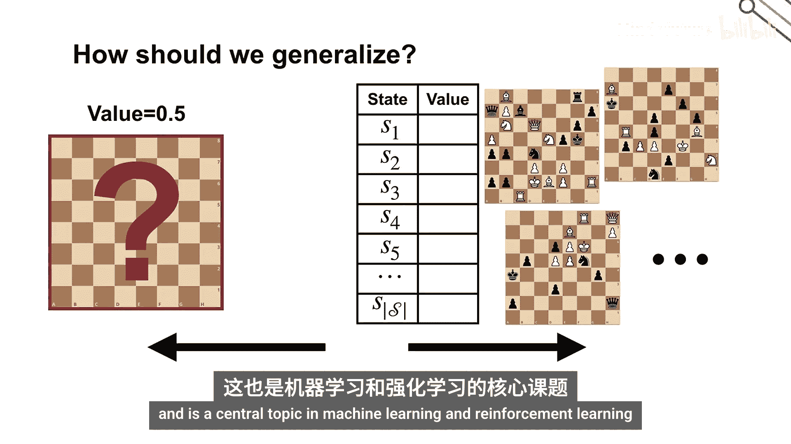

# 【阿尔伯塔大学】利用函数逼近进行预测和控制 ｜ Prediction Control Function Approximation p04 P04_泛化和区分_02_01_04 -BV1GYYWz9E1k_p4-

Perhaps the most important consideration in function approximation is how it generalizes between states。

Journalization is something that humans do naturally。Once a person learns how to drive one car。

 they don't have to start from scratch to learn how to drive a different car。

They also don't have to start from scratch on a different street or when it is raining。

We'd like our agents to be able to generalize too。By the end of this video。

 you will be able to understand what is meant by generalization and discrimination。

Understand how generalization can be beneficial。And explain what we want both generalization and discrimination from our function approximation。

Journalization intuitively means applying knowledge about specific situations to draw conclusions about a wider variety of situations。

When we talk about generalization in the context of policy evaluation。

 we mean that updates to the value estimate of one state influence the value of other states。

Imagine a robot task with collecting cans， observing the world through a set of distant sensors in many locations。

 it would take the same amount of time to drive to the nearest can。

Even though they correspond to different sensor readings， these locations have similar values。

 thus we might want the value function to generalize across those states。

Generalization can speed learning by making better use of the experience we have。

We may not have to visit every state as much to get its values correct if we can learn its value from similar states。

On the other hand， discrimination means the ability to make the values for two states different。

 to distinguish between the values for these two states。

Going back to the example of a robot collecting cans。

Imagine it is in a state where a can is3 feet away， but behind a wall。

Contrast this to a state where a can is3 feet away， but with a clear path to reach it。

The robot would want to assign different values to these states。

So while it is useful to generalize between states with similar distance to the nearest can。

 it is also important that we discriminate between states based on other information when it is likely to impact their value。

We can visualize the space of possible methods in terms of a two dimensional plot of generalization and discrimination。

The tabular methods we've discussed so far lie down here。

They discriminate between different states perfectly， but do not generalize the learn values at all。

Each value is represented independently。On the other extreme， we could treat all states as the same。

Each update generalizes to all states but cannot discriminate at all。At best。

 we will be able to learn the average return independent of the current state。

 this is not very useful。What we would really like is a learning method that achieves good generalization and good discrimination。

Such a method would generalize the learned values to similar states， allowing it to learn faster。

 but it could also discriminate between states， meaning with more data。

 the value function approximation can accurately represent the values。In practice。

 we are more likely to get a point here where we trade off some level of discrimination for generalization。

 for example。We might combine similar states together and represent their values with one number。

To build some more intuition， let's look at the game of chess as a concrete example。

Take the extreme case or we treat all states as the same。

This value corresponds to the probability of winning。Regardless of the state of the game。

With equally matched players， this number might be 50%。On the opposite extreme。

 we have the tabular case where we treat every state as totally different。

This is fine for small problems， but in a game like chess it is impractical to even enumerate all the possible states。

 there are approximately 10 to the 46 states， and further。

 imagine how long it would take to individually learn the value of all these states。

We obviously want something in between， where we generalize between states with similar probabilities of winning。

Identifying these similarities to get such groupings is a difficult question with no single answer。

How we generalize can have a major impact on the performance of our algorithms and is a central topic in machine learning and reinforcement learning。

That's it for this video you should now understand that tabular representations provide good discrimination。

 but no generalization。Generalization is important for faster learning。

And having both generalization and discrimination is ideal。

 though in practice there's typically a tradeoff。Throughout the next few modules。

 we will visit these concepts as we examine particular function appximators。

