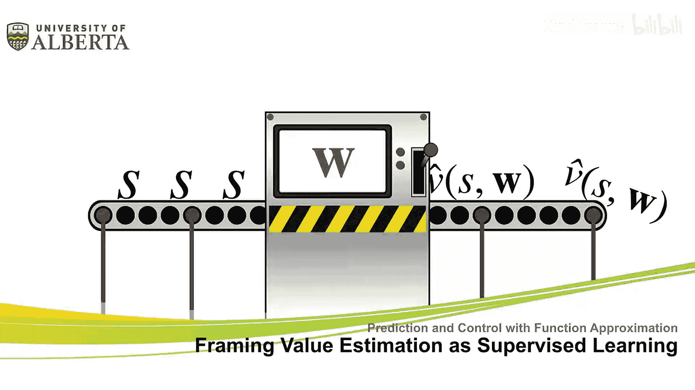
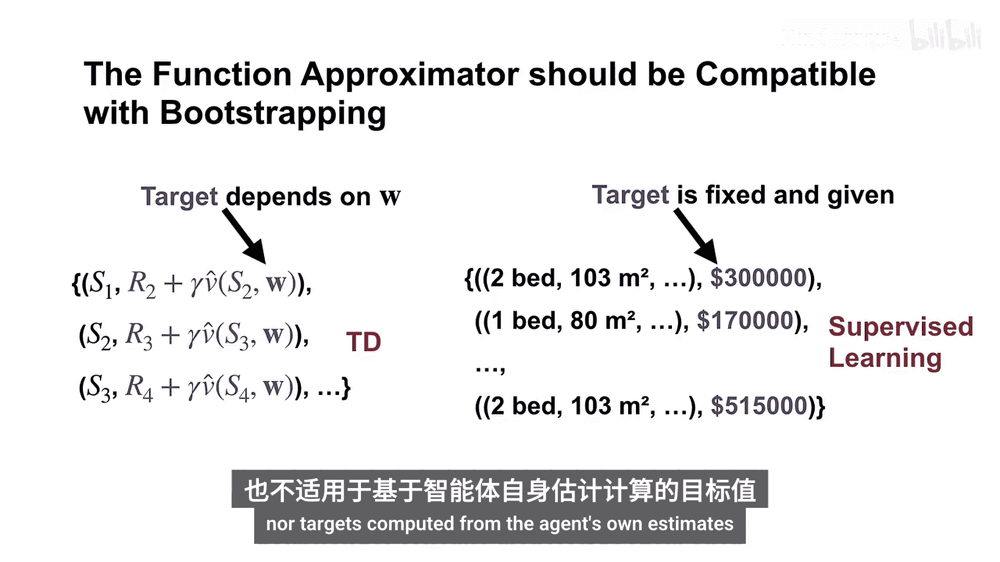

# 【阿尔伯塔大学】利用函数逼近进行预测和控制 ｜ Prediction Control Function Approximation p05 P05_将价值估计构建为监督学习_02_01_05 -BV1GYYWz9E1k_p5-

Supervised learning methods learn a function from a set of input target examples this is very different from reinforcement learning。

😊，But supervised learning methods can be useful for handling parts of the reinforcement learning problem。

By the end of this video， you will be able to understand how value estimation can be framed as a supervised learning problem。

And recognize that not all functional approximation methods are well suited for reinforcement learning。

Supervised learning involves approximating a function given a data set of input target pairs for example。

 imagine we had a list of house prices along with a set of attributes for each house。

We could use supervised learning to train a function to take the attributes of a house as input and estimate the expected price of the house。

The hope is that the function learned will also generalize to approximate the expected price for houses that were not in the training set。

This parameterized function can be represented in a variety of ways， for example， a neural network。

The problem of policy evaluation and reinforcement learning can be framed similarly。

This similarity is most obvious in the case of Montete carlo methods。

Remember that Monte Carlo methods estimate the value function using samples of the return。

We can think of this as an example of a supervised learning problem where the input is the state and the targets are the returns。

By training on enough examples， we hope that the output of our learn function will be a close approximation of the expected return。

 in other words， the value in each state。TD can also be framed as supervised learning。In this case。

 the targets are the one step bootstrap return。In principle。

 any function approximation technique from supervised learning can be applied to the policy evaluation task。

 however， not all are equally well suited， let's see why。In reinforcement learning。

 an agent interacts within an environment and continually generates new data。

This is often called the Online setting to distinguish it from the offline setting where the full data set is available from the start and remains fixed throughout learning。

If we want to use a function approximation technique。

 we should make sure it can work in the online setting。

Some methods are not compatible with the online setting because they are either designed for a fixed batch of data or they are not designed for temporal correlated data。

And the data and reinforcement learning is always correlated。

TD methods introduce an additional complication when applying techniques from supervised learning。

TD methods use bootstrapping， meaning that our targets now depend on our own estimates。

 these estimates change as learning progresses， and so our targets continually change。

This is different than supervised learning， where we have access to a ground truth label as the target。

For example， the price of a house does not depend on our estimate。

 nor does it change when we change our estimates。Supervised learning methods are typically not designed for changing targets。

 nor targets computed from the agent's own estimates。

That's it for this video， you should now understand how we can frame the policy evaluation task as a supervised learning problem。

But that not all methods from supervised learning are ideal for reinforcement learning。

We will need methods that are compatible with online updating and bootstrapping see you next time。

