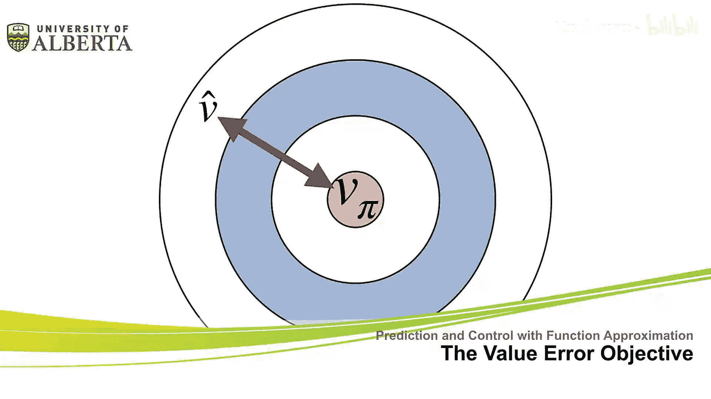
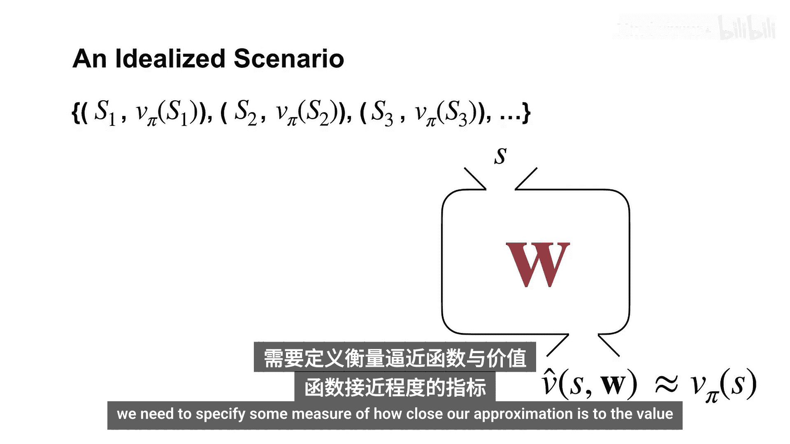
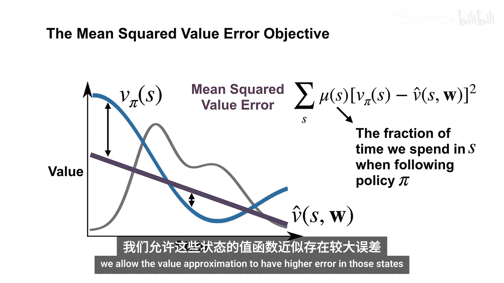
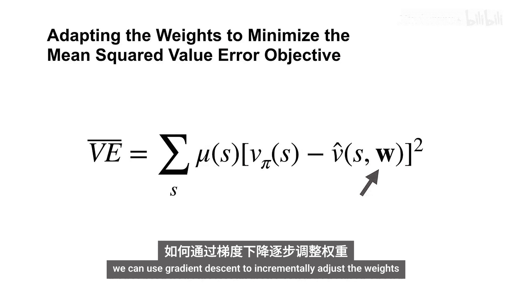

# 【阿尔伯塔大学】利用函数逼近进行预测和控制 ｜ Prediction Control Function Approximation p06 P06_价值误差目标_02_02_01 -BV1GYYWz9E1k_p6-

We discussed how we can frame value estimation as a supervised learning problem。

And supervise learning， an important step is to find the objective to optimize。In this video。

 we will be more precise about the objective we would like to optimize。After watching this video。

 you will be able to。Understand the mean squared value objective for policy evaluation。

And explain the role of the state distribution in the objective。

Let's start by imagining an idealized scenario。We get a sequence of pairs of states and true values。

We want to use this data to find a parameterized function that closely approximates VP。

We will do this by adjusting the weights so that the output of the function closely matches the associated value for a given state。

In general， we can expect to perfectly match the value function on all states。

The function approximation we choose will limit the value functions we can represent。

To make our goal precise， we need to specify some measure of how close our approximation is to the value function。

Consider a linear value function approximation denoted by V hatAT。

Here to keep the visualization simple， the state is a single dimensional and continuous。

Let's plotter estimate of the value function。Now imagine the true value function looks like this。

Clearly， our approximation of V is not perfect， but how far off is it？

Let's define this more precisely。Let's start by defining a measure of the error between the value of a state and the approximate value。

A natural choice is the squared error。That is the square difference between the value and our approximation。

However， this is not enough to define an objective for function approximation。

 making the estimate more accurate in one state will often mean making it less accurate in another state。

For this reason， we need to specify how much we care about getting the value right for each state。

 we will call that mu of s。More about that in a second。

We can now write our full objective as a sum of the squared error over the entire state space where each state is weighted by mu。

We call this objective the mean squared value error。Back to you。What should we pick from U of S？

Remember， MuV should tell us how much we care about each state。

A natural measure is the fraction of time each state is visited under the policy。

That means we want to minimize the average value error for the states we visit while following pi。

The states that the policy spends more time in have a higher weight than the objective。

We care less about errors in the states the policy visits less frequently。

Mu ofs is a probability distribution， as shown on the slide。 In this example。

 the policy spends little time at the extremes of the state face。

This means under the mean squared value error， we allow the value approximation to have higher error in those states。

Now remember the purpose of defining the objectiveive。

We want to adapt our weights to make the mean square value as low as possible。From now on。

 we will call this objective VE bar。Changing the weights in one way may increase the value error。

 while changing them in a different way might decrease the value error In the next lecture。

 we'll talk about how we can use。

Creating descent to incrementally adjust the weights。

That brings us to the end of this video， you should now understand why policy evaluation under function approximation requires us to specify an objective。

The mean squared value error is one possible objective。See you next time。

