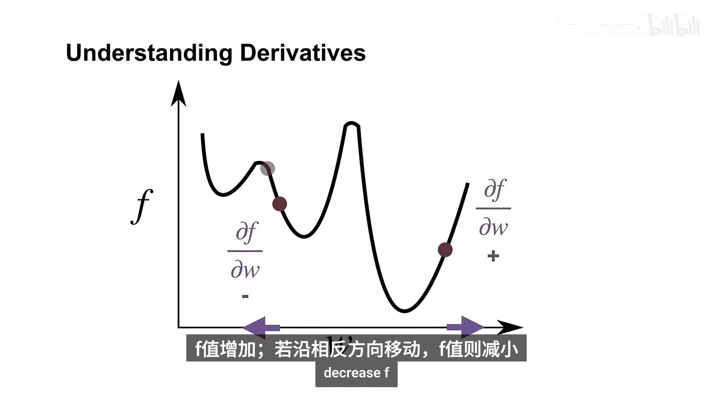
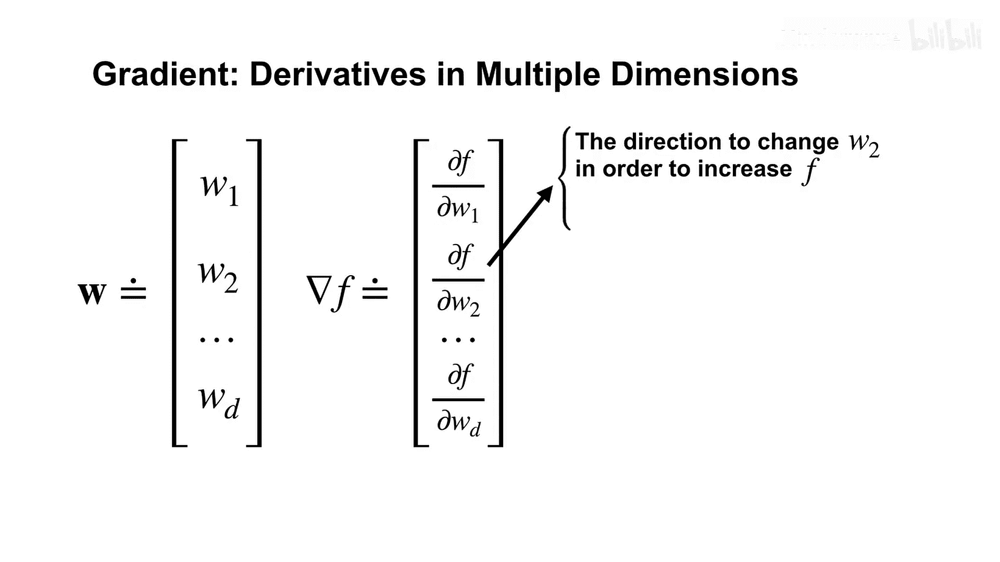
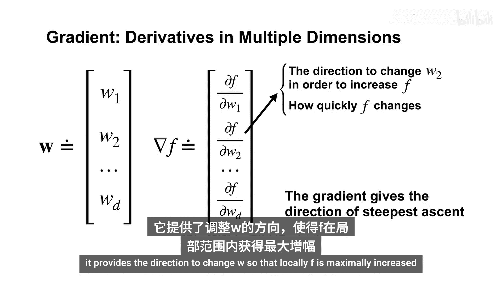
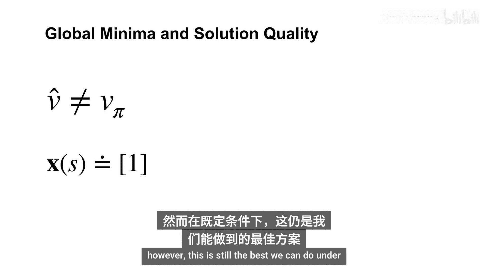

# 【阿尔伯塔大学】利用函数逼近进行预测和控制 ｜ Prediction Control Function Approximation p07 P07_介绍梯度下降_02_02_02 -BV1GYYWz9E1k_p7-

Previously， we looked at how value function estimation can be framed as supervised learning。

We made this precise by specifying an objective。Now we want to figure out how to find solutions to this objective。

Today， we'll talk about a general strategy for minimizing objectives called gradient asscent。

In the following videos， we'll cover specific algorithms for the objectives in reinforcement learning。

After watching this video， you will be able to understand the idea of gradient descent and understand that gradient descent converges to stationary points。

We want to minimize the me squared value error to make our value estimates close to the true value function。

Recall that our value estimate is given by a function of the state。

 parameterized by a set of real valued weights w。These weights determine how the value is computed for each state。

 changing the weights will modify the value estimate for many states。

We have to think about how to change the weights to minimize the overall value error to do that we'll need a little bit of calculus。

Hopefully you remember the idea of a derivative from calculus。

Here we've plotted a function F with scalar parameter W。

The derivative tells us how to locally change w to increase or decrease F。

The sign of the derivative of f at a particular point W indicates the direction to change w to increase F。

The magnitude of the derivative indicates the slope of the function F at the point W。

 That is how quickly F will change as we vary W。Here， the derivative is positive。

 if we move W in this direction， we increase F。At this other point， the derivative is negative。

 it is pointing in a direction to decrease w， but this direction still indicates how to increase F。

If we move w in this direction， it increases F。If we were to move it in the negative of this direction。

 it would decrease F。

If F is parameterized by more than one variable， then w is a vector。In this case。

 we need to introduce the idea of a gradient to describe how F changes as the vector W changes。

The gradient is a vector of partial derivatives， indicating how a local change in each component of w affects the function。

Notice that the gradient has to be the same size as the weight vector。

The sign of each component of the gradient specifies the direction to change the associated component of W in order to increase F。

 The direction is either positive or negative。

The magnitude of the component specifies how quickly F changes as w moves in that direction。

If the function is very steep in one dimension， the magnitude will be high， if it is very flat。

 the magnitude of the gradient in that dimension will be low。Regardless of the magnitude。

 the gradient gives the direction of steepest descent。

 it provides the direction to change W so that locally F is maximally increased。

To give a specific example， let's drive the gradient of a linear value function。Remember。

 a linear value approximation is just an inner product of the weights with the feature vector for the state。

The partial derivative of that with respect to a single weight is just the feature associated with that weight。

Remember， the features themselves do not depend on the weights。

This means the gradient of a linear value approximation is simply the feature vector for that state。

Our objective is a function of the weights， for example。

 the mean squared value error is a function of the weights because it is a function of B head。

And v hatAT is a function of the weights。Our goal is to adjust the weights to make the objectives small。

Here we have a hypothetical plot of our objective to keep things simple。

 let's say our function is parameterized by a single weight。

The x axis corresponds to this weight and the y axis to the objective value for this weight。

Because we have a single weight， this means our gradient is just a scalar derivative。

If we want to decrease our objective function， we should move the weights in the direction of the negative of the gradient。

This is the idea of gradient descent。Here's the grading Descent update rule that captures this intuition we make small changes in the direction that will most reduce the objective。

We use a step size parameter alpha to control how far we move。

 as otherwise theres a risk of stepping too far。This is because moving in this direction is only guaranteed to decrease the objective locally。

By doing such updates repeatedly with a sufficiently small alpha。

 we will eventually converge to a stationary point where the gradient is zero。

Likely this will be a local minimum this means these weights are better than all weights in the immediate vicinity。

 but may not be the best possible。Other possible stationary points are local maxima and saddle points。

 these are unstable solutions the stochasticity inherent in our algorithms is usually enough to prevent getting stuck at these poor stationary points。

On the other hand， a local minima is stable， so even a stochastic algorithm will tend to converge there。

For this reason， we usually talk about our algorithms converging to local minima。In some cases。

 grading descent is guaranteed to converge to the global minimum。

 which is the best possible setting of the weights for the objective。For example。

 this is true for the me squared value error with linear function approximation。

For more complex function appmators， such as a neural network。

A stationer point may not be a global minimum。Note that a global minimum does not necessarily correspond to the true value function。

It is limited by our choice of function parameterization and depends on our choice of objective。

Imagine a feature vector， which just contains a single element that is always one。

 no matter what state you are in。The approximate value function that minimizes me squared value error would converge to the average value over all the states。

 this is not a very good value function。However， this is still the best we can do under that parameterization in terms of the value error objective。

That's it for this video， you should now understand how gradient descent can be used to find stationary points of objectives and that these solutions are not always globally optimal。

Next time we'll talk about how to use gradient descent specifically for Rl， see you then。

