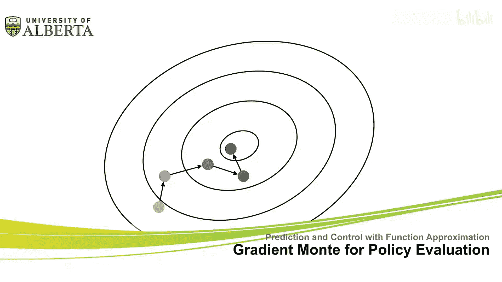
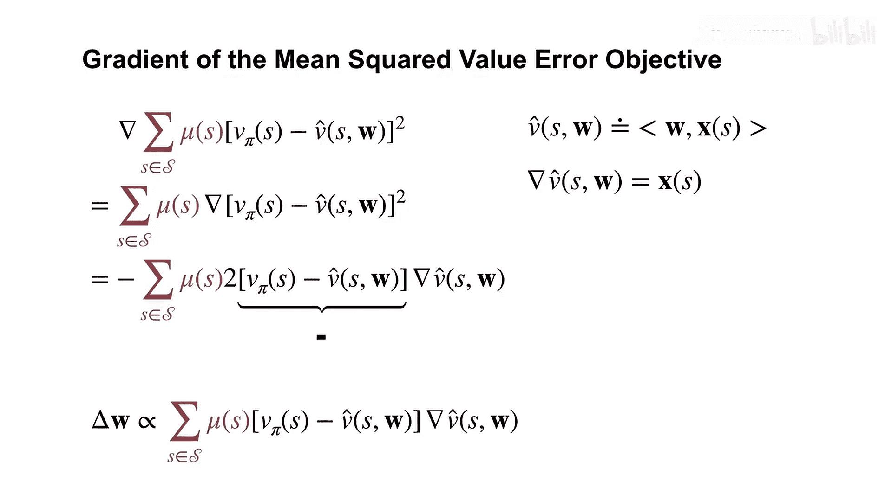
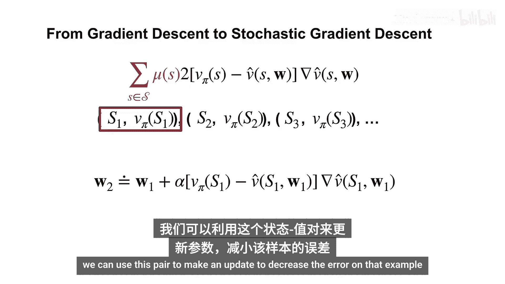
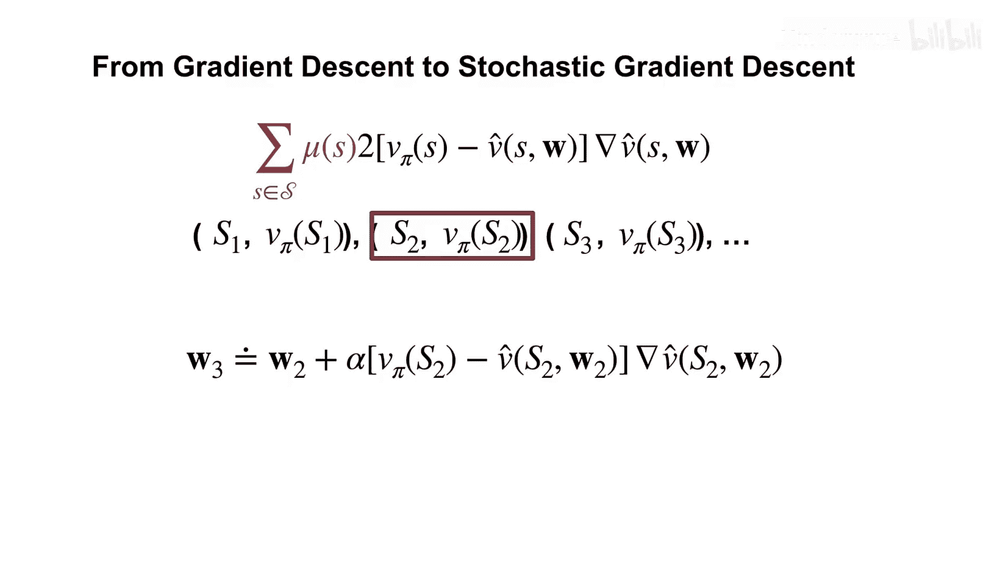
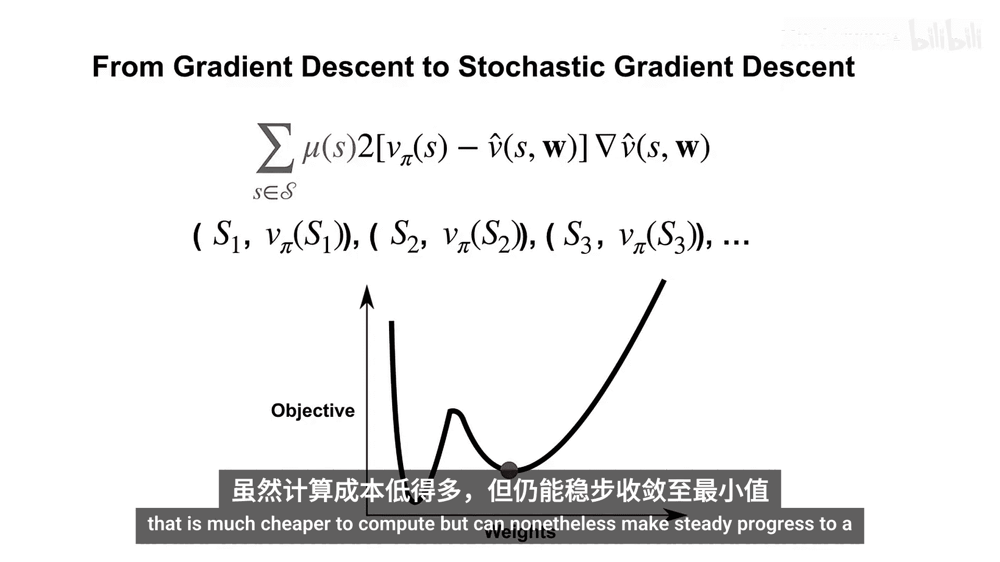
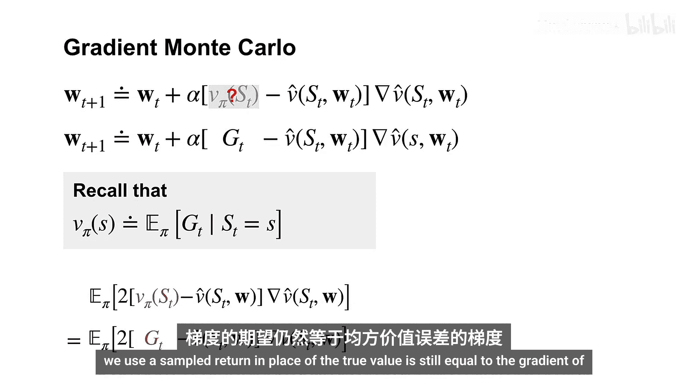

# 【阿尔伯塔大学】利用函数逼近进行预测和控制 ｜ Prediction Control Function Approximation p08 P08_策略评估的梯度蒙特卡洛方法_02_02_03 -BV1GYYWz9E1k_p8-

You now know one strategy to minimize objectives， gradient desent。

And we formulated a clear objective for policy evaluation， the value error。

We should now be able to put these together to approximate values let's return to our old friend money Carlo and see how it can be used to minimize the value error。

After watching this video， you will be able to。Understand how to use gradient descent and stochastic gradient descent to minimize value error and outline the gradient Monte Carlo algorithm for value estimation。

We just saw how to use gradient descent to minimize objectives to use this approach。

 the first step is to find the gradient of your objective。

So let's start by computing the gradient of the mean squared value error with respect to the weights of our approximation。

Remember， this objective is a weighted sum of the squared error over all states。

Following the rules of calculus， we can pull the gradient inside the sum。

We then take the gradient of each term inside the sum， which requires the chain rule。

The gradient of v pi minus v hat equals the gradient of v hat because v pi is not a function of w。

In other words， changing W does not change v pi of S。

The gradient of the value function approximation will depend on the particular parameterized function we are using。

In the case of linear function approximation。The grading is particularly easy to compute。

 as we showed in the previous video。It is simply the feature vector in that state。

This gradient makes sense the gradient of the value function approximation indicates how to change the weights to increase the value for that state。

We multiply this direction by the difference between the true value and our estimate。

If the difference is positive。It means the true value is higher than our estimate。

So we should change the weights in the direction that increases our estimate。

If the current error is negative， we should change the weights in the opposite direction。

Computing the gradienting for the means grid value error requires summing over all states。

 this is generally not feasible。Also， we likely do not know the distribution mu。Instead。

 let's approximate this gradient。Imagine an idealized setting where we have access to V P。

Though we do not explicitly have mu， we can sample states from it simply by following the policy。

Let's take one of these states， S1 that occurs while following the policy with target v pi of S1。

We can use this pair to make an update to decrease the error on that example。

Here is the gradient for a single state。We can do gradient descent with this gradient to decrease the air on that state。

So here's the corresponding gradient update rule for s1。

We can perform this update to decrease the error for this pair。

Then we can do this again with another state S2 observed while following pi by making small updates in the direction that improves error on each pair。

 we might sometimes increase the error on the full objective。

But the overall trend will be to make progress for the full objective。

This updating approach is called stochastic gradient descent because it only uses a stochastic estimate of the gradient。

In fact， the expectation of eachtochastic gradient equals the gradient of the objective。

You can think of this toastic gradient as a noisy approximation to the gradient that is much cheaper to compute。

 but can nonetheless make steady progress to a minimum。

Stochastic gradient descent allowed us to efficiently update the weights on every step by sampling the gradient。

However， there is one remaining practical issue we do not have access to VPI let's see how we can get rid of it from our update rule。

Let's replace v pi with an estimate。One option is to use samples of the return for each visiteded state ST。

 as we did for Monte Carlo methods。This makes sense because the value function is the expected value of these samples。

In fact， the expectation of the gradient when we use a sampled return in place of the true value is still equal to the gradient of the mean squared value error。

This brings us to the gradient Monte Carlo algorithm for estimating V Pi。

We take any policy pie we wish to evaluate。We choose some function which maps statess and weights to a real number that is differentiable in the weights for a given weight factor。

 this V hatt is a function of state producing the approximate values。

We choose the value of the step size alpha。And initialize the weights parameterizing our estimate however we like。

 for example， to zero。On each iteration， the agent interacts with the environment to generate a full episode。

We compute the sampled return for each visited state。

Then we loop through every step in the episode and perform a stochastic gradientcent update based on the sampled returns。

That's it for this video， you should now understand how stochastic gradient descent can be used to estimate a value function。

And how the greedy Monte Carlo algorithm works。Next time you'll get to see the algorithm in action。

