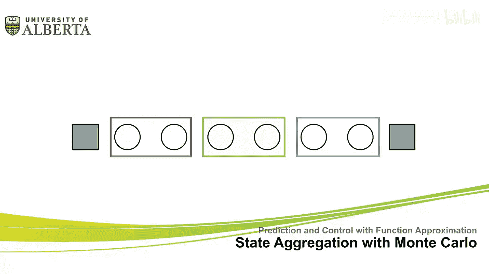
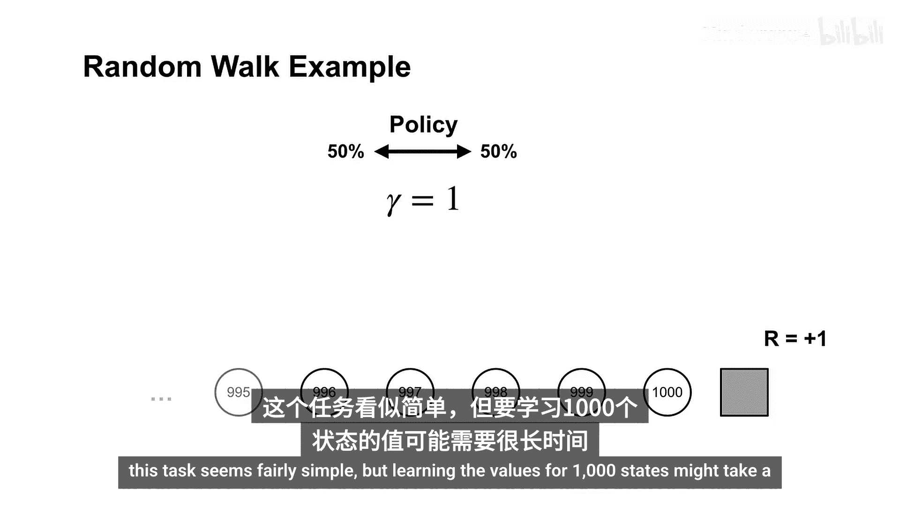
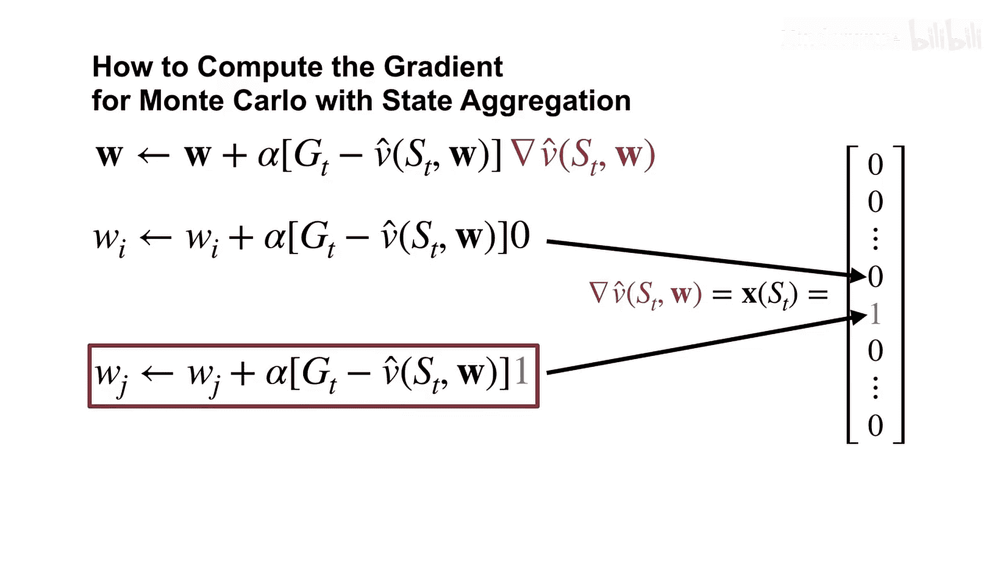
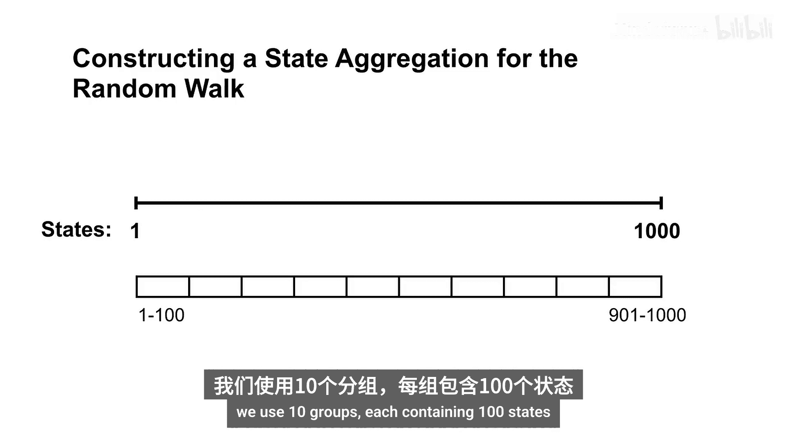
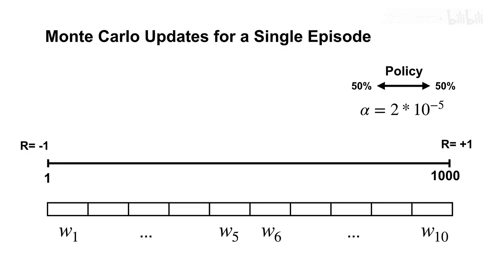
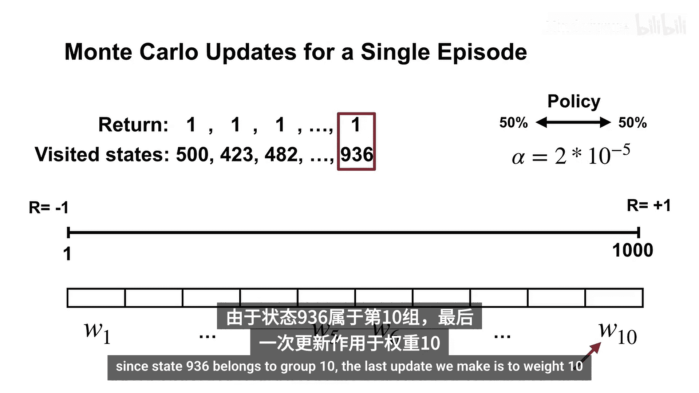
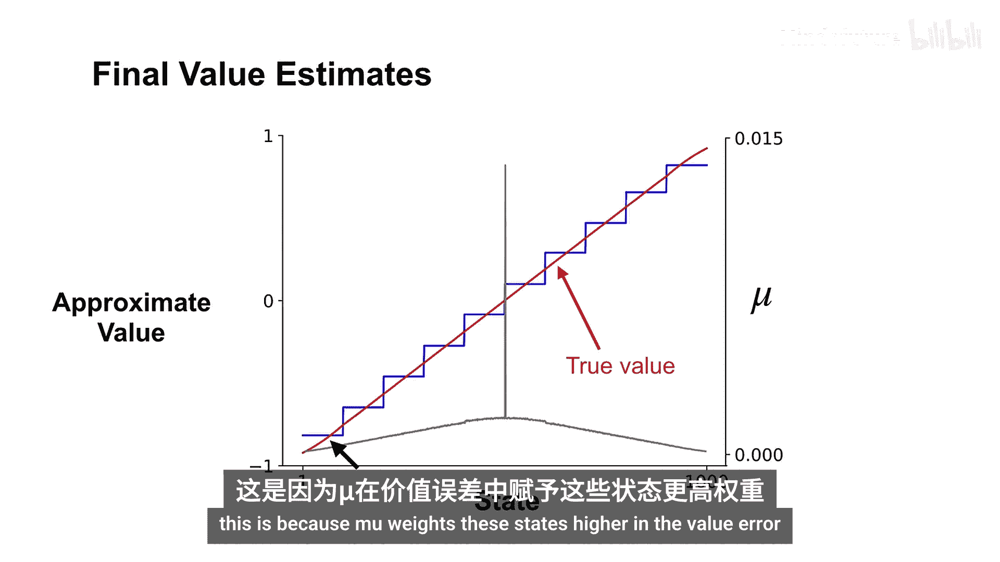

# 【阿尔伯塔大学】利用函数逼近进行预测和控制 ｜ Prediction Control Function Approximation p09 P09_使用蒙特卡洛的状态聚合_02_02_04 -BV1GYYWz9E1k_p9-

In this video， we will discuss a concrete example of value approximation using a technique called state aggregation。

We will use Monte Carlo with state aggregation to approximate the values for a large random walk domain。

After watching this video， you will be able to understand how state aggregation can be used to approximate the value function。

And apply gradient Monte Carlo with state aggregation。

Let's look at an example where function approximation can help speed up learning。

A large random walk task。The states are numbered from 1 to 1。

000 and arranged in a line from left to right。All episodes will begin in the middle of the line at State 500。

There are two actions left and right。The left action moves the agent to the left。

 but not necessarily just one place。The agent jumps left to any state within the 100 neighboring states uniformly at random。

Likewise， the right action jumps to the right to one of the neighboring 100 states。

Let's evaluate the uniform random policy， which moves either left or right with equal probability。

States close to the Ter state on the left， have fewer than 100 neighbors to the left。

All actions that would jump past the end of the chain go to the terminal state instead。Likewise。

 on the right。Terinating on the left gives a reward of minus1。

Tmining in the right gives a reward of plus one。All other transitions give a reward of zero。

The discount gamma is one。This task seems fairly simple。

 but learning the values for a thousand states might take a lot of time。

We might benefit from some kind of function approximation。

Here we will use a technique called state aggregation。As the name suggests。

 state aggregation treats certain states as the same。In this table of eight states。

 we might choose to aggregate states together in groups of four。So now。

 instead of a table of eight entries for the value function， we just have two。

When we update the value of any state in the first group。

 the values of all the other states in that group is updated。

State aggregation is another example of linear function approximation。

There is one feature for each group of states。Each feature will be one if the current state belongs to the associated group and zero otherwise。

The approximate value of a state is the weight associated with the group that state belongs to。

Let's look at the gradient Monte Carlo algorithm with state aggregation。

We already know how to compute the value for a given state。

Now we need to think about how we compute the gradient。

Of the value function so that we can use our key update formula。

State aggregation is an example of linear function approximation。

So the gradient is equal to the feature vector。The update rule modifies only the weight corresponding to the current active group。

Let's think about how this update rule changes the weight。

If the estimated value was smaller than the sample return GT， then the weight is increased。

If the estimated value was greater than the sampled return GT， then the weight has decreased。

Let's return to the random walk and see how we can apply state aggregation。First。

 we have to choose how we aggregate states。State aggregation forces states in the same group to use the same value estimate。

So ideally， we should group states together if we have reason to believe their values will be similar。

In this problem， it's an easy choice， states close together should have similar values。

Now we have to choose how many states to put in each group。If the groups are small。

 our value estimates will ultimately be more accurate。But will take longer to learn。

We use 10 groups each containing 100 states。 This is a nice change from the thousand states we started with。

Let's step through the gradient Monte Carlo algorithm to see how it works。We input the policy。

 our chosen state aggregation function， and a small step size parameter value。

We initialized the weights to zero。

First， we generate an episode。Once we have a complete trajectory。

 we step through all the states we visited and make an update。

The return from each date was one because the agent terminated on the right with a reward of plus one。

All other transitions generated zero reward。Our first update is the state 500。

 which belongs to group5。So we perform a gradient Monte Carlo update to that weight based on the sample return of one。

We do updates like this for every state in the trajectory， eventually we finish with state 936。

Which was the last state we visited before terminating。Since state 936 belongs to group 10。

 the last update we make is to weigh 10。

After all the updates have been made， our value estimates might look something like this。

This plot shows the estimates after a single episode。

We plotted to learn values for each states from 1 to 1，000。The state space is not continuous。

 but it makes sense to plot the approximate value as a line。

Notice that the value estimates for each group are non negative。

This is because the return for the first episode was positive， and our initial estimates were zero。

Let's look at the same plot after another episode。This time the agent terminated on the left。

 getting a reward of minus1。That means the return from every state was minus1。

The weights for the visited states decrease slightly。After running for many episodes。

 we get state values that look something like this。

Each step in the plot corresponds a group of states that share the same approximate value。

For comparison， here's the true value function。Although we have heavily approximated by aggregating many states together。

 our value estimate is not that far off。Why doesn't the red line pass directly through the center of all the blue steps？

This is where mu plays an important role。Recall mu of S is the visitation frequency for state S。

States near the center of the chain are visited more often than those near the terminal states as depicted here。

For example， let's look at the leftmost group of states， states 1 to 100。

States near State 100 are visited much more than states near state  one。

The approximate value is skewed towards the true value for states near state 100。

This is because mu weights these states higher in the value error。

That's it for this video。You should now have an idea of how gradient Monte Carlo works in practice when combined with state aggregation。

See you next time。