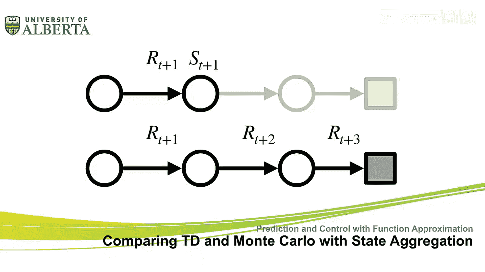
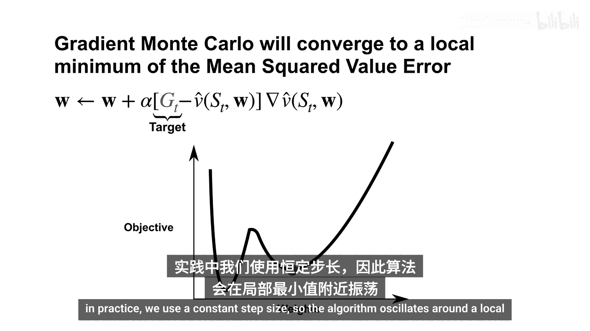
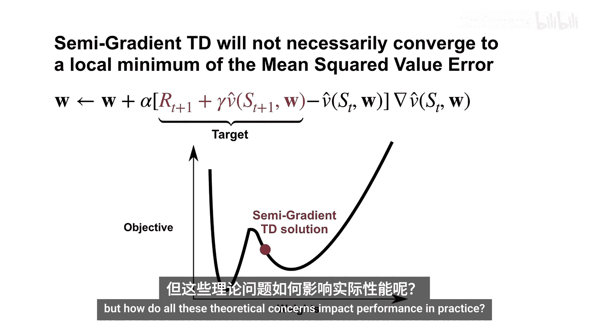
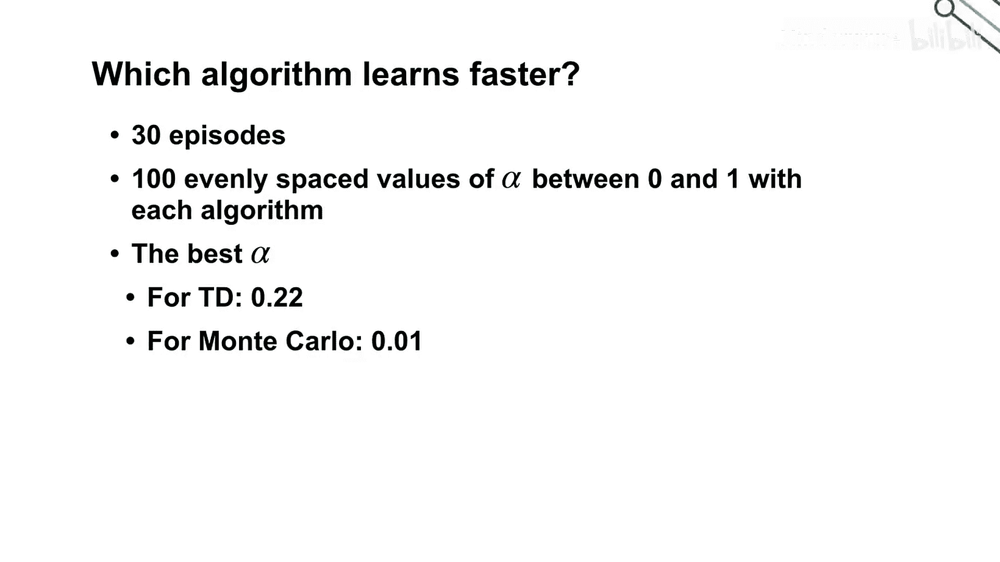
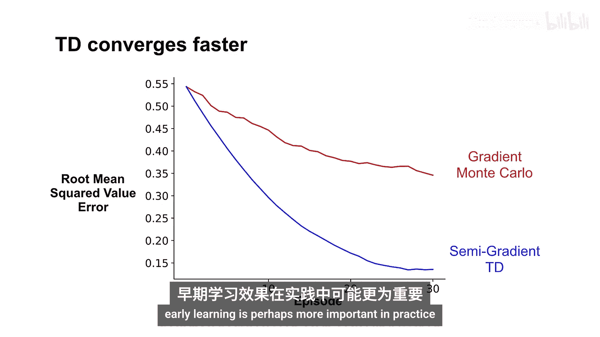

# 【阿尔伯塔大学】利用函数逼近进行预测和控制 ｜ Prediction Control Function Approximation p11 P11_比较使用状态聚合的TD和蒙特卡洛_02_03_02 -BV1GYYWz9E1k_p11-

We just talked about Monte Carlo with function approximation and TD with function approximation。

But how did these algorithms differ？Today we're going to talk more about the bias and the TD update and compare it to Monte Carlo in a small experiment。

After watching this video， you will be able to understand that TD converges to a bias value estimate。

And understand that TD can learn faster than gradient Monte Carlo。Under reasonable assumptions。

 Gry Monte Carlo will approach a local minimum of the mean squared value error with more and more samples。

This is because it uses an unbiased estimate of the gradient of the value error。In theory。

 we need to run the algorithm for a very long time and decay the step size parameters to obtain this convergence。

In practice， we use a constant step size， so the algorithm oscillates around a local minimum。

On the other hand， the TD target depends on our estimate of the value in the next state。

This means our update could be biased because the estimate in our target may not be accurate。

Since our value approximation will never be perfect， even in the limit， the target may remain biased。

 We cannot guarantee that semigding T D will converge to a local minimum of the mean squared value error。

Of course， this bias will reduce as our estimates improved。

But how do all these theoretical concerns impact performance and practice？

Let's return to the T State Rand Walk example to see the impact of bias in the TD update。This time。

 we will learn approximate values using semi gradient TD instead of Monte Carlo。

After running T for a long time， such of our value estimates have stopped changing。

 this is what we get。The value estimates do not align well with the true values for many states。

TD's estimates are not as accurate as the estimates learned by Monte Carlo。

In this domain with state aggregation， Monte Carlo has an advantage in terms of long run performance。

But what about the speed of learning？Which of T and Monte Carlo makes best used of limited samples？

Let's run a different experiment to get to the bottom of this。To focus on early learning。

 we only run 30 episodes。Remember， in the last experiment we used the thousand episodes。

The performance of both algorithms depends on how we set the step size parameter alpha。

The two algorithms may require very different values of alpha。To do a fair comparison。

 we tested each algorithm with 100 evenly spaced values of alpha between 0 and 1。

We take the best performing alpha for each algorithm。And compare the performance。

The best alpha was defined as the one that resulted in the lowest value error after 30 episodes of training。

For this task， the best alpha we found for TD was 0。22。

The best alpha for Monte Carlo was much smaller，0。01。

Let's plot the performance of each algorithm， the y axis shows the root mean squared value error。

For the thousand states， average over 100 runs。The X axis shows us the episode number。

We expect the value error for each algorithm to start high and progressively decrease with more and more episodes。

Let's look at the results。We see that TD reaches a lower error faster。This is not a one off result。

TD often learns faster than Monte Carlo。This is because TD can learn during the episode and has lower variance updates。

Moonney Carlo's better long run performance is not always the main concern。

We can never run our experiments to achieve asymptotic performance。

Early learning is perhaps more important in practice。

That's it for today。You have now seen how the TD update for function approximation can be biased。

But we often prefer TD learning over Monte Carlo anyway， because it can learn more quickly。

See you next time。