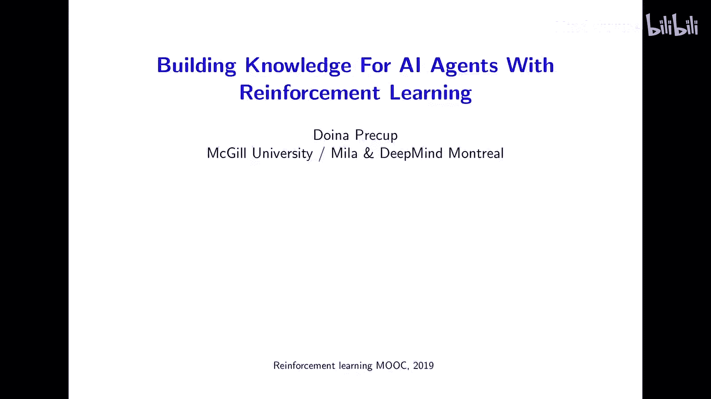
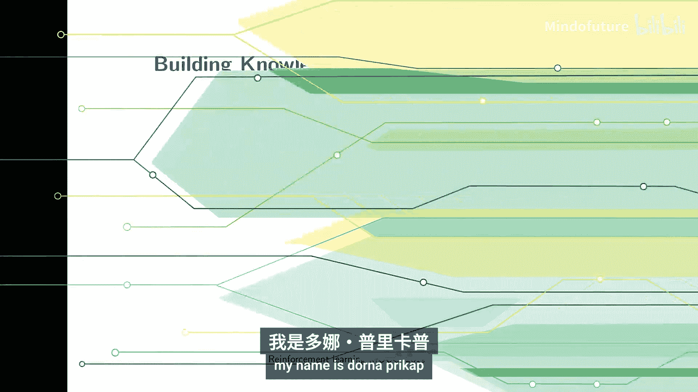

# 【阿尔伯塔大学】利用函数逼近进行预测和控制 ｜ Prediction Control Function Approximation p12 P12_Doina Precup_利用强化学习为AI代理构建知识_02_03_03 -BV1GYYWz9E1k_p12-

My name is Dna Pricap， I'm a professor at McGver University and I also work for DeepM as a research scientist。

And a lot of my research interests have to do with abstraction in reinforcement learning。

 reinforcement learning agents have to acquire two kinds of knowledge。

 one is what we would call procedural knowledge how to do things and the policy is the most basic example of this。

 but actually there's lots of other pieces of knowledge we might want to have like how to interact with particular objects or how to travel between different places。

 so I will talk about this in terms of skills or options or sometimes goal- drivenven behavior。

And we also would like to have predictive knowledge or empirical knowledge。

 which means what might happen conditioned on an agent's behavior， and so this is value functions。

 but also other things like， for example， models。嗯。

Now there's certain characteristics we would like to have for these kinds of pieces of knowledge。

 one is we would like this knowledge to be learnable so that we can acquire it from data。

 and we would also like it to be expressive， we would like to be for the agent to be able to know about many different things and different circumstances。

 and we would like the agent to be able to compose pieces of knowledge that it already has into larger pieces。

So those are the main things， the mainta for our knowledge representation。

 and knowledge representation has to sort of generalize both in terms of the agent's behavior over time scales。

 as well as in terms of the agent's capacity to reason about the world about its perceptions。

 so that's where state abstraction， function approximation coming。

I will talk a little bit more about generalization in terms of procedural knowledge。

 so over the different timescales。Now why might we want to have something like this。

 Well a lot of our agents when they aren born， they have a very limited set of actions and these actions always last one time step because we want to fit with the Markov decision process framework。

But in realistic circumstances， agents might need to keep a course of action for many time steps so for example。

 if you're thinking of going from Montreal to Edmonton you don't want to think in terms of muscle twitches you' would like to think in terms of taking a cab to the airport and then flying to Edmonton and taking a cab to the university and know maybe grabbing dinner or in the meantime these are periods of time that are extended。

 they are not the same， but the agent should be able to reason at this level because that means its plan will now be much shorter only four steps instead of many thousands of steps potentially and also the plan might be reusable in other circumstances。

 for example， if you want to travel not to Edmonton but to Toronto or some other city。

 the agent would still go through the same kinds of steps。嗯。

Now how do we formalize this idea of abstraction at the temporal level or at the behavior level。

 one way to do this is through this notion of options。

And we are going to think of an option as consisting of three components。

 one is an initiation set that means the set of circumstances under which an option could be initiated。

 for example， we can only fly somewhere if we are at the airport。

 so being at the airport is an initiation set。A second component is an internal policy that means a way of picking primitive actions while the option is executing。

 so for example， if we're walking to the gate， the walking motion is a policy。

And that will take control and execute， and this is the usual probability of taking primitive actions conditioned on the agent state。

And then we have a termination condition and typically this is also stochastic。

 it basically tells us what is the probability of the agent finishing the behavior in any particular state。

 so if we're walking to the gate， we might finish this behavior because we've reached the gate of the airplane but we might also finish the behavior for example if there is an alarm。

 maybe we want to go outside the building so switch the behavior to something else。嗯。

So if we think in terms of these components， actually agents have now chance of behavior that they can execute and we can also think of models that are paired up with these chance of behavior and so each option will have a model and its model consists of the expected reward that the agent might get along the way。

 and essentially a transition probability distribution。

 of the states where it might end up now because options take different amounts of time instead of just thinking of transitions to next states。

 we are in fact going to think of transition to a next time as well。

 and so this will be a joint distribution in fact over states and over time。

But once an agent is endowed with options， it essentially reasons in the same way that it would in an MVP except we have what's now called the semi Markov decision process。

 so the Markov property still holds， but the duration of a behavior is not fixed。

 it's actually based on probability distribution， however all of the planning and learning algorithms that you already know and love。

such as value creation， temporal difference learning。

 all the other things that are talked about in this course work in almost the same way in semi mark decision processes as they do in MDPs。

 and so we can bring to bear all of the ideas from these algorithms in order to learn about options。

And。One of the interesting questions is how to do temporal abstraction at the same time as doing state abstraction or doing function approximation。

 ideally we would like to do both of these things right so we would like to reason about the airport rather than specific centimeters in space just like we would like to think about the behavior of going to the airport instead of muscle twitches。

 however these two are actually distinct and we would like them to work together in some sense。

 but how to get good temporal abstraction and state abstraction at the same time and in a way in which they communicate well with each other is actually still an open research problem。

Similarly， one interesting open research problem is figuring out where options come from。

Who tells us what is a good termination condition， well。

 this is something that we would like to find out， but we don't quite have a hand on it。

