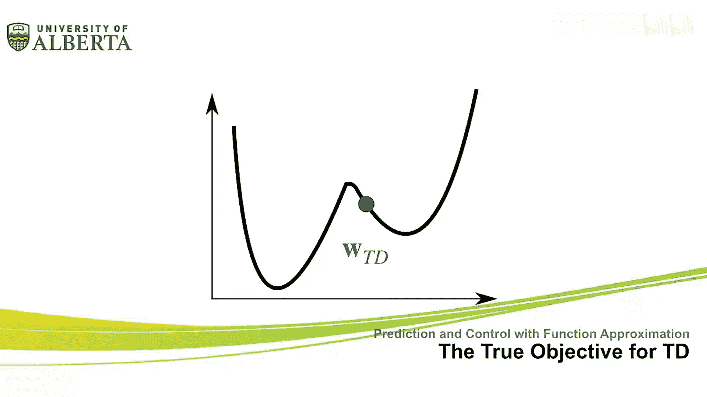
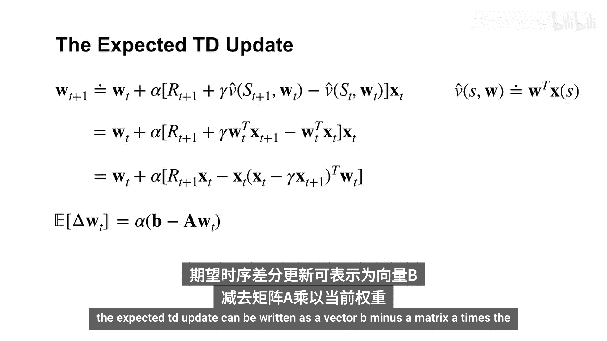
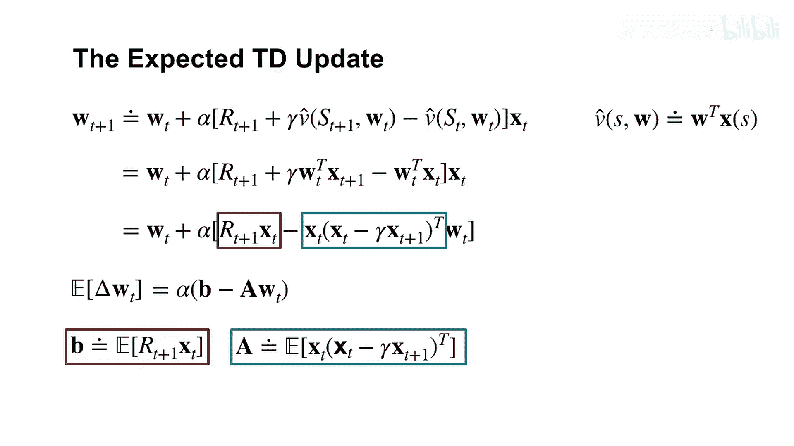
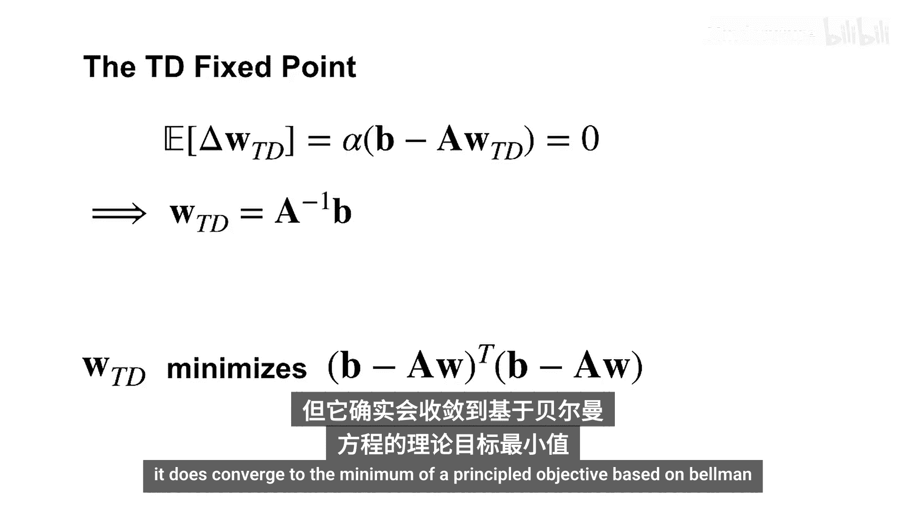

# 【阿尔伯塔大学】利用函数逼近进行预测和控制 ｜ Prediction Control Function Approximation p14 P14_TD的真实目标_02_04_02 -BV1GYYWz9E1k_p14-

In a previous lecture we introduce semi gradient TD as approximate gradient descent in the mean squared value error。

 but this is a simplification of a more nuanced story TD does not precisely optimize this objective。

 instead there's a different objective we can consider for semi gradient TD with linear function approximation。

In fact， linear TD provably converges to a well understood approximation called the TD fixed point We'll talk about this today。

By the end of this video， you will be able to understand the fixed point of linear TD。

And describe a theoretical guarantee on the means grid value error at the TD fixed point。

Let's take a closer look at the TD update with linearar function approximation。

The value of a state is the inner product of the state features and the learn weight vector。

To simplify the notation， we'll use Xt to mean the features associated with the state ST。

We can then expand the TD update like this。We can rewrite this using a bit of linear algebra。

 first we'll pull Xt into the brackets。We then use the fact that taking the transpose of a scalar leaves it unchanged。

Now let's think about what this update looks like in expectation。

Understanding the expected update is key for proving convergence。

 the TD update can be rewritten as the expected update plus a noise term。

 and so is largely dominated by the behavior of the expected update。

The expected update characterizes the expected change in the weight from one time step to the next。

The expected TD update can be written as a vector b minus a matrix a times the current weights。

The matrix A is defined in terms of an expectation over the features。

 while the vector B is defined in terms of the features and the reward。

The weights are set to converge when this expected TD update is zero。We call this point wTD。

If a is invertible， we can express this as WTD equals a inverse B。More generally。

 wTD is a solution to this linear system。We call this solution the TD fixed point。

It can be proven that linear td converges to this point。In fact。

 it can be shown that TD minimizes an objective that is based on this A and B。

This objective extends the connection between TD and Belman equations to the function approximation setting。

Recall that in the tabular setting， we describe TD as a sample based method for solving the Belllman equation。

Linear TD similarly approximates the solution to the bellman equation。

 minimizing what is called the projected bellman error。

The details of this objective are beyond the scope of this course。

 but you can refer to the course textbook for more detail。

The key takeaway is that even though TD does not converge to the minimum of the means squared value error。

 it does converge to the minimum of a principled objective based on velmin equations。

Nonetheless， we do still want to understand the relationship between the solution found by TD and the minimum value error solution。

We can formally characterize this relationship with this equation。

The difference between the TD fixed point and the minimum value error solution can be large if gamma is close to1。

If Gamma is very close to zero on the other hand， the TD fixed point is very close to the minimum value error solution。

This bound also depends on the quality of the features， if the features are limited。

 both the minimum mean squared value error and the value error at the TD fixed point may be large。

If we can perfectly represent the value function， then regardless of gamma。

 the TD fixed point is equivalent to the minimum value error solution。

This is because both the left and right hand sides would be zero。So in general。

 why isn't the TD fixed point equal to the minimum value error solution？

This is because of bootstrapping under function approximation。

If our estimate of the next state is persistently inaccurate due to function approximation。

 then TD may forever update towards an inaccurate target。On the other hand。

 if our function appximator is very good， then our estimate of the next date will become very accurate。

 so bootstrapping off this estimate is not problematic and the error for the TD solution is close to the minimum value error。

That's it for today。You should now know a bit more about why linear semi gradient TD is guaranteed to converge to a fixed point called the TD fixed point。

And how the TD fixed point relates to the minimum mean squared value error。

