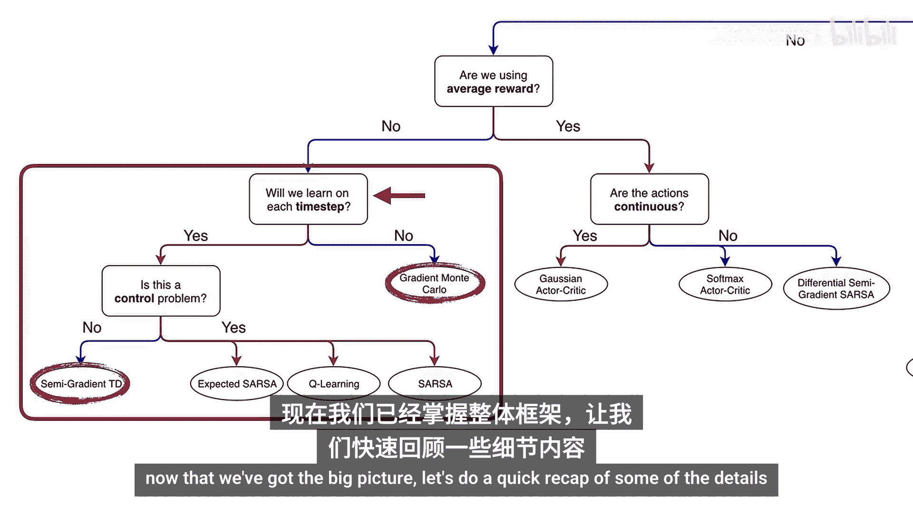
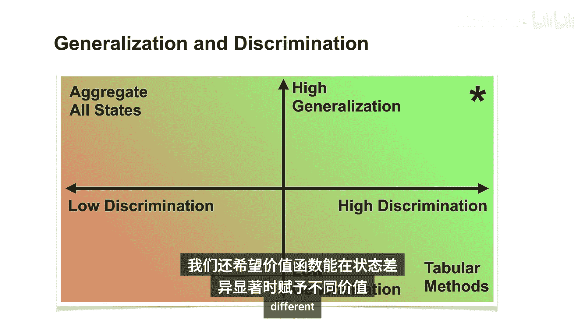
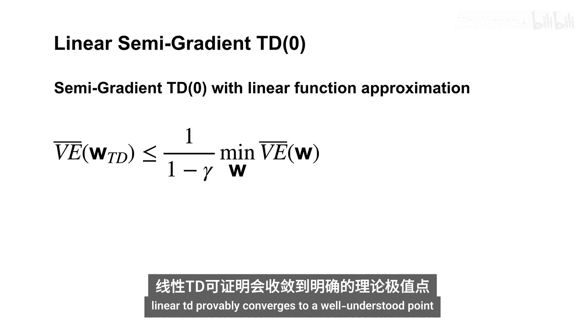

# 【阿尔伯塔大学】利用函数逼近进行预测和控制 ｜ Prediction Control Function Approximation p15 P15_第一周总结_02_04_03 -BV1GYYWz9E1k_p15-

This week， we learned a lot about how to extend reinforcement learning from the tabular case to function approximation。

In many real world problems， it is not practical to enumerate every possible state in a table。

So moving to function approximation is a big step in making reinforcement learning more broadly applicable。

In this video we'll do a quick recap of what we've learned。We've covered a lot of material already。

 and it's easy to get lost in all the different concepts。

So let step back and see how this week's topics fit into the bigger picture。

This map shows all the different algorithms we've covered in the specialization and how they relate to each other。

Remember， the map only shows the algorithms we present in the specialization。

The main conceptual change this week was moving to the framework of parameterized function approximation。

This means we are no longer using a table to store the value of each state。

This puts us on the left side of the map。Our discussion of average award will come later for now。

 let's focus over here。This week we focused on the policy evaluation problem。

 we cover two algorithms， gradient Monte Carlo and semi gradient T。

Credy Monte Carlo makes updates at the end of each episode。

TD bootstraps using the value estimate at the next time step。

 so it does not need to wait until the end of an episode to learn。Now that we've got the big picture。

 let's do a quick recap of some of the details。

We described a parameterd value function as a mapping from states to real numbers。

The output is controlled by a vector of real valued weights W。

We use the notation v had of S and W to represent the approximate value function。

This indicates that the value estimate is determined by the current state and the learn weight vector。

One example of a parameterized value function is a linear function of fixed or expert design features。

Another example is a neural network。We talked about two key properties of function approximation。

 generalization and discrimination。Updateating the value of one state can improve the value estimates of other states。

This generalization can make learning faster。We also want our value function to assign different values when states are very different。

We call this discrimination。Next， we discussed how to use ideas from supervised learning to learn approximate value functions。

We cannot guarantee perfect approximation for every state's value。So we need to define an objective。

 a measure of the distance between our approximation and the true values。

We use the mean squared value objective。The sum of the squared error between the value of each state and our approximatex value。

Wighted by the visitation frequency， mu。We discussed how stochastic grain descent can be used to optimize our objective。

The gradient of Monte Carlo algorithm performs s acidastic gradientnessend using sampled returns to update the weights。

This means it can learn an approximate value from the experience generated by an agent interacting with the world。

We also introduced semi gradient TD as an approximation to stochastic gradient descent。

Semi gradient TD takes advantage of bootstrapping and in practice may converge much faster than Monte Carlo。

The semigrading part of the name reminds us that it's not a gradientd descent algorithm。Finally。

 we discuss the linear semi gradient TD algorithm or TD with linear function approximation。

Linear TD provably converges to a well understood point。

You now have a good foundation to understand reinforcement learning with parameterized functions。

Next， we will discuss different ways to construct state and state action features until next time。

