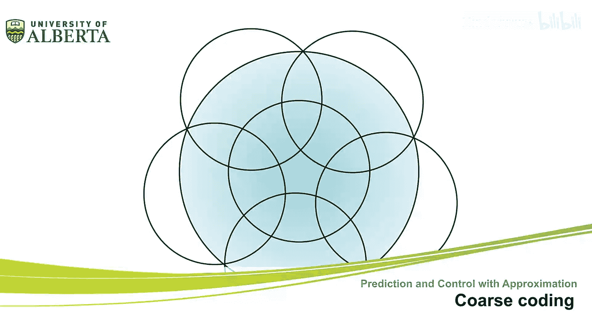
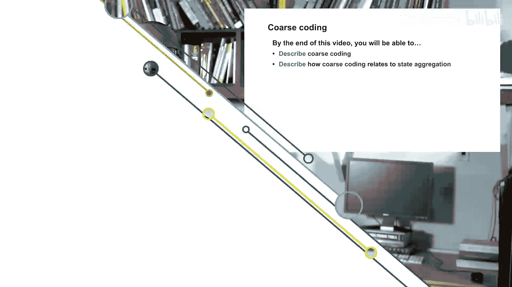
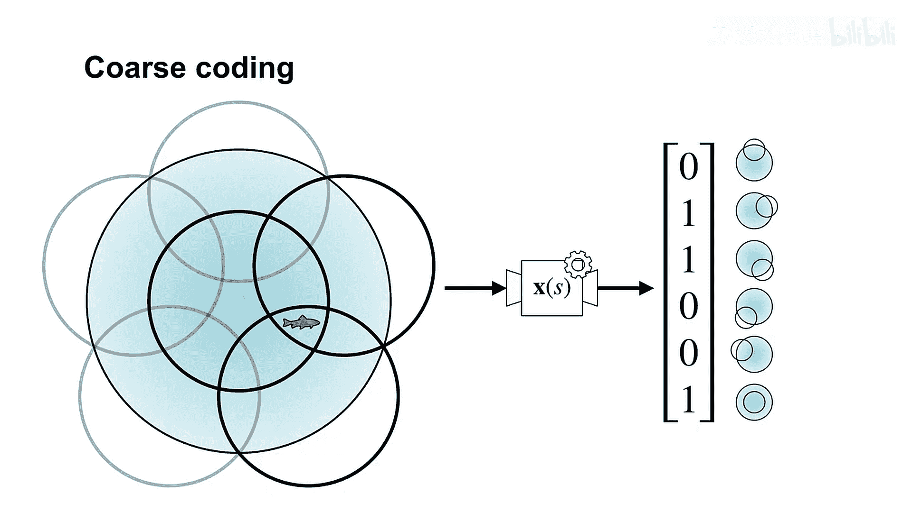

# 【阿尔伯塔大学】利用函数逼近进行预测和控制 ｜ Prediction Control Function Approximation p16 P16_粗编码_03_01_03 -BV1GYYWz9E1k_p16-

The features used to construct value estimates are one of the most important parts of a reinforcement learning agent。

Today we'll discuss one simple but effective way to do this。By the end of this video。

 you'll be able to。Describe course coding and describe how it relates to state aggregation。

Let's talk about a new way to create features for linear value functions。

Recall that approximate value functions are parameterized by a weight vector W。

To calculate the value of a state， we first compute the features and construct the feature vector x of S。

Then the value of the state is approximated by dot product between the weight vector and the feature vector。

Recall that a tabular representation can be expressed as a binary feature vector。

Each state is associated with a different feature。If the agent is in a state。

 then the feature corresponding to that state is one。All other features are zero。

The tabular case is just a special case of linear function approximation。

 where the feature vector is an indicator or one hot encoding of the state。Of course。

 this is not feasible when the size of the state space becomes much larger than the agent's available memory。

Suppose we want to represent the location of this fish that's swimming in a pond。

 a two dimensional state。The fish can be in one of infinitely many locations。

 It's impossible to represent all these locations with a finite lookup table。

Recall that we can use state aggregation to associate nearby states with the same feature。

This is like treating all states within each square as the same state。In this example。

 all the groups have roughly the same shape。But it's not necessary to use the same shape。In general。

 we can aggregate states using any shapes we want， as long as those shapes do not have any gaps or overlap。

State aggregation does not usually allow the shapes to overlap。

 but this restriction is not necessary， in fact， by allowing overlap。

 we obtain a more flexible class of feature representations called course coding。

Let's look at an example feature vector for the fish's current location in the pond。Remember。

 each index in the feature vector corresponds to one of the shapes。

The feature corresponding to the circle is active or set to one if the fish is within that circle。

Otherwise， the feature is set to zero。The features's receptive field corresponds to the locations that activate that feature。

When the fish moves to a new location， it's usually covered by a different set of circles。

Nearby states will have similar feature activations。

 but they may also have different components active， including different numbers of active features。

In this example， there's always at least one active feature and at most three active features。

All the ideas we've discussed so far are not limited to 2D state spaces。

 course coding can also be applied to higher dimensional inputs。

In this video， we talked about how the tab ofular case can be represented with a binary one hot en coatding of the state。

And how course coding is a generalization of state aggregation。See you next time。

