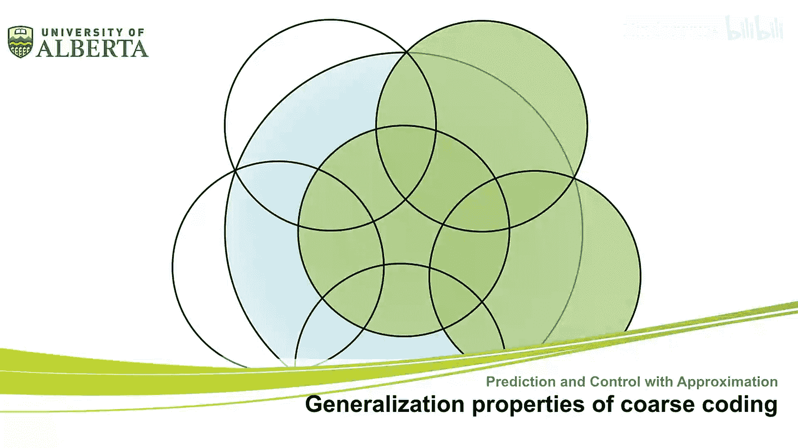
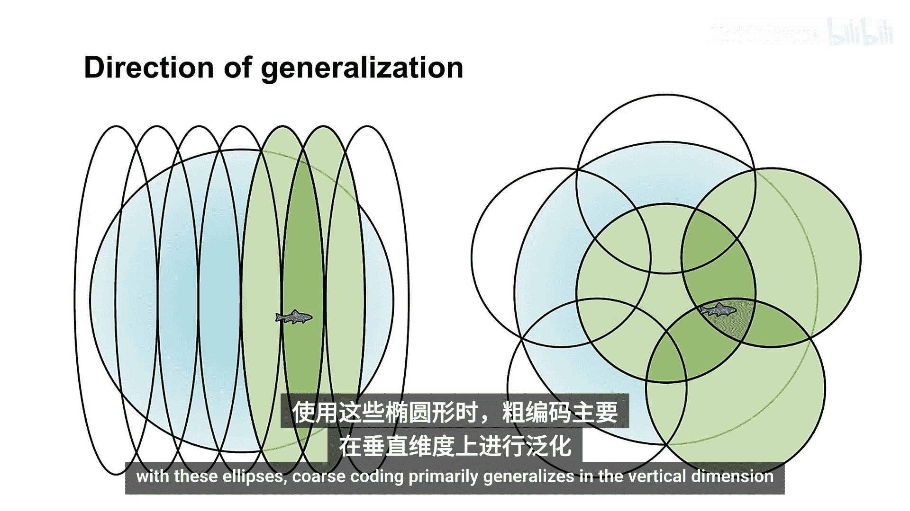
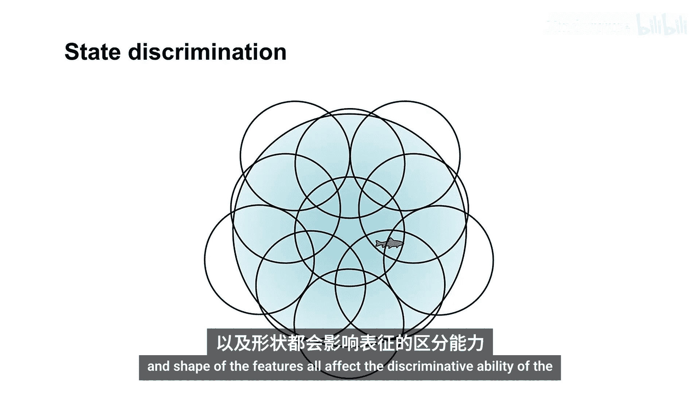

# 【阿尔伯塔大学】利用函数逼近进行预测和控制 ｜ Prediction Control Function Approximation p17 P17_粗编码的泛化属性_03_01_04 -BV1GYYWz9E1k_p17-

Previously， we talked about a few different feature representations， tabular， state aggregation。

 and course coding。But we didn't tell you why course coding might be useful Today we'll talk about how changing the properties of course coding affects generalization and discrimination。

By the end of this video， you'll be able to describe how course coding parameters affect generalization and discrimination and how that affects learning speed and accuracy。

We've talked about how course coding groups states into features of arbitrary shapes and sizes。

 they can be circles， ellipses， squares， or a combination of different shapes。

 let's look at how changing the shapes and sizes of features impacts generalization and discrimination。

 and so affects the speed of learning and the value functions we can represent。

Notice that performing an update to the weights in one state changes the value estimate for all states within the receptive fields of the active features。

If the union of the receptive fields for the active features is large。

 the feature representation generalizes more。Conversely， if the union is small。

 there is little generalization。Here， the larger circles on the right generalize more broadly。

 distributing the update across a larger number of states。

Generalization is not just a scalar quantity， however。

Using different shapes in course coding can change the direction of generalization as well。

Let's compare the previous example with circles to how cocoing generalizes with vertically elongated ellipses。

The receptive fields made from ellipses are longer than they are wide， with these ellipses。

 course coating primarily generalizes in the vertical dimension。

So we've talked about how the shape and size of the receptive fields impact generalization and so the speed of learning。

 but what about the final accuracy of our estimates， this is where discrimination comes in。

Recall that the ability to distinguish between values for two different states is called discrimination。

In course coding， the overlap between circles dictates the level of discrimination。

It is impossible to do perfect discrimination because we can never update the value of one state without impacting the values of other states。

The colored shapes depict the discriminative ability of this particular course coding we've only highlighted a few regions to keep the visualization simple。

😊，Every state within the same colored shape will have the exact same feature vector， as a result。

 they must all have the same approximate value。The smaller these regions are。

 the better we can discriminate。With many circles， the regions become smaller and we can discriminate more finely between the values of different states。

 or we can make the circles smaller。So the size， number。

 and shape of the features all affect the discriminative ability of the representation。

Let's look at a simple example with a one dimensional input space。

 consider learning an approximation to a step function。

Let's assume we can sample the true function values in order to update our estimates。

This example should help you better understand how representation choices impact the speed of learning and the quality of the final approximation。

For our one dimensional function， the receptive fields of each feature will be represented as overlapping intervals。

 Let's start with this relatively short interval。We'll lay about 50 of these intervals so that they overlap randomly over the domain of our function。

Let's see how our estimate of the function changes as we randomly sample the true values of the function。

We start with an initial estimate of  zero depicted as a flat line。

The receptive field for each feature is quite small， so even after many samples。

 our approximation of the step function is not that great。With much more training。

 our approximation finally obtains a close match to the true function， but it's not perfect。

 This is easy to see by inspecting the approximation of the top of the function。

 It's not nearly as flat or smooth。Let's try this again with longer intervals。

The receptive field of each feature is quite large。

 This means we can approximate the rough shape of the function with relatively few samples。

As we sample the function more， our estimate forms a better and better approximation of the true function。

The broad generalization of the longer intervals made learning faster。

 we needed less samples to get a good approximation。

The large number of longer intervals also resulted in better discrimination。

 better final approximation of the true function。In this example。

 longer intervals ended up achieving better generalization and discrimination。

 but this may not always be the case， each task may require different feature properties and there's not one general solution。

In this video， we talked about how the size， number。

 and shape of the features affects generalization and how the resulting shape intersections affect the ability to discriminate。

Course coding is a very general type of representation。

 understanding how it generalizes and discriminates during learning will help us understand other representations。

 including neural networks。