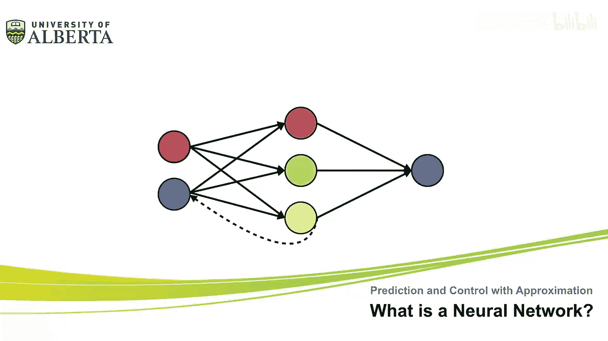
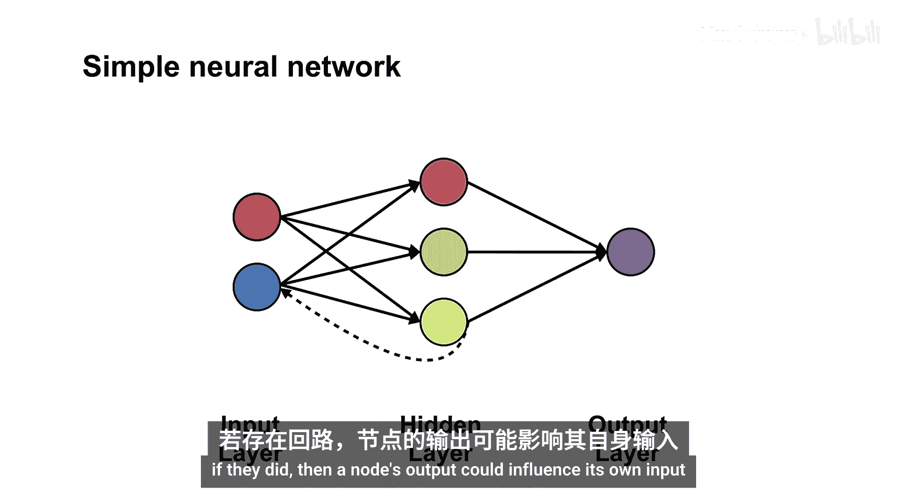
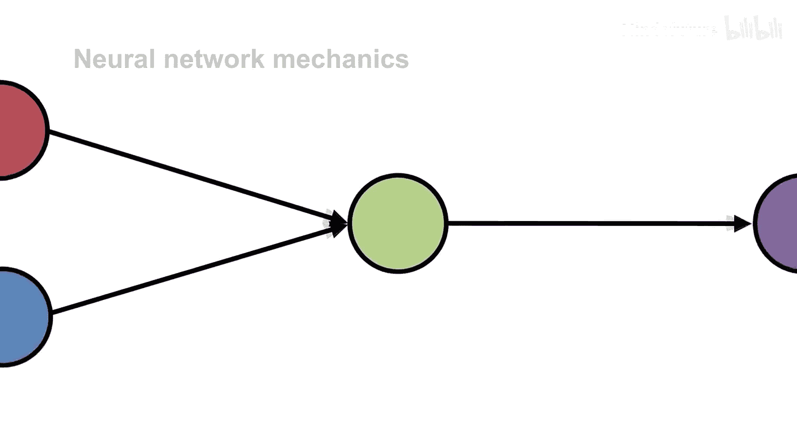
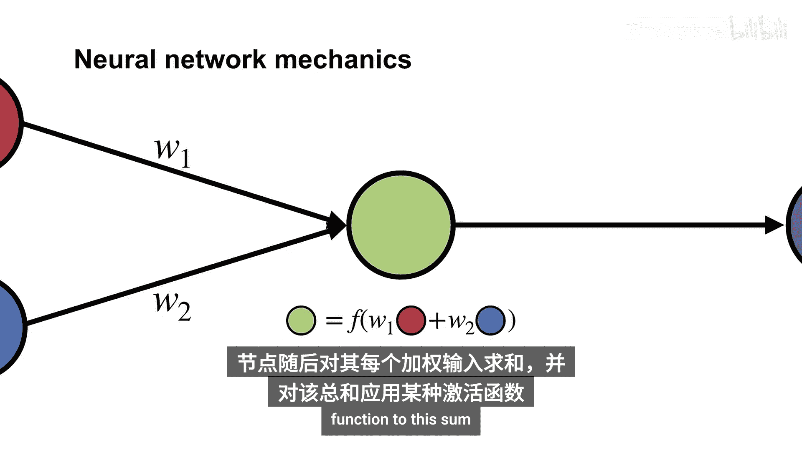
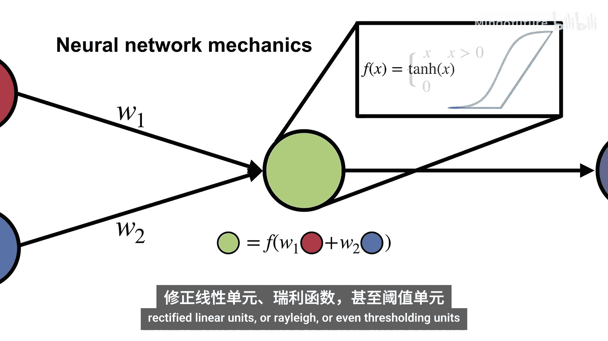
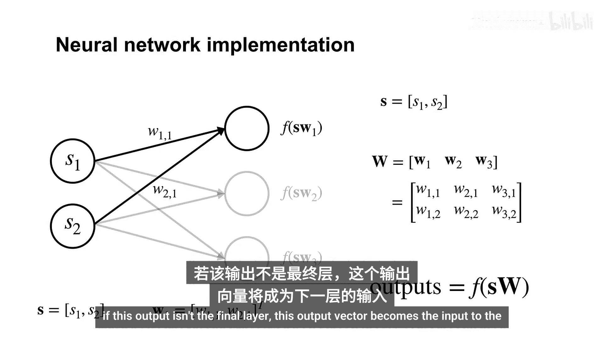

# 【阿尔伯塔大学】利用函数逼近进行预测和控制 ｜ Prediction Control Function Approximation p20 P20_什么是神经网络_03_02_01 -BV1GYYWz9E1k_p20-

Today， we will discuss neural networks， a flexible and powerful class of nonlinear function approximators。

Reinforcement learning with neural networks has been used to create a world champion goal player。

 to create a tireari agents capable of superhuman performance and even a help with autonomous cars。

By the end of this video， you will be able to understand feed4 neural networks。

 to find an activation function， and understand how a neural network is a parameterized function。

Let's walk through a simple neural network。Each of these circles represents nodes in the network。

Each of the lines represents connections between nodes。 The nodes are organized into layers。

 When new data comes in， it starts in the input layer and is sent through the connections to the next layer of nodes。

This layer performs some computation on the data， then sends the results to the next layer。

This process continues until the last layer produces the final output。

We call this a feed forward neural network because the data always moves forward through the layers。

None of the connections loo back through the network， if they did。

 then a notes output could influence its own input such a neural network is called a recurrent neural network。

When data is passed through a connection， a weight is applied。

The node then sums up each of its weighted inputs and applies some activation function to this sum。

 The activation function is often a nonlinear transformation。

 Common activation functions include sigmoidal functions like tan0 H or the logistic function。

 rectified linear units or railU or even thresholdholding units。

Let's take a look at how to write a feed forward pass of a neural network mathematically。

At each node， we have two vectors， the inputs， and the weights for each input。

The first subscript refers to the node the connection comes from。

The second subscript refers to the node the connection feeds into。

We don't product the weights with the input and pass the result through the activation function。

Notice here that S is a row vector， so we do not need to write the doc product with a transpose。

Each layer consists of many such nodes， a neural network is just a parameterized function。

 though this can be a bit hard to see by thinking of it as a collection of connected nodes。

To see this more explicitly， let's rewrite the operations in the network using matrix vector multiplication。

We can view the inputs to a layer as a row vector and the weights for that layer as a matrix。

In other words， as this two dimensional array。We can compute the output of an entire layer using matrix multiplication。

We then apply our activation function to each element of the outputted vector。

If this output isn't the final layer， this output vector becomes the input to the next layer and we repeat the process。

That's it for this video we explained how neural networks consist of a network of nodes which process and pass information along and discussed how a feed for neural network is a parameterized function See you next time。

