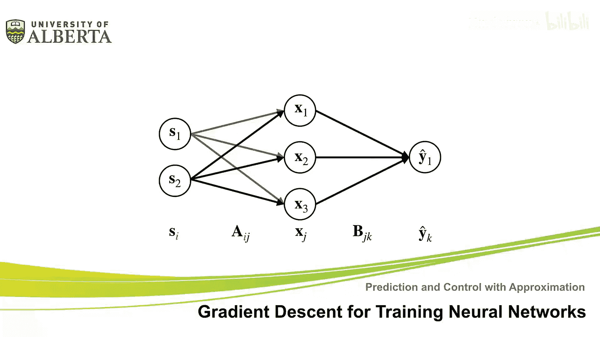
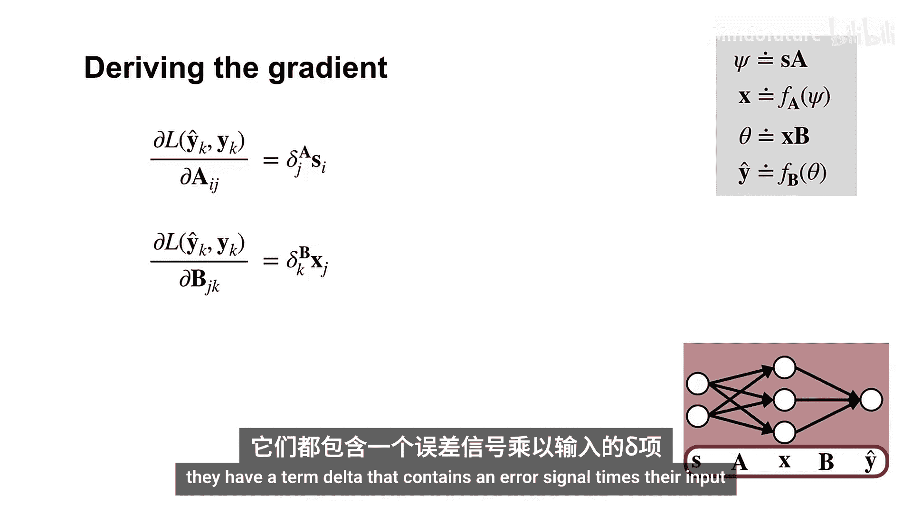
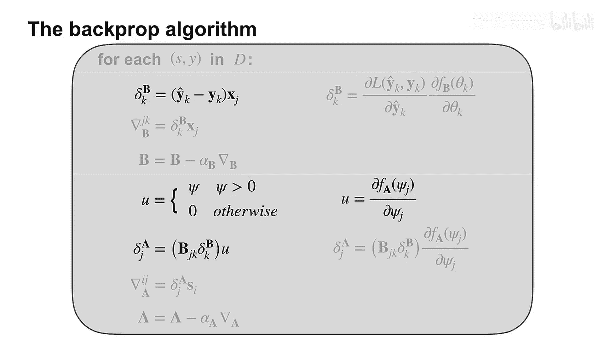

# 【阿尔伯塔大学】利用函数逼近进行预测和控制 ｜ Prediction Control Function Approximation p23 P23_用于训练神经网络的梯度下降_03_03_01 -BV1GYYWz9E1k_p23-

The updates for our algorithms have been pretty simple and most have been based on gradient descent。

 the same is true for neural networks。The back propagation algorithm is actually not that complex。

 it is in fact just gradient descent， but the gradient is a bit more complex because of the nested functions。

By the end of this video， you will be able to drive the gradient of a neural network and implement gradient descent on a neural network。

As in linear function approximation， the first step is to define a loss on the parameters of the neural network and then derive the gradient。

The loss function specifies how far the network's predictions are from being correct Our goal in training the neural network is to find the parameters which minimize this loss function。

The gradient of a function points in the direction of greatest descent by moving in the direction opposite the gradient。

 we move in the direction that most quickly minimizes the loss。

So how do we compute this gradient of the loss function for a neural network？Before we get started。

 let's establish some notation。The input to the network is S and the output is Y hat。

The hidden layer is the learn features， so let's call it X， the weights A produce the features。

 the weights B linearly weigh x to produce the output。

The output of each layer of the network can be represented as a vector， here that is X and Y hat。

The first index of the weight matrices refers to the inputs to that layer。

And the second index refers to the outputs。We assume for now we have a generic loss L so we can describe the basic idea。

An example of L is the squared error。For the derivation， we will keep L generic。

 we will give you the specific update with the squared error later。

Before we dive into the derivation， let's get oriented。Though the derivation is a bit involved。

 we will find that the final update is quite simple。

Each matrix of parameters has an update that looks like an error term delta times the input to that layer for a。

 the input is S for B， the input is x。Further， we will find that Delta A can be efficiently computed as a function of Delta B。

 The errors， Delta B from the output of the network are propagated backwards to this earlier layer to help determine the role A had in producing that error。

So now， how do we get Delta A and Delta B？For fun and of course， educational purposes。

 let's do the full derivation now。Let's start at the output of the network and work backwards there's a good reason for this as you will see。

We start by taking the partial derivative of the loss function with respect to the first set of weights B。

We use the chain rule， giving the derivative of L with respect to Y hat times the derivative of Y hat with respect to B。

The next step is again to use the chain rule for this derivative。To make this easier。

 let's introduce a new variable， theta。Theta is the output of the hidden layer times the last set of weights。

 Let's write it down on the side so we remember it。Now let's rewrite why hat using theta。

Let's expand the derivative of Y hat with respect to B。Using the chain rule。

 we get the derivative of FB with respect to theta times the derivative of theta with respect to B。

The derivative of theta with respect to B is x。 This is because theta is a linear function of B and because x does not depend on B。

And now we're done driving the gradient for B， next we'll do the gradient for A。But before that。

 let's make some choices for the loss and activation so that we can see a specific instance of this general equation for B。

Let's define L to be the squared error and use a linear activation on the last layer。

The derivative of the loss with respect to Y hat is this。

 the derivative of the activation for the output layer is one。This is because FB is the identity。

 and the derivative of theta with respect to itself is one。

Here is the generic gradient of the loss with respect to B。

Plugging this into the gradient with respect to B， we get y hat minus y times 1 times x。

To ease notation while computing the gradient with respect to A， let's define a new term delta B。

We can replace most of the gradient for B so that it now becomes deelta B times its input x。Now。

 to compute the gradient with respect to A， we need to go through the same steps as for B。

 The main difference is that we have one extra chain rule step because the weights A also affect x。

Let's start there。Let's expand this derivative using the chain rule。Before we expand the next term。

 let's introduce another helper variable。si equals inputs S times a。

Let's throw that off to the side and rewrite X to use it。We then expand the next term。

Using the chain rule again， we get the derivative of FA of P psi with respect to psi times the derivative of psi with respect to a。

And because psi is s times a， we get that d Psi D is S。Putting it all together。

 we finally get the derivative with respect to a。We now have all we need to compute the gradient of the network parameters。

 we can clean up this derivative by again defining a term deelta A。

Now the derivative with respect to a is deelta a times its input s。

Notice that both gradients can be rewritten in a similar form。

 they have a term delta that contains an error signal times their input。

Let's take a brief look at some pseudocode for implementing the back prop algorithm of stochastic gradient descent。

For each data point， SY in our data set， we first get our prediction Y hat from the network。

 this is typically called the forwardward pass。Then we compute the gradient starting from the output。

We first compute Delta B and the gradient for B， then we use this gradient to update the parameters B。

 the step size alpha B。Next we update the parameters A。 we compute Dta A， which uses deelta B。

 noticeice that by computing the gradients at the end of the network first。

 we avoid recomputing the same terms for a that were already computed for deelta B。 In fact。

 this is the main idea behind back propagation。 It is simply gradient descent with a sufficient strategy to compute gradients。

We then compute the gradient for a and update A with this gradient using step size alpha A。

This derivation and algorithm easily extend to deeper networks。

 the delta for the earlier layer is similarly computed recursively using the delta in the next layer。

The update on each layer is always of the form of a delta times the input to that layer。Essentially。

 the network passes back error information stored in the delta at each layer to make this less abstract。

 let's look at the back prop algorithm for a particular network。 Here is the pseudocode。

 If we use the rail activation on the hidden layer and a linear unit for the output。First。

 we compute the error for the output layer。Then we compute the derivative of the railu units with respect to Psi。

And finally， we use the error signal from the output layer along with you to compute the error signal for the hidden layer。

The rest remains the same。And that's it for this video Today we derive the gradient of a neural network we also discussed the main idea of backpro。

 that computing gradients starting at the output of the network can save computation。

This is a pretty detailed derivation you do not actually need to remember all of these steps。

 the goal was to give you some insight into the update for a neural network and how that might change with different choices for the loss。

 activations and layers in your assessment you'll implement the pseudocode given near the end of this video。

In the next video， we'll give you a few more tools to make your neural network implementation more effective in practice。

