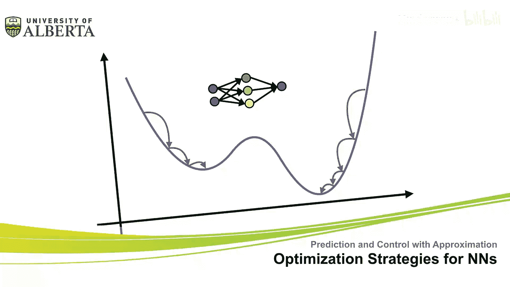
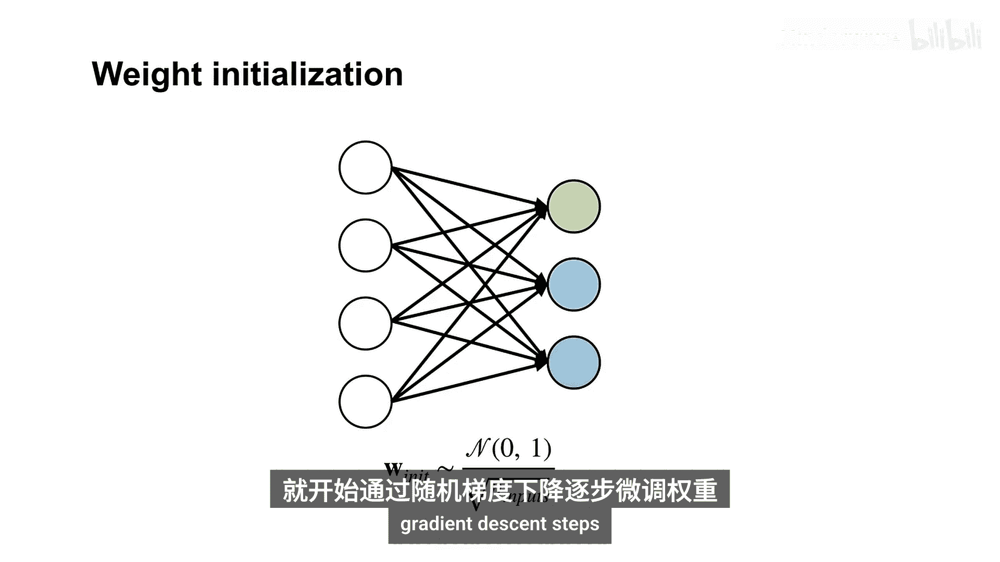
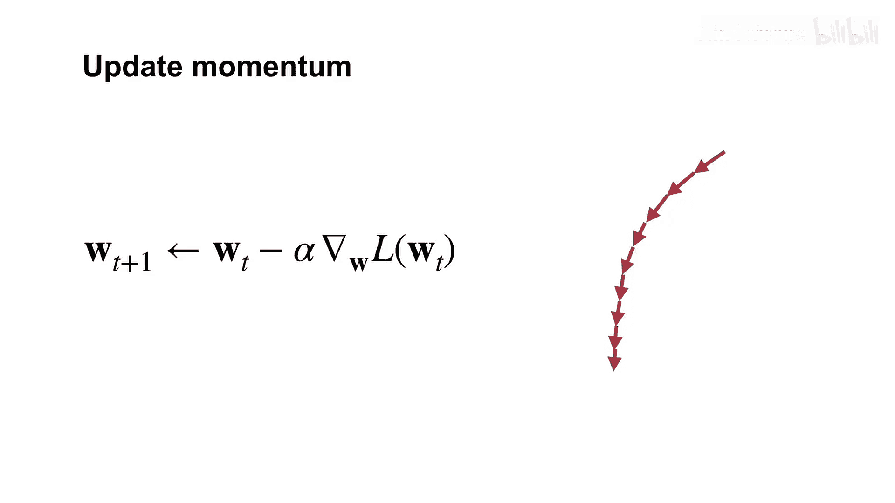
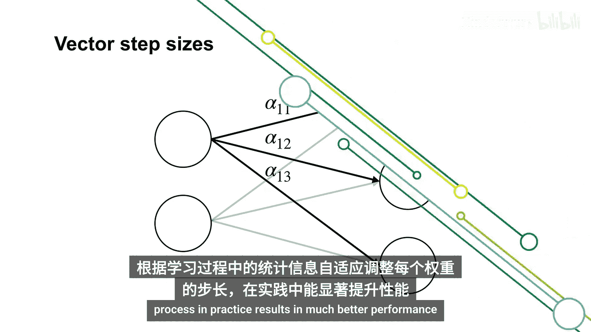

# 【阿尔伯塔大学】利用函数逼近进行预测和控制 ｜ Prediction Control Function Approximation p24 P24_神经网络的优化策略_03_03_02 -BV1GYYWz9E1k_p24-

Supervised learning systems based on deep neural networks are now the GoTo solution for image classification。

 speech recognition and natural language processing part of the reason is due to the dramatic increases in training data and affordable computation。

But to really take advantage of these increases in data and computation。

 improvements in training were needed。A couple of simple optimization strategies made it much easier to train networks and helped accelerate adoption we'll talk about these today。

By the end of this video， you will be able to understand the importance of initialization for neural networks and describe optimization techniques for training neural networks。

Like many machine learning methods， neural networks are trained using an iterative process This procedure must have some starting point。

 the choice of this starting point can play a big role in the performance of the neural network。

Let's look at an example with only one weight on the y axis we will show the loss function on the x axis。

 we will show values of the weight。As you know， grading descent will iteratively move the weight towards the nearest stationary point。

But neural network loss functions are not quite so simple。 If we start in this nearly flat region。

 it can be hard to make any progress with gradient descent since the gradient is near 0。

If instead we start inside this small bowl， then we can quickly find the local Opima。

But wouldn't it be nice if we could start somewhere here where we can quickly find an even better optimal point？

One simple yet effective initialization strategy is to randomly sample the initial weights from a normal distribution with small variants。

This way， each neuron has a different output from other neurons within its layer。

This provides a more diverse set of potential features。By keeping the variant small。

 we ensure that the output of each neuron is within the same range as its neighbors。

One downside to this strategy is that as we add more inputs to a neuron。

 the variance of the output grows， we can get around this issue by scaling the variance of the weights by one over the square root of the number of inputs。

After we have picked the starting point for our network。

 we start incrementally making small improvements to the weights using stochastic gradient descent steps。

Another way to improve training is to consider more sophisticated update mechanisms two common strategies are to use the heavy well method also called momentum and vector step size adaptation Let's talk about momentum first。

Imagine this is the trajectory of a two dimensional weight vector under stochastic gradient descent。

Here is the stochastic gradient descent update rule。

And here is the update modified to include momentum notice it is similar to the regular stochastic gradient descent update plus an extra term called the momentum The momentum term summarizes the history of the gradients using a decaying sum of gradients with decay rate lambda。

If recent gradient have all been in similar directions， then we gain momentum in that direction。

This means we make a large step in that direction。If recent updates have conflicting directions。

 then it kills the momentum， the momentum term will have little impact on the update and we will make a regular gradient descent step。

Momentum provably accelerates learning， meeting a gets to a stationary point more quickly。

Another potential improvement is to use a separate step size for each weight in the network so far we have only talked about a global scalar step size。

 this is well known to be problematic because this can result in updates that are too big for some weights and too small for other weights。

 adapting the step sizes for each weight based on statistics about the learning process in practice results in much better performance。

Now how does the update change the change is very simple， instead of updating with a scalar alpha。

 there's a vector of step sizes indexed by T to indicate that it can change on each time step。

Each dimension of the gradient is scaled by its corresponding step size instead of the global step size。

There are a variety of methods to adapt a vector of subss you will get to implement one in your assignment。

That's it for this video。 Today， we discussed ways to improve the training of neural networks。

 specifically， we discussed one strategy for initializing the weights in a neural network。

And how to accelerate learning using momentum and step size adaptation。

Now you're all set to implement a td agent with a neural network， hope you have fun。

