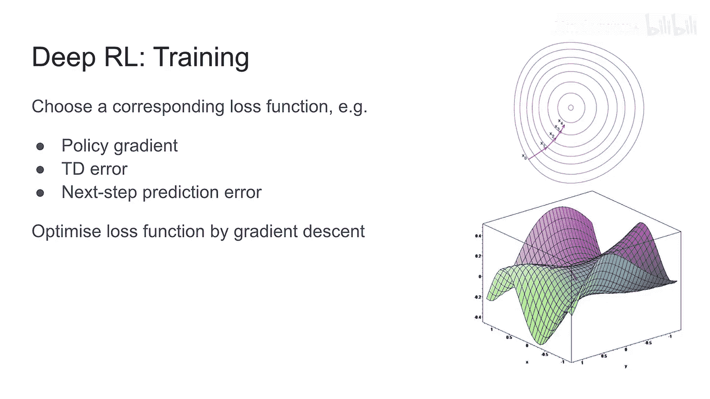

# 【阿尔伯塔大学】利用函数逼近进行预测和控制 ｜ Prediction Control Function Approximation p25 P25_David Silver 谈深度学习、强化学习和人工智能_03_03_03 -BV1GYYWz9E1k_p25-

Hi， I'm David Silva and I'm going to talk about deep reinforcement learning。😊。

So let's remind ourselves why we care about reinforcement learning。

Reinforcement learning is a very general purpose framework that lets us think about all kinds of different decision making problems。

So it really provides a way to think about any problem where there's an agent and that agent gets to take actions in the world。

 and importantly that agent' actions actually affect the world and the world in turn changes as a result and gives some observations back to the agent and the agent gets to choose the actions that maximize its performance in the world that's measured by some kind of reward signal。

😊，So this is such a general problem it can be applied to all kinds of things from robots to games to financial transactions。

 whatever you think of reinforcement learning is this problem framework that lets us do all of those things。

🎼So deep learning is a way to， it's actually a general purpose framework to help us solve a wide variety of problems。

 it's a way to think about representation learning in a very general way。In particular。

 if we're given an objective， then deep learning gives a way to build up a representation that actually achieves that objective。

 a way to start with these inputs that kind of filter into the system and build up some kind of features that help to understand those inputs in a way that helps to solve the problem using minimal to main knowledge。

 you don't have to put a lot of knowledge into the system。

 you just pass something in like an image of something like a cat or a dog and the system builds up features to understand patches of this image and then more complicated features and eventually comes up with a decision。

 for example， say whether this thing is a cat or a dog。😊，So if we put these two things together。😊。

Deep reinforcement learnings， the combination of the two really we're trying to seek an agent that can solve any human level task that's our ultimate goal here when that's why many of us are interested in artificial intelligence and if we want to achieve that goal how can we do it well the problem can be defined by reinforcement learning but deep learning maybe gives us the mechanism that helps us to get there so RL is like the problem and deep learning is more like the solution。

😊，And so here's a big conjecture and the big conjecture is that RL plus EL。

 if we put these two things together， it gives us a recipe that can carry us maybe most of the way towards our big goal。

 our big ambitions of being able to solve any of these problems。😊。

🎼So let's just dive in a little bit to understand what deep learning is all about。

So the main piece of deep learning is this thing called a neural network and a deep neural network really is just something that you can think of as a multilayed function。

 a compositional function， a function of a function。😊，And so if we just unpack that a little bit。

 it's made up of a few pieces， we start off with some input that goes into the system that might be your image describing whether this thing is a cat or a dog。

 and that gets processed by a bunch of different functions to give you these kind of internal states or features and each of those things takes weights。

 these ws that kind of tell you what that function should actually do。

 the parameters of the function， and then that gets processed by a series of different functions。

 until eventually this thing， this deep neural network outputs after all of these different layers of computation。

 some kind of output describing what the system actually thinks like is this a cat or a dog。😊。

And as a result of that， there's one final step， which is an important step which defineds the objective of the system。

 what it's really trying to do， and that we call the loss。

 it's a number saying you know how well this system did， typically a scalr you one。

 if you classified this correctly and zero if you got it wrong as an example。😊。

🎼Now the special thing about these deep neural networks is that you can actually not just compute these things in the forward direction but you can actually reverse the flow of all of that information to work out which of these parameters led to that loss being good or bad。

 we can understand if I was to tweak these parameters in a particular direction。

 how would those change parameters actually lead to the output changing and lead to that causing a particular loss would it lead to me predicting this thing being a catmo or a dog more and the way we do that is just by reversing the direction of flow and using the chain rule of calculus to compute the gradient of this whole system and that is known as back propagation？

😊，🎼So the main idea of training a deep neural network is actually just to use this gradient to adjust the parameters so we compute the gradient of the loss with respect to the parameters and that you can think of as kind of giving us pointing us in the direction that kind of goes down the hill in terms of think of this big landscape that's describing you for each point in the landscape is one potential choice of your parameters and the gradient kind of tells you which direction is going to take you down that landscape where the height of that landscape is really telling you how good it is and downhill might be better with your lower error we want to move down this landscape by following the gradient down to the point that has the lowest error。

😊，So we just moved the parameters in that direction and that really is the fundamental idea behind training and neural network。

 that's the whole idea of deep learning。😊，🎼Okay， so let's get back to our elegant and understand how we can actually put these pieces together to really try and do something amazing。

😊，So if we think about RL agents， it's really useful to understand the anatomy of an RL agent so the way I think about this is that you know there's these major components that may or may not be inside our agent and that really defines the kind of category of what type of agent it is so it might have a policy inside it that determines that agent's behavior in which case we say this is a policy-based approach to RL。

 it may have a value function inside it， which kind of describes the agent's predictions about how much reward it will get or potentially other terms and in that case we call it a value-based RL agent and it might have a model inside it。

 something saying you know how the agent thinks the environment works。

 what it thinks is going to happen next and so if it has a model inside it we say it's a model-based approach to RL。

😊，🎼We can apply。The combination of deep learning and reinforcement learning by essentially using deep neural networks as a function appximator。

 and that function appxiator can be used to represent any one of these three kind of major components of reinforcement learning that could be used to represent the policy。

😊，It could be used to represent the value function or it can be used to represent the model Now to train this system the main idea is really that we have to pick a loss function。

 we have to pick an objective that describes what we really want in terms of one of these three kind of families of reinforcement learning algorithms so if we're doing policy-based reinforcement learning then for example we might choose to follow the policy gradient。

If we're doing value based reinforcement learning， we might choose to minimize the TD error。

 the temporal difference error。🎼And if we were doing modelbased reinforcement learning we might choose to minimizeise the next step prediction error。

 and so what do we do， what's the algorithm or the algorithm' is very simple just like in deep learning。

 all we have to do is to optimize that loss function by gradient descent。

 following this landscape down and down and down and down until our loss gets lower and lower and lower and we're doing better and better and better。

🎼So if we put those things together， it gives us a recipe for achieving all kinds of interesting things in reinforcement learning and some of those have actually led to some of the exciting success stories that we've seen in recent years。

 so for example it's possible to use a deep reinforcement learning approach to try and play games to very high levels so we've seen agents that are able to defeat the human world champions in the game of go and indeed in other games like chess and so forth or taking this into the modern era。

 you might want to play in video games as well， so we have deep reinforcement learning agents that are able to play 50 or more completely different games from the Atari system。

 and recently we've had a system which was able to play the very challenging game of Starcraft this is one of the most challenging video games for humans。

 but it's not just games that these things can do they can have impact on all kinds of applications as well。

😊，For example， we've seen deep reinforcement learning agents that can learn to manipulate objects with a great deal of dexterity。

 we've seen deep reinforcement learning agents which are able to solve chemical synthesis problems by an approach known as retroynthesis。

 or we've seen deep reinforcement learning agents that actually go out and trade in the real world like actually algorithmically deciding what to do on these trading floors。

😊，🎼So in conclusion， when we combine the problem of reinforcement learning with the solution approach of deep learning and we use these deep learning methods to provide us with a powerful toolkit for function approximation。

 we actually have a very flexible and powerful approach that can take us a long way towards solving many of the problems that we care about in AI。

