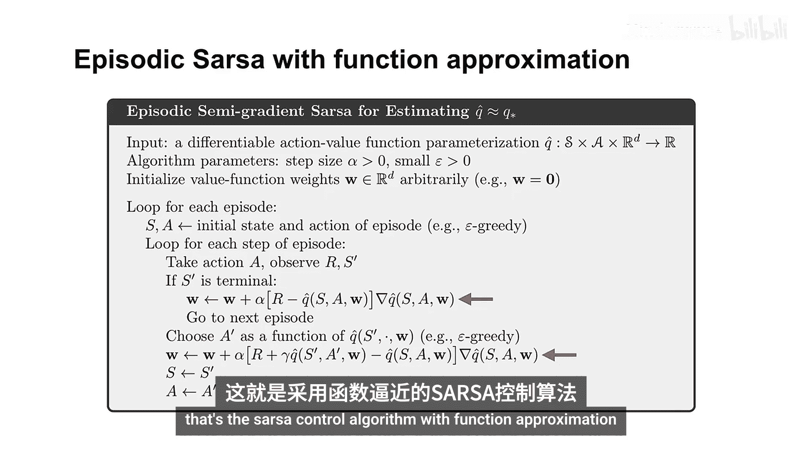

# 【阿尔伯塔大学】利用函数逼近进行预测和控制 ｜ Prediction Control Function Approximation p27 P27_带有函数逼近的回合制Sarsa_04_01_03 -BV1GYYWz9E1k_p27-

We've learned a lot about how to construct features and approximate functions。

But that was all in the context of making predictions with a fixed policy。This week。

 we'll talk about control with function approximation。In this video。

 we'll start with the GPI algorithm， Esodic SAarRSA。By the end of this video。

 you'll be able to understand how to construct action dependent features for approximate action values。

And explain how to use SARSSA in episodic tasks with function approximation。

Recall that the value function approximation has two components， a weight vector。

 and a feature vector。In a given state， the value estimate is the dot product between these two components。

To move from TD to SARSA， we need action value functions。

So the feature representation has to represent actions as well。

One way to do this is to have a separate function approximator for each action。

This can be accomplished by stacking the features， that is we can use the same state features for each action。

 but only activate the features corresponding to that action。To understand this more clearly。

 let's look at an example。Let's say there are four features and three actions。

The four features represent the state you' are in。But we want to learn a function of both states and actions。

 We can do this by repeating the four features for each action。

Now the feature vector has 12 components here， each segment of four features corresponds to a separate action。

We call this feature representation stacked because the weight for each action are stacked on top of each other。

Thus， only the features for the specified action will be active。

 while those for the other actions will be set to zero。

Let's see an example of how to calculate the action values from a given state。

Let's say that there are four features and three actions。The weight factor looks like this。

With stack features， we get the following feature vector for action 0 in state S。

 We zero out the features for the other actions。So we extract the segment of the weight factor corresponding to each action。

The action values are then the dot products between each segment of the weight vector and the feature vector。

You might think that stacking features to create action values is specific to linear function approximation。

 but this is not the case。For example， the common way to represent action values with the neural network is to generate multiple outputs。

 one for each action value。This， however， is equivalent to the stacking procedure we just described。

The neural network inputs the state， and the last hidden layer produces the state features。

Each action value is computed from an independent set of weights using those state features。

The weights for one action value do not interact with those of another action value。

 just like in stacking。We might want to generalize over actions for the same reason generalizing overstate can be useful。

Now how might this work with the neural network？We would input both the state and the action to the network。

There would only be one output， the approximate action value for that state in action。

We can do something similar with tileu coding by passing both the state and action as input。Okay。

 we now know how to handle action values with function approximation。

 Let's talk about using SARSa for control with function approximation。

The algorithm is quite similar to the tabular version， so we will just review the differences。

We use parameterize action value functions for the action value estimates。

The update also changes to use the gradient to update the weights similar to semi gradient TD。

And that's it， that's the SArsRSO control algorithm with function approximation。

In this video， we talked about action dependent features and we introduced episodic SARSA with function approximation。

We will cover a few more control algorithms in the coming lectures。Until next time。

