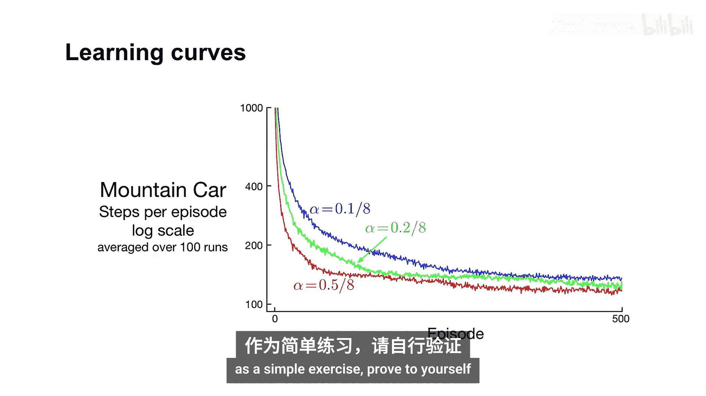

# 【阿尔伯塔大学】利用函数逼近进行预测和控制 ｜ Prediction Control Function Approximation p28 P28_山地车中的回合制Sarsa_04_01_04 -BV1GYYWz9E1k_p28-

In this video， we get to see episodic SArsRSa in action on a continuous state domain。

We'll visualize the learn values and gain some intuition about the solutions learned by SARSSA。

By the end of this video， you will gain experience analyzing the performance of an approximate TD control method。

Let's look an example of Es SArsRSa on a classic control domain called Mountain Car。

Mountain Car is an episodic task where the objective is to drive an underpowered car up the side of a mountain。

Gravity is stronger than the car's engine， so the agent cannot directly drive up the mountain。

The only way to escape is to first drive backwards up the left slope。

Then driving down the hill gives the car enough momentum to drive up the right slope and out。

The episode begins with a car in a random location near the bottom of the valley。

It ends when the car reaches the flag at the top of the hill。

To encourage the agent to finish the episode as quickly as possible。

 the reward is minus1 on each time step。And no discounting is used。

The agent can observe the current position and velocity of the car。This is a two dimensional。

 continuous valued state。The agent has a choice between three actions， accelerate forward。

 accelerate backward， or coast。For this example， we jointly tcode the position and velocity to produce features。

We use eight tiles， which means we use8 by8 grids for the two dimensional input space。

 We use eight tielings， which means we have eight overlapping grids。

We treat actions independently by using a stacked feature representation。

We initialize the weight to0。 This initialization is actually optimistic。

 This is because the reward is -1 per step， so the values under any policy will be less than 0。

In this problem， these optimistic initial values cause extensive and systematic exploration。

Because of this， we can act greedily without any additional random exploration。

Let's see what the value function looks like after we run the agent for a very long time。Ideally。

 we would like to plot the value function for every state。 However。

 there is an uncountably infinite number of states， so we will have to sample the set of states。

We'll use the max value in each sample state。This number tells us the number of steps the agent thinks it will take to escape under its greedy policy。

The reward is minus1 for each step。So we negate this number to produce the agent's estimate of the number of steps go from each state。

Here's the agent's estimate of the expected number of steps after 9，000 episodes。

 this is a really long time for this problem， so we're pretty sure the value estimates are but as good as they're going to get。

But they're not perfect due to function approximation。The green line represents the goal position。

 which does not depend on the velocity。Near the goal， if the velocity is large enough。

The agent can directly drive out。However， if the agent is near the goal， but the velocity is too low。

It will take many steps to escape。This is because the agent must first go back down the hill and up the left side again to gain enough momentum to escape。

The peak corresponds to the start states， where it takes around 120 steps to reach the flag。

This green trajectory reveals the path taken through the state space by the Learn policy。

The value function looked pretty interesting。But let's look at some learning curves to get better insight into the speed of learning。

Let's try SARSa with three different values of alpha， so three variants of the algorithm。

Here we are interested in the steps the goal， which in this case corresponds to the return per episode。

We expect the number of steps per episode to decrease with learning。

Lower on the X axis corresponds to better policies。

 policies that can reach the goal in the fewest steps on average。As always。

 we average the performance over many independent runs。Here are the results。By 500 episodes。

 the number of steps per episode has roughly stabilized。

 all the learning curves exhibit the familiar exponential profile。

The smaller step size parameter value of 0。1 results in slower learning， while alpha of 0。

5 allowed the agent to learn more quickly and find a better policy over 500 episodes。

Notice we divided each alpha value by8。If we are not using a vector of step sizes。

 we often scale the step size parameter by the norm of the feature vector。

Here we use eight tlings in our tacoder。 That means the number of ones in the feature vector is always 8。

As a simple exercise， proves yourself that8 corresponds to the L1 norm of the feature vector。

Okay， that's enough for today in this video we evaluated episodic SARSa with linear function approximation in Mountain car。

See you next time。