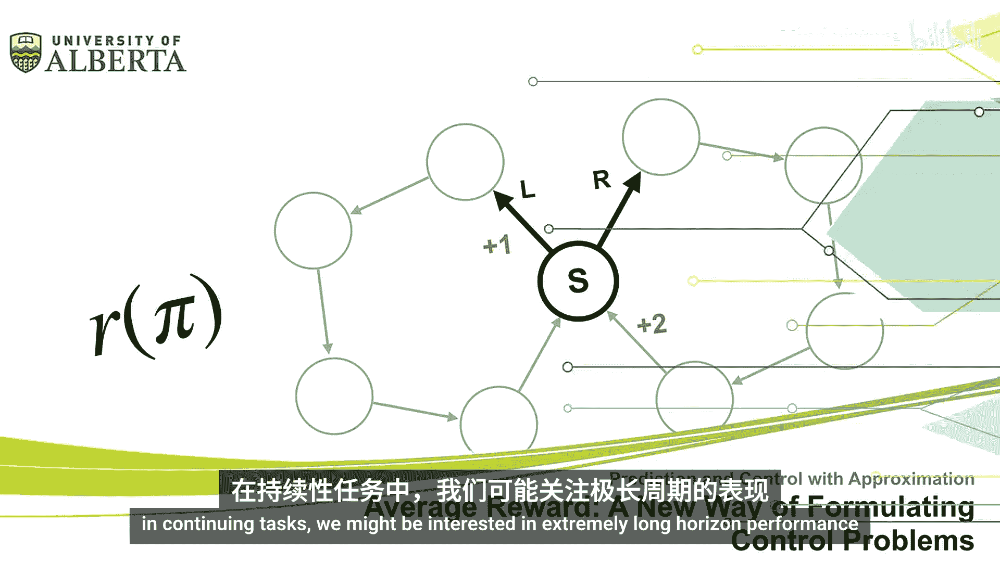
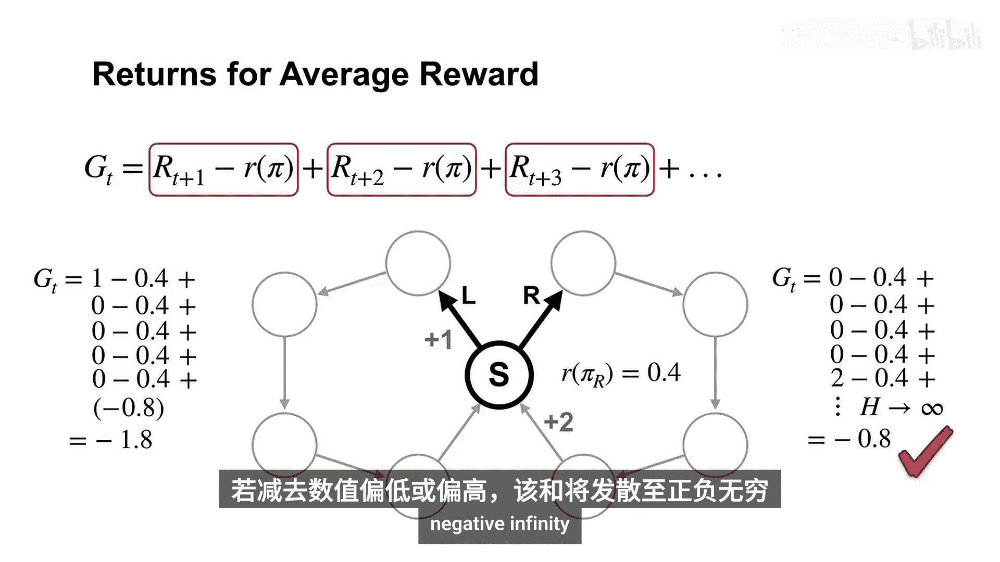
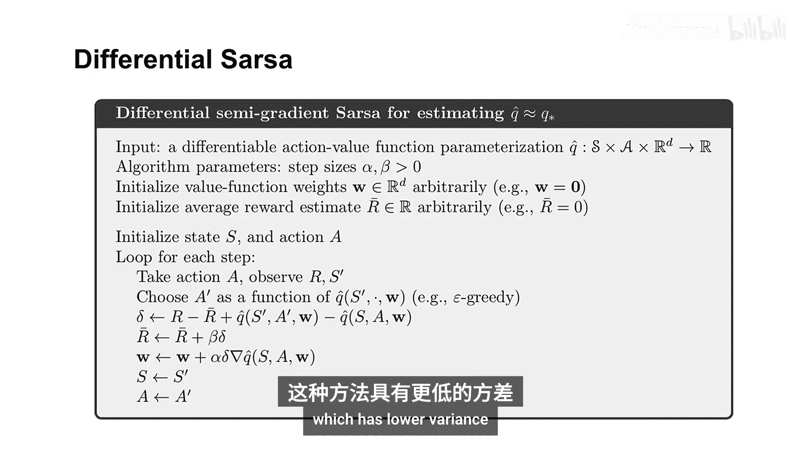

# 【阿尔伯塔大学】利用函数逼近进行预测和控制 ｜ Prediction Control Function Approximation p31 P31_平均奖励_一种构建控制问题的新方法_04_03_01 -BV1GYYWz9E1k_p31-

In continuing tasks， we might be interested in extremely long horizon performance up until now。

 we've used discounting and continuing problems to balance short term performance and long term gain。

However， this is not the only way to formulate the problem。

Today we'll learn about a new way of formulating continuing problems called the average reward Form。

By the end of this video， you'll be able to describe the average reward setting。

Explain when average reward optimal policies are different from policies obtained under discounting。

And understand differential value functions。Today is all about continuing tasks Imagine a simple task where the states are arranged in two intersecting rings let's call this the near sighted MDP。

In most states， there's only one action so there are no decisions to be made。

There's only one state where a decision can be made in this state。

 the agent can decide which ring to traverse。This means there are two deterministic policies traversing the left ring or traversing the right ring。

The reward is zero everywhere， except for in one transition in each ring。In the left ring。

 the reward is plus1 immediately after state S。In the right ring。

 the reward is plus2 immediately before state S。 Intuitively。

 you would pick the right action because， you know you will get plus 2 reward。

 But what would the value function tell us to do。If we use discounting。

 what are the values of state S under these two different policies？

The policy that chooses the left action has a value of one over one minus gamma to the5。

 How do we figure this out， If you write out the infinite discounted return。

 you will see this is a fairly straightforward geometric series with a closed form solution。

 See if you can get the same answer that we did。The policy that chooses the right action has a value of two times gamma to the4 over1 minus gamma to the5。

Let's think of the value of state s under these two part policies for particular values of gamma。

If gamma is 0。5， VL is approximately 1 and VR is approximately 0。1。

This means the policy that takes the left action is preferable under this more myopic discount。

Let's try a larger value of gamma， 0。9。VL is now approximately 2。4， and VR is approximately 3。2。

 so now we prefer the other policy。In fact， we can figure out the minimum value of gamma so that the agent prefers the policy that goes right。

Gamma needs to be at least 0。841。So the problem here is that the discount magnitude depends on the problem for this example。

 0。85 is sufficiently large， but if the rings had hundred0 states each。

 this discount factor would need to be over 0。99。In general。

 the only way to ensure that the agent's actions maximize reward over time is to keep increasing the discount factor towards one。

 depending on the problem， we might need gamma to be quite large and remember we can't set it to one in a continuing setting because then the return might be infinite。

Now what's wrong with having larger gamma， La values of gamma can also result in larger and more variable sums。

 which might be difficult to learn。So is there an alternative？

Let's discuss a new objective called the average reward。

Imagine the agent has interacted with the world for H steps。

This is the reward it has received on average across those age steps， in other words。

 its rate of reward。If the agent's goal is to maximize this average reward。

 then it cares equally about nearby and distant rewards。

 we denote the average reward of a policy with R P。More generally。

 we can write the average reward using the state visitation mu。

This inner term is the expected reward in a state under policy pie。

 The outer sum takes the expectation over how frequently the policy is in that state。

Together we get the expected reward across states， in other words， the average reward for a policy。

In the near sighted example， the two deterministic possible policies visit either the left loop or the right loop indefinitely。

 in both cases， the five states in each loop are visited equally many times。In the left loop。

 the immediate expected reward is plus zero for all statess except one， which gets plus one。

This results in an average reward of one every5 steps or 0。2。

Most states in the right loop also have plus zero immediateted expected reward。

 but this time the last date gets plus2。This gives an average reward of two every five steps or 0。4。

We can see the average reward puts preference on the policy that receives more reward in total without having to consider larger and larger discounts。

The average reward definition is intuitive for saying if one policy is better than another。

 but how can we decide which actions from a state are better。

 what we need are action values for this new setting。

The first step is to figure out what their return is。In the average reward setting。

 returns are defined in terms of differences between rewards and the average reward R pi this is called the differential return。

Let's look at what the differential returns are in our near sighted MDP。

The differential return represents how much more reward the agent will receive from the current state in action compared to the average reward of the policy。

Let's look at the differential return starting in state S， first choosing A L。

 and then following P L afterwards。The average reward for this policy is 0。2。

The differential return is the sum of rewards into the future。

 with the average rewards subtracted from each one。This sum starts in state S with the action L。

We can compute it by summing to some finite horizon H， then taking the limit as H goes to infinity。

We are simplifying things slightly with this limit notation while the notation provider works in many cases。

 we need to use a different technique when the environment is periodic in this case we compute the return using a more general limit called the Carro sum。

 but this technical detail is not critical， the main point here is the intuition。

We find that the differential return is 0。4。Now let's look at the other action。This time。

 we can break the differential return into two parts。 First。

 the sum for a single trajectory through the right loop。

 we can write the sum explicitly and is's equal to one。

Then the sun corresponding to taking the left action indefinitely。

This sum is the same as the differential return we just computed， 0。4。Adding the two parts together。

 we find that the differential return is 1。4。So if the agent's policy is to always take the left action。

 it can observe its differential returns and realize it should switch to taking the right action。

Now let's look at the differential returns if the agent's policy is to always take the right action。

This policy results in an average reward of 0。4， and the differential term for the policy that takes the right action in state S is minus 0。

8。Now what's the differential return for taking the left action once in state S and then taking the right action indefinitely？

Like before we break up the sum into two parts， taking the left loop once results in a sum of minus1 over the first five time steps。

 adding the differential return from following pi R from state S， which we found to be minus 0。8。

 results in our answer of minus 1。8。Once again， we see that the right action is preferred。

You may have noticed that the differential returns for PR were lower than the differential returns for PL。

 even though PR has a higher average reward。This is because the differential return represents how much better it is to take an action in a state than on average under a certain policy。

The differential return can only be used to compare actions if the same policy is followed on subsequent time steps to compare policies。

 their average reward should be used instead。Interestingly。

 the differential return is only a convergent sum if the subtracted constant is equal to the true average reward。

 if a lower or higher number is subtracted， the sum will diverge to positive or negative infinity。

Now that we have a valid definition of the return for average reward。

 we define value functions in the usual way as the expected return， similarly。

 we can also define differential value functions as the expected differential return under a policy from a given state or state action pair。

This quantity captures how much more reward the agent will get by starting in a particular state than it would get on average over all states if it followed a fixed policy。

Like in the discounted setting， differential value functions can be written as Belelmon equations conveniently。

 they look like the previous ones we've seen， they only differ and that they subtract RP Pi from the immediate reward and there is no discounting。

Many algorithms from the discounted case can be rewritten to apply to the average reward case。

 for example， differential SArsSA is very similar to the SARSSA algorithm you've seen before。

Let's step through the differences。A key difference is that differential SArsA has to track an estimate of the average reward under its policy and subtract it from the sample reward in its update。

This implementation does so with the incremental averaging techniques we've seen throughout the course。

Given this estimate， it then subtracts our bar from the sampled reward in its update。

In practice we can get better performance with a slight modification to this algorithm。

 instead of the exponential average of the reward to compute our bar。

 we use this update which has lower variance。

In this video， we introduce the average reward objective and define differential returns and differential value functions for this setting。

Next week we'll talk about another way to optimize this average reward objective， see you then。

