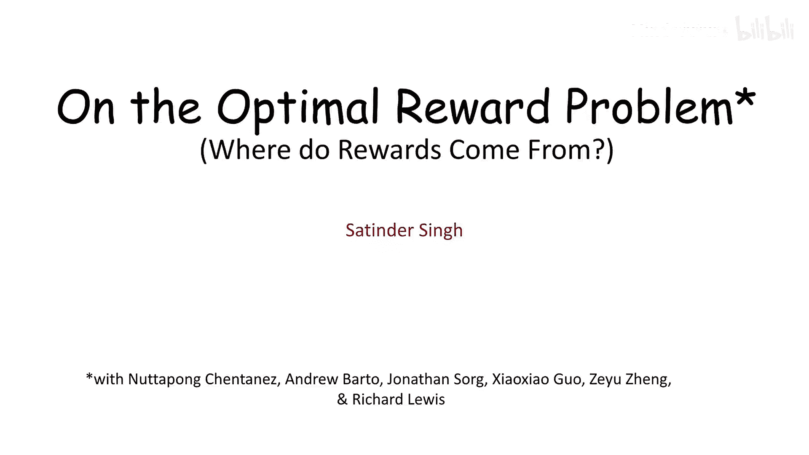
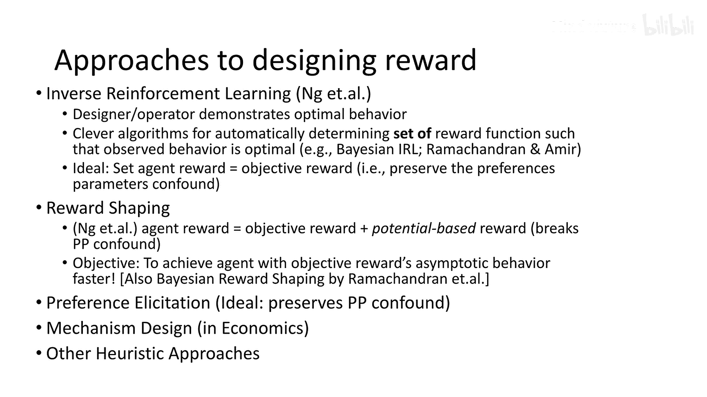
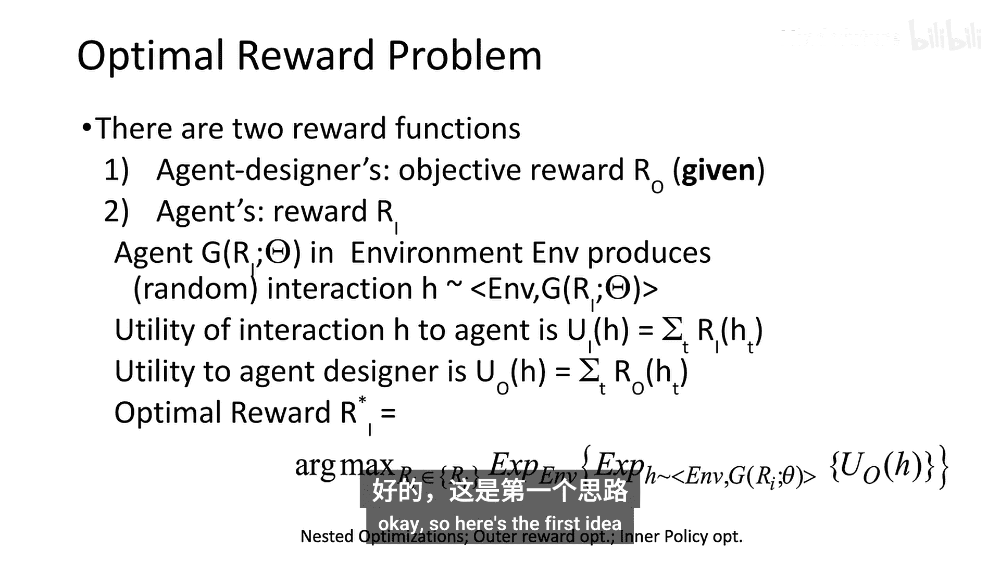
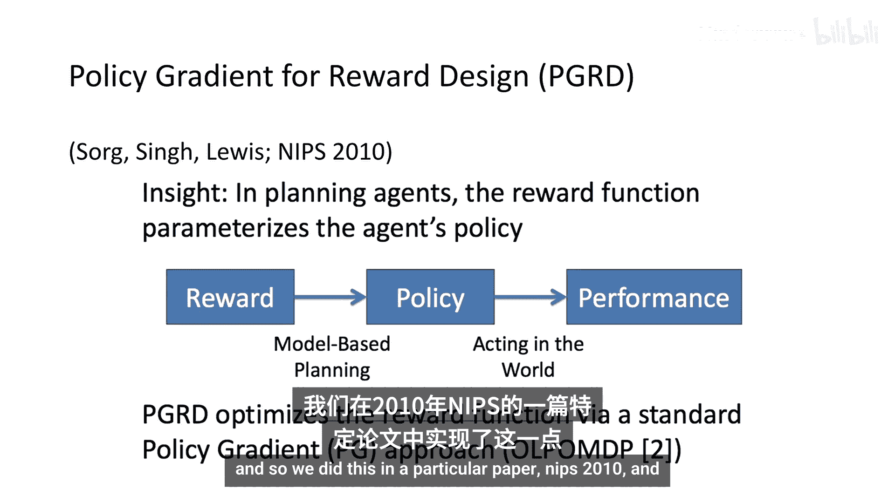
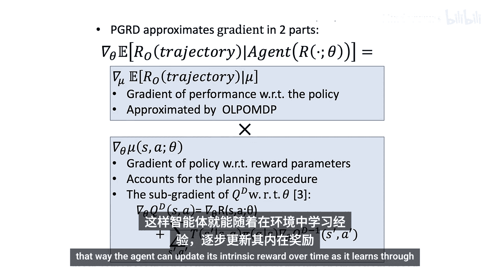
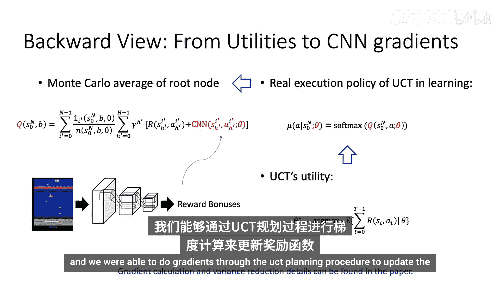
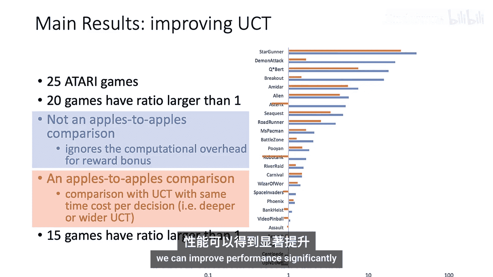
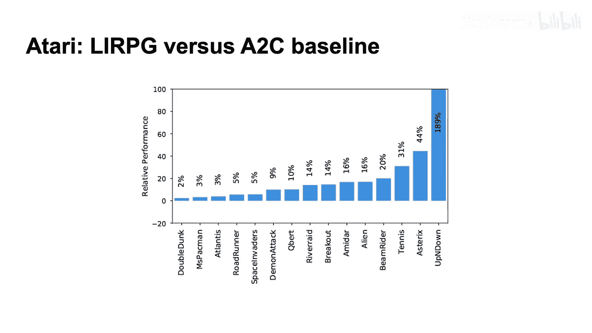

# 【阿尔伯塔大学】利用函数逼近进行预测和控制 ｜ Prediction Control Function Approximation p32 P32_Satinder Singh 谈内在奖励_04_03_02 -BV1GYYWz9E1k_p32-

I'm such interesting and thanks amount time。And Adam for inviting me for this。

 so I'm at deep mind right now I'm going to leave the University of Michigan。

And I'm going to talk about the problem of where do rewards come from in reinforcement learning now when we all study reinforcement learning。

 we assume the rewards are given and the rest of we study how to optimize social rewards。

 but could be an interesting question to ask where do these rewards come from at the beginning with？

So the way I'm going to set this question up is by talking about the preferences parameters compoundfo。

That's a mouthful so I'm going to break it down for you。

 so the starting point when we're doing sort of AI is for an agent designer that has an objective or extrinsic reward function that specifies preferences over agent behavior。

So I'm the agent designer， I'm designing an agent， I have preferences over the agent agent's behavior。

 that's my objective or exttrisic reward function， and often it's too sparse and delayed。

And so the question then becomes， what reward function should I give the agent。

 what should the agent's reward function be， where do the rewards come from， in other words。

When we think about it this way， the single reward function that you read about reinforcement learning。

Confounds two roles from the designer's point of view simultaneously in reinforcement learning agent。

 it embodies or it captures preferences that is it expresses the agent designer's preferences over behavior。

 its also parameters because through the reward hypothesis it expresses the Ral agent's goals or purposes and therefore becomes parameters of the actual agent behavior。

So the same single reward function in the standard algorithm framework captures two things。

 preferences by the agent designer or agent behavior。

 and as parameters or whatever parallel algorithm the agent is using to convert the reward function into behavior。

And the question that I'm asking is these role seem distinct and should they be confounded into a single reward function？

And so the answer I'm going to suggest is that they should not be。

 though we we can imagine two different reward functions， so here's a diagram of the standard。

Reinforcement learning agent where the reward function is assumed to be part of the environment。

 the critic is part of the environment and then the agent's task is to optimize some cumulative measure over that reward function here's another diagram in which we blow up the agent into let's call it the organism in which inside the agent is a critic。

Which then rewards the agent and then the agent to optimize and there's an external environment。

Which led the role of the previous environment in which the extrinsic reward would lie。And of course。

 when you think of the organism， you think of natural organisms， for example。

 you would think that evolution would have been able to reach inside us and configure our internal reward function。

 and it's a locus of adaptation。Okay， so Age reward is internal or intrinsic to the agent。

Because they are parameters in essence to be designed by the agent designer in artificial agents。

 or by evolution in natural agents。Okay so many people think about designing the reward function。

 there are many approaches to it， for example， inverse reinforcement learning is a way of converting expert behavior into a reward function。

 reward shaping our ideas about how to change the reward function to make the reward function more efficient for the agent to learn from preference eitation is a way of eliciting preferences or rewards from a agent designer。

Mechanism design in economics， think about how to design rewards and so on。

 and then many other heuristic approaches often very successful empirically in designing reward functions。

I'm going to tell you about a little light of work that I've been pursuing called the optimal reward framework or the optimal reward problem so what is the optimal reward problem again。

 as I've been arguing there are two different notions of reward。

One which we can't change because the true reward is the objective reward denoted here by R sub0 or R sub O。

 and then the agent's reward， which is the internal reward of R by。

And so the optimal reward problem in English shown math in the slides is the following。

Given a space of reward functions。What is the reward function I should give the agent so that？

In translating the reward function of the behavior。

The agent ends up optimizing the agent designers or objective reward function。

So that's the optimal award。If you give me a space of reward functions。

 you can essentially use any algorithm you want， potentially to search over the space and design or recover or discover the reward function that optimizes the agent's behavior from the agent designer's point of view or the extrinsic or the objective reward point of view equivalent key。

So that's the optimal report。And it's a search problem， it's a problem that we can solve anyway。

 we can think of it as a meta problem， right an outer loop where you're optimizing the reward。

 where the inner loop is optimizing the behavior given the reward。

And that's why I'm going to show you a couple of quick ideas that we have developed in my lab for optimizing the internal reward。

Okay， so here's the sort of first idea， very simple intuition we call PGRD or policy gradient for reward design。

 and it stems on the following simple observation。

We've always had policy gradient。Approaches for optimizing an extrisic reward。

 those policy gradientding approaches take parameters that specify the policy in some way。

One way to think about the intrinsic reward is that it's just parameters。That are in effect。

 parameterizing the policy of the agent， and so just as policy gradientd methods can optimize parameters of the policy。

 they can optimize the internal reward function。And that's one approach is basically using。

Graands of the extrinsic reward。With respect to policy parameters， it our intrinsic what parameters。

And so we did this in a particular paper， at NIPS 2010。

 and I'm going to tell you a little bit about it。

By this slide， so this slide describes how you can compute the gradient with respect to the intrinsic reward parameters。

When you do policy gradients， so the first box on top shows you how you can define the。

Gient of the objective reward along a trajectory with respect to the policy。

 with respect to the probabilities of taking actions embodied in the policy。

And the second part tells you how you can take the gradient with respect to these policy choices or probabilities of actions。

 with respect to the parameters of the intrinsic reward。

 and it's basically a pretty straightforward iter process and you can compute it and that way the agent can update its intrinsic reward。

Over time as it learns to experience in the environment， so one of the first projects we did。

Was to use， this is in Ichi 2016 where we showed how you can use。

This procedure of PGRV policy gradient for reward design to optimize the intrinsic reward function to use with UCT as a policy gradient algorithm。

As a planning algorithm to compute behavior and given an intrinsic reward。So we have the UCT。

 which is actually a look at such procedure for computing。

Policies from a model and UCT has a fixed number of trajectories a fixed depth and it searches over as parameters and we print uses an intrinsic reward and we were able to do gradients through the UCT planning procedure to update the reward function I didn't walk through the algorithm details but we did PGRD with UCT and here is a slide showing results of 25 Atari games where the verticalical line is if a bar is on the vertical line that means we were able to just match the performance of UCT and as bars go to the right that means we are improving a performance of UCT and you can see that in most of these games we were able to improve performance significantly so the only thing that's being learned in these results is the intrinsic reward function we' using UCT to plan so the conversion。

Of intrinsic rewards to behavior is through UCD， which is a fixed planning procedure。

 the only thing we are learning from。Experience is the intrinsic reward function and we can see that we can improve performance significantly。

Okay so this was for doing this over planning with respect to a planning algorithm can we do this with respect to a learning algorithm so that's the next bit of result I'm going to tell you about this is what presented in neuro in 2018 my students say youuzang and junior girl and this was exactly the same idea except now we're going to do it through a learning algorithm rather than through a planning algorithm it wasn't clear to me to begin with that you can actually take the gradients through a learning procedure to update the intrinsic rewards because conceptual you can imagine that as you perturb the intrinsic reward you perturb the dynamics of learning so what we need to do is take the gradient through that change in dynamics of learning and update the intrinsic reward to update 10 the learning process and that's what we show it that we can do through a megraded procedure so here's a diagram for the agent in this diagram the agent has two boxes the policy box we told do the a a credit box。

Wwhich will take an intrinsic reward or in this case。

 a sum of an extrinsic reward an extrinsic reward and do policy gradients act a critic to update the policy。

 and we're going to use this meta gradient procedure for updating the intrinsic reward。Okay。

 so I'm going to skip the notation， but there is a specific way of updating the。

Pameterters of the intrinsic reward， given that we're updating the parameters of the policy using Actritic and so the first equation shows you a standard aritic update。

 essentially I think this is showing the reinforced version of the aritic update and the second set of equations shows you how we update the parameters of the intrinsic reward with respect to the update of the policy parameters。

 and so we can move the intrinsic reward parameters and a direction that improves the performance of the learned policy。

Okay and here's just some results where we did this on a bunch of Atari games。

 you can see the names on the X axis of the Y axis we show the percentage improvement we get over're using just the extrinsic reward with the same actorri architecture that we use with the learned intrinsic rewards and so we can see that learning the intrinsic rewards improves performance quite significantly okay so I'm going to stop and just conclude by saying that。

As we think about the reinforcement learning problem。

The textbook and all the lectures you hear about start by assuming the reward function is given and the goal of the agent is to convert that reward function into good behavior。

And the question we asked in this little snippet is how do we design those reward functions effectively and the bottom line answer that this little snippet tells you about is a gradient procedure for updating the intrinsic reward so that we can learn better intrinsic reward and this could be useful in many different ways the way I emphasize today is that。

The agent can be bounded in many different ways， and so the intrinsic reward is a method for overcoming those bounds。

 a value alignment between user and the agent designer， if this could be thought of in that way。

 can also be thought of as a way of addressing problems and continuing our lifelong learning。

