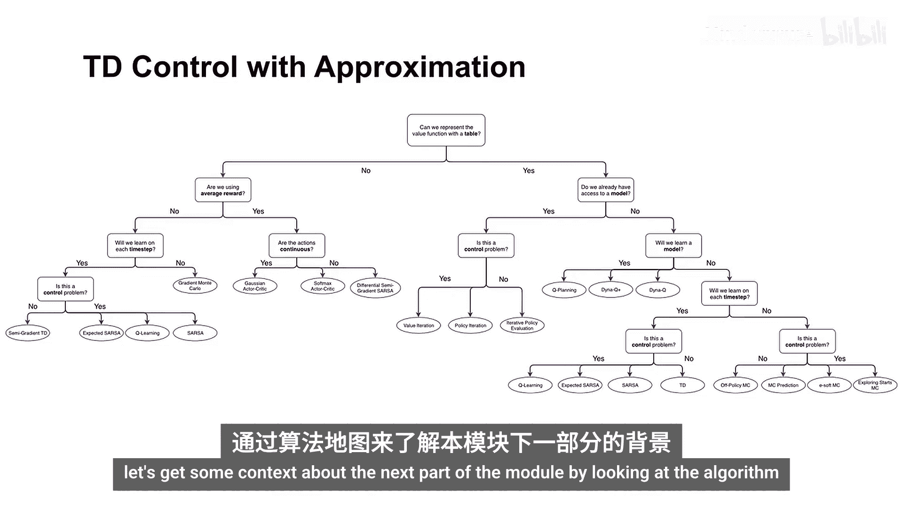
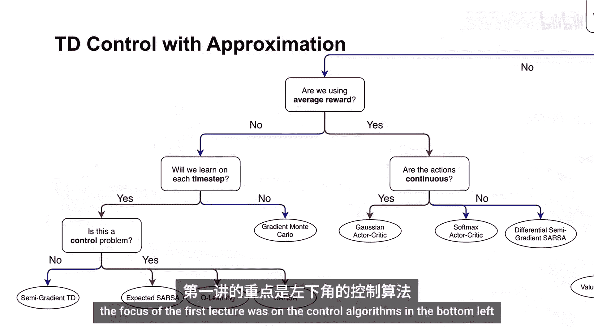
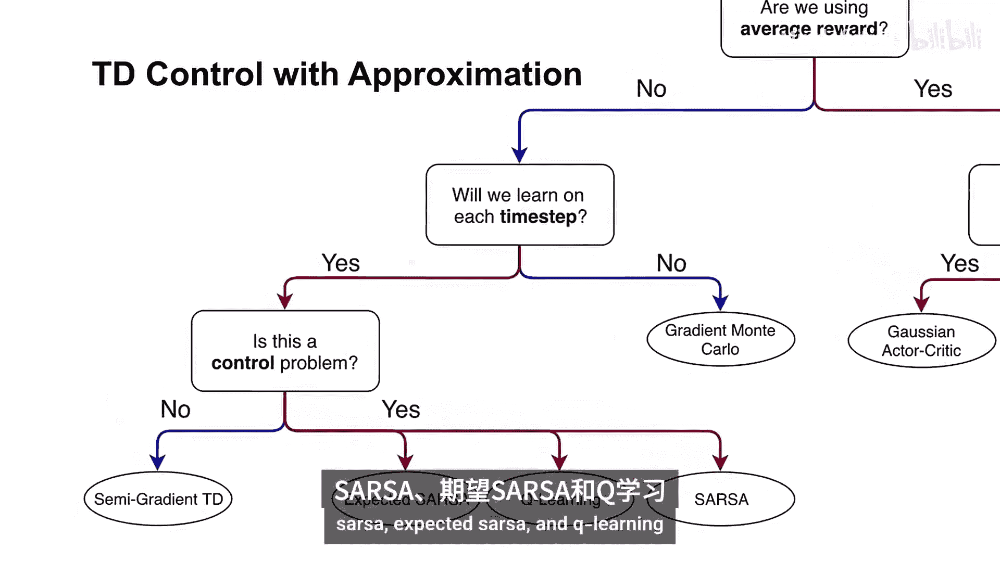
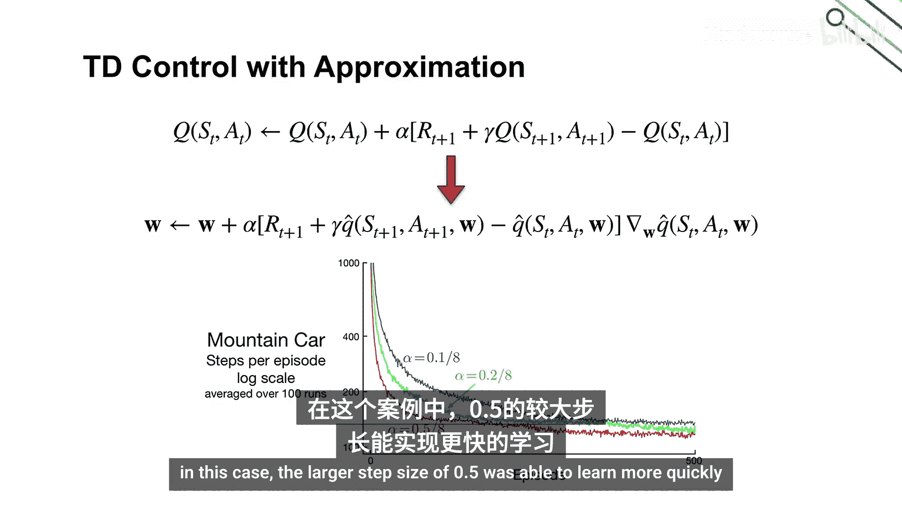
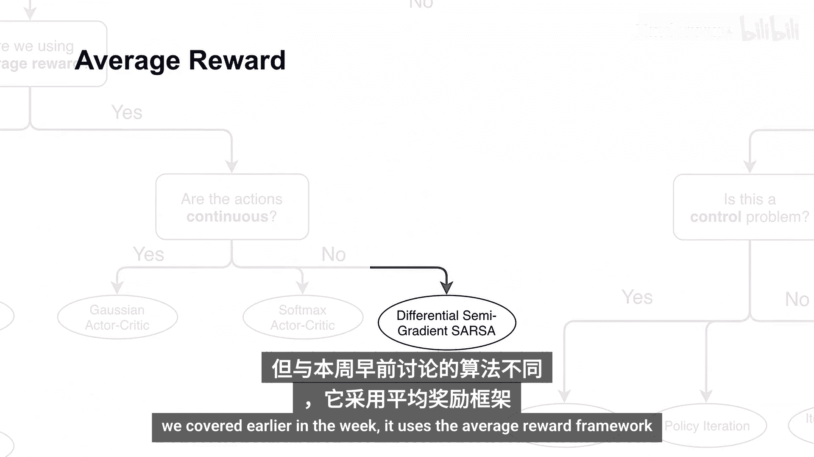

# 【阿尔伯塔大学】利用函数逼近进行预测和控制 ｜ Prediction Control Function Approximation p33 P33_第三周回顾_04_03_03 -BV1GYYWz9E1k_p33-

This week we talked about how to do control when using function approximation。

 let's go over the main ideas。First， we showed you how to estimate action values with function approximation if the action space is discrete it's probably easiest to stack the state features；

 if the action space is continuous or you want to generalize over actions。

 the action can be passed as an input like any other state variable。

Let's get some context about the next part of the module by looking at the algorithm map function approximation puts us on the left side of the map。

The focus of the first lecture was on the control algorithms in the bottom left corner， SARSSA。

 Exp SArsSA and Q learning。

These are all extensions of the tabular control algorithms we covered in Cose2。

The only difference between these algorithms and their tabular counterparts are the update equations。

The updates are all adapted for function approximation in the same way。

 using the gradient to update the weights。We also saw how episodic SArsSA could be used to solve the mountain car problem。

In this case， the larger step size of 0。5 was able to learn more quickly。

Next， we talked about exploration Op initialization can be used with some structured feature representations like tile coding。

 but in general it's not clear how to optimistically initialize values with nonlinear function approximators like neural networks。

 and it might not behave as expected。For example， the optimism may fade too quickly。

Epsilon greedy can be used regardless of the function approximator。Finally。

 we talked about a new way to think about the continuing control problem。

Instead of maximizing the discounted return from the current state。

 we can think about maximizing the average reward that a policy receives over time。

We define differential returns and differential values。

These enable the agent to assess the relative value of actions in the average reward setting。Finally。

 we introduce differential semi gradient SArsa that approximates differential values to learn policies。

Differential SA size is also in the left half of the algorithm map。

 but unlike the algorithms we covered earlier in the week， it uses the average reward framework。

That's all for this week we extended our tabular control algorithms to function approximation。

 discussed how exploration changes， and introduced a new way to think about the control problem。

Next week we'll talk all about how to do reinforcement learning without learning a value function。

 see you then。