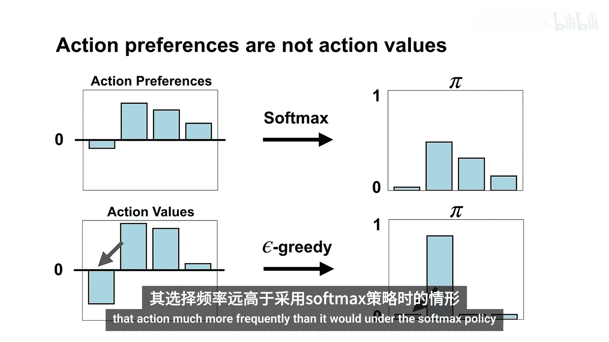

# 【阿尔伯塔大学】利用函数逼近进行预测和控制 ｜ Prediction Control Function Approximation p34 P34_直接学习策略_05_01_03 -BV1GYYWz9E1k_p34-

So far all the methods we've looked at for learning good policies estimate action values。

Every control algorithm we study was built on the framework of generalized policy iteration。

In this module， we'll explore a new class of methods where the policies are parameterd directly。

By the end of this video， you'll be able to understand how to define policies as parameterized functions。

And define one class of parameterized policies based on the softmax function。

Let's think about what it means to specify a palsy directly。We'll do this in Mountain car。Previously。

 we used Epsilon greedy to convert approximate action values into a policy。

But we could also consider policy which maps states directly to actions without first computing action values。

For example， in Mountain car we can define such a policy。

 simply choose accelerate right when the velocity is positive。

 and otherwise choose the accelerate left action。Put another way。

 this policy accelerates in whatever direction we are already moving。In fact。

 this simple energy pumping policy is close to optimal。

This policy does not make use of action values at all。

But this was just an example to stimulate your intuitions and to show you that we don't need action values to construct policies。

We are not actually going to specify policies by hand， rather we will learn them。

We can use the language of function approximation to both represent and learn policies directly。

We'll use the Greek letter theta for the policies parameter vector。

 This distinguishes it from the parameters W for the approximate value function。

We'll use the notation pi of a given asyntheta to denote the parameterized policy。

For a given input state in action， the parameterized policy function will output the probability of taking that action in that state。

 This mapping will be controlled by the parameters theta。

The parameter function has to generate a valid policy。

 this means it has to generate a valid probability distribution over actions for every state。

Specifically， the probabilities selecting an action must be greater than or equal to zero。

 and for each state， the sum of the probabilities over all actions must be one。

It requires some thought to satisfy these conditions for a parameterized function。For example。

 this means we cannot use a linear function directly， like we did with value function approximation。

There is no easy way to guarantee that a linear function will sum to one。Instead。

 we will need to restrict the class of functions we can use to construct policies。

Let's consider a simple but effective way to satisfy these conditions called a soft MA policy。

Here's the definition of a softm policy。The function H shown here is called the action Pre。

 a higher preference for a particular action in a state means that the action is more likely to be selected。

The action preference is a function of the state and action， as well as a parameter vector theta。

 Comping the probability of selecting an action with the Somax is simple。

 we take the action preference， exponentiate it， and then divide by the sum over all the actions for the same thing。

The exponential function guarantees a probabilitybil's positive reach。

The denominator normalizes the output of each action such that the sum over actions is one。

 The action preference can be parameterd in any way we like。

 since the softm will enforce the constraints of a probability distribution。For example。

 the action preferences could be a linear function of the state action features or something more complex like the output of a neural network。

Here's what we get when we pass a particular set of action preferences through the Softmax。

The input preferences can be arbitrarily large or even negative。

If one preference is much larger than all the others， the action probably would be close to one。

No matter how big the preference gets， the probability will never be greater than one。

 if one preference is very small， the SouthmX policy will still select the action with nonzero probability。

For example， if the preference is negative and the other's positive。

 the negative action will still have nonzero probability。Finally。

 actions with similar preferences will be chosen with near equal probability under a softmax policy。

It's important to distinguish between action preferences and action values。

Preferences indicate how much the agent prefers each action。

 but they are not summaries of future reward。Only the relative differences between preferences are important。

For example， we could add plus 100 to all the preferences and it would not matter an epsilon greedy policy derived from action values can behave very differently than a softmax policy over action preferences。

In Epsilon greedy， the action corresponding to the highest valued action is selected with high probability。

The probability selecting all the other actions is quite small。

Actions with nearly the same but lower action value are selected with much lower probability。

On the other hand， actions with very poor action values are still selected frequently due to the Epsilon exploration step。

So even if the agent learns an action has terrible consequences。

 it will continue to select that action much more frequently than it would under the softftmax policy。

That's it for this video， you should now understand we can parameterize policies directly。

That we need to define parameterizations that produce valid probability distributions。

And understand the softftmax policy primization。See you next time。

