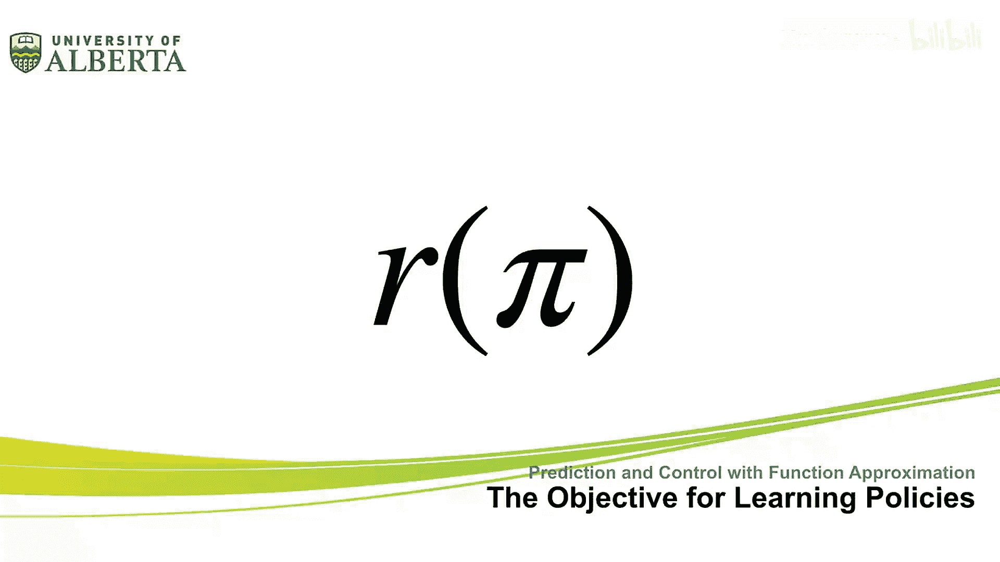
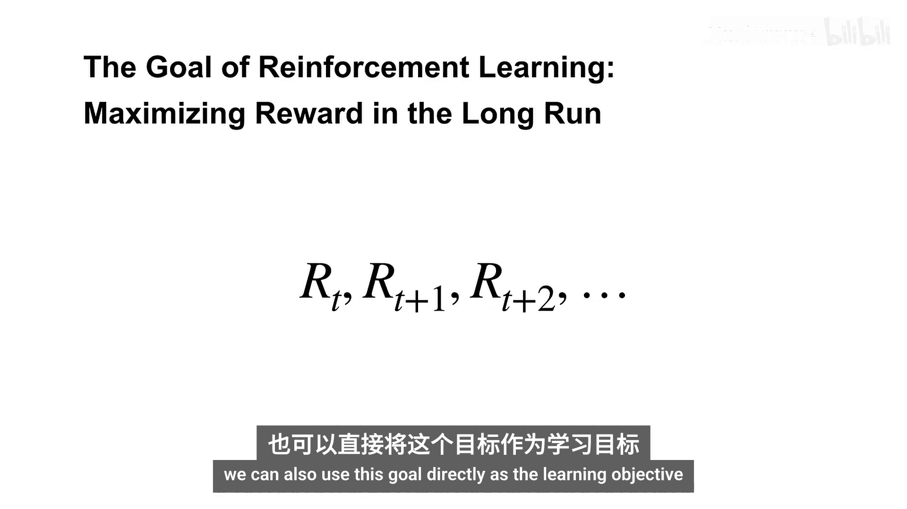
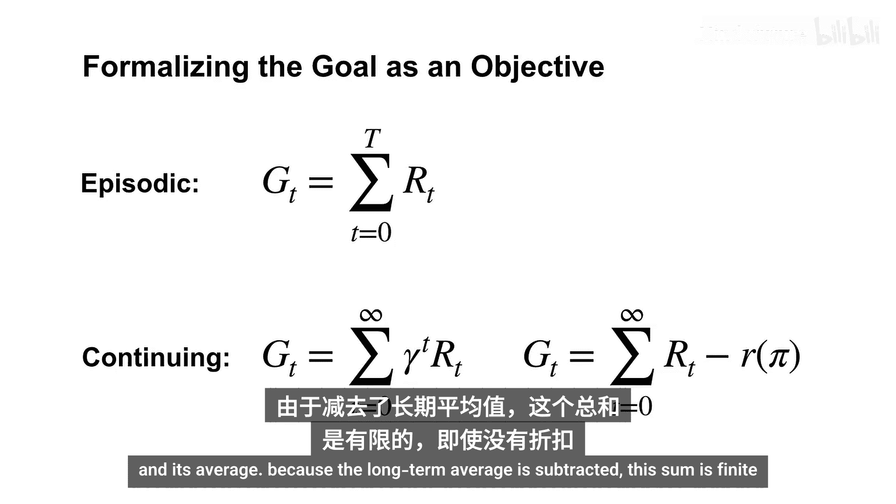
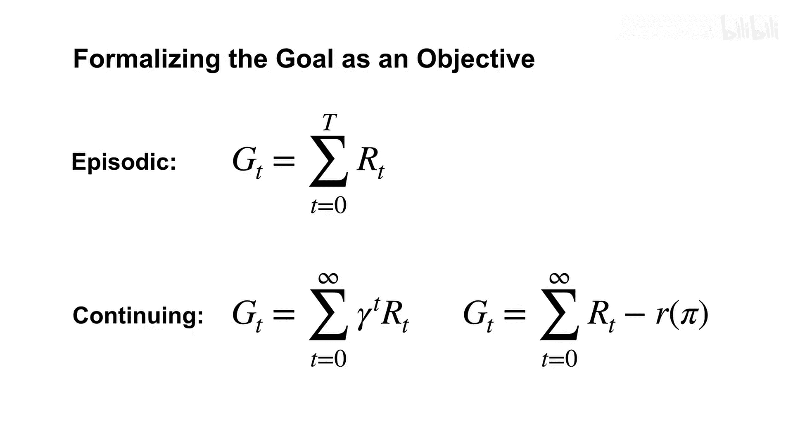
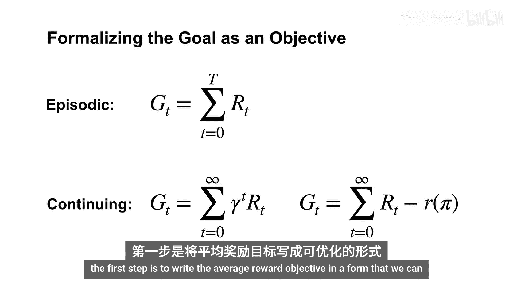
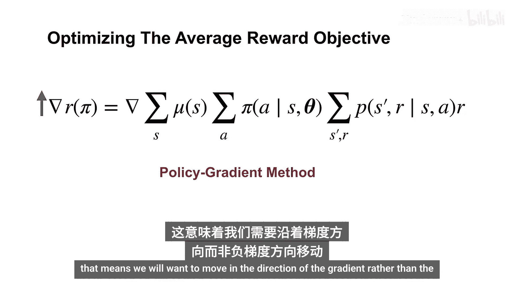
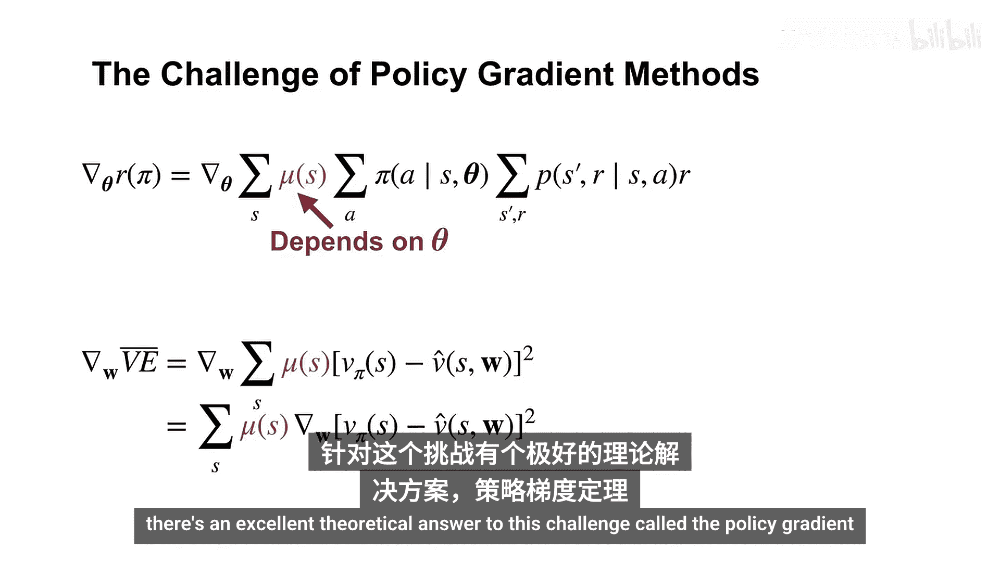

# 【阿尔伯塔大学】利用函数逼近进行预测和控制 ｜ Prediction Control Function Approximation p36 P36_学习策略的目标_05_02_01 -BV1GYYWz9E1k_p36-

Now that we've introduced the idea of parameterizing policies directly。

 we're ready to talk about how we can learn to improve a parameterized policy。

Just like with action value based methods， the basic idea will be to specify an objective and then figure out how to estimate the gradient of that objective from an agent's experience。

After watching this video， you'll be able to describe the objective for policy gradient algorithms。

Formulating an objective for learning a parameterized policy is in some sense more straightforward than it was for action value based methods。

We've said many times that the ultimate goal of reinforcement learning is to learn a policy that obtains as much reward as possible in the long run。

It turns out that when we parameterize our policy directly。

 we can also use this goal directly as the learning objective。

Throughout this specialization， we've introduced a few different interpretations of what it means to obtain as much reward as possible in the long run。

For the episodic case， we can use the Undiscounted return。

 which is the sum of rewards over a whole episode。For the continuing case。

 we introduce the discounted return， which places more emphasis on immediate reward in order to keep the sum finite。

Most recently， we introduced the average reward formulation here we maximize the long term average of the reward。

The appropriate return here is the sum of the differences between the immediate reward and its average。

Because the long term average is subtracted， this sum is finite， even without discounting。

Here we have three potential problem formulations to consider。

 we are going to restrict our attention to the continuing setting with average reward。

Remember what our aim is here to find a way to directly optimize the parameters of a policy。

The first step is to write the average reward objective in a form that we can optimize。

Previously， we estimated the average reward to learn action values in an average reward variant of SArsSA。

Now， our aim is to learn a policy that directly optimizes average reward。Toward this aim。

 let's start by writing the average reward under a policy in a more useful form。

We can write the average reward achieved by a particular policy pie like this。

 Let's break this formula down， starting from the inner sum and moving out。

This inner sum gives the expected reward if we start in state S and take action A。

 this is simply the sum over all rewards we might receive。

 weighted by their probability from S and A。We sum over next states as prime to get marginal probabilities over the reward。

The next level of the summation is over all possible actions， weighted by their probability under P。

This gives us the expected reward under the policy pie from a particular state S。Finally。

 we get the overall average reward by considering the fraction of time we spend in state S under policy P。

The distribution mu provides these probabilities the expected reward across states is a sum over s of the expected reward in a state weighted by mu of S。

Our P is our average reward learning objective。Our goal with policy optimization will be to find a policy which maximizes the average reward。

Our basic approach will be to estimate the gradientding of the objective with respect to the policy parameters and adjust the parameters based on this estimate。

The class of methods that use this idea are often referred to as policy gradient methods。

Up until now we've used a very different approach。 We use the generalized policy iteration framework to learn approximate action values。

 Then we use these approximate values indirectly to infer a good policy。

 Now we're interested in learning policies directly。

There is also a superficial difference in that before we were minimizing the mean squared value error。

 and now we are maximizing an objective。 That means we will want to move in the direction of the gradient rather than the negative gradient。

There are a few challenges in computing this gradient， however。

 the main difficulty is that modifying our policy changes the distribution mu。

This contrasts value function approximation， where we minimize me grid value error under a particular policy。

 there， the distribution mu was fixed。It does not change as the weights in the parameterized value function change。

We were therefore able to estimate gradients for states drawn from you by simply following the policy。

This is less straightforward and mu itself depends on the policy we are optimizingLuckily there's an excellent theoretical answer to this challenge called the policy gradient theorem we'll talk more about that soon。

That's it for this video， you should now understand that we can use the average reward as an objective for policy optimization。

In upcoming lectures， we will discuss how to actually optimize this objective from sampled experience See you then。

😊。