# 【阿尔伯塔大学】利用函数逼近进行预测和控制 ｜ Prediction Control Function Approximation p37 P37_策略梯度定理_05_02_02 -BV1GYYWz9E1k_p37-

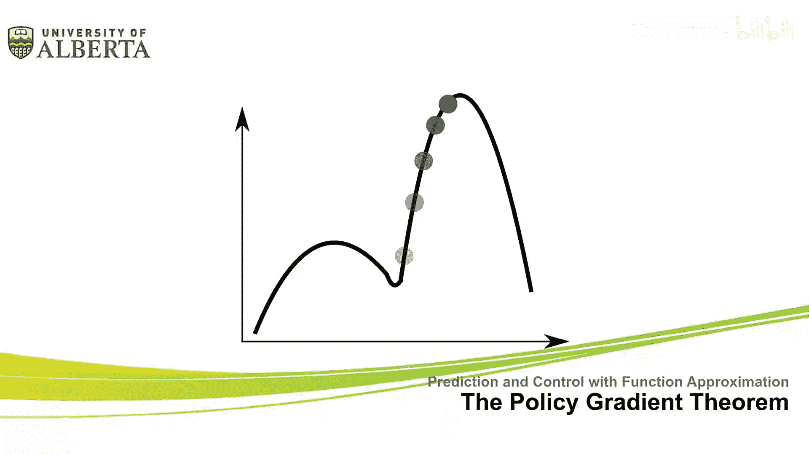

We just discussed an objective for policy optimization the next step is to figure out how the agent can optimize it based on its own experience。

In this video we will describe the policy gradient theorem this is a key theoretical result。

 it allows us to write the gradient of the average reward so that it is easier to estimate from experience。

After watching this video， you will be able to describe the result of the policy gradient theorem and understand the importance of the policy gradient theorem。

To optimize the mean square value error， we used methods based on stochastic， gradient descent。

We estimate the negative of the gradient of our objective and adjust the weights of the value function in that direction。

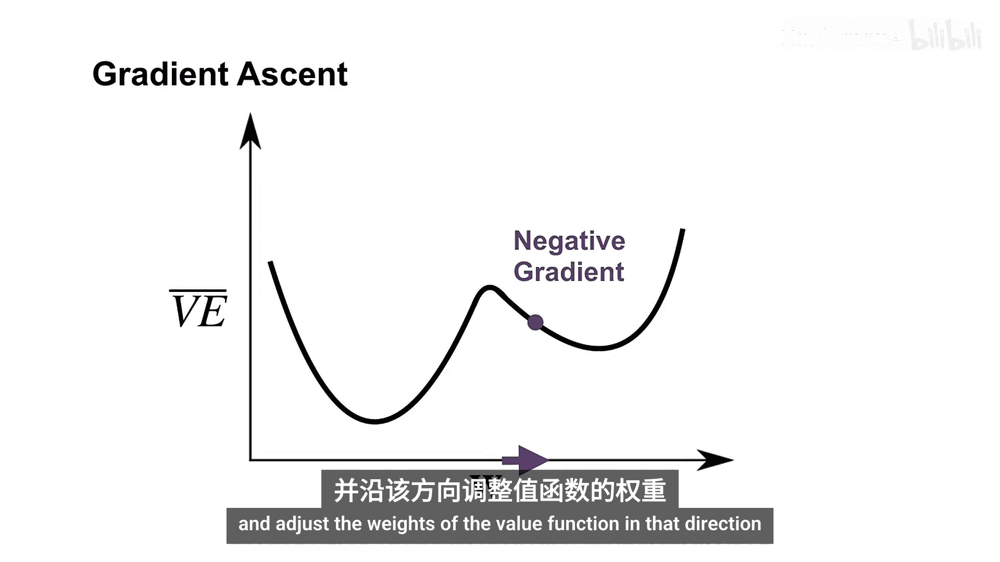

Policy gradienting methods use a similar approach， but with the average reward objective and the policy parameters theta。

We want to maximize the average reward rather than minimizing it。

 this means we do gradient ascent and move in the direction of the positive gradient。

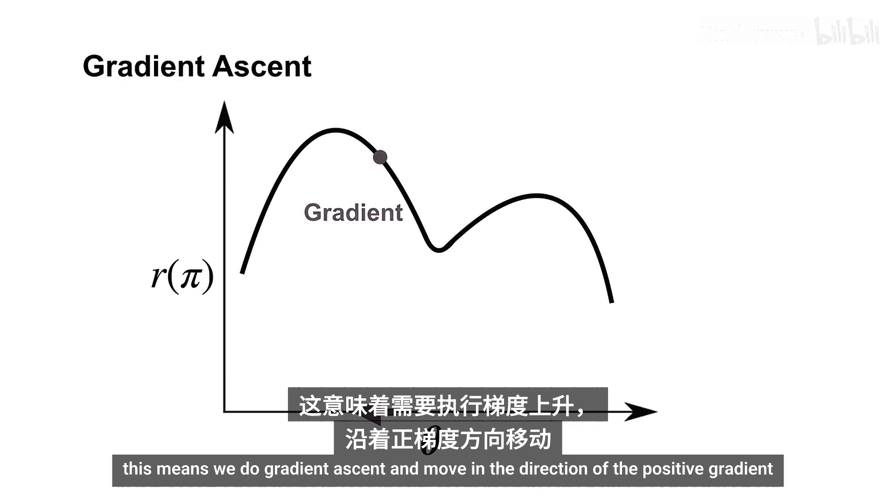

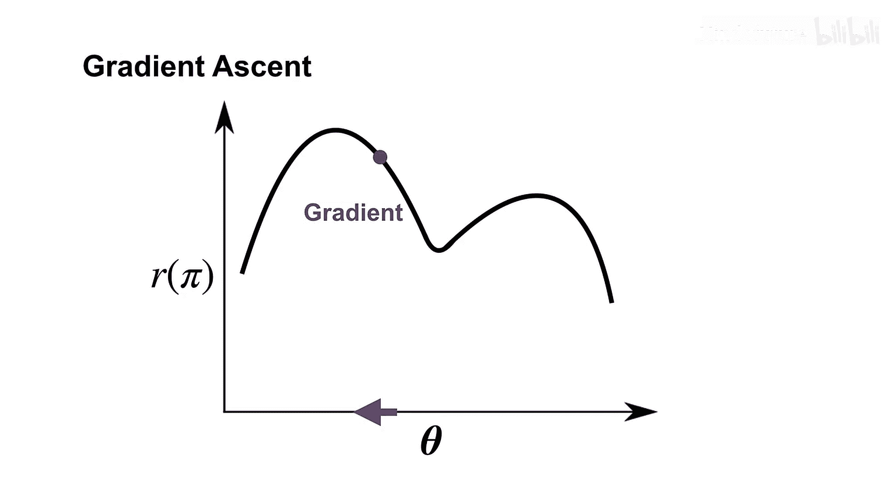

Remember that a simple recipe for solving a problem is to first specify an objective。

 then estimate the gradient of that objective and finally adjust the weights in that direction Step one is done Now the next step is to estimate the gradient of our objective。

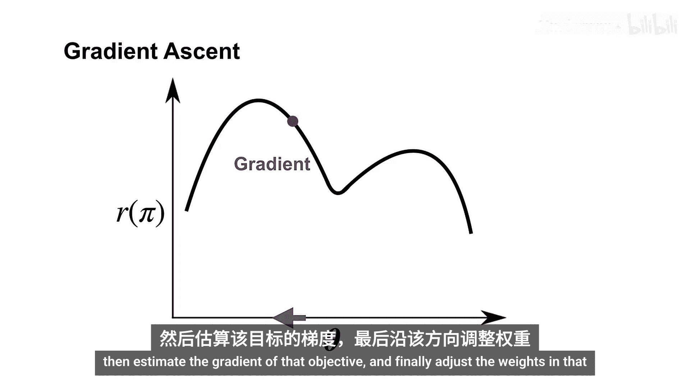

Recall the average reward objective， let's compute the gradient。

We can apply the product rule of calculus to the objective to yield two terms this looks pretty complex。

 so let's look at it a bit more closely。The first term involves the gradient of the stationary distribution over states。

 Unfortunately， the gradient of mu is not straightforward to estimate the stationary distribution mu depends on a long term interaction between the policy and the environment。

😊。

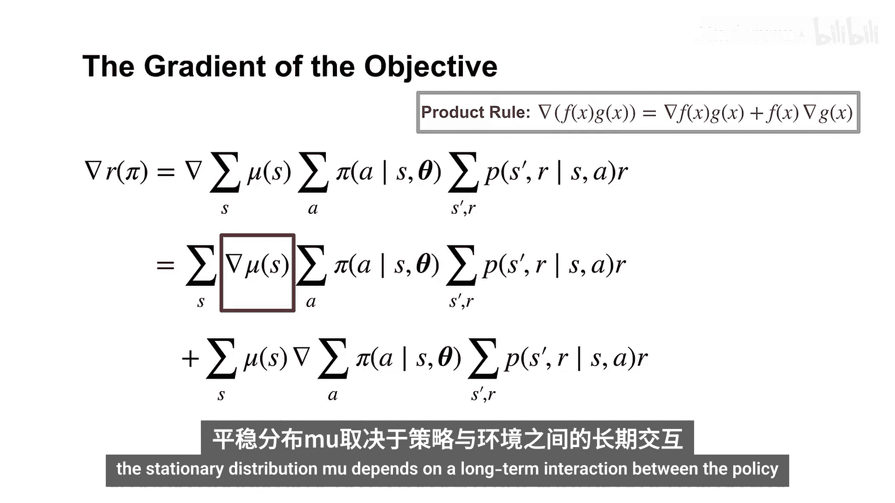

Luckily， the policy gradient theorem gives us a simpler expression for this gradient here we show the result of the theorem。

 it's worth walking through this expression。

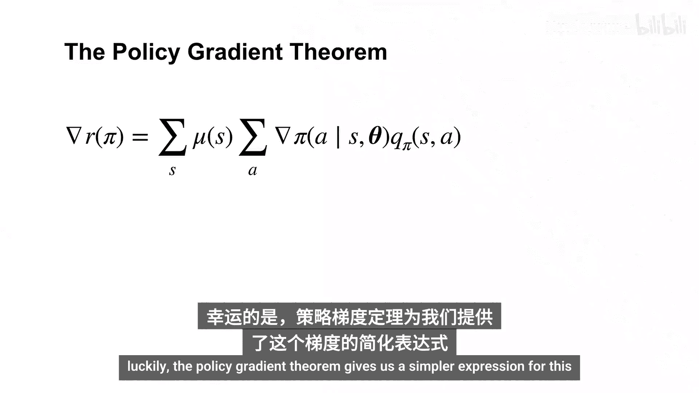

In the inner sum， we have the gradient of the policy times the action value function。

 let's try to understand this term a little better。

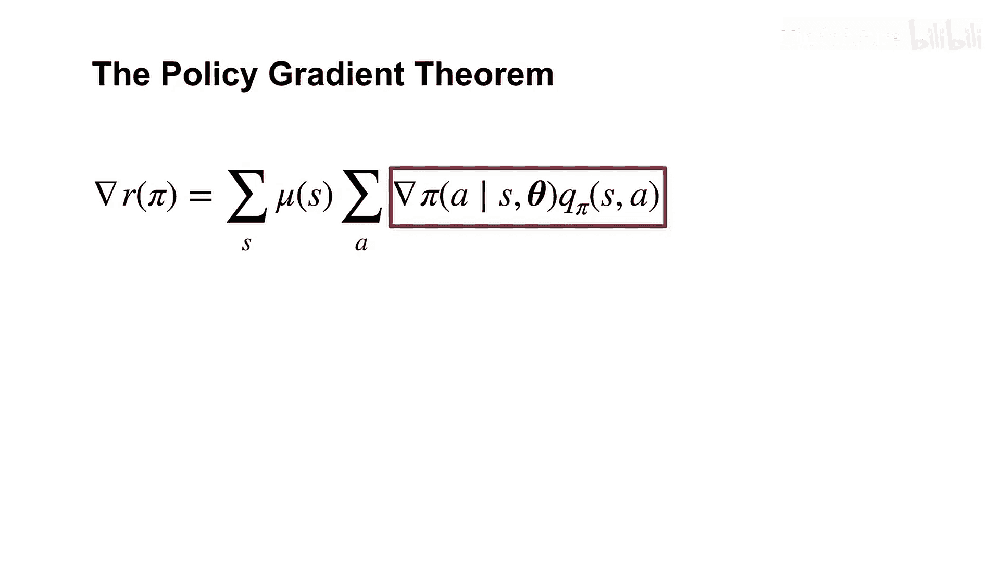

The gradientding of the policy is easy to compute as long as our policy parameterization is differentiable。

The gradient of the policy tells you how to adjust your parameters to increase the probability of a certain action。

Consider the simple grid rules shown here。As usual， the agent can move up， down， left or right。

For simplicity， let's assume the policy is controlled by just two parameters。

The parameters are currently set to the point marked here。

The arrows indicate the agent's action probabilities in a particular state with the current parameter settings。

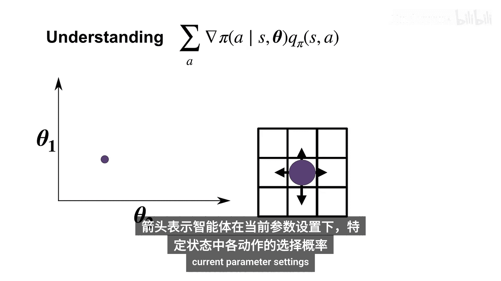

The gradient for the up action might look something like this on the plot。

The gradient tells us how to change the policy parameters to make that action more likely to be selected in the given state。

By moving the parameters in the direction of the gradient。

 we increase the probability for the up action， this necessarily means decreasing the probability of some of the other actions。

Different actions have different gradients， for example。

 the gradient of the left action probability may look like this moving the parameters in that direction will increase the probability of the left action and decrease the probability of some of the other actions。

This might all sound a bit abstract， but we will show concrete examples of computing this gradient in the coming lectures。

Now let's bring some reward into this situation and think about what this whole term means。

This is a sum over the gradients of each action probability。

 weighted by the value of the associated action。

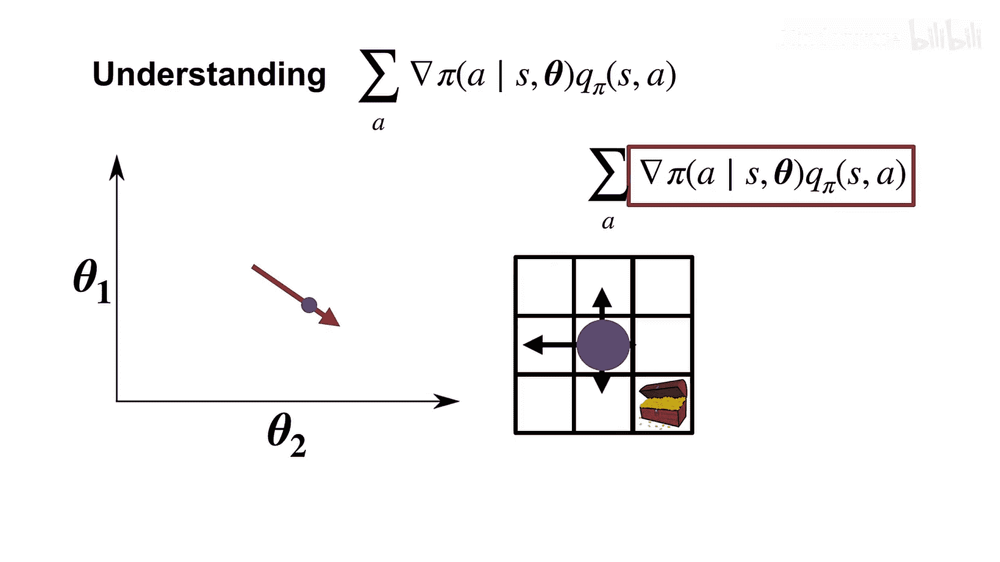

Imagine we've added a rewarding state in the bottom right。

The up and left actions move away from it and should have negative value。

 The down and right actions move toward it and should have positive value。

 The precise values will depend on the current policy。 But let's say they look something like this。

The weighted sum gives a direction to move the parameters that decreases the probability of moving up or right since their value is negative。

 while increasing the probability of moving down or left since their value is positive。

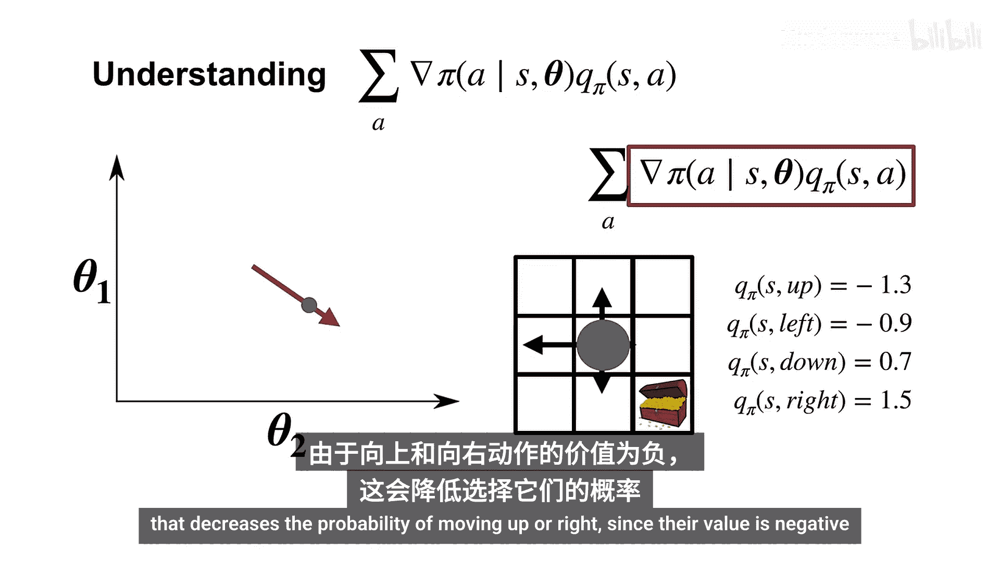

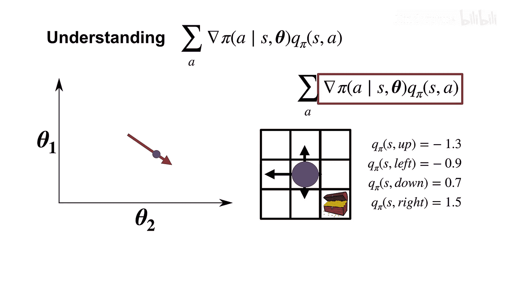

That direction might look like this。The gradient expression given by the policy gradient theorem takes this expression and sums it over each state。

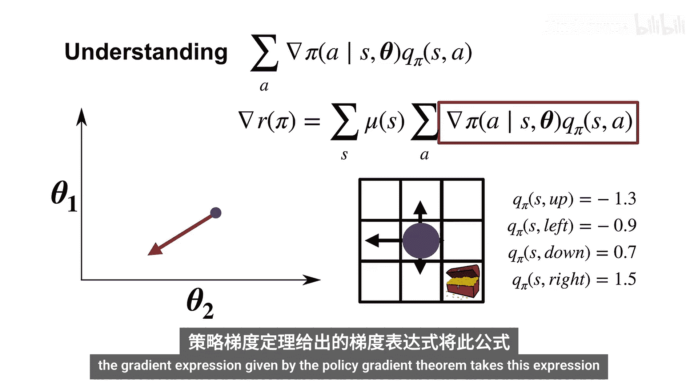

This gives the direction to move the policy parameters to most rapidly increase the overall average reward。

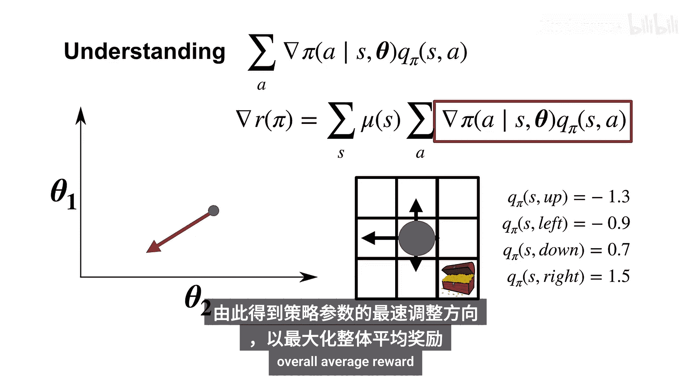

And that's it。 we now have a simple expression for the gradient。 importantlyly。

 this expression does not contain the gradient of the state distribution mu。

 which is challenging to estimate。The proof of the policy grading theorem can be found in the course textbook。

As we will see in the next lecture， this gradient is straightforward to estimate that means we will be able to build an incremental policy gradient algorithm using an agent's experience。

😊。

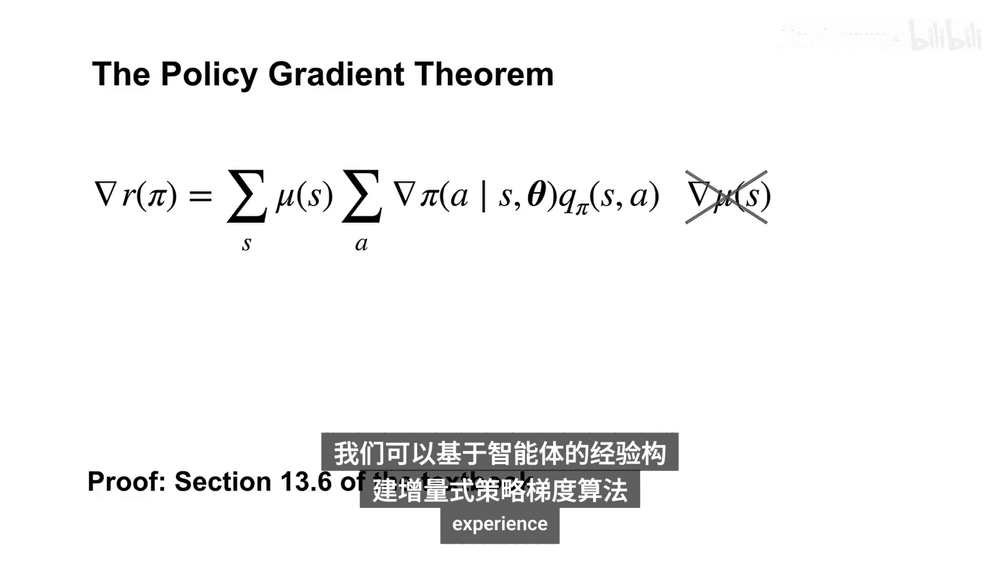

That's it for this video， you should now understand how the policy gradient theorem gives us an expression for the gradient to the average reward and understand the terms in the gradient。

 see you next time。