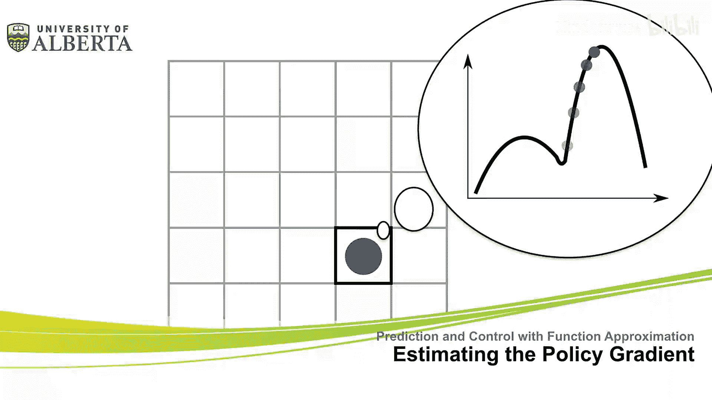
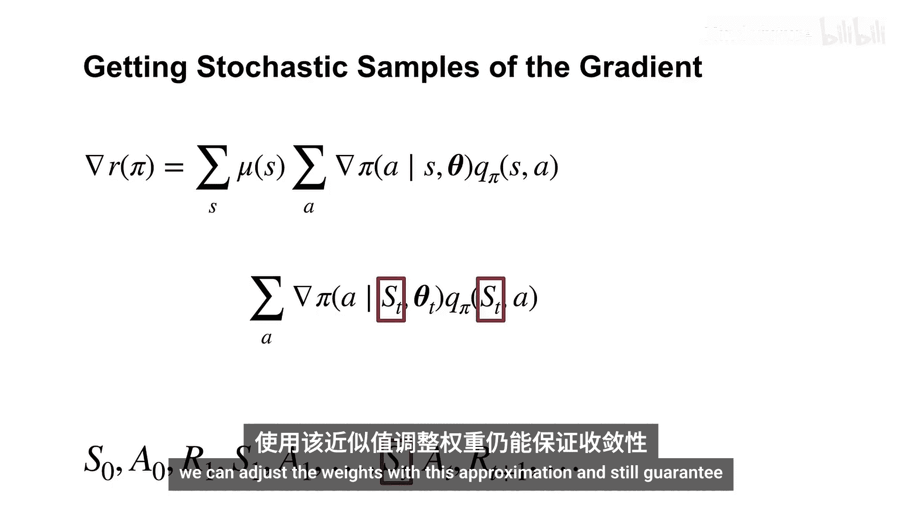
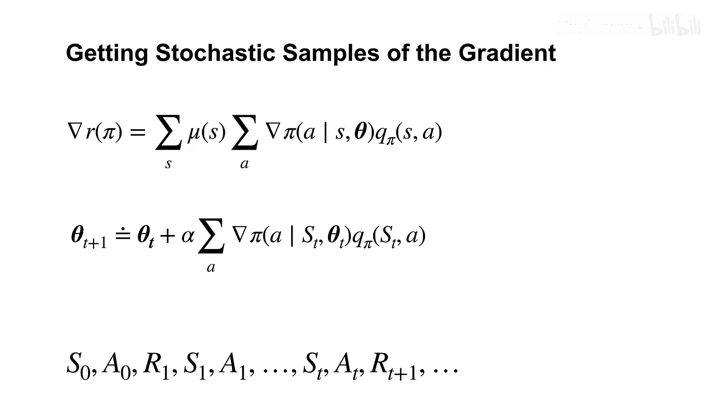
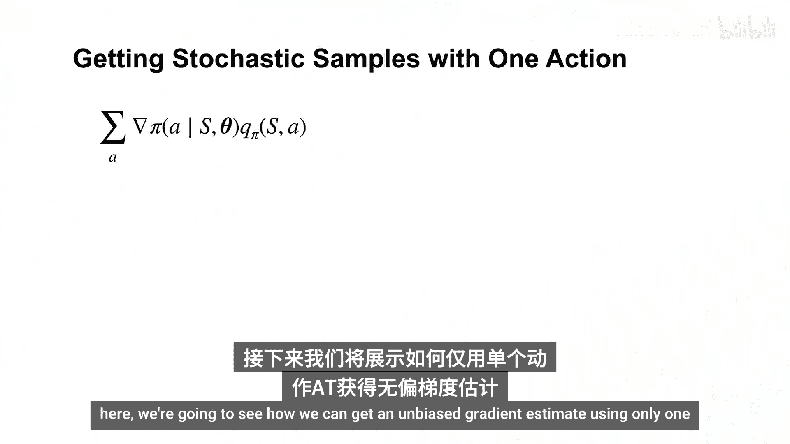
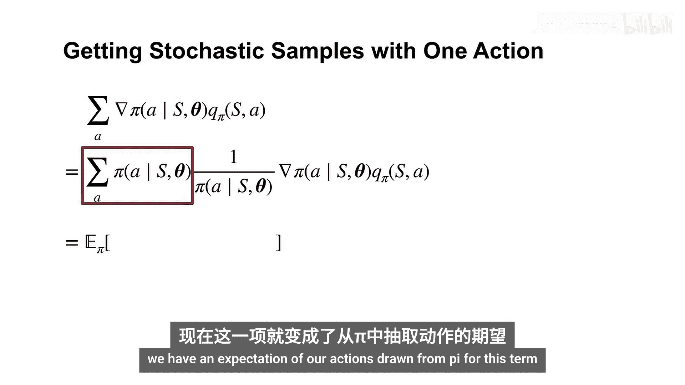
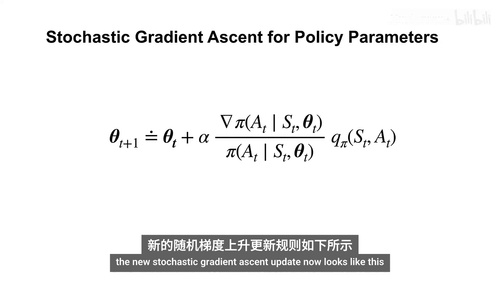
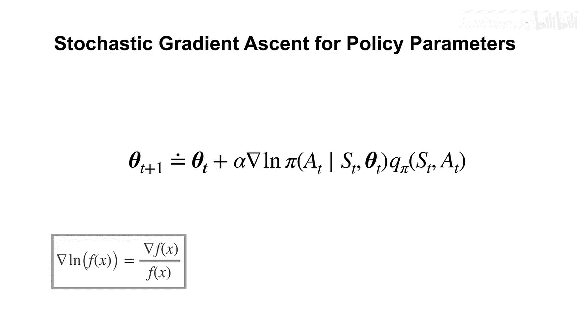
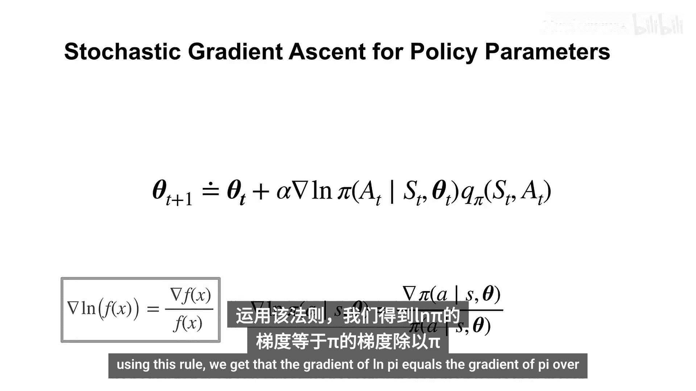
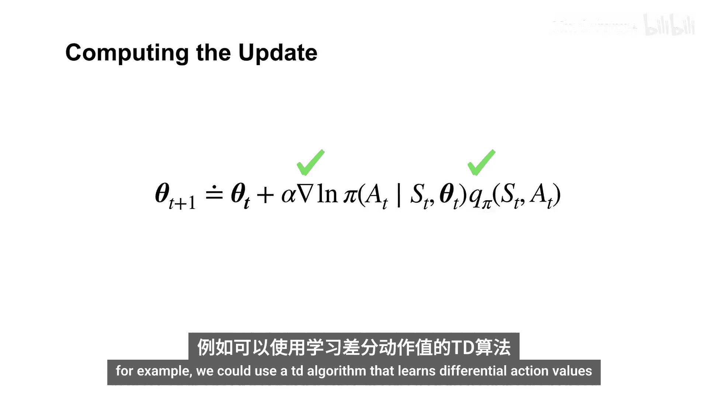
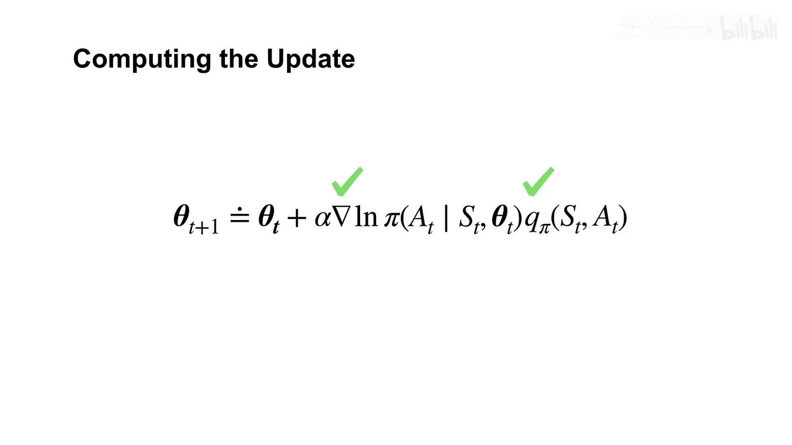

# 【阿尔伯塔大学】利用函数逼近进行预测和控制 ｜ Prediction Control Function Approximation p38 P38_估计策略梯度_05_03_01 -BV1GYYWz9E1k_p38-

We have an objective for policy optimization， we also have the policy gradient theorem which gives us a simple expression for the gradient of that objective in this video we'll complete the puzzle by showing how to estimate this gradient using the experience of an agent interacting with the environment。

After watching this video， you will be able to derive a sample based estimate for the gradient of the average reward objective。

We want to drive a gradient ascent algorithm for our policy we have our objective and its gradient due to the policy gradient theorem now we need to figure out how to approximate this gradient in fact what we will do is get a stochastic sample of the gradient。

Recall this expression for the gradient of the average reward Computing the sum over states is really impractical。

 but we can do the same thing we did when deriving our stochastic gradient descent rule for policy evaluation。

We simply make updates from states we observe while following policy Pi。

This gradient from state ST provides an approximation to the gradient of the average reward。

 as we discussed before for stochastic gradient descent。

 we can adjust the weights with this approximation and still guarantee we will reach a stationary point。

This is what the stochastic gradienting descent update looks like for the policy parameters we could stop here。

 but let's simplify this further。

Let's re-ex examineamine this from a perspective based on expectations。

 this will help us simplify the update and give you more insight into why the update makes sense。

Notice that the sum overstate weighted by mu can be rewritten as an expectation under mu。

 recall that muu is the stationary distribution for pi， which reflects state visitation under pi。

In fact， the states we observe while following pi are distributed according to mu。

By computing the gradient from a state ST， we get an unbiased estimate of this expectation。

Thinking about a stochastic grading as an unbiased estimate suggests one other simplification。

Notice that inside the expectation， we have a sum over all actions。

 we want to make this term even simpler and get rid of the sum over all actions。

If this was an expectation over actions， we could get a stochastic sample of this too and so avoid summing overall actions。

Here we're going to see how we can get an unbiased gradient estimate using only one action AT。

 which is the action taken by the agent。

It would be nice if the sum of our actions was weighted by pi and so was an expectation under P that way we could sample it using the agent's action selection。

 which is distributed according to P。It turns out this is an easy problem to solve to get a weighted sum corresponding to an expectation。

 we can just multiply and divide by pi of a given S。

 Now we have an expectation of actions drawn from pi for this term。

The Newtochastic Gr Ascent updateate now looks like this。

As an aside， it is common to rewrite this gradient as the gradient of the natural logarithm of pi。

This is based on a formula from calculus for the gradient of a logarithm。Using this rule。

 we get that the gradient of lawn pi equals the gradient of pi over pi。

 so this update is equivalent to what we started with。

But whyhy do we do this， One reason is that it is actually simpler to compute the gradient of the logarithm of certain distributions。

 The other less important reason is simply that it lets us write this gradient more compactly。

 In the end， it is just a mathematical trick， so don't let it distract you from the underlying algorithm。

We now have something that looks like many of the learning rules used in this course。

 we adjust the parameters theta proportionly to a stochastic gradientding of the objective。

 we use a step size parameter alpha to control the magnitude of the step in that direction so alpha has the same role it always has and that's it we now have a nice clean update rule to learn the policy parameters。

The last thing to talk about is how to actually compute the stochastic gradient for a given state in action。

We just need two components， the gradient of the policy and an estimate of the differential values。

 The first is easy。 We know the policy and is parameterization， and so can compute its gradient。

The action value can be approximated in a variety of ways， for example。

 we could use a TD algorithm that learns differential action values in an upcoming video we will go through one particular choice in detail as well as how to compute the gradient for specific policy parameterization。

In this video， we derived a policy gradient learning rule for the average reward setting in the next video we will see how to use this rule。

