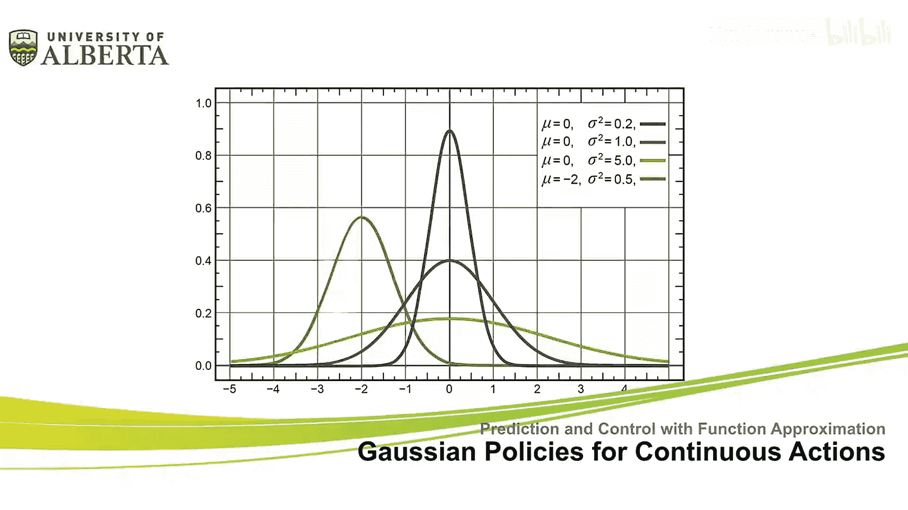
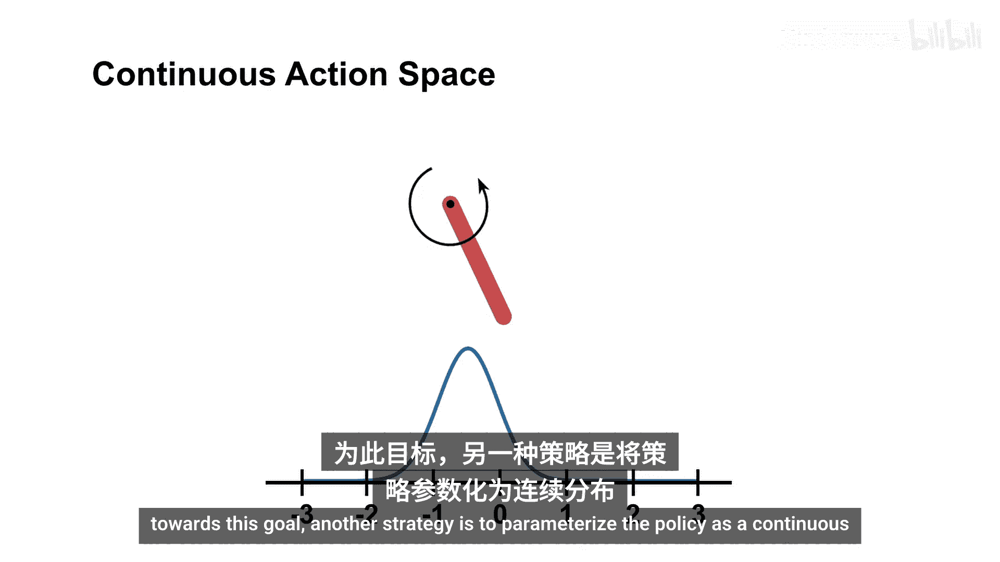
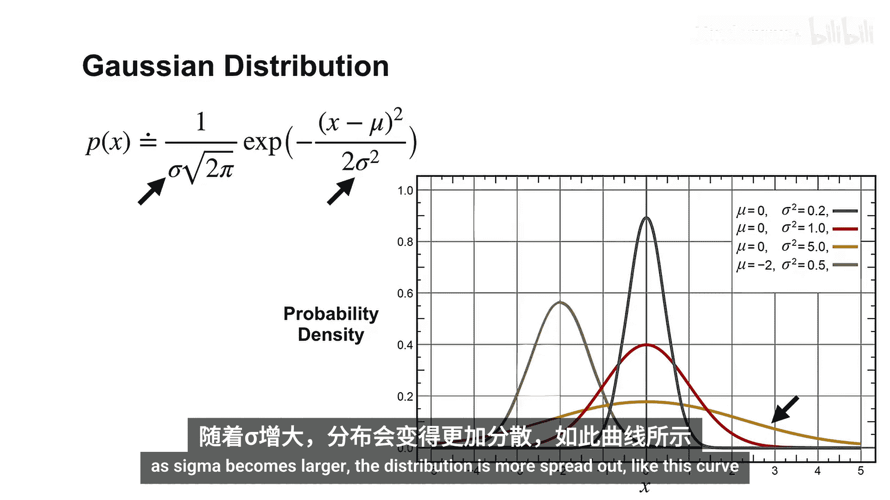
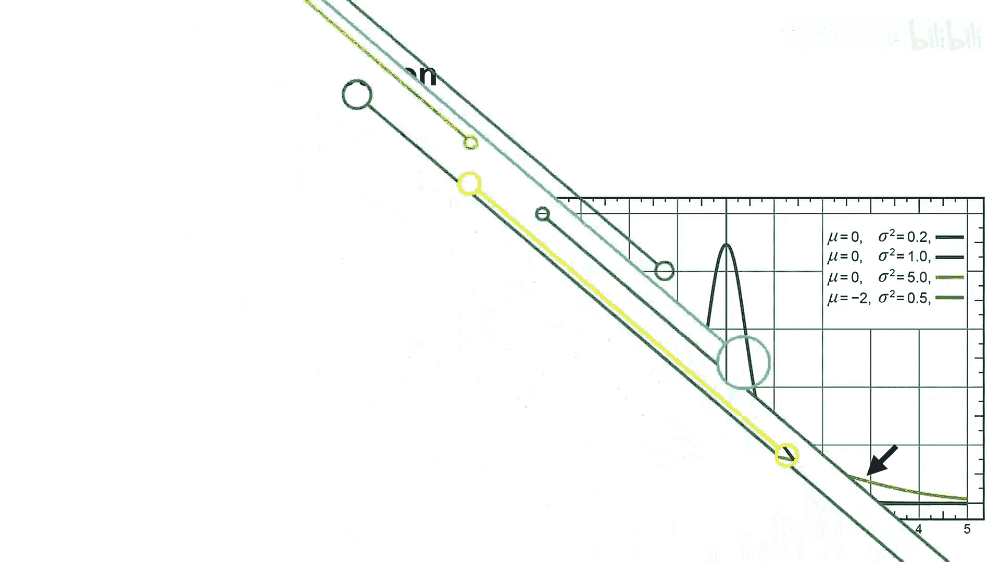
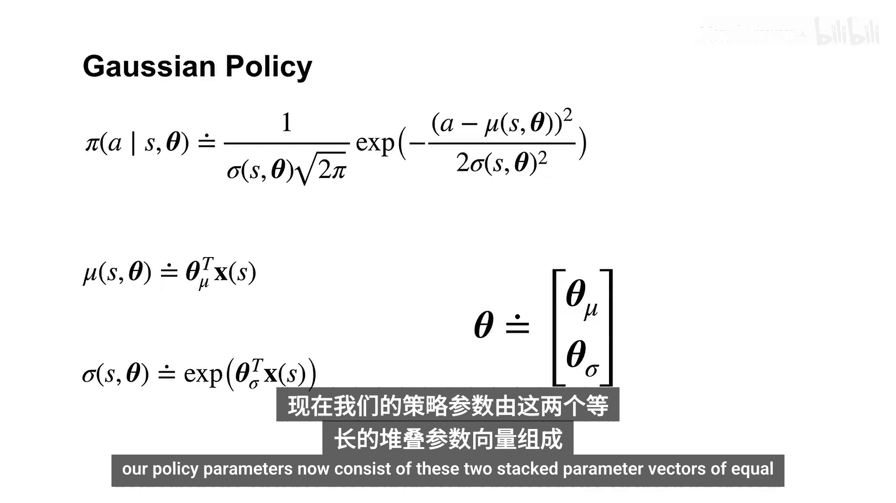
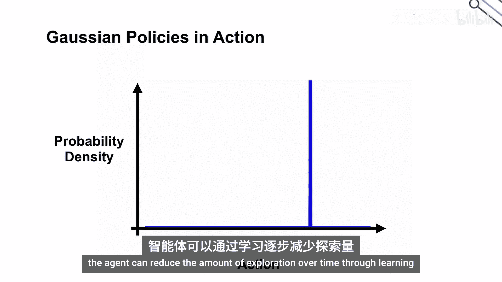
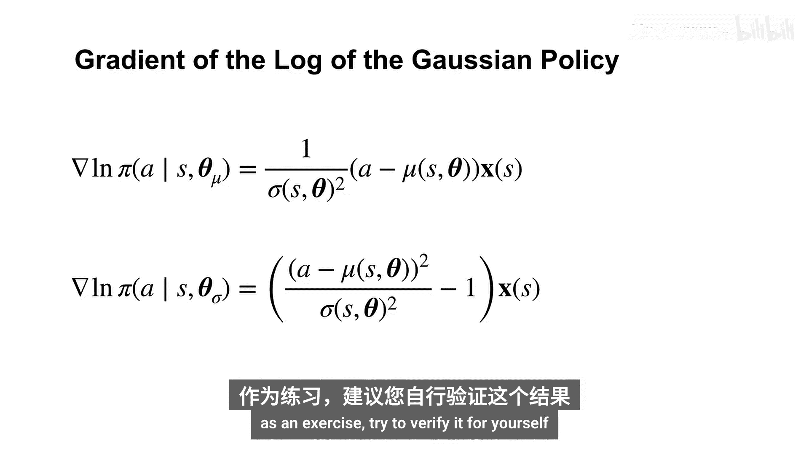
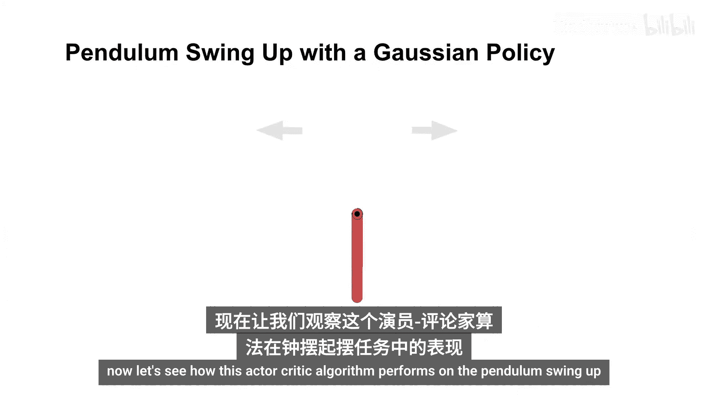
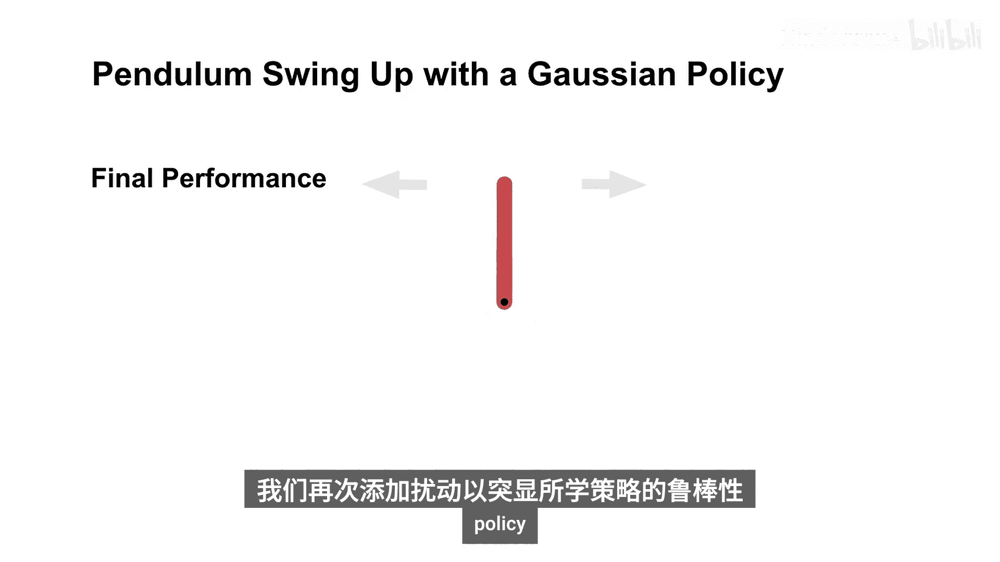

# 【阿尔伯塔大学】利用函数逼近进行预测和控制 ｜ Prediction Control Function Approximation p42 P42_用于连续动作的高斯策略_05_04_03 -BV1GYYWz9E1k_p42-

One of the nice things about policybased methods is that they give us a natural way to deal with very large or even continuous action spaces we don't have to use a policy parameterization that assigns individual probabilities to each action we could instead learn the parameters of some distribution over actions In this video we will discuss how to learn a state dependentent Gaussian distribution over continuous actions。

By the end of this video， you will be able to drive the Actctor critictic update for a Gaussian policy and apply average reward Actctor critictic with a Gaussian policy to a task with continuous actions。

Let's look at the same pendulum swing up task we explored last time。

The state space and reward is exactly the same This time。

 we will use a continuous interval for the action space instead of just three discrete levels of angular acceleration。

The angular acceleration can be anywhere between minus3 and plus 3。

 which are the minimum and maximum。We cannot assign a probability to every action separately because the space of possible actions is infinite。

One solution is to restrict actions to a discrete subset of the full range of possibilities。

 this is what we did previously。In this case， we compromised by picking a set of actions that were gentle enough to allow fine grain control。

But this also inhibits the agent's ability to apply larger acceleration。

 we'd really like the agent to be able to apply large acceleration when it's appropriate and smaller acceleration to correct its balance。

Towards this goal， another strategy is to parameterize the policy as a continuous distribution。

 such as a Gaussian distribution。

A Gaussian random variable X has the probability density function shown here Here are a few examples of this PDF with different means and variances。

 note that the Y axis in this case is density and not probability。

Probability density means that for a given range， the probability of x lying in that range will be the area under the probability density curve。

The parameter mu controls the mean of the distribution； if mu is0。

 the distribution will be centered around  zero。For this curve， mu is minus2。

 so the distribution is centered around minus2。The parameter sigma is the standard deviation。

 the square root of the variance， if sigma is low like this curve。

 the distribution will be sharply peaked around the mean value mu。As sigma becomes larger。

 the distribution is more spread out like this curve， and x is drawn from a wider range of values。

Let's define our policy using a Gaussian over actions we make the parameters mu and Sigma functions of the state。

 this way the agent can assign different action distributions to different states。

Mux can be any parameterized function， but to keep things simple。

 let's make it a linear function of the state features。

The policy parameters associated with mu are denoted by theta mu。

The parameterized function sigma has one constraint， it must be positive to enforce this。

 we will parameterize it as the exponential of a linear function。

 The policy parameters associated with sigma are denoted by theta sigma。

Our policy parameters now consist of these two stacked parameter vectors of equal size。

We've defined our Gaussian policy remember the main point of a policy is that it gives us a way to select actions to select actions with this policy。

 we sample from the Gaussian， many programming libraries include functions to sample from Gaussians。

 so we won't worry about that here。The procedure is simple， in a state。

 we compute new and sigma from that state。We then call the Gaussian random number generator with that mu and Sigma。

In one state， mu and Sigma might look like this， for this state。

 a wide range of actions are likely to be sampled。Here's an action that might be sampled in this state。

In another state mu and Sigma might look like this for this state。

 only a narrow range of actions are likely to be sampled。

 here's an action that might be sampled in this state。

Sigma essentially controls the degree of exploration。

 we typically initialize the variances to be large so that a wide range of actions are tried as learning progresses。

 we expect the variances to shrink and the policy to concentrate around the best action in each state。

Like many parametertri policies， the agent can reduce the amount of exploration over time through learning。

Though we now have continuous actions instead of discrete actions。

 we can use the same actic architecture， the algorithm is actually very similar。

 the main difference is that the gradient of the policy is different because the parameterization is different。

Underneath， the objectivedject also looks slightly different because we integrate over actions instead of summing。

But sampling and the gradient ends up being the same。

 So all we have to do is work out the gradient of the natural log of the policy。

We'll skip the steps here， but the result is shown on the slide as an exercise。

 try to verify it for yourself。

So we now have an update rule for continuous actions， but why do we do all this。

 given that the discrete actions that we used previously seem to work fine on this problem？

The most obvious reason is it might not be straightforward to choose a discrete set of actions for example。

 imagine a robot train to play golf。Putting accurately requires quite a bit of precision。

 We could try to pick a discrete set of forces to apply to the club and hope it's good enough。

 but inevitably there will be situations where it isn't depending on the distance and terrain we may need to use the full range of forces。

Continuous actions also allow us to generalize over actions。 For example。

 the Gaussian policy smoothly assigns probability density to nearby actions。

 Imaginem an action is found to be good， and the update increases density for that action。

 The density for a nearby action will also increase with the agent generalizing that those actions are likely also to be good。

Finally， even if the true action set is discrete but very large。

 it might be better to treat them as a continuous range。

This gives a natural way to generalize over them and avoid the costly process of exploring each one independently。

Now let's see how this actic algorithm performs on the pendulum swingup task。

Again， we swept over many step size values。We use separate step sizes for thetum U and theta Sigma。

Here we visualize the policy in early learning。It doesn't look too different from when we are using a discrete action set。

It quickly learns to rock the pendulum back and forth。

The size of the error around the pivot indicates the magnitude of the angular acceleration applied at a given time。

Here we visualize the policy at the end of learning。

 it's learning a very nice balancing policy here again。

 we added perturbations to highlight the robustness of the learned policy。😊。

And that's it for today， you should now understand how we can apply Act critic to problems with continuous actions。

 and we showed an example of how this can be done with the Gaussian policy parameterization in a simple environment bye for now。

