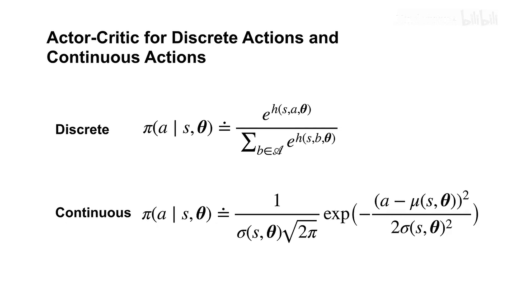

# 【阿尔伯塔大学】利用函数逼近进行预测和控制 ｜ Prediction Control Function Approximation p43 P43_第四周总结_05_04_04 -BV1GYYWz9E1k_p43-

This week we talk about a whole new way to do control directly learning parameterized policies。

 we introduced a new objective and a new algorithmic framework called Actctor Critic。

Let's take a step back and look at where this new material fits into the bigger picture。

We learn policies using function approximation， so we're still on the left side of the map。

We focused on a critic using the average reward objective， so that puts us here。From there。

 we introduce two possible parameterizations depending on whether the actions are continuous or discrete。

For discrete actions， we use the soft MA policy parameterization。For continuous action spaces。

 we use Augusttian policy， which samples actions from a continuous range。

This is the first time we implemented an algorithm for continuous actions。

Average reward actor critic can be used in the same settings as the differential semi gradientd StarA algorithm we introduced previously。

We started this week by making the shift from parameterized action values to parameterized policies parameterized policies take state action pairs and output the associated action probabilities This function is parameterized by a vector of parameters denoted by theta。

A parameterized policy has to be a valid probability distribution。

 that is every action probability must be greater than zero。

 and the sum over all actions in a given state must be1。

A softmax over action preferences is one way to ensure the parameterized policy obeys these constraints in discrete action spaces。

Prameizing policies directly has a number of potential advantages These advantages include the ability to autonomously converge to a deterministic policy over time while using a stochastic policy to explore early on。

Another advantage is the ability to learn stochastic policies。

 This can be useful with function approximation when the optimal deterministic policy is not representable and finally。

 we discussed that a good policy might be easier to learn and represent than precise action values。😊。

To learn parameter policies， we had to consider a new objective and a new strategy to optimize it。

We revisited the average reward objective。 we showed that the average reward could be expanded out like this。

 Our strategy to optimize this objective was to use stochastic gradient asscent。For that。

 we needed an estimate of the gradient of the average reward。

This is challenging because the state distribution mu depends on the policy parameters。

The policy gradient theorem provides an expression for the gradient of the average reward objective that's convenient to optimize。

This form allows us to estimate the gradient by sampling states from U by following the policy Pi。

Using the policy gradient theorem， we derive the actor critictic algorithm。

Acctor critics simultaneously learns a parameterized policy， the actor。

 and an estimate of the policy's value function， the critic。

The TD error from the critic reflects that the actor did better or worse than the critic expected。

The actor is trained to favor actions that exceed the critic's expectations。

 the critic is trained to improve its value estimates of the actor so that it knows what value it should expect for this actor。

We demonstrated how the a critictic algorithm can be used for both discrete and continuous action spaces for discrete actions we used a softmax policy parameterization for continuous actions we used de Gaussian policy with state dependent mean and variance。

This made the Gausstian policy over actions conditional on the state。

Now you know how to parameterize and learn policies directly in addition to the action value methods we looked at before。

 this is a valuable new tool in your reinforcement learning toolbox。

