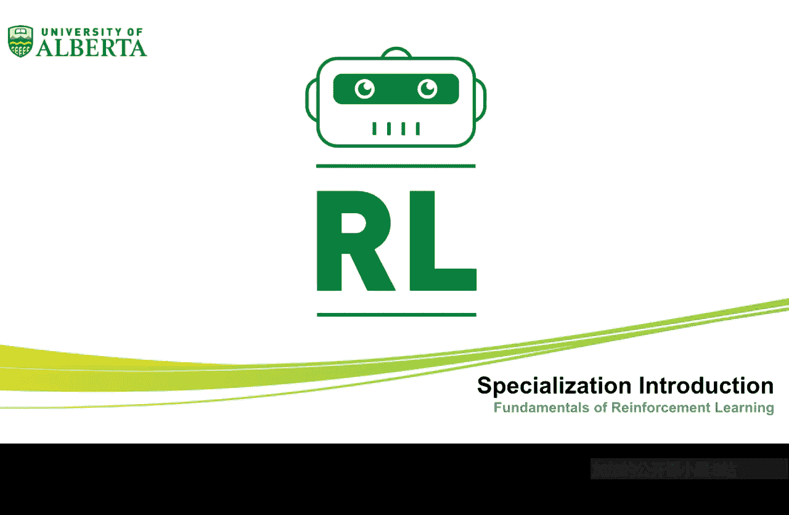
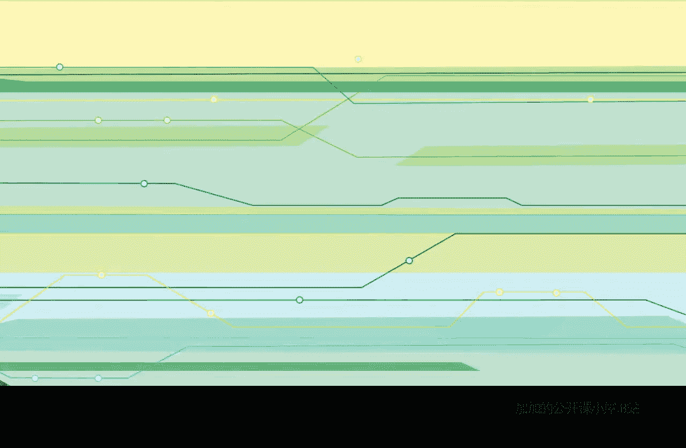

强化学习专项课程：P1-01：专业介绍

在本节课中，我们将通过一个生动的例子，初步了解强化学习的基本概念及其解决问题的独特思路。

亚当，你在做什么？团队最近为了测试新算法经常熬夜到很晚。众所周知，研究人员是靠汽水和披萨来补充能量的。现在，实验室开始看起来像个废品场了。

所以，你打算禁止在实验室里吃东西吗？不，那太不近人情了。我在考虑编程一个机器人，让它能在实验室里四处移动并收集空罐子。

这听起来很酷。它要怎么工作呢？嗯，我认为需要一个视觉系统来识别罐子、障碍物和人。机器人还需要构建一张地图，并确定自己在实验室中的位置。然后，我们还得编写一些导航程序。

我得在这里打断你一下。我想可能有更简单的方法来解决这个问题。让我们用强化学习来解决它。

好吧，强化学习。玛莎，你会怎么做呢？奖励可以设定为机器人收集的罐子数量。智能体可以通过试错，简单地学习如何收集尽可能多的罐子。原则上，它甚至不需要实验室的地图，可以从零开始学习一切。

---

### 概述

上述对话展示了一个传统编程方法与强化学习方法解决问题的对比。传统方法需要工程师预先定义好所有规则（如识别、建图、定位、导航），而强化学习则让一个“智能体”通过与环境的交互来自主学习最优行为策略。

### 核心概念解析

在强化学习框架中，有几个核心组成部分：

*   **智能体**：做出决策和行动的主体，例如对话中提到的机器人。
*   **环境**：智能体所处并与之交互的外部世界，例如布满罐子的实验室。
*   **状态**：环境在特定时刻的描述，例如机器人当前的位置、周围有哪些罐子和障碍物。
*   **动作**：智能体可以执行的操作，例如前进、转向、抓取。
*   **奖励**：环境对智能体动作的即时反馈信号，是智能体学习的目标导向。在例子中，**奖励是收集到的罐子数量**。

智能体的目标是学习一个策略，使其在与环境交互的过程中，获得的**累计奖励总和最大化**。这个过程通常可以形式化地表示为寻找最优策略 π*，以最大化期望回报（总奖励）：
`max π E[Σ γ^t * R_t | π]`
其中，`R_t` 是时间步 t 获得的奖励，`γ` 是折扣因子（用于权衡近期与远期奖励）。

### 方法对比

为了更清晰地理解强化学习的思路，以下是两种方法的简单对比：

*   **传统编程方法**：
    1.  感知：需要复杂的视觉系统识别物体。
    2.  建模：需要构建环境地图。
    3.  规划：需要编写详细的导航与抓取逻辑。
    4.  执行：机器人按预设程序运行。

*   **强化学习方法**：
    1.  定义目标：设定奖励信号（如捡到罐子得+1分）。
    2.  交互试错：机器人尝试各种动作，观察结果（是否捡到罐子、是否撞墙）。
    3.  学习优化：根据奖励不断调整策略，最终学会高效收集罐子的行为。
    4.  结果：机器人可能学会走捷径、避开拥堵区域等策略，而无需被明确编程这些规则。

### 总结

本节课我们一起学习了强化学习的一个入门示例。通过“实验室机器人收集罐子”的场景，我们看到了强化学习如何通过定义奖励、让智能体与环境交互试错来解决问题，从而避免了传统方法中需要手动设计复杂规则和系统的过程。其核心思想是**从交互中学习，以最大化累积奖励为目标**。在接下来的课程中，我们将深入探讨实现这一目标的具体算法和理论。