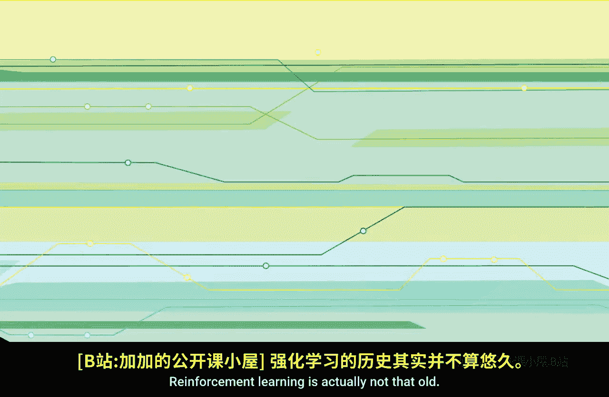
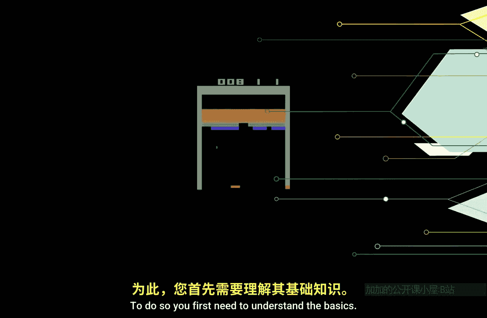

# 002：课程介绍 🎯

在本节课中，我们将介绍强化学习领域的基本概念、其与其他机器学习范式的区别，以及本专项课程的学习路径与目标。

## 概述

强化学习的历史并不算久远。在21世纪初，该领域与现今情况大不相同。当时全球仅有少数实验室专注于强化学习，业界几乎无人使用，其实际成功应用也仅限于少数几个领域。

## 强化学习的早期成就与愿景

尽管早期应用有限，但强化学习已展现出潜力。例如，它能让直升机完成人类难以做到的倒飞动作；我们的方法能击败世界上最顶尖的双陆棋玩家，并能很好地调度电梯。然而，当时强化学习并非让机器人完成有用任务的最佳方式。一个计算机学习智能体能在电子游戏中胜过人类的想法，几乎是不可想象的。

尽管如此，我们仍抱有希望。因为我们相信，强化学习是实现人工智能进步的最佳途径。人工智能的承诺令人神往：一个学习智能体能够通过简单地尝试并观察结果，来理解世界如何运作。毕竟，我们认为人类和动物就是这样学习的。那么，为什么不能在计算机上模拟这个过程呢？

如果能够实现，它将在几乎任何应用中都发挥作用。作为一个不错的附带效果，我们也可能对自身思维的工作方式有更深入的了解。

## 与其他机器学习范式的区别

你可能会问，监督学习、无监督学习和强化学习之间有何区别？区别其实相当简单。

在**监督学习**中，我们假设学习者能够获得带有正确答案的标记示例。其核心是学习从输入到已知输出的映射。

在**强化学习**中，奖励信号为智能体提供了其近期行动好坏的某种反馈。你可以将监督学习想象成需要一位老师，通过告诉你正确答案来帮助你。而奖励则像是有一个能识别什么是好行为，但无法确切告诉你如何去做的人。

**无监督学习**听起来可能相关，但其目标截然不同。无监督学习是关于从数据中提取潜在结构，关注的是数据表示。它可以用来构建能使监督学习或强化学习系统更好的表示。事实上，在本课程后面你将看到，监督学习和无监督学习的技术都可以在强化学习中使用，以辅助泛化。

## 强化学习的核心：在线交互学习

在强化学习中，我们专注于在与不断变化的世界交互的过程中进行学习的问题。我们不期望智能体只是计算出一个好的行为，然后以开环方式执行该行为。我们期望智能体会犯错，并在过程中不断完善其理解。

世界不是静态的：我们会受伤，天气会变化，我们会遇到新情况，我们的目标也会改变。一个能即时整合其最新经验的智能体应该会表现得更好，特别是与那些试图完美记忆世界运作方式的智能体相比。

**在线学习**的理念极其强大，是强化学习的一个定义性特征。我们引入概念的方式也由这一事实决定。例如，我们先介绍赌博机和探索的概念，之后再引入来自监督学习的理念。如果你有机器学习背景，这可能会让你感觉顺序颠倒了。但正如你将看到的，困难的部分是在线学习，而不仅仅是从数据中学习。适应在线环境需要新的视角。

## 强化学习的现状与基础的重要性

如今，强化学习领域正以惊人的速度发展。几乎每周都有关于新算法进展以及在基准领域达到最先进性能的改进的帖子发布。搜索公司、在线零售商和硬件制造商正在探索强化学习解决方案以优化其日常运营。他们相信在线学习能提高效率、节省资金，并使人类远离危险环境。

我从未想过会有公司专门致力于强化学习的研究与应用，这确实非常了不起。然而，事物变化越快，专注于基础就越重要。强化学习中的一些思想甚至可以追溯到巴甫洛夫和他的流口水狗。

仔细观察几乎任何现代强化学习系统，你会发现它都是由比本专项课程早一二十年的思想和算法构建而成的。例如，**DQN**的核心结合了**Q学习**、**神经网络**和**经验回放**。然而，要让这些系统获得良好性能，需要重大的创新。我们绝不会贬低那些工作的重要性。事实上，我们希望你能理解这些复杂而庞大的学习系统。为此，你首先需要理解基础知识。

## 本课程的学习路径

这正是本课程的起点——从基础开始。在本专项课程中，我们将涵盖现代强化学习系统中使用的大部分主要思想。到最后，你将实现一个神经网络学习系统来解决一个无限状态控制任务。

但我们将从小问题开始。我们将花时间讨论强化学习中的基本挑战以及我们解决这些挑战的最佳思路。序列决策问题代表了我们这一代人最伟大的奖赏之一，因此花时间并正确处理细节是恰当的。

我们的研究将从强化学习问题的一个特例开始，称为**多臂赌博机问题**。智能体必须决定哪个选择平均能产生最好的结果或奖励。这个完整强化学习问题的简化实例，或许是理解和解决强化学习根本挑战的最佳场景。

本模块将介绍价值估计、增量学习、探索、非平稳性和参数调优。在接下来的四门课程中，我们将继续以不同的方式发展和组合这些思想。

## 总结

本节课中，我们一起学习了强化学习的定义、其与其他机器学习范式的核心区别，以及在线交互学习的核心思想。我们回顾了该领域的发展历程与现状，并强调了掌握基础原理对于理解复杂系统的重要性。最后，我们明确了本专项课程将从多臂赌博机这一基础问题入手，逐步构建完整的强化学习知识体系。