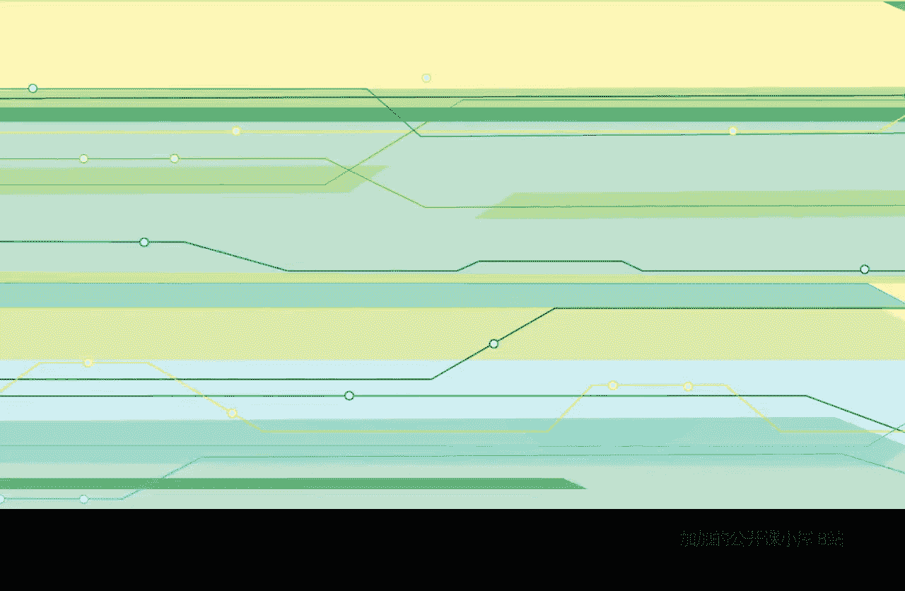
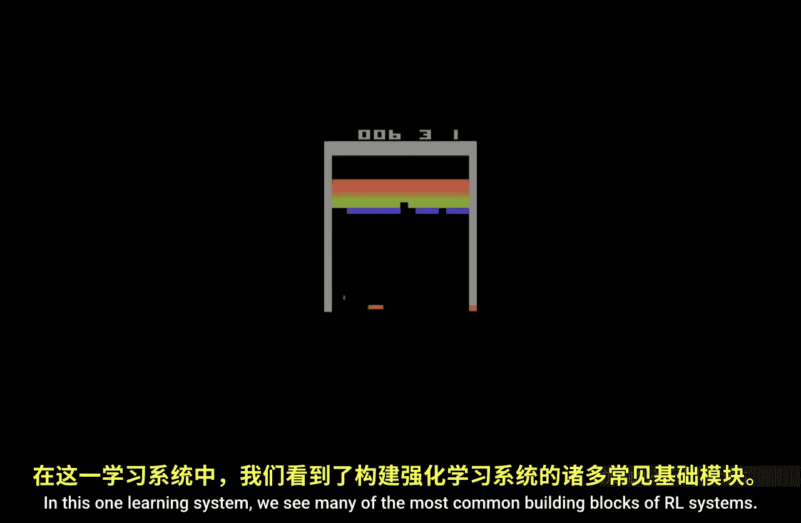

# 004：你的专业学习路线图 🗺️

在本节课中，我们将概述整个强化学习专项课程的学习路线图。我们将从基础概念开始，逐步深入到高级主题，最终通过一个顶点项目将所有知识融会贯通。

---

强化学习是一个热门领域，每周似乎都有新的算法或应用出现。然而，强化学习的基础原理在很大程度上是稳定不变的。最先进的学习系统通常由几个广为人知且并不复杂的核心思想构建而成。以DQN为例，这个学习系统结合了**Q学习**、**ε-贪心动作选择**、**神经网络函数逼近**以及其他一些思想，从而在雅达利游戏中取得了超越人类的分数。在这一系统中，我们可以看到许多强化学习系统最常见的构建模块。

本课程将紧密跟随萨顿和巴托的《强化学习导论》新版。第一版培养了两代强化学习研究者，包括玛莎和我本人。这本书以及本专项课程遵循一个简单的原则：**在问题出现的最简单情境中介绍每个思想**。秉承这一精神，我们将从多臂老虎机问题开始学习。

## 课程一：基础与规划

上一节我们提到了从简单情境入手的原则，本节中我们来看看课程一的具体内容。

我们从多臂老虎机问题入手，首次体验增量学习、探索与利用之间的复杂性。之后，我们将转向马尔可夫决策过程，以扩展强化学习方法所能解决的问题范围。在这里，我们将学习如何平衡短期与长期奖励，并介绍几乎所有强化学习系统都会用到的关键思想，如**策略**和**价值函数**。课程一将以经典的动态规划规划方法作为结束。这些方法已被用于大型工业控制问题，并且可以在给定完整世界模型的情况下计算出最优策略。

## 课程二：无模型学习

在掌握了基于模型规划的基础后，课程二中我们将基于这些思想，设计无需世界模型即可进行学习的算法。

我们将研究三类专为通过试错交互进行学习而设计的方法：
*   **蒙特卡洛方法**：通过完整的经验片段进行学习。
*   **时序差分学习**：包括著名的**Q学习**算法。
*   **基于学习模型的规划方法**：探讨如何利用学到的模型进行规划。

## 课程三：函数逼近

离开小型有限MDP的相对舒适区后，课程三我们将研究使用函数逼近的强化学习。

我们将看到，课程一和课程二中的主要概念可以迁移到具有巨大或无限状态空间的问题中。课程涵盖内容包括：
*   **特征构建**
*   **神经网络学习**
*   **策略梯度方法**
*   函数逼近设定下的其他特性

你会发现，本专项课程从基础材料开始，但到课程三结束时，你会看到我们如何在早期介绍的简单概念上构建出丰富的知识体系。完成课程三后，你可能会惊讶于自己学到了如此多的内容，尽管每一步在当时看来都相当简单。

## 课程四：顶点项目与科学方法

专项课程的最后一门课程将通过一个顶点项目将所有内容整合在一起。与理查德和安迪的书一样，在整个专项课程中，我们强调严谨、科学的强化学习方法。

我们进行了大量实验，旨在仔细比较不同算法。要产生有意义的实证结果，需要细致的规划和大量的艰苦工作。😊

在顶点项目中，我们将引导你完成这个过程的每一步，以便你能进行自己的科学实验。我们将探索从问题定义一直到生成达到出版质量的图表的所有阶段。这不仅仅是学术训练，在实际问题中，验证和理解你的系统同样至关重要。

在此之后，你应该准备好测试自己的新想法，或在工作中应对强化学习激动人心的新应用。

---

本节课中，我们一起学习了阿尔伯塔大学强化学习专项课程的整体路线图。我们从多臂老虎机和MDP的基础开始，逐步深入到无模型学习、函数逼近等高级主题，并最终通过强调科学方法的顶点项目完成整个学习循环。希望你能享受这段学习之旅。