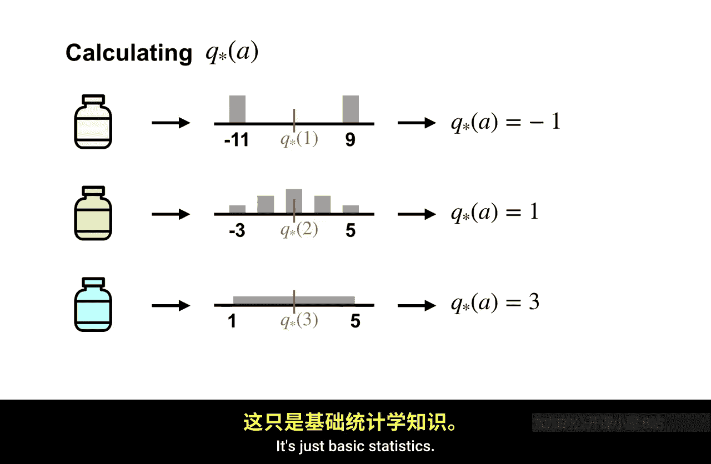

# 005：基于评估反馈的序贯决策

在本节课中，我们将学习强化学习的核心特征：智能体通过与环境的交互来生成自己的训练数据。我们将聚焦于一个简化的决策问题——多臂老虎机问题，并借此形式化不确定性下的决策，介绍奖励、时间步和价值等基本概念。

## 问题引入：不确定性下的决策

在强化学习中，智能体必须通过试错来学习自身行动的后果，而不是被告知正确的行动。

上一节我们介绍了强化学习的基本范式，本节中我们来看看一个具体的简化场景。

想象一个医学试验，医生想测量三种不同疗法的效果。每当有病人就诊，医生会随机开一种处方，然后观察病人健康状况的变化。一段时间后，医生发现其中一种疗法似乎比其他两种效果更好。此时，医生面临一个抉择：是坚持使用效果最好的疗法，还是继续进行随机化研究。如果只使用一种疗法，就无法收集其他两种疗法的数据，也许它们实际上更好，只是由于偶然性显得更差。但如果其他两种疗法确实更差，继续研究就会损害其他病人的健康。这个医学试验是不确定性下决策的一个典型案例。

## 形式化：K臂老虎机问题

这个医学试验的例子是**K臂老虎机问题**的一个实例。在K臂老虎机问题中，我们有一个决策者或智能体，它需要在K个不同的动作中进行选择，并根据其选择的动作获得奖励。

以下是该问题的核心组成部分：
*   **智能体**：在我们的例子中，由医生扮演。
*   **动作**：医生需要在三个动作中选择一个，即开蓝色、红色或黄色疗法的处方。
*   **奖励**：病人接受治疗后的健康状况（或更易测量的指标，如血压变化）就是医生获得的奖励。

## 核心概念：动作价值

为了让医生决定哪个动作最好，我们必须定义执行每个动作的价值。我们称这些价值为**动作价值**或**动作价值函数**。

我们可以通过概率语言更精确地定义它。我们将选择某个动作的价值定义为**采取该动作时预期获得的奖励**。

**公式**：`Q*(a) ≐ E[Rt | At = a]`， 对于所有可能的动作 a = 1, ..., K。

（注：符号“≐”表示“定义为”。`Q*(a)` 定义为在给定选择了动作a的条件下，奖励`Rt`的期望值。）

这个条件期望被定义为对所有可能奖励的求和。在求和内部，我们将可能的奖励乘以其被观察到的概率。对于连续奖励的情况，可以将求和替换为积分。

智能体的目标是最大化预期奖励。如果智能体选择了具有最高价值的动作，它就实现了这个目标。我们称这个过程为**贪心策略**，即选择使函数`Q*`最大化的参数（动作）。

## 深入理解动作价值

为了更好地理解`Q*`，让我们回到医学试验的例子。之前我们说奖励可以是病人接受治疗后的健康状况。但在这个例子中，我们使用更容易测量的东西，比如接受治疗后的血压变化。

每种疗法可能产生遵循不同概率分布的奖励。也许一种是伯努利分布，一种是二项分布，一种是均匀分布。`Q*`就是每个动作对应分布的均值。

例如，你可以轻松计算伯努利分布的期望值：只需将失败的概率乘以失败时的奖励，加上成功的概率乘以成功时的奖励。这是基础的统计学知识。

## 现实世界中的例子

不确定性下决策的例子有很多。例如我们已经讨论过的医学试验。

以下是其他一些例子：
*   **内容推荐**：比如推荐看什么电影或听什么歌。
*   **餐厅点餐**：你无法确定自己会喜欢什么，但你会做出你所能做的最佳选择。

## 为什么先研究老虎机问题？

因为最好在问题最初出现的、最简单的环境中考虑算法设计中的问题和选择。例如，最大化奖励和估计价值是老虎机问题和强化学习中共同的重要子问题。

## 课程总结

本节课中我们一起学习了K臂老虎机问题。我们展示了如何通过K臂老虎机问题来形式化不确定性下的决策。在老虎机问题中，我们已经看到了强化学习背后的基本思想：**动作**、**奖励**和**价值函数**。